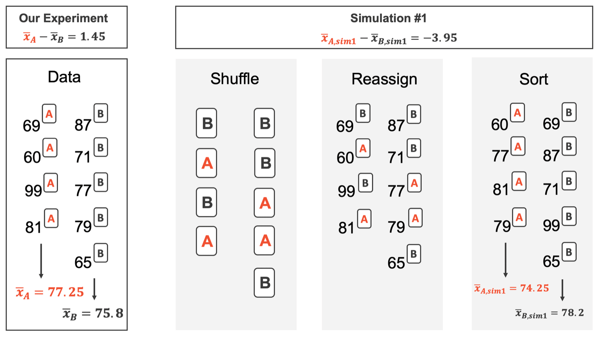
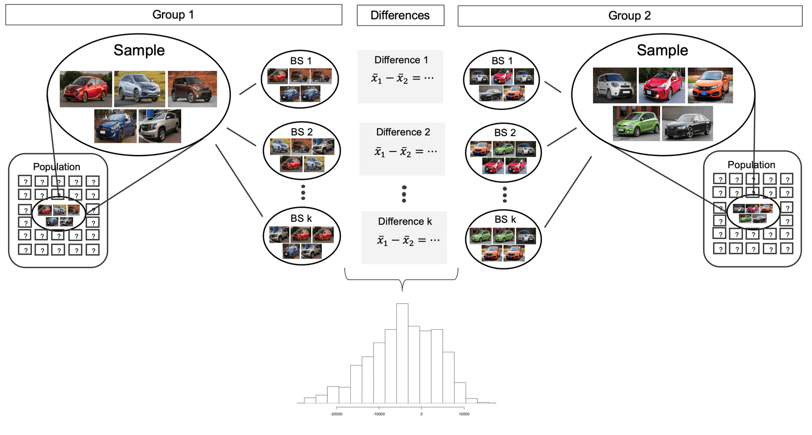



```{r}
#| label: setup
#| include: false
library(tidyverse)
library(openintro)
library(infer)
knitr::opts_chunk$set(out.width = "90%")

exams <- classdata |>
  filter(lecture %in% c("a", "b")) |>
  mutate(exam = str_to_upper(lecture))

set.seed(47)
null_dist <- exams |>
  specify(m1 ~ exam) |>
  hypothesize(null = "independence") |>
  generate(reps = 1000, type = "permute") |>
  calculate(stat = "diff in means", order = c("A", "B"))
```

## Student Information

```{r}
#| label: student-information-1
#| echo: false
learnr2::student_info()
```

## Introduction

This tutorial covers [Chapter 20: Inference for comparing two independent means](https://openintrostat.github.io/ims/inference-two-means.html) from [*Introduction to Modern Statistics*](https://openintrostat.github.io/ims/) by Mine Çetinkaya-Rundel and Johanna Hardin. You will learn to compare the means of two groups with a randomization test and a bootstrap interval, and then with the t-distribution, using two versions of an exam, an experiment on stem cells in sheep, and a sample of US births.

### Exercise 1

You should be doing this tutorial in a repo named `inference-for-comparing-two-independent-means`. If you are not, create one and then connect to it.

Create a new file, `analysis.qmd`, with the title `"Inference for Comparing Two Independent Means"` and your name as the author. In a bash Terminal, render it:

```bash
quarto render analysis.qmd
```

Open `analysis.html` with Live Server (right-click it in the Explorer → **Open with Live Server**) and keep the tab open. It refreshes on every render. Going forward, we will just tell you to "Render" when we want you to take these steps.

Create a `.gitignore` with `analysis_files` followed by a blank line. Commit and push. Use AI however you like.

If `show_file()` fails, it is probably because you have not yet loaded `library(learnr2)` in the R Terminal.

```{r}
#| label: introduction-1
#| echo: false
learnr2::question('In the R Terminal, run show_file(".gitignore"). CP/CR.', type = "reflection")
```

###

```{.output}
analysis_files
```

###

The details for working through inferential problems in the two independent means setting are strikingly similar to those applied to the two independent proportions setting. The difference is the statistic: a difference in sample means instead of a difference in sample proportions.

### Exercise 2

Add a chunk to `analysis.qmd` that loads the **[tidyverse](https://www.tidyverse.org/)**, with `#| message: false` so the startup messages stay out of the rendered page. Add `execute: echo: false` to the YAML header. Render.

```{r}
#| label: introduction-2
#| echo: false
learnr2::question('In the R Terminal, run show_file("analysis.qmd"). CP/CR.', type = "reflection")
```

###

````{verbatim}
#| message: false
library(tidyverse)
````

###

The point estimate of a difference in means is straightforward to find: it is the difference in the sample means. The **tidyverse** computes each group's mean with **dplyr** and draws every plot with **ggplot2**.

### Exercise 3

Add **[openintro](https://openintrostat.github.io/openintro/)** to that chunk. Render.

```{r}
#| label: introduction-3
#| echo: false
learnr2::question('In the R Terminal, run show_file("analysis.qmd"). CP/CR.', type = "reflection")
```

###

````{verbatim}
#| message: false
library(tidyverse)
library(openintro)
````

###

**openintro** holds all three of the chapter's datasets: `classdata`, `stem_cell`, and `births14`. The inferential tools are applied to three different data contexts: determining whether stem cells can improve heart function, exploring the relationship between pregnant women's smoking habits and birth weights of newborns, and exploring whether there is convincing evidence that one variation of an exam is harder than another variation.

### Exercise 4

Add **[infer](https://infer.tidymodels.org/)** to that chunk. Render.

```{r}
#| label: introduction-4
#| echo: false
learnr2::question('In the R Terminal, run show_file("analysis.qmd"). CP/CR.', type = "reflection")
```

###

````{verbatim}
#| message: false
library(tidyverse)
library(openintro)
library(infer)
````

###

**infer** runs both simulations in this tutorial, the shuffling and the resampling. We first cover a randomization test where the observations are shuffled under the assumption that the null hypothesis is true.

## Randomization and bootstrapping

An instructor decided to run two slight variations of the same exam. Prior to passing out the exams, they shuffled the exams together to ensure each student received a random version. This section tests whether one version was harder with a randomization test, then estimates the effect of stem cells on sheep hearts with a bootstrap interval.

### Exercise 1

Add a chunk that prints `classdata`. Render.

```{r}
#| label: randomization-and-bootstrapping-1
#| echo: false
learnr2::question('In the R Terminal, run show_file("analysis.qmd"). CP/CR.', type = "reflection")
```

###

```{r}
#| label: randomization-and-bootstrapping-1-test
#| echo: true
classdata
```

###

Each of the 164 rows is one student, with a midterm score, `m1`, and a `lecture`. Anticipating complaints from students who took Version B, the instructor would like to evaluate whether the difference observed in the groups is so large that it provides convincing evidence that Version B was more difficult (on average) than Version A.

### Exercise 2

Replace the code in that chunk so that it counts the students in each `lecture`. Render.

```{r}
#| label: randomization-and-bootstrapping-2
#| echo: false
learnr2::question('In the R Terminal, run show_file("analysis.qmd"). CP/CR.', type = "reflection")
```

###

```{r}
#| label: randomization-and-bootstrapping-2-test
#| echo: true
classdata |>
  count(lecture)
```

###

Lectures `a`, `b`, and `c` have 58, 55, and 51 students, and the help page says the scores are simulated. The chapter keeps only `a` and `b`, which it calls Version A and Version B.

### Exercise 3

Replace the code in that chunk so that it keeps only lectures `a` and `b`, adds a column `exam` holding the version in capitals, `A` or `B`, and then calculates, for each `exam`, the number of students and the mean, standard deviation, minimum, and maximum of `m1`. Render.

```{r}
#| label: randomization-and-bootstrapping-3
#| echo: false
learnr2::question('In the R Terminal, run show_file("analysis.qmd"). CP/CR.', type = "reflection")
```

###

```{r}
#| label: randomization-and-bootstrapping-3-test
#| echo: true
classdata |>
  filter(lecture %in% c("a", "b")) |>
  mutate(exam = str_to_upper(lecture)) |>
  summarize(n = n(),
            mean = mean(m1),
            sd = sd(m1),
            min = min(m1),
            max = max(m1),
            .by = exam)
```

###

Version A averaged 75.1 and Version B 72.0, with nearly equal standard deviations of 13.9 and 13.8. The summary statistics suggest the data are roughly symmetric about the mean, and the min/max values do not suggest any outliers of concern.

### Exercise 4

Replace the code in that chunk so that, for the same two versions, it calculates a single number: the mean score on Version A minus the mean score on Version B. Render.

```{r}
#| label: randomization-and-bootstrapping-4
#| echo: false
learnr2::question('In the R Terminal, run show_file("analysis.qmd"). CP/CR.', type = "reflection")
```

###

```{r}
#| label: randomization-and-bootstrapping-4-test
#| echo: true
classdata |>
  filter(lecture %in% c("a", "b")) |>
  mutate(exam = str_to_upper(lecture)) |>
  specify(m1 ~ exam) |>
  calculate(stat = "diff in means", order = c("A", "B"))
```

###

The observed difference in means is 3.14 points, the chapter's *point estimate* of the difference in population means. The randomization distribution allows us to identify whether a difference of 3.1 points is more than one would expect by natural variability of the scores if the two tests were equally difficult.

### Exercise 5

Replace the code in that chunk so that it creates `exams`, the two versions with their `exam` column, as before. Then set a random seed and create `null_dist`: 1,000 differences in mean score, Version A minus Version B, each from a random shuffle of the `exam` labels under the null hypothesis that the versions are equally difficult. Print `null_dist`. Render.

```{r}
#| label: randomization-and-bootstrapping-5
#| echo: false
learnr2::question('In the R Terminal, run show_file("analysis.qmd"). CP/CR.', type = "reflection")
```

###

```{r}
#| label: randomization-and-bootstrapping-5-test
#| echo: true
exams <- classdata |>
  filter(lecture %in% c("a", "b")) |>
  mutate(exam = str_to_upper(lecture))

set.seed(47)
null_dist <- exams |>
  specify(m1 ~ exam) |>
  hypothesize(null = "independence") |>
  generate(reps = 1000, type = "permute") |>
  calculate(stat = "diff in means", order = c("A", "B"))

null_dist
```

###

By reallocating which student got which exam, we are able to understand how the difference in average exam scores changes due only to natural variability. Each row of `null_dist` is one reallocation, like this single shuffle of nine toy scores.

{fig-alt="Four panels representing four different orientations of a toy dataset of 9 exam scores. The first panel provides the observed data; 4 of the exams were version A and the average score was 77.25; 5 of the exams were version B and the average score was 75.8, a difference of 1.45. The second panel shows the shuffled reassignment of the exam versions (4 of the scores are randomly reassigned to A, 5 of the scores are randomly reassigned to B). The third panel shows which score is connected with which new reassigned version of the exam. And the fourth panel sorts the exams so that version A exams are together and version B exams are together. In the randomly reassigned versions, the average score for version A is 74.25 and the average score for version B is 78.2, a difference of -3.95."}

### Exercise 6

Start a new chunk that calculates the proportion of the shuffled differences in `null_dist` that are at least as large as the observed difference, which comes from `exams`. Render.

```{r}
#| label: randomization-and-bootstrapping-6
#| echo: false
learnr2::question('In the R Terminal, run show_file("analysis.qmd"). CP/CR.', type = "reflection")
```

###

```{r}
#| label: randomization-and-bootstrapping-6-test
#| echo: true
null_dist |>
  get_p_value(obs_stat = exams |>
                specify(m1 ~ exam) |>
                calculate(stat = "diff in means", order = c("A", "B")),
              direction = "greater")
```

###

With the chapter's seed, exactly 10% of our shuffles are larger than 3.14, as in the book. But the question was whether either version was harder, so differences far below zero count as evidence too.

### Exercise 7

Change the code in that chunk so that it calculates the two-sided p-value instead. Render.

```{r}
#| label: randomization-and-bootstrapping-7
#| echo: false
learnr2::question('In the R Terminal, run show_file("analysis.qmd"). CP/CR.', type = "reflection")
```

###

```{r}
#| label: randomization-and-bootstrapping-7-test
#| echo: true
null_dist |>
  get_p_value(obs_stat = exams |>
                specify(m1 ~ exam) |>
                calculate(stat = "diff in means", order = c("A", "B")),
              direction = "two-sided")
```

###

To get the p-value, we double the proportion of randomized differences which are larger than the observed difference, p-value = 0.2. That is far above the chapter's $\alpha = 0.01$, but the hypothesis testing framework is set up only to reject a null claim, it is not set up to validate a null claim.

### Exercise 8

Replace the code in that chunk so that it prints `stem_cell`. Render.

```{r}
#| label: randomization-and-bootstrapping-8
#| echo: false
learnr2::question('In the R Terminal, run show_file("analysis.qmd"). CP/CR.', type = "reflection")
```

###

```{r}
#| label: randomization-and-bootstrapping-8-test
#| echo: true
stem_cell
```

###

Each of the 18 rows is one sheep, nine in each group, with its heart's pumping capacity `before` and `after` treatment. Each of these sheep was randomly assigned to the ESC or control group, and the change in their hearts' pumping capacity was measured in the study.

### Exercise 9

Replace the code in that chunk so that it adds a column `change`, equal to `after` minus `before`, and then calculates, for each `trmt`, the number of sheep and the mean and standard deviation of `change`. Render.

```{r}
#| label: randomization-and-bootstrapping-9
#| echo: false
learnr2::question('In the R Terminal, run show_file("analysis.qmd"). CP/CR.', type = "reflection")
```

###

```{r}
#| label: randomization-and-bootstrapping-9-test
#| echo: true
stem_cell |>
  mutate(change = after - before) |>
  summarize(n = n(),
            mean = mean(change),
            sd = sd(change),
            .by = trmt)
```

###

The ESC sheep gained 3.50 points of pumping capacity on average while the control sheep lost 4.33, a difference of 7.83. A positive value corresponds to increased pumping capacity, which generally suggests a stronger recovery.

### Exercise 10

Replace the code in that chunk so that it sets a random seed, then calculates 1,000 bootstrap differences in mean `change`, ESC minus control, and from them a 90% percentile confidence interval. Render.

```{r}
#| label: randomization-and-bootstrapping-10
#| echo: false
learnr2::question('In the R Terminal, run show_file("analysis.qmd"). CP/CR.', type = "reflection")
```

###

```{r}
#| label: randomization-and-bootstrapping-10-test
#| echo: true
set.seed(470)
stem_cell |>
  mutate(change = after - before) |>
  specify(change ~ trmt) |>
  generate(reps = 1000, type = "bootstrap") |>
  calculate(stat = "diff in means", order = c("esc", "ctrl")) |>
  get_confidence_interval(level = 0.90, type = "percentile")
```

###

With the chapter's seed, our 90% interval runs from 4.56 to 11.2. A bootstrap resample is done on each of the groups separately, but the results are combined to have a single bootstrapped difference in means.

{fig-alt="Samples are shown as separately coming from two independent, large, unknown populations. Directly from each of the two observed samples, bootstrap resamples can be taken (with replacement). Bootstrap resample 1 from sample 1 is compared to bootstrap resample 1 from sample 2 by comparing the difference in bootstrapped averages. A histogram of differences in bootstrapped averages displays the differences ranging from roughly -20000 dollars to +10000 dollars."}

### Exercise 11

Replace the confidence interval with the standard deviation of the 1,000 bootstrap differences. Render.

```{r}
#| label: randomization-and-bootstrapping-11
#| echo: false
learnr2::question('In the R Terminal, run show_file("analysis.qmd"). CP/CR.', type = "reflection")
```

###

```{r}
#| label: randomization-and-bootstrapping-11-test
#| echo: true
set.seed(470)
stem_cell |>
  mutate(change = after - before) |>
  specify(change ~ trmt) |>
  generate(reps = 1000, type = "bootstrap") |>
  calculate(stat = "diff in means", order = c("esc", "ctrl")) |>
  summarize(se = sd(stat))
```

###

The bootstrap estimate of the standard error is 1.98. The next section checks it against a formula.

### Exercise 12

Replace the code in that chunk with a histogram of the 1,000 bootstrap differences, with bars 0.5 wide. Add a solid vertical line at the observed difference, 7.83, and dashed vertical lines at the ends of our 90% interval, 4.56 and 11.2. Render.

```{r}
#| label: randomization-and-bootstrapping-12
#| echo: false
learnr2::question('In the R Terminal, run show_file("analysis.qmd"). CP/CR.', type = "reflection")
```

###

```{r}
#| label: randomization-and-bootstrapping-12-test
#| echo: true
set.seed(470)
stem_cell |>
  mutate(change = after - before) |>
  specify(change ~ trmt) |>
  generate(reps = 1000, type = "bootstrap") |>
  calculate(stat = "diff in means", order = c("esc", "ctrl")) |>
  ggplot(aes(x = stat)) +
  geom_histogram(binwidth = 0.5) +
  geom_vline(xintercept = 7.83) +
  geom_vline(xintercept = c(4.56, 11.2), linetype = "dashed")
```

###

The smallest of the 1,000 bootstrap differences is 2.04, so none reaches zero. Because the 90% interval does not overlap zero (and zero is never one of the bootstrapped differences, so 95% and 99% intervals would give the same conclusion), we conclude that the ESC treatment is substantially better with respect to heart pumping capacity than the control.

### Exercise 13

Improve the plot. Give the bars a light fill with white outlines, extend the x-axis to include zero and add a thin vertical line there, and add a title, axis labels, a subtitle that states the main finding, and a caption giving the number of resamples and sheep and the source. Render.

```{r}
#| label: randomization-and-bootstrapping-13
#| echo: false
learnr2::question('In the R Terminal, run show_file("analysis.qmd"). CP/CR.', type = "reflection")
```

###

```{r}
#| label: randomization-and-bootstrapping-13-test
#| echo: true
set.seed(470)
stem_cell |>
  mutate(change = after - before) |>
  specify(change ~ trmt) |>
  generate(reps = 1000, type = "bootstrap") |>
  calculate(stat = "diff in means", order = c("esc", "ctrl")) |>
  ggplot(aes(x = stat)) +
  geom_histogram(binwidth = 0.5, fill = "gray75", color = "white") +
  geom_vline(xintercept = 0, linewidth = 0.3) +
  geom_vline(xintercept = 7.83, linewidth = 1) +
  geom_vline(xintercept = c(4.56, 11.2), linetype = "dashed") +
  expand_limits(x = 0) +
  labs(title = "Embryonic Stem Cells and Heart Recovery in Sheep",
       subtitle = "No bootstrap difference reaches zero: the 90% interval runs from 4.6 to 11.2 points",
       x = "Difference in Mean Change in Pumping Capacity (ESC - Control)",
       y = "Count",
       caption = "1,000 bootstrap resamples of 18 sheep; Ménard et al. (2005)")
```

###

Because the study is a randomized controlled experiment, we can conclude that it is the treatment (ESC) which is causing the change in pumping capacity. Random assignment, not the bootstrap, allows the causal claim.

### Exercise 14

Commit `analysis.qmd` with the message `"Shuffle exams and bootstrap sheep"` and push.

```{r}
#| label: randomization-and-bootstrapping-14
#| echo: false
learnr2::question("In the bash Terminal, run git log --oneline -3. CP/CR.", type = "reflection")
```

###

```{.output}
4c81d2e (HEAD -> main, origin/main) Shuffle exams and bootstrap sheep
a37f09b Initial commit
```

###

Nine sheep per group is small for a method that resamples the data. The bootstrap relies heavily on the sample being an outstanding proxy for the population, and five observations are almost never enough to truly represent the nuances of a full population.

## The t-distribution for two means

Every year, the US releases to the public a large dataset containing information on births recorded in the country. This section uses the t-distribution to test for a difference in birth weight between babies of mothers who did and did not smoke, then checks the t-distribution against the simulations from the first section.

### Exercise 1

Start a new chunk that prints `births14`. Render.

```{r}
#| label: the-t-distribution-for-two-means-1
#| echo: false
learnr2::question('In the R Terminal, run show_file("analysis.qmd"). CP/CR.', type = "reflection")
```

###

```{r}
#| label: the-t-distribution-for-two-means-1-test
#| echo: true
births14
```

###

Each of the 1,000 rows is one birth, from a random sample of the births released in 2014, with 13 variables. The chapter calls the mother's smoking status `smoke`, but in the data it is `habit`.

### Exercise 2

Replace the code in that chunk so that it counts the births by `habit`. Render.

```{r}
#| label: the-t-distribution-for-two-means-2
#| echo: false
learnr2::question('In the R Terminal, run show_file("analysis.qmd"). CP/CR.', type = "reflection")
```

###

```{r}
#| label: the-t-distribution-for-two-means-2-test
#| echo: true
births14 |>
  count(habit)
```

###

867 mothers did not smoke, 114 did, and 19 have no `habit` recorded, so the chapter's analysis uses 981 births. Because the data come from a simple random sample, the observations are independent, both within and between samples.

### Exercise 3

Replace the code in that chunk so that it drops the births with a missing `habit`, then calculates, for each `habit`, the number of births and the mean and standard deviation of `weight`. Render.

```{r}
#| label: the-t-distribution-for-two-means-3
#| echo: false
learnr2::question('In the R Terminal, run show_file("analysis.qmd"). CP/CR.', type = "reflection")
```

###

```{r}
#| label: the-t-distribution-for-two-means-3-test
#| echo: true
births14 |>
  filter(!is.na(habit)) |>
  summarize(n = n(),
            mean = mean(weight),
            sd = sd(weight),
            .by = habit)
```

###

Babies of nonsmokers averaged 7.27 pounds, and babies of smokers 6.68. The average birth weight of babies born to smoker moms is lower than those born to nonsmoker moms.

### Exercise 4

Replace the code in that chunk with histograms of `weight`, one for each `habit`, side by side, with bars 1 pound wide and each panel's y-axis on its own scale. Keep dropping the births with a missing `habit`. Render.

```{r}
#| label: the-t-distribution-for-two-means-4
#| echo: false
learnr2::question('In the R Terminal, run show_file("analysis.qmd"). CP/CR.', type = "reflection")
```

###

```{r}
#| label: the-t-distribution-for-two-means-4-test
#| echo: true
births14 |>
  filter(!is.na(habit)) |>
  ggplot(aes(x = weight)) +
  geom_histogram(binwidth = 1) +
  facet_wrap(~ habit, scales = "free_y")
```

###

Both distributions are bell-shaped with a longer left tail. With both groups over 30 observations, we inspect the data for any particularly extreme outliers and find none, the second condition for the t-distribution.

### Exercise 5

Replace the code in that chunk so that it shows the five lightest babies, with their `weight`, `weeks`, and `habit`. Keep dropping the births with a missing `habit`. Render.

```{r}
#| label: the-t-distribution-for-two-means-5
#| echo: false
learnr2::question('In the R Terminal, run show_file("analysis.qmd"). CP/CR.', type = "reflection")
```

###

```{r}
#| label: the-t-distribution-for-two-means-5-test
#| echo: true
births14 |>
  filter(!is.na(habit)) |>
  arrange(weight) |>
  select(weight, weeks, habit) |>
  head(5)
```

###

The lightest baby weighed 0.75 pounds, born at 21 weeks, and all five were born at 29 weeks or earlier. These are very premature births, not recording errors, and a handful among 981 births are not particularly extreme outliers.

### Exercise 6

Replace the code in that chunk so that it calculates the point estimate: the mean `weight` for nonsmokers minus the mean `weight` for smokers. Render.

```{r}
#| label: the-t-distribution-for-two-means-6
#| echo: false
learnr2::question('In the R Terminal, run show_file("analysis.qmd"). CP/CR.', type = "reflection")
```

###

```{r}
#| label: the-t-distribution-for-two-means-6-test
#| echo: true
births14 |>
  filter(!is.na(habit)) |>
  specify(weight ~ habit) |>
  calculate(stat = "diff in means", order = c("nonsmoker", "smoker"))
```

###

Babies of nonsmokers were 0.593 pounds heavier on average. The null hypothesis represents the case of no difference between the groups, so the test asks how surprising 0.593 would be if the true difference were zero.

### Exercise 7

Replace the code in that chunk so that it starts from the mean, standard deviation, and number of births for each `habit`, and calculates the difference in means, nonsmokers minus smokers; the standard error, the square root of $s_1^2/n_1 + s_2^2/n_2$; the degrees of freedom, the smaller of $n_1 - 1$ and $n_2 - 1$; and the T score, the difference divided by the standard error. Render.

```{r}
#| label: the-t-distribution-for-two-means-7
#| echo: false
learnr2::question('In the R Terminal, run show_file("analysis.qmd"). CP/CR.', type = "reflection")
```

###

```{r}
#| label: the-t-distribution-for-two-means-7-test
#| echo: true
births14 |>
  filter(!is.na(habit)) |>
  summarize(n = n(), mean = mean(weight), sd = sd(weight), .by = habit) |>
  summarize(diff = mean[habit == "nonsmoker"] - mean[habit == "smoker"],
            se = sqrt(sum(sd^2 / n)),
            df = min(n) - 1) |>
  mutate(t = diff / se)
```

###

The *T score* is a ratio of how the groups differ as compared to how the observations within a group vary. Our SE is 0.155 and our T is 3.82, while the chapter rounds the SE to 0.16 and the difference to 0.59 before dividing, and gets 3.69.

### Exercise 8

Add a column with the two-sided p-value from a t-distribution with those degrees of freedom. Render.

```{r}
#| label: the-t-distribution-for-two-means-8
#| echo: false
learnr2::question('In the R Terminal, run show_file("analysis.qmd"). CP/CR.', type = "reflection")
```

###

```{r}
#| label: the-t-distribution-for-two-means-8-test
#| echo: true
births14 |>
  filter(!is.na(habit)) |>
  summarize(n = n(), mean = mean(weight), sd = sd(weight), .by = habit) |>
  summarize(diff = mean[habit == "nonsmoker"] - mean[habit == "smoker"],
            se = sqrt(sum(sd^2 / n)),
            df = min(n) - 1) |>
  mutate(t = diff / se,
         p_value = 2 * pt(-abs(t), df))
```

###

Our p-value is 0.00022, and the chapter's, from its rounded T of 3.69, is 0.00034. Either way, the p-value is smaller than the discernibility level, 0.05, so we reject the null hypothesis.

### Exercise 9

Replace the code in that chunk with a t-test of `weight` by `habit`, nonsmokers minus smokers, done entirely by software. Render.

```{r}
#| label: the-t-distribution-for-two-means-9
#| echo: false
learnr2::question('In the R Terminal, run show_file("analysis.qmd"). CP/CR.', type = "reflection")
```

###

```{r}
#| label: the-t-distribution-for-two-means-9-test
#| echo: true
births14 |>
  filter(!is.na(habit)) |>
  t_test(weight ~ habit, order = c("nonsmoker", "smoker"))
```

###

The software gets the same T, 3.82, but 131 degrees of freedom instead of 113, and so a slightly smaller p-value, 0.00021. The official formula for the degrees of freedom is quite complex and is generally computed using software, and the smaller of $n_1 - 1$ and $n_2 - 1$ is a cautious stand-in.

### Exercise 10

Now check the formula against the first section's simulation. Replace the code in that chunk so that it does the same calculation as in Exercise 8 for `exams`: the difference in mean `m1`, Version A minus Version B, its standard error, the degrees of freedom, the T score, and the two-sided p-value. Render.

```{r}
#| label: the-t-distribution-for-two-means-10
#| echo: false
learnr2::question('In the R Terminal, run show_file("analysis.qmd"). CP/CR.', type = "reflection")
```

###

```{r}
#| label: the-t-distribution-for-two-means-10-test
#| echo: true
exams |>
  summarize(n = n(), mean = mean(m1), sd = sd(m1), .by = exam) |>
  summarize(diff = mean[exam == "A"] - mean[exam == "B"],
            se = sqrt(sum(sd^2 / n)),
            df = min(n) - 1) |>
  mutate(t = diff / se,
         p_value = 2 * pt(-abs(t), df))
```

###

The formula's SE, 2.60, matches the 2.61 standard deviation of the 1,000 shuffled differences in `null_dist`, and its p-value, 0.233, is close to the randomization test's 0.2. The mathematical model, here the t-distribution, is able to describe both the randomization test and the bootstrapping as long as the conditions are met.

### Exercise 11

Replace the code in that chunk so that it does the same for the sheep: from the mean, standard deviation, and number of sheep in each `trmt`, calculate the difference in mean `change`, ESC minus control, its standard error, the degrees of freedom, the t-distribution's cutoff for 95% confidence, and the lower and upper ends of a 95% confidence interval. Render.

```{r}
#| label: the-t-distribution-for-two-means-11
#| echo: false
learnr2::question('In the R Terminal, run show_file("analysis.qmd"). CP/CR.', type = "reflection")
```

###

```{r}
#| label: the-t-distribution-for-two-means-11-test
#| echo: true
stem_cell |>
  mutate(change = after - before) |>
  summarize(n = n(), mean = mean(change), sd = sd(change), .by = trmt) |>
  summarize(diff = mean[trmt == "esc"] - mean[trmt == "ctrl"],
            se = sqrt(sum(sd^2 / n)),
            df = min(n) - 1) |>
  mutate(t_star = qt(0.975, df),
         lower = diff - t_star * se,
         upper = diff + t_star * se)
```

###

The formula's SE, 1.95, is close to the bootstrap's 1.98, and the interval, 3.33 to 12.34, is the chapter's up to rounding. We are 95% confident that the heart pumping function in sheep that received embryonic stem cells is between 3.32% and 12.34% higher than for sheep that did not receive the stem cell treatment.

### Exercise 12

Back to the exams. Replace the code in that chunk with a histogram of the shuffled differences in `null_dist`, with bars 1 point wide and density on the y-axis. Lay over it a t-distribution with 54 degrees of freedom, stretched to the scale of the data by the standard error, 2.60: its height at a difference x is the t density at x / 2.60, divided by 2.60. Add dashed vertical lines at the observed difference and its mirror image, 3.14 and -3.14. Render.

```{r}
#| label: the-t-distribution-for-two-means-12
#| echo: false
learnr2::question('In the R Terminal, run show_file("analysis.qmd"). CP/CR.', type = "reflection")
```

###

```{r}
#| label: the-t-distribution-for-two-means-12-test
#| echo: true
null_dist |>
  ggplot(aes(x = stat)) +
  geom_histogram(aes(y = after_stat(density)), binwidth = 1) +
  geom_function(fun = \(x) dt(x / 2.60, df = 54) / 2.60) +
  geom_vline(xintercept = c(-3.14, 3.14), linetype = "dashed")
```

###

The t-curve, built only from the means, standard deviations, and sample sizes, traces the histogram of 1,000 shuffles. The area beyond the dashed lines is the p-value, 0.2 by shuffling and 0.233 by the t-distribution.

### Exercise 13

Improve the plot. Give the bars a light fill with white outlines, make the curve thicker and colored, and add a title, axis labels, a subtitle that states the main finding, and a caption giving the number of shuffles and students and the source. Render.

```{r}
#| label: the-t-distribution-for-two-means-13
#| echo: false
learnr2::question('In the R Terminal, run show_file("analysis.qmd"). CP/CR.', type = "reflection")
```

###

```{r}
#| label: the-t-distribution-for-two-means-13-test
#| echo: true
null_dist |>
  ggplot(aes(x = stat)) +
  geom_histogram(aes(y = after_stat(density)), binwidth = 1,
                 fill = "gray75", color = "white") +
  geom_function(fun = \(x) dt(x / 2.60, df = 54) / 2.60,
                color = "steelblue", linewidth = 1.2) +
  geom_vline(xintercept = c(-3.14, 3.14), linetype = "dashed") +
  labs(title = "Shuffled Exam Versions and the t-Distribution",
       subtitle = "A t-curve with SE 2.60 matches the shuffles; a 3.14-point gap is common by chance",
       x = "Difference in Mean Score (Version A - Version B)",
       y = "Density",
       caption = "1,000 shuffles of 113 students; classdata, openintro")
```

###

The data are consistent with exams A and B being equally difficult, but the data are also consistent with exam A being 3.1 points "easier" than exam B. The data are not able to adjudicate on whether the exams are equally hard or whether one of them is slightly easier.

### Exercise 14

Commit `analysis.qmd` with the message `"Compare two means with the t-distribution"` and push.

```{r}
#| label: the-t-distribution-for-two-means-14
#| echo: false
learnr2::question("In the bash Terminal, run git log --oneline -3. CP/CR.", type = "reflection")
```

###

```{.output}
9e5b7f3 (HEAD -> main, origin/main) Compare two means with the t-distribution
4c81d2e Shuffle exams and bootstrap sheep
a37f09b Initial commit
```

###

Health differences between babies born to mothers who smoke and those who do not are not limited to weight differences. Unlike the sheep, though, the mothers chose whether to smoke, so `births14` shows an association, not proof that smoking caused the lower weights.

## Summary

This tutorial covered [Chapter 20: Inference for comparing two independent means](https://openintrostat.github.io/ims/inference-two-means.html) from [*Introduction to Modern Statistics*](https://openintrostat.github.io/ims/) by Mine Çetinkaya-Rundel and Johanna Hardin. You have learned to compare the means of two groups with a randomization test and a bootstrap interval, and then with the t-distribution, using two versions of an exam, an experiment on stem cells in sheep, and a sample of US births.

In this tutorial we extended the single mean inferential methods to questions of differences in means. You may have seen parallels from the tutorials that extended a single proportion to differences in proportions. When considering differences in sample means (indeed, when considering many quantitative statistics), we use the t-distribution to describe the sampling distribution of the T score (the standardized difference in sample means). Ideas of confidence level and type of error which might occur from a hypothesis test conclusion are similar to those seen in other tutorials.

For the stem cell experiment itself, read "[Transplantation of cardiac-committed mouse embryonic stem cells to infarcted sheep myocardium: a preclinical study](https://doi.org/10.1016/S0140-6736(05)67380-1)" by Claudine Ménard and colleagues, the source the `stem_cell` help page cites.

Many sentences in this tutorial, and its figures, come from the chapter, used under the book's [CC BY-SA 3.0 license](https://creativecommons.org/licenses/by-sa/3.0/).

### Exercise 1

Render one last time.

```{r}
#| label: summary-1
#| echo: false
learnr2::question('In the R Terminal, run show_file("analysis.qmd", start = 0). CP/CR.', type = "reflection")
```

###

````{verbatim}
---
title: "Inference for Comparing Two Independent Means"
author: "Your Name"
format: html
execute:
  echo: false
---

```{r}
#| message: false
library(tidyverse)
library(openintro)
library(infer)
```

```{r}
exams <- classdata |>
  filter(lecture %in% c("a", "b")) |>
  mutate(exam = str_to_upper(lecture))

set.seed(47)
null_dist <- exams |>
  specify(m1 ~ exam) |>
  hypothesize(null = "independence") |>
  generate(reps = 1000, type = "permute") |>
  calculate(stat = "diff in means", order = c("A", "B"))

null_dist
```

```{r}
set.seed(470)
stem_cell |>
  mutate(change = after - before) |>
  specify(change ~ trmt) |>
  generate(reps = 1000, type = "bootstrap") |>
  calculate(stat = "diff in means", order = c("esc", "ctrl")) |>
  ggplot(aes(x = stat)) +
  geom_histogram(binwidth = 0.5, fill = "gray75", color = "white") +
  geom_vline(xintercept = 0, linewidth = 0.3) +
  geom_vline(xintercept = 7.83, linewidth = 1) +
  geom_vline(xintercept = c(4.56, 11.2), linetype = "dashed") +
  expand_limits(x = 0) +
  labs(title = "Embryonic Stem Cells and Heart Recovery in Sheep",
       subtitle = "No bootstrap difference reaches zero: the 90% interval runs from 4.6 to 11.2 points",
       x = "Difference in Mean Change in Pumping Capacity (ESC - Control)",
       y = "Count",
       caption = "1,000 bootstrap resamples of 18 sheep; Ménard et al. (2005)")
```

```{r}
null_dist |>
  ggplot(aes(x = stat)) +
  geom_histogram(aes(y = after_stat(density)), binwidth = 1,
                 fill = "gray75", color = "white") +
  geom_function(fun = \(x) dt(x / 2.60, df = 54) / 2.60,
                color = "steelblue", linewidth = 1.2) +
  geom_vline(xintercept = c(-3.14, 3.14), linetype = "dashed") +
  labs(title = "Shuffled Exam Versions and the t-Distribution",
       subtitle = "A t-curve with SE 2.60 matches the shuffles; a 3.14-point gap is common by chance",
       x = "Difference in Mean Score (Version A - Version B)",
       y = "Density",
       caption = "1,000 shuffles of 113 students; classdata, openintro")
```
````

###

Your second plot lays the t-distribution over a simulated one.

### Exercise 2

Publish your analysis to GitHub Pages. In a bash Terminal, run:

```bash
quarto publish gh-pages analysis.qmd
```

```{r}
#| label: summary-2
#| echo: false
learnr2::question("Paste the URL of your published page.", type = "reflection")
```

###

Your answer should look like `https://your-github-username.github.io/inference-for-comparing-two-independent-means/`.

###

Your page uses all three of the chapter's approaches: a randomization test, bootstrapping for interval estimates, and the mathematical framework of the t-distribution.

### Exercise 3

Commit and push any remaining changes.

```{r}
#| label: summary-3
#| echo: false
learnr2::question("Paste the URL of your GitHub repo.", type = "reflection")
```

###

Your answer should look like `https://github.com/your-github-username/inference-for-comparing-two-independent-means`.

###

Is there convincing evidence that newborns from mothers who smoke have a different average birth weight than newborns from mothers who do not smoke? With 981 births and a p-value near 0.0002, `births14` says yes.

## Your Answers

```{r}
#| label: your-answers-1
#| echo: false
learnr2::question(
  "How many minutes, approximately, did it take you to complete this
  tutorial? For example, an hour and a half would be 90 minutes.",
  type = "reflection_editable",
  validate = "integer"
)
```

```{r}
#| label: your-answers-2
#| echo: false
learnr2::download_answers_button(filename_prefix = "comparing-independent-means")
```
