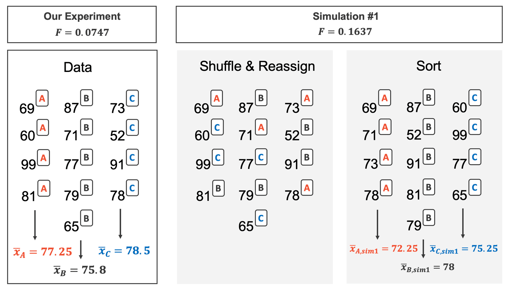
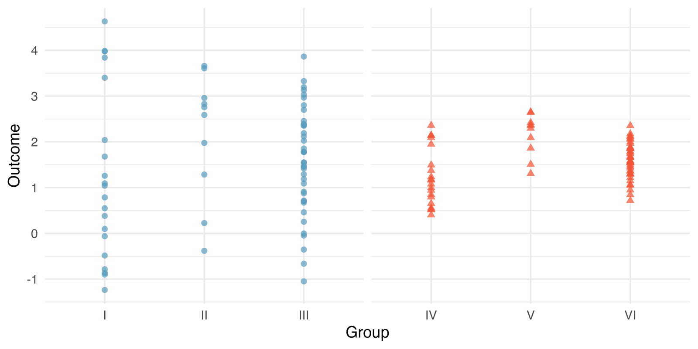
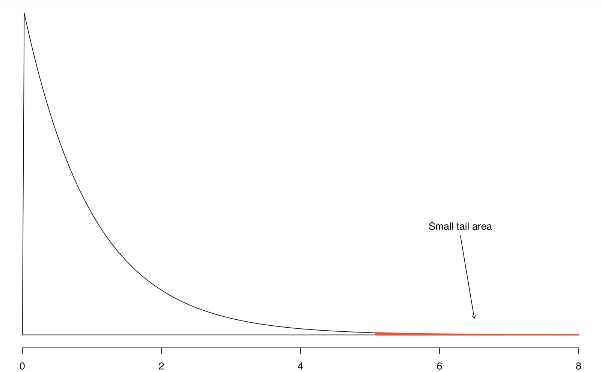



```{r}
#| label: setup
#| include: false
library(tidyverse)
library(openintro)
library(infer)
library(broom)
knitr::opts_chunk$set(out.width = "90%")
```

## Student Information

```{r}
#| label: student-information-1
#| echo: false
learnr2::student_info()
```

## Introduction

This tutorial covers [Chapter 22: Inference for comparing many means](https://openintrostat.github.io/ims/inference-many-means.html) from [*Introduction to Modern Statistics*](https://openintrostat.github.io/ims/) by Mine Çetinkaya-Rundel and Johanna Hardin. You will learn to compare the means of three or more groups with a single test, analysis of variance (ANOVA), first by shuffling groups to build a null distribution of the F statistic and then with the F distribution, using exam scores from three classes and the on-base percentages of Major League Baseball players.

### Exercise 1

You should be doing this tutorial in a repo named `inference-for-comparing-many-means`. If you are not, create one and then connect to it.

Create a new file, `analysis.qmd`, with the title `"Inference for Comparing Many Means"` and your name as the author. In a bash Terminal, render it:

```bash
quarto render analysis.qmd
```

Open `analysis.html` with Live Server (right-click it in the Explorer → **Open with Live Server**) and keep the tab open. It refreshes on every render. Going forward, we will just tell you to "Render" when we want you to take these steps.

Create a `.gitignore` with `analysis_files` followed by a blank line. Commit and push. Use AI however you like.

If `show_file()` fails, it is probably because you have not yet loaded `library(learnr2)` in the R Terminal.

```{r}
#| label: introduction-1
#| echo: false
learnr2::question('In the R Terminal, run show_file(".gitignore"). CP/CR.', type = "reflection")
```

###

```{.output}
analysis_files
```

###

Sometimes we want to compare means across many groups. But if we have many groups and do many comparisons, it is likely that we will eventually find a difference just by chance, even if there is no difference in the populations.

### Exercise 2

Add a chunk to `analysis.qmd` that loads the **[tidyverse](https://www.tidyverse.org/)**, with `#| message: false` so the startup messages stay out of the rendered page. Add `execute: echo: false` to the YAML header. Render.

```{r}
#| label: introduction-2
#| echo: false
learnr2::question('In the R Terminal, run show_file("analysis.qmd"). CP/CR.', type = "reflection")
```

###

````{verbatim}
#| message: false
library(tidyverse)
````

###

Instead of many pairwise tests, we should apply a holistic test to check whether there is evidence that at least one pair of groups are in fact different, which is where ANOVA saves the day. The **tidyverse** does the filtering, grouping, and plotting around that test.

### Exercise 3

Add **[openintro](https://openintrostat.github.io/openintro/)** to that chunk. Render.

```{r}
#| label: introduction-3
#| echo: false
learnr2::question('In the R Terminal, run show_file("analysis.qmd"). CP/CR.', type = "reflection")
```

###

````{verbatim}
#| message: false
library(tidyverse)
library(openintro)
````

###

**openintro** holds both of the chapter's datasets: `mlb_players_18`, the batting records of the 2018 baseball season, and `classdata`, the scores from three exams. ANOVA tests the null hypothesis that the mean outcome is the same across all groups against the alternative that at least one mean is different.

### Exercise 4

Add **[infer](https://infer.tidymodels.org/)** to that chunk. Render.

```{r}
#| label: introduction-4
#| echo: false
learnr2::question('In the R Terminal, run show_file("analysis.qmd"). CP/CR.', type = "reflection")
```

###

````{verbatim}
#| message: false
library(tidyverse)
library(openintro)
library(infer)
````

###

**infer** shuffles groups and calculates a statistic from each shuffle, as you did for two groups, and it can also give the matching mathematical distribution.

### Exercise 5

Add **[broom](https://broom.tidymodels.org/)** to that chunk. Render.

```{r}
#| label: introduction-5
#| echo: false
learnr2::question('In the R Terminal, run show_file("analysis.qmd"). CP/CR.', type = "reflection")
```

###

````{verbatim}
#| message: false
library(tidyverse)
library(openintro)
library(infer)
library(broom)
````

###

**broom** turns the output of a fitted model into a tidy tibble, one row per term. An ANOVA analysis can be summarized in a table very similar to that of a regression summary, and **broom** builds that table.

## Batting and randomization

We would like to discern whether there are real differences between the batting performance of baseball players according to their position: outfielder (OF), infielder (IF), and catcher (C). The chapter then tests three exams the same way, by shuffling.

### Exercise 1

Add a chunk that prints `mlb_players_18`. Render.

```{r}
#| label: batting-and-randomization-1
#| echo: false
learnr2::question('In the R Terminal, run show_file("analysis.qmd"). CP/CR.', type = "reflection")
```

###

```{r}
#| label: batting-and-randomization-1-test
#| echo: true
mlb_players_18
```

###

Each of the 1,270 rows is one player's 2018 season, and every `name` starts with a stray space, as in `" Allard, K"`. The measure we will use for the player batting performance (the outcome variable) is on-base percentage (`OBP`).

### Exercise 2

Replace the code in that chunk so that it counts the players at each `position`. Render.

```{r}
#| label: batting-and-randomization-2
#| echo: false
learnr2::question('In the R Terminal, run show_file("analysis.qmd"). CP/CR.', type = "reflection")
```

###

```{r}
#| label: batting-and-randomization-2-test
#| echo: true
mlb_players_18 |>
  count(position)
```

###

642 of the 1,270 players, more than half, are pitchers, and only 6 are designated hitters. Pitchers are on a team for their arms, not their bats.

### Exercise 3

Replace the code in that chunk so that it shows the five players with the highest `OBP`, along with their `position` and `AB`. Render.

```{r}
#| label: batting-and-randomization-3
#| echo: false
learnr2::question('In the R Terminal, run show_file("analysis.qmd"). CP/CR.', type = "reflection")
```

###

```{r}
#| label: batting-and-randomization-3-test
#| echo: true
mlb_players_18 |>
  slice_max(OBP, n = 5) |>
  select(name, position, AB, OBP)
```

###

The best on-base percentages in baseball belong to pitchers, each with an `OBP` of 1 from one or two at bats, and ties push the list to seven. The on-base percentage roughly represents the fraction of the time a player successfully gets on base or hits a home run, and a fraction built on one at bat is mostly luck.

### Exercise 4

Replace the code in that chunk so that it keeps only the players with at least 100 at bats and counts them at each `position`. Render.

```{r}
#| label: batting-and-randomization-4
#| echo: false
learnr2::question('In the R Terminal, run show_file("analysis.qmd"). CP/CR.', type = "reflection")
```

###

```{r}
#| label: batting-and-randomization-4-test
#| echo: true
mlb_players_18 |>
  filter(AB >= 100) |>
  count(position)
```

###

436 players had at least 100 at bats, and only one of them is a pitcher, against 642 before the filter. That pitcher and the 6 designated hitters, who bat but never take the field, are the last players the chapter removes.

### Exercise 5

Replace the code in that chunk so that it keeps players with at least 100 at bats, drops pitchers and designated hitters, and combines the remaining positions into three groups: outfield (`LF`, `CF`, `RF`) as `OF`, infield (`1B`, `2B`, `3B`, `SS`) as `IF`, and catcher, `C`, in the order `OF`, `IF`, `C`. Store the result as `mlb`, and then count the players at each `position` of `mlb`. Render.

```{r}
#| label: batting-and-randomization-5
#| echo: false
learnr2::question('In the R Terminal, run show_file("analysis.qmd"). CP/CR.', type = "reflection")
```

###

```{r}
#| label: batting-and-randomization-5-test
#| echo: true
mlb <- mlb_players_18 |>
  filter(AB >= 100, !position %in% c("P", "DH")) |>
  mutate(position = case_when(position %in% c("LF", "CF", "RF") ~ "OF",
                              position %in% c("1B", "2B", "3B", "SS") ~ "IF",
                              .default = position),
         position = fct_relevel(position, "OF", "IF", "C"))

mlb |>
  count(position)
```

###

160 outfielders, 205 infielders, and 64 catchers make the chapter's 429 players. The player positions have been divided into three groups: outfield (OF), infield (IF), and catcher (C).

### Exercise 6

Start a new chunk that calculates, for each `position` in `mlb`, the number of players and the mean and standard deviation of `OBP`. Render.

```{r}
#| label: batting-and-randomization-6
#| echo: false
learnr2::question('In the R Terminal, run show_file("analysis.qmd"). CP/CR.', type = "reflection")
```

###

```{r}
#| label: batting-and-randomization-6-test
#| echo: true
mlb |>
  summarize(n = n(),
            mean_obp = mean(OBP),
            sd_obp = sd(OBP),
            .by = position)
```

###

Outfielders average 0.320, the chapter's point estimate of their mean, and the three standard deviations run from 0.038 to 0.043. The variability appears to be approximately constant across groups, and nearly constant variance across groups is an important assumption that must be satisfied before we consider the ANOVA approach.

### Exercise 7

Replace the code in that chunk with side-by-side box plots of `OBP` for each `position`. Render.

```{r}
#| label: batting-and-randomization-7
#| echo: false
learnr2::question('In the R Terminal, run show_file("analysis.qmd"). CP/CR.', type = "reflection")
```

###

```{r}
#| label: batting-and-randomization-7-test
#| echo: true
mlb |>
  ggplot(aes(x = position, y = OBP)) +
  geom_boxplot()
```

###

The largest difference between the sample means is between the catcher and the outfielder positions. Testing only that pair would be *data snooping*: it is inappropriate to examine all data by eye (informal testing) and only afterwards decide which parts to formally test.

### Exercise 8

The chapter builds its randomization test on a second dataset. Start a new chunk that prints `classdata`. Render.

```{r}
#| label: batting-and-randomization-8
#| echo: false
learnr2::question('In the R Terminal, run show_file("analysis.qmd"). CP/CR.', type = "reflection")
```

###

```{r}
#| label: batting-and-randomization-8-test
#| echo: true
classdata
```

###

Each of the 164 rows is one student, with a score, `m1`, and a `lecture` of `a`, `b`, or `c`, and the help page says the scores are simulated. Suppose now that the teacher had had such an extremely large class that three different exams were given: A, B, and C.

### Exercise 9

Replace the code in that chunk so that it adds a variable `exam`, the `lecture` letter in upper case, and calculates, for each `exam`, the number of students and the mean, standard deviation, minimum, and maximum of `m1`. Render.

```{r}
#| label: batting-and-randomization-9
#| echo: false
learnr2::question('In the R Terminal, run show_file("analysis.qmd"). CP/CR.', type = "reflection")
```

###

```{r}
#| label: batting-and-randomization-9-test
#| echo: true
classdata |>
  mutate(exam = str_to_upper(lecture)) |>
  summarize(n = n(),
            mean = mean(m1),
            sd = sd(m1),
            min = min(m1),
            max = max(m1),
            .by = exam)
```

###

Exam C averages 78.9, against 75.1 for A and 72.0 for B, and all three standard deviations are close to 14. The alternative hypothesis is that at least one of the exams is inherently more (or less) difficult than the others.

### Exercise 10

Replace the code in that chunk so that it uses **infer** to calculate the F statistic for `m1` across the three values of `exam`. Store the result as `class_F` and print it. Render.

```{r}
#| label: batting-and-randomization-10
#| echo: false
learnr2::question('In the R Terminal, run show_file("analysis.qmd"). CP/CR.', type = "reflection")
```

###

```{r}
#| label: batting-and-randomization-10-test
#| echo: true
class_F <- classdata |>
  mutate(exam = str_to_upper(lecture)) |>
  specify(m1 ~ exam) |>
  calculate(stat = "F")

class_F
```

###

The observed F is 3.48, the chapter's value. The *F statistic* is a ratio of how the groups differ (MSG) as compared to how the observations within a group vary (MSE).

### Exercise 11

Below `class_F`, replace the line that prints it with code that shuffles the exams across the 164 scores once, as if the exam made no difference, and calculates the number of students and the mean score for each shuffled `exam`. Set a seed of 47 first, the one the chapter used. Render.

```{r}
#| label: batting-and-randomization-11
#| echo: false
learnr2::question('In the R Terminal, run show_file("analysis.qmd"). CP/CR.', type = "reflection")
```

###

```{r}
#| label: batting-and-randomization-11-test
#| echo: true
class_F <- classdata |>
  mutate(exam = str_to_upper(lecture)) |>
  specify(m1 ~ exam) |>
  calculate(stat = "F")

set.seed(47)
classdata |>
  mutate(exam = str_to_upper(lecture)) |>
  specify(m1 ~ exam) |>
  hypothesize(null = "independence") |>
  generate(reps = 1, type = "permute") |>
  group_by(exam) |>
  summarize(n = n(),
            mean_score = mean(m1))
```

###

The shuffle keeps 58, 55, and 51 students per exam, but the means become 76.4, 75.4, and 73.8, and exam C drops from best to worst. By reallocating which student got which exam, we are able to understand how the difference in average exam scores changes due only to natural variability.

{fig-alt="Four panels representing four different orientations of a toy dataset of 13 exam scores. The first panel provides the observed data; 4 of the exams were version A and the average score was 77.25; 5 of the exams were version B and the average score was 75.8; 4 of the exams were version C and the average score was 78.5. The observed F statistic is 0.0747. The second panel shows the shuffled reassignment of the exam versions (4 of the scores are randomly reassigned to A, 5 of the scores are randomly reassigned to B, 4 of the scores are randomly reassigned to C). The third panel shows which score is connected with which new reassigned version of the exam. And the fourth panel sorts the exams so that version A exams are together, version B exams are together, and version C exams are together. In the randomly reassigned versions, the average score for version A is 72.25, the average score for version B is 78, and the average score for version C is 75.25. The randomized F statistic is 0.1637."}

### Exercise 12

Change the shuffle so that, instead of the group means, it calculates the F statistic for the shuffled exams. Render.

```{r}
#| label: batting-and-randomization-12
#| echo: false
learnr2::question('In the R Terminal, run show_file("analysis.qmd"). CP/CR.', type = "reflection")
```

###

```{r}
#| label: batting-and-randomization-12-test
#| echo: true
class_F <- classdata |>
  mutate(exam = str_to_upper(lecture)) |>
  specify(m1 ~ exam) |>
  calculate(stat = "F")

set.seed(47)
classdata |>
  mutate(exam = str_to_upper(lecture)) |>
  specify(m1 ~ exam) |>
  hypothesize(null = "independence") |>
  generate(reps = 1, type = "permute") |>
  calculate(stat = "F")
```

###

Our shuffled F is 0.451, far below the observed 3.48, and yours will differ if your shuffle did. If the null hypothesis is true, then the score on each exam should represent the true student ability on that material.

### Exercise 13

Change the code so that it shuffles the exams 1,000 times, calculating the F statistic for each shuffle, and stores the 1,000 values as `class_null`. Keep the seed of 47. Below that, calculate the minimum, mean, and maximum of the 1,000 F statistics. Render.

```{r}
#| label: batting-and-randomization-13
#| echo: false
learnr2::question('In the R Terminal, run show_file("analysis.qmd"). CP/CR.', type = "reflection")
```

###

```{r}
#| label: batting-and-randomization-13-test
#| echo: true
class_F <- classdata |>
  mutate(exam = str_to_upper(lecture)) |>
  specify(m1 ~ exam) |>
  calculate(stat = "F")

set.seed(47)
class_null <- classdata |>
  mutate(exam = str_to_upper(lecture)) |>
  specify(m1 ~ exam) |>
  hypothesize(null = "independence") |>
  generate(reps = 1000, type = "permute") |>
  calculate(stat = "F")

class_null |>
  summarize(min_F = min(stat),
            mean_F = mean(stat),
            max_F = max(stat))
```

###

The shuffled F statistics average 1.01 and never fall below zero, since F is a ratio of two measures of variability. Our largest is 7.12: just by chance, the F statistic can be as large as 7.

### Exercise 14

Replace the summary at the bottom of that chunk with code that uses **infer** to calculate the p-value: the proportion of the 1,000 shuffled F statistics in `class_null` at least as large as `class_F`. Render.

```{r}
#| label: batting-and-randomization-14
#| echo: false
learnr2::question('In the R Terminal, run show_file("analysis.qmd"). CP/CR.', type = "reflection")
```

###

```{r}
#| label: batting-and-randomization-14-test
#| echo: true
class_F <- classdata |>
  mutate(exam = str_to_upper(lecture)) |>
  specify(m1 ~ exam) |>
  calculate(stat = "F")

set.seed(47)
class_null <- classdata |>
  mutate(exam = str_to_upper(lecture)) |>
  specify(m1 ~ exam) |>
  hypothesize(null = "independence") |>
  generate(reps = 1000, type = "permute") |>
  calculate(stat = "F")

class_null |>
  get_p_value(obs_stat = class_F, direction = "greater")
```

###

The p-value of the test is 0.036. At a discernibility level of 0.05, the p-value is smaller than the level of discernibility which would lead us to reject the null hypothesis.

### Exercise 15

Replace the p-value with a histogram of the 1,000 shuffled F statistics in `class_null`, with a vertical line at the observed F in `class_F`. Render.

```{r}
#| label: batting-and-randomization-15
#| echo: false
learnr2::question('In the R Terminal, run show_file("analysis.qmd"). CP/CR.', type = "reflection")
```

###

```{r}
#| label: batting-and-randomization-15-test
#| echo: true
class_F <- classdata |>
  mutate(exam = str_to_upper(lecture)) |>
  specify(m1 ~ exam) |>
  calculate(stat = "F")

set.seed(47)
class_null <- classdata |>
  mutate(exam = str_to_upper(lecture)) |>
  specify(m1 ~ exam) |>
  hypothesize(null = "independence") |>
  generate(reps = 1000, type = "permute") |>
  calculate(stat = "F")

class_null |>
  ggplot(aes(x = stat)) +
  geom_histogram(binwidth = 0.25, boundary = 0) +
  geom_vline(xintercept = class_F$stat, color = "red")
```

###

Unlike a difference in means, the shuffled F statistics do not center on zero: they pile up near 1 and trail off in a long right tail. Only large values of F count against the null hypothesis, so the p-value is the area to the right of the red line.

### Exercise 16

Improve the histogram. Color the bars at or beyond the observed F differently from the rest, make the vertical line dashed, move the legend below the plot, and add a title, axis labels, a subtitle that states the main finding, and a caption giving the number of students, the number of shuffles, and the source. Render.

```{r}
#| label: batting-and-randomization-16
#| echo: false
learnr2::question('In the R Terminal, run show_file("analysis.qmd"). CP/CR.', type = "reflection")
```

###

```{r}
#| label: batting-and-randomization-16-test
#| echo: true
class_F <- classdata |>
  mutate(exam = str_to_upper(lecture)) |>
  specify(m1 ~ exam) |>
  calculate(stat = "F")

set.seed(47)
class_null <- classdata |>
  mutate(exam = str_to_upper(lecture)) |>
  specify(m1 ~ exam) |>
  hypothesize(null = "independence") |>
  generate(reps = 1000, type = "permute") |>
  calculate(stat = "F")

class_null |>
  mutate(extreme = if_else(stat >= class_F$stat,
                           "At least as large as observed",
                           "Smaller than observed")) |>
  ggplot(aes(x = stat, fill = extreme)) +
  geom_histogram(binwidth = 0.25, boundary = 0) +
  geom_vline(xintercept = class_F$stat, linetype = "dashed") +
  scale_fill_manual(values = c("At least as large as observed" = "steelblue",
                               "Smaller than observed" = "gray70")) +
  labs(title = "F Statistics in 1,000 Shuffles of Three Exams",
       subtitle = "If the exams were equally hard, only 3.6% of shuffles would reach the observed F of 3.48",
       x = "F Statistic",
       y = "Number of Shuffles",
       fill = NULL,
       caption = "164 students; 1,000 random shuffles of the exams\nSimulated data: classdata, openintro package") +
  theme(legend.position = "bottom")
```

###

When the null hypothesis is true, random variability that exists in nature sometimes produces data with p-values less than 0.05. To best mitigate any extra Type I errors, we suggest that you set up your hypotheses and testing protocol before running any analyses.

### Exercise 17

Commit `analysis.qmd` with the message `"Test three exams by randomization"` and push.

```{r}
#| label: batting-and-randomization-17
#| echo: false
learnr2::question("In the bash Terminal, run git log --oneline -3. CP/CR.", type = "reflection")
```

###

```{.output}
5b7e2c9 (HEAD -> main, origin/main) Test three exams by randomization
9be04d2 Initial commit
```

###

The test says at least one exam differs, not which one. Once the conclusions have been reached, you should report your findings instead of running a different type of test on the same data.

## Mathematical model for many means

As seen with many of the tests and statistics from previous sections, the randomization test on the F statistic has corresponding mathematical theory to describe the distribution that can be used without using a computational approach. The chapter applies that theory to the batting data.

### Exercise 1

Start a new chunk that uses **infer** to calculate the F statistic for `OBP` across the three values of `position` in `mlb`. Store the result as `mlb_F` and print it. Render.

```{r}
#| label: mathematical-model-for-many-means-1
#| echo: false
learnr2::question('In the R Terminal, run show_file("analysis.qmd"). CP/CR.', type = "reflection")
```

###

```{r}
#| label: mathematical-model-for-many-means-1-test
#| echo: true
mlb_F <- mlb |>
  specify(OBP ~ position) |>
  calculate(stat = "F")

mlb_F
```

###

The observed F is 5.08, the chapter's 5.077 rounded. When the null hypothesis is true, the two measures of variability in F should be about equal, so an F near 1 is unremarkable.

### Exercise 2

F is MSG divided by MSE. The **mean square between groups** (MSG) adds up, over the groups, each group's size times the squared distance between its mean and the overall mean, and divides by the number of groups minus 1. The **mean square error** (MSE) adds up, over the groups, each group's size minus 1 times its variance, and divides by the number of players minus the number of groups.

Below `mlb_F`, replace the line that prints it with code that calculates MSG, MSE, and their ratio from the size, mean, and standard deviation of `OBP` for each `position`. Render.

```{r}
#| label: mathematical-model-for-many-means-2
#| echo: false
learnr2::question('In the R Terminal, run show_file("analysis.qmd"). CP/CR.', type = "reflection")
```

###

```{r}
#| label: mathematical-model-for-many-means-2-test
#| echo: true
mlb_F <- mlb |>
  specify(OBP ~ position) |>
  calculate(stat = "F")

mlb |>
  summarize(n = n(), mean = mean(OBP), sd = sd(OBP), .by = position) |>
  summarize(MSG = sum(n * (mean - weighted.mean(mean, n))^2) / (n() - 1),
            MSE = sum((n - 1) * sd^2) / (sum(n) - n()),
            F = MSG / MSE)
```

###

MSG is 0.00803 and MSE is 0.00158, the chapter's values, and their ratio is the same 5.08 that **infer** found. Differences in the groups' centers are noticeable when those differences are large *relative to the variability in the individual observations within each group*, as in groups IV, V, and VI below but not in groups I, II, and III.

{fig-alt="Two sets of side by side dot plots. The first set shows three groups of observations where the variability within a group is so large that it swamps out any variability across the groups. The second set shows three groups of observations where the variability within a group is much smaller and the center of the groups appears different."}

### Exercise 3

If the null hypothesis is true and the conditions are met, F follows an **F distribution** with two degrees of freedom: the number of groups minus 1, here 2, and the number of players minus the number of groups, here 426.

Replace the MSG and MSE calculation with code that uses **infer** to calculate the p-value of `mlb_F` from that F distribution, not from shuffles. Render.

```{r}
#| label: mathematical-model-for-many-means-3
#| echo: false
learnr2::question('In the R Terminal, run show_file("analysis.qmd"). CP/CR.', type = "reflection")
```

###

```{r}
#| label: mathematical-model-for-many-means-3-test
#| echo: true
mlb_F <- mlb |>
  specify(OBP ~ position) |>
  calculate(stat = "F")

mlb |>
  specify(OBP ~ position) |>
  hypothesize(null = "independence") |>
  assume(distribution = "F") |>
  get_p_value(obs_stat = mlb_F, direction = "greater")
```

###

The p-value, 0.0066, is the small tail area above 5.08 of an F distribution with 2 and 426 degrees of freedom. The data provide strong evidence that the average on-base percentage varies by player's primary field position.

{fig-alt="A line plot showing the theoretical F distribution with the first degree of freedom equal to 2 and the second degree of freedom equal to 426. The curve is right-skewed with most values less than 4. The tail extends to approximately 8. Area to the right of 5.077 has been shaded in red."}

### Exercise 4

Replace the p-value with an ANOVA table for `OBP` by `position`, as a tidy tibble. Render.

```{r}
#| label: mathematical-model-for-many-means-4
#| echo: false
learnr2::question('In the R Terminal, run show_file("analysis.qmd"). CP/CR.', type = "reflection")
```

###

```{r}
#| label: mathematical-model-for-many-means-4-test
#| echo: true
mlb_F <- mlb |>
  specify(OBP ~ position) |>
  calculate(stat = "F")

lm(OBP ~ position, data = mlb) |>
  anova() |>
  tidy()
```

###

One table holds everything you calculated: degrees of freedom of 2 and 426, mean squares of 0.00803 and 0.00158, an F of 5.08, and a p-value of 0.0066. The calculations required to perform an ANOVA by hand are tedious and prone to human error.

### Exercise 5

There are three conditions we must check for an ANOVA analysis: all observations must be independent, the data in each group must be nearly normal (or each group must have reasonably large sample sizes), and the variance within each group must be approximately equal.

Replace the ANOVA table with a histogram of `OBP` for each `position`, one panel per position, stacked vertically. Render.

```{r}
#| label: mathematical-model-for-many-means-5
#| echo: false
learnr2::question('In the R Terminal, run show_file("analysis.qmd"). CP/CR.', type = "reflection")
```

###

```{r}
#| label: mathematical-model-for-many-means-5-test
#| echo: true
mlb_F <- mlb |>
  specify(OBP ~ position) |>
  calculate(stat = "F")

mlb |>
  ggplot(aes(x = OBP)) +
  geom_histogram(binwidth = 0.01) +
  facet_wrap(~ position, ncol = 1, scales = "free_y")
```

###

All three histograms are roughly bell-shaped. Since each of the groups we are considering have relatively large sample sizes, what we are looking for are major outliers.

### Exercise 6

Replace the histograms with code that calculates the standard deviation of `OBP` for each `position`, and then the ratio of the largest standard deviation to the smallest. Render.

```{r}
#| label: mathematical-model-for-many-means-6
#| echo: false
learnr2::question('In the R Terminal, run show_file("analysis.qmd"). CP/CR.', type = "reflection")
```

###

```{r}
#| label: mathematical-model-for-many-means-6-test
#| echo: true
mlb_F <- mlb |>
  specify(OBP ~ position) |>
  calculate(stat = "F")

mlb |>
  summarize(sd = sd(OBP), .by = position) |>
  summarize(sd_ratio = max(sd) / min(sd))
```

###

The largest standard deviation is only 1.12 times the smallest. The constant variance condition is especially important when the sample sizes differ between groups, as they do here, from 64 to 205 players.

### Exercise 7

Check the F distribution against a simulation. Replace the ratio with code that shuffles the positions across the 429 players 1,000 times, calculates the F statistic for each shuffle, and stores the 1,000 values as `mlb_null`. Set a seed of 47 first. Below that, use **infer** to calculate the p-value of `mlb_F` from `mlb_null`. Render.

```{r}
#| label: mathematical-model-for-many-means-7
#| echo: false
learnr2::question('In the R Terminal, run show_file("analysis.qmd"). CP/CR.', type = "reflection")
```

###

```{r}
#| label: mathematical-model-for-many-means-7-test
#| echo: true
mlb_F <- mlb |>
  specify(OBP ~ position) |>
  calculate(stat = "F")

set.seed(47)
mlb_null <- mlb |>
  specify(OBP ~ position) |>
  hypothesize(null = "independence") |>
  generate(reps = 1000, type = "permute") |>
  calculate(stat = "F")

mlb_null |>
  get_p_value(obs_stat = mlb_F, direction = "greater")
```

###

Only 5 of our 1,000 shuffles reached the observed 5.08, a p-value of 0.005, close to the 0.0066 from the F distribution. Randomization and the mathematical model reach the same conclusion.

### Exercise 8

Replace the p-value with code that calculates the value that cuts off the top 5% of an F distribution with 2 and 426 degrees of freedom, and the proportion of the 1,000 shuffled F statistics in `mlb_null` above it. Render.

```{r}
#| label: mathematical-model-for-many-means-8
#| echo: false
learnr2::question('In the R Terminal, run show_file("analysis.qmd"). CP/CR.', type = "reflection")
```

###

```{r}
#| label: mathematical-model-for-many-means-8-test
#| echo: true
mlb_F <- mlb |>
  specify(OBP ~ position) |>
  calculate(stat = "F")

set.seed(47)
mlb_null <- mlb |>
  specify(OBP ~ position) |>
  hypothesize(null = "independence") |>
  generate(reps = 1000, type = "permute") |>
  calculate(stat = "F")

mlb_null |>
  summarize(cutoff = qf(0.95, df1 = 2, df2 = 426),
            prop_above = mean(stat > cutoff))
```

###

The F distribution puts 5% of its area above 3.02, and 5.2% of our shuffles landed there. When the null hypothesis is true, a test at the 0.05 level rejects it about 5% of the time, whichever method draws the null distribution.

### Exercise 9

Replace the proportion with a histogram of the 1,000 shuffled F statistics in `mlb_null`, drawn on a density scale, with the curve of the F distribution with 2 and 426 degrees of freedom on top and a vertical line at the observed F in `mlb_F`. Render.

```{r}
#| label: mathematical-model-for-many-means-9
#| echo: false
learnr2::question('In the R Terminal, run show_file("analysis.qmd"). CP/CR.', type = "reflection")
```

###

```{r}
#| label: mathematical-model-for-many-means-9-test
#| echo: true
mlb_F <- mlb |>
  specify(OBP ~ position) |>
  calculate(stat = "F")

set.seed(47)
mlb_null <- mlb |>
  specify(OBP ~ position) |>
  hypothesize(null = "independence") |>
  generate(reps = 1000, type = "permute") |>
  calculate(stat = "F")

mlb_null |>
  ggplot(aes(x = stat)) +
  geom_histogram(aes(y = after_stat(density)), binwidth = 0.25, boundary = 0) +
  stat_function(fun = df, args = list(df1 = 2, df2 = 426), color = "blue") +
  geom_vline(xintercept = mlb_F$stat, color = "red")
```

###

The curve traces the bars from the tall first bin down the long right tail, so the formula describes the shuffles well. The observed 5.08 sits where both the curve and the bars have almost nothing left.

### Exercise 10

Improve the plot. Make the bars light gray, the curve thicker, and the vertical line dashed, and add a title, axis labels, a subtitle that states the main finding, and a caption giving the number of players, the number of shuffles, and the source. Render.

```{r}
#| label: mathematical-model-for-many-means-10
#| echo: false
learnr2::question('In the R Terminal, run show_file("analysis.qmd"). CP/CR.', type = "reflection")
```

###

```{r}
#| label: mathematical-model-for-many-means-10-test
#| echo: true
mlb_F <- mlb |>
  specify(OBP ~ position) |>
  calculate(stat = "F")

set.seed(47)
mlb_null <- mlb |>
  specify(OBP ~ position) |>
  hypothesize(null = "independence") |>
  generate(reps = 1000, type = "permute") |>
  calculate(stat = "F")

mlb_null |>
  ggplot(aes(x = stat)) +
  geom_histogram(aes(y = after_stat(density)), binwidth = 0.25, boundary = 0,
                 fill = "gray80", color = "white") +
  stat_function(fun = df, args = list(df1 = 2, df2 = 426),
                color = "steelblue", linewidth = 1) +
  geom_vline(xintercept = mlb_F$stat, linetype = "dashed") +
  labs(title = "On-Base Percentage by Position: Shuffles and the F Distribution",
       subtitle = "Both put the observed F of 5.08 in the far tail: position matters (p = 0.007)",
       x = "F Statistic",
       y = "Density",
       caption = "429 MLB players with at least 100 at bats in 2018; 1,000 random shuffles of position\nSource: mlb_players_18, openintro package; mlb.com")
```

###

The ANOVA test does not provide a mechanism for knowing *which* group is driving the differences. If we move forward with all possible two mean comparisons, we run the risk of a high Type I error rate.

### Exercise 11

Commit `analysis.qmd` with the message `"Test on-base percentage by position with ANOVA"` and push.

```{r}
#| label: mathematical-model-for-many-means-11
#| echo: false
learnr2::question("In the bash Terminal, run git log --oneline -3. CP/CR.", type = "reflection")
```

###

```{.output}
e1d40a8 (HEAD -> main, origin/main) Test on-base percentage by position with ANOVA
5b7e2c9 Test three exams by randomization
9be04d2 Initial commit
```

###

The third condition, independence, cannot be read from a plot. In the MLB data, the data were not sampled, but there are not obvious reasons why independence would not hold for most or all observations.

## Summary

This tutorial covered [Chapter 22: Inference for comparing many means](https://openintrostat.github.io/ims/inference-many-means.html) from [*Introduction to Modern Statistics*](https://openintrostat.github.io/ims/) by Mine Çetinkaya-Rundel and Johanna Hardin. You have learned to compare the means of three or more groups with a single test, analysis of variance (ANOVA), first by shuffling groups to build a null distribution of the F statistic and then with the F distribution, using exam scores from three classes and the on-base percentages of Major League Baseball players.

In this tutorial we have provided both the randomization test and the mathematical model appropriate for addressing questions of equality of means across two or more groups. Note that there were important technical conditions required for confirming that the F distribution appropriately modeled the ANOVA test statistic. Also, you may have noticed that there was no discussion of creating confidence intervals. That is because the ANOVA statistic does not have a direct analogue parameter to estimate. If there is interest in comparisons of mean differences (across each set of two groups), then the methods from the tutorial comparing two independent means should be applied.

For the arithmetic behind MSG and MSE, read the OpenIntro supplement "[ANOVA Calculations](https://www.openintro.org/download.php?file=stat_extra_anova_calculations)," which the chapter cites. For the same tests in R, read **infer**'s "[Tidy ANOVA (Analysis of Variance) with infer](https://infer.tidymodels.org/articles/anova.html)."

Many sentences in this tutorial, and its figures, come from the chapter, used under the book's [CC BY-SA 3.0 license](https://creativecommons.org/licenses/by-sa/3.0/).

### Exercise 1

Render one last time.

```{r}
#| label: summary-1
#| echo: false
learnr2::question('In the R Terminal, run show_file("analysis.qmd", start = 0). CP/CR.', type = "reflection")
```

###

````{verbatim}
---
title: "Inference for Comparing Many Means"
author: "Your Name"
format: html
execute:
  echo: false
---

```{r}
#| message: false
library(tidyverse)
library(openintro)
library(infer)
library(broom)
```

```{r}
mlb <- mlb_players_18 |>
  filter(AB >= 100, !position %in% c("P", "DH")) |>
  mutate(position = case_when(position %in% c("LF", "CF", "RF") ~ "OF",
                              position %in% c("1B", "2B", "3B", "SS") ~ "IF",
                              .default = position),
         position = fct_relevel(position, "OF", "IF", "C"))

mlb |>
  count(position)
```

```{r}
mlb |>
  ggplot(aes(x = position, y = OBP)) +
  geom_boxplot()
```

```{r}
class_F <- classdata |>
  mutate(exam = str_to_upper(lecture)) |>
  specify(m1 ~ exam) |>
  calculate(stat = "F")

set.seed(47)
class_null <- classdata |>
  mutate(exam = str_to_upper(lecture)) |>
  specify(m1 ~ exam) |>
  hypothesize(null = "independence") |>
  generate(reps = 1000, type = "permute") |>
  calculate(stat = "F")

class_null |>
  mutate(extreme = if_else(stat >= class_F$stat,
                           "At least as large as observed",
                           "Smaller than observed")) |>
  ggplot(aes(x = stat, fill = extreme)) +
  geom_histogram(binwidth = 0.25, boundary = 0) +
  geom_vline(xintercept = class_F$stat, linetype = "dashed") +
  scale_fill_manual(values = c("At least as large as observed" = "steelblue",
                               "Smaller than observed" = "gray70")) +
  labs(title = "F Statistics in 1,000 Shuffles of Three Exams",
       subtitle = "If the exams were equally hard, only 3.6% of shuffles would reach the observed F of 3.48",
       x = "F Statistic",
       y = "Number of Shuffles",
       fill = NULL,
       caption = "164 students; 1,000 random shuffles of the exams\nSimulated data: classdata, openintro package") +
  theme(legend.position = "bottom")
```

```{r}
mlb_F <- mlb |>
  specify(OBP ~ position) |>
  calculate(stat = "F")

set.seed(47)
mlb_null <- mlb |>
  specify(OBP ~ position) |>
  hypothesize(null = "independence") |>
  generate(reps = 1000, type = "permute") |>
  calculate(stat = "F")

mlb_null |>
  ggplot(aes(x = stat)) +
  geom_histogram(aes(y = after_stat(density)), binwidth = 0.25, boundary = 0,
                 fill = "gray80", color = "white") +
  stat_function(fun = df, args = list(df1 = 2, df2 = 426),
                color = "steelblue", linewidth = 1) +
  geom_vline(xintercept = mlb_F$stat, linetype = "dashed") +
  labs(title = "On-Base Percentage by Position: Shuffles and the F Distribution",
       subtitle = "Both put the observed F of 5.08 in the far tail: position matters (p = 0.007)",
       x = "F Statistic",
       y = "Density",
       caption = "429 MLB players with at least 100 at bats in 2018; 1,000 random shuffles of position\nSource: mlb_players_18, openintro package; mlb.com")
```
````

###

Your page has a randomization test on three exams and an F-test on three groups of players, checked against its own shuffles. Analysis of variance (ANOVA) is used to test whether the mean outcome differs across two or more groups.

### Exercise 2

Publish your analysis to GitHub Pages. In a bash Terminal, run:

```bash
quarto publish gh-pages analysis.qmd
```

```{r}
#| label: summary-2
#| echo: false
learnr2::question("Paste the URL of your published page.", type = "reflection")
```

###

Your answer should look like `https://your-github-username.github.io/inference-for-comparing-many-means/`.

###

The larger the observed variability in the sample means (MSG) relative to the within-group observations (MSE), the larger F will be and the stronger the evidence against the null hypothesis.

### Exercise 3

Commit and push any remaining changes.

```{r}
#| label: summary-3
#| echo: false
learnr2::question("Paste the URL of your GitHub repo.", type = "reflection")
```

###

Your answer should look like `https://github.com/your-github-username/inference-for-comparing-many-means`.

###

Independence is always important to an ANOVA analysis. Large samples relax the other two conditions, but not this one.

## Your Answers

```{r}
#| label: your-answers-1
#| echo: false
learnr2::question(
  "How many minutes, approximately, did it take you to complete this
  tutorial? For example, an hour and a half would be 90 minutes.",
  type = "reflection_editable",
  validate = "integer"
)
```

```{r}
#| label: your-answers-2
#| echo: false
learnr2::download_answers_button(filename_prefix = "comparing-many-means")
```
