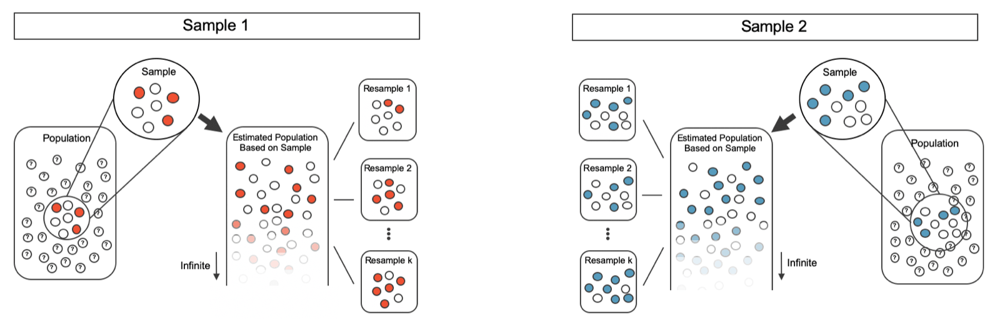
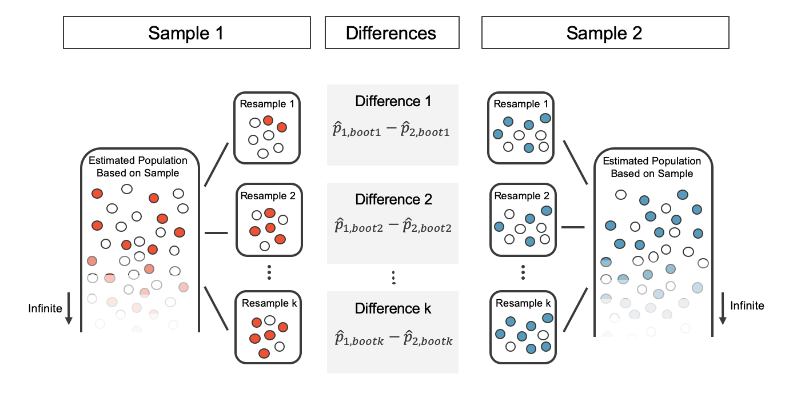
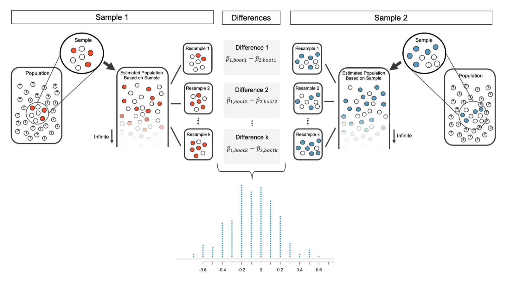
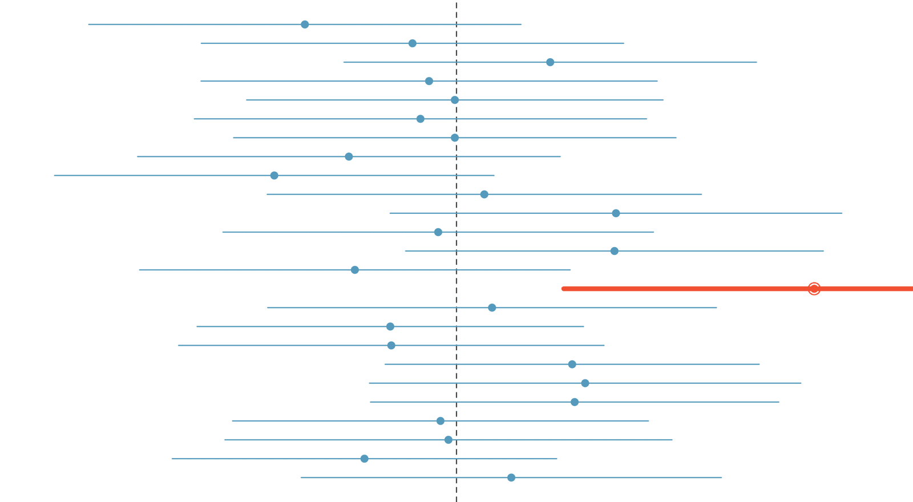



```{r}
#| label: setup
#| include: false
library(tidyverse)
library(openintro)
library(infer)
knitr::opts_chunk$set(out.width = "90%")
```

## Student Information

```{r}
#| label: student-information-1
#| echo: false
learnr2::student_info()
```

## Introduction

This tutorial covers [Chapter 17: Inference for comparing two proportions](https://openintrostat.github.io/ims/inference-two-props.html) from [*Introduction to Modern Statistics*](https://openintrostat.github.io/ims/) by Mine Çetinkaya-Rundel and Johanna Hardin. You will learn to compare two proportions with a randomization test and a bootstrap confidence interval, and then with the normal model, using the unpooled standard error for confidence intervals and the pooled proportion for hypothesis tests, in experiments on blood thinners after CPR, fish oil supplements, and mammograms.

### Exercise 1

You should be doing this tutorial in a repo named `inference-for-comparing-two-proportions`. If you are not, create one and then connect to it.

Create a new file, `analysis.qmd`, with the title `"Inference for Comparing Two Proportions"` and your name as the author. In a bash Terminal, render it:

```bash
quarto render analysis.qmd
```

Open `analysis.html` with Live Server (right-click it in the Explorer → **Open with Live Server**) and keep the tab open. It refreshes on every render. Going forward, we will just tell you to "Render" when we want you to take these steps.

Create a `.gitignore` with `analysis_files` followed by a blank line. Commit and push. Use AI however you like.

If `show_file()` fails, it is probably because you have not yet loaded `library(learnr2)` in the R Terminal.

```{r}
#| label: introduction-1
#| echo: false
learnr2::question('In the R Terminal, run show_file(".gitignore"). CP/CR.', type = "reflection")
```

###

```{.output}
analysis_files
```

###

We look at the inferential analysis in three different ways: using a randomization test, applying bootstrapping for interval estimates, and, if we verify that the point estimate can be modeled using a normal distribution, we compute the estimate's standard error, and we apply the mathematical framework. All three compare the proportions of two groups.

### Exercise 2

Add a chunk to `analysis.qmd` that loads the **[tidyverse](https://www.tidyverse.org/)**, with `#| message: false` so the startup messages stay out of the rendered page. Add `execute: echo: false` to the YAML header. Render.

```{r}
#| label: introduction-2
#| echo: false
learnr2::question('In the R Terminal, run show_file("analysis.qmd"). CP/CR.', type = "reflection")
```

###

````{verbatim}
#| message: false
library(tidyverse)
````

###

The **tidyverse** does the counting, the proportions, and the plots in this tutorial. The chapter's tables, like its two-by-two summary of the CPR study, were built with **[dplyr](https://dplyr.tidyverse.org/)** and **[tidyr](https://tidyr.tidyverse.org/)**, two of its packages.

### Exercise 3

Add **[openintro](https://openintrostat.github.io/openintro/)** to that chunk. Render.

```{r}
#| label: introduction-3
#| echo: false
learnr2::question('In the R Terminal, run show_file("analysis.qmd"). CP/CR.', type = "reflection")
```

###

````{verbatim}
#| message: false
library(tidyverse)
library(openintro)
````

###

**openintro** holds all three of the chapter's datasets: `cpr`, `fish_oil_18`, and `mammogram`. Each comes from a randomized experiment, so a difference between the groups can be read as an effect of the treatment.

### Exercise 4

Add **[infer](https://infer.tidymodels.org/)** to that chunk. Render.

```{r}
#| label: introduction-4
#| echo: false
learnr2::question('In the R Terminal, run show_file("analysis.qmd"). CP/CR.', type = "reflection")
```

###

````{verbatim}
#| message: false
library(tidyverse)
library(openintro)
library(infer)
````

###

**infer** shuffles for randomization tests and resamples for bootstrap intervals with the same steps, changing only the kind of simulation it generates. The chapter's figures of shuffled and bootstrapped differences were drawn with it.

## Randomization and bootstrapping

Each patient was randomly assigned to either receive a blood thinner (treatment group) or not receive a blood thinner (control group). This section tests whether the blood thinner made a difference by shuffling, then estimates how big the difference might be by bootstrapping.

### Exercise 1

Add a chunk that prints `cpr`. Render.

```{r}
#| label: randomization-and-bootstrapping-1
#| echo: false
learnr2::question('In the R Terminal, run show_file("analysis.qmd"). CP/CR.', type = "reflection")
```

###

```{r}
#| label: randomization-and-bootstrapping-1-test
#| echo: true
cpr
```

###

Each of the 90 rows is one patient. The experiment consisted of two treatments on patients who underwent CPR for a heart attack and were subsequently admitted to a hospital.

### Exercise 2

Replace the code in that chunk so that it counts the patients by `group` and `outcome`. Render.

```{r}
#| label: randomization-and-bootstrapping-2
#| echo: false
learnr2::question('In the R Terminal, run show_file("analysis.qmd"). CP/CR.', type = "reflection")
```

###

```{r}
#| label: randomization-and-bootstrapping-2-test
#| echo: true
cpr |>
  count(group, outcome)
```

###

11 out of the 50 patients in the control group and 14 out of the 40 patients in the treatment group survived. The outcome variable of interest was whether the patient survived for at least 24 hours.

### Exercise 3

Replace the code in that chunk so that it calculates the proportion of patients who survived in each `group`. Render.

```{r}
#| label: randomization-and-bootstrapping-3
#| echo: false
learnr2::question('In the R Terminal, run show_file("analysis.qmd"). CP/CR.', type = "reflection")
```

###

```{r}
#| label: randomization-and-bootstrapping-3-test
#| echo: true
cpr |>
  summarize(prop_survived = mean(outcome == "survived"),
            .by = group)
```

###

Survival was 0.35 with a blood thinner and 0.22 without, a gap of 0.13. Based on these observed proportions alone, we cannot determine whether the difference provides *convincing evidence* that blood thinner usage after CPR is effective.

### Exercise 4

Replace the code in that chunk so that it uses **infer** to calculate the observed difference in the proportion who survived, treatment minus control. Store the result as `cpr_obs` and print it. Render.

```{r}
#| label: randomization-and-bootstrapping-4
#| echo: false
learnr2::question('In the R Terminal, run show_file("analysis.qmd"). CP/CR.', type = "reflection")
```

###

```{r}
#| label: randomization-and-bootstrapping-4-test
#| echo: true
cpr_obs <- cpr |>
  specify(outcome ~ group, success = "survived") |>
  calculate(stat = "diff in props", order = c("treatment", "control"))

cpr_obs
```

###

The difference of two sample proportions is the *point estimate* of the difference between the two population proportions. Here it is 0.13: 13 more survivors per 100 patients given a blood thinner.

### Exercise 5

Replace the line that prints `cpr_obs` with code that creates `cpr_null`, the differences in survival proportions from 1,000 shuffles of the `group` labels, assuming blood thinners have no effect on survival. Set a seed of 47 first, the seed the chapter used. Then calculate how many of the shuffled differences are at least as large as `cpr_obs`, and what proportion of the 1,000 that is. Render.

```{r}
#| label: randomization-and-bootstrapping-5
#| echo: false
learnr2::question('In the R Terminal, run show_file("analysis.qmd"). CP/CR.', type = "reflection")
```

###

```{r}
#| label: randomization-and-bootstrapping-5-test
#| echo: true
set.seed(47)
cpr_null <- cpr |>
  specify(outcome ~ group, success = "survived") |>
  hypothesize(null = "independence") |>
  generate(reps = 1000, type = "permute") |>
  calculate(stat = "diff in props", order = c("treatment", "control"))

cpr_null |>
  summarize(n_extreme = sum(stat >= cpr_obs$stat),
            prop_extreme = mean(stat >= cpr_obs$stat))
```

###

We simulated the differences assuming that the independence model was true, that blood thinners after CPR have no effect on survival. In 135 of our 1,000 shuffles, chance alone produced a gap of at least 0.13.

### Exercise 6

Replace the code that calculates the proportion with **infer**'s own tool for the p-value. The alternative hypothesis is that blood thinners increase survival. Render.

```{r}
#| label: randomization-and-bootstrapping-6
#| echo: false
learnr2::question('In the R Terminal, run show_file("analysis.qmd"). CP/CR.', type = "reflection")
```

###

```{r}
#| label: randomization-and-bootstrapping-6-test
#| echo: true
cpr_null |>
  get_p_value(obs_stat = cpr_obs, direction = "greater")
```

###

Our p-value is 0.135, close to the chapter's 12%, so this is not a very rare event. This does not mean that we have proved that blood thinners are not effective, it just means that this study does not provide convincing evidence that they are effective in this setting.

### Exercise 7

A bootstrap resample draws patients, with replacement, from the patients in the study. Replace the p-value code with code that draws one bootstrap resample of the 90 patients, with a seed of 47 set first, and counts the resampled patients by `group` and `outcome`. Render.

```{r}
#| label: randomization-and-bootstrapping-7
#| echo: false
learnr2::question('In the R Terminal, run show_file("analysis.qmd"). CP/CR.', type = "reflection")
```

###

```{r}
#| label: randomization-and-bootstrapping-7-test
#| echo: true
set.seed(47)
cpr |>
  specify(outcome ~ group, success = "survived") |>
  generate(reps = 1, type = "bootstrap") |>
  count(group, outcome)
```

###

Our resample has 53 control patients and 37 treated ones, not 50 and 40. The chapter's diagram resamples each group separately, which keeps each group's size, but its code, like ours, resamples all 90 patients at once.

{fig-alt="Sample 1 is taken from Population 1 (3 colored marbles out of 7); Sample 2 is taken from Population 2 (5 colored marbles out of 9). Each of the two samples is used to create separate infinitely large proxy populations. Proxy population 1 has 3/7 colored marbles; proxy population 2 has 4/9 colored marbles. Resamples are taken from each of the proxy populations. The three resamples from proxy population 1 have 2/7, 4/7 and 5/7 colored marbles, respectively. The three resamples from proxy population 2 have 5/9, 4/9, and 7/9 colored marbles, respectively."}

### Exercise 8

Replace the code that draws one resample with code that creates `cpr_boot`, the differences in survival proportions, treatment minus control, from 1,000 bootstrap resamples, with a seed of 47 set first. Print `cpr_boot`. Render.

```{r}
#| label: randomization-and-bootstrapping-8
#| echo: false
learnr2::question('In the R Terminal, run show_file("analysis.qmd"). CP/CR.', type = "reflection")
```

###

```{r}
#| label: randomization-and-bootstrapping-8-test
#| echo: true
set.seed(47)
cpr_boot <- cpr |>
  specify(outcome ~ group, success = "survived") |>
  generate(reps = 1000, type = "bootstrap") |>
  calculate(stat = "diff in props", order = c("treatment", "control"))

cpr_boot
```

###

Unlike the shuffles, these differences scatter around 0.13, not 0: 0.085, 0.102, 0.167, and so on. Each comes from taking one bootstrap resample from each group and calculating the difference in the bootstrap proportions.

{fig-alt="Shown are the two infinitely large proxy populations (created from sample 1 and sample 2). From each proxy population, three resamples are shown. For each pair of resamples, the difference in bootstrap proportions is taken. The first pair of resamples gives a difference in bootstrapped proportions of 2/7 minus 5/9; the second pair of resamples gives a difference in bootstrapped proportions of 4/7 minus 4/9; the last pair of resamples gives a difference in bootstrapped proportions of 5/7 minus 7/9."}

### Exercise 9

Replace the line that prints `cpr_boot` with a 90% percentile confidence interval from `cpr_boot`. Render.

```{r}
#| label: randomization-and-bootstrapping-9
#| echo: false
learnr2::question('In the R Terminal, run show_file("analysis.qmd"). CP/CR.', type = "reflection")
```

###

```{r}
#| label: randomization-and-bootstrapping-9-test
#| echo: true
cpr_boot |>
  get_confidence_interval(level = 0.90, type = "percentile")
```

###

The bootstrap 5 percentile proportion is -0.032 and the 95 percentile is 0.284, the chapter's interval exactly, because the same seed gives the same resamples. The interval shows that we do not have much definitive evidence of the effect of blood thinners, one way or another.

### Exercise 10

Replace the confidence interval code with code that calculates the standard deviation of the 1,000 bootstrap differences, which estimates the standard error, and a 95% interval that runs from two standard errors below `cpr_obs` to two standard errors above it. Render.

```{r}
#| label: randomization-and-bootstrapping-10
#| echo: false
learnr2::question('In the R Terminal, run show_file("analysis.qmd"). CP/CR.', type = "reflection")
```

###

```{r}
#| label: randomization-and-bootstrapping-10-test
#| echo: true
cpr_boot |>
  summarize(se = sd(stat)) |>
  mutate(lower = cpr_obs$stat - 2 * se,
         upper = cpr_obs$stat + 2 * se)
```

###

The resulting interval, -0.067 to 0.327 with a standard error of 0.098, is called the *SE interval*. The wide confidence interval that contains zero indicates that the study provides very little evidence about the effectiveness of blood thinners.

### Exercise 11

Replace the standard error code with two histograms, one above the other: the shuffled differences in `cpr_null` and the bootstrap differences in `cpr_boot`, each with a vertical line at the observed difference. Render.

```{r}
#| label: randomization-and-bootstrapping-11
#| echo: false
learnr2::question('In the R Terminal, run show_file("analysis.qmd"). CP/CR.', type = "reflection")
```

###

```{r}
#| label: randomization-and-bootstrapping-11-test
#| echo: true
bind_rows(Shuffled = cpr_null, Bootstrapped = cpr_boot, .id = "simulation") |>
  ggplot(aes(x = stat)) +
  geom_histogram(binwidth = 0.045) +
  geom_vline(xintercept = cpr_obs$stat) +
  facet_wrap(~ simulation, ncol = 1)
```

###

Shuffling assumes the null hypothesis, so the shuffled differences center on 0, while the bootstrapped ones center on 0.13. Repeated bootstrap simulations lead to a bootstrap sampling distribution of the statistic of interest, here the difference in sample proportions.

{fig-alt="Shown are the two infinitely large proxy populations (created from sample 1 and sample 2). From each proxy population, three resamples are shown. For each pair of resamples, the difference in bootstrap proportions is taken. A dotplot displays many differences in bootstrap proportions. The differences range from roughly -0.6 to +0.3."}

### Exercise 12

Improve the plot. Put the shuffled panel on top, add a dotted line at zero, make the observed line dashed, show the x-axis as percentage points, and add a title, axis labels, a subtitle that states the main finding, and a caption giving the number of patients, the number of simulations, and the source. Render.

```{r}
#| label: randomization-and-bootstrapping-12
#| echo: false
learnr2::question('In the R Terminal, run show_file("analysis.qmd"). CP/CR.', type = "reflection")
```

###

```{r}
#| label: randomization-and-bootstrapping-12-test
#| echo: true
bind_rows(Shuffled = cpr_null, Bootstrapped = cpr_boot, .id = "simulation") |>
  mutate(simulation = fct_relevel(simulation, "Shuffled")) |>
  ggplot(aes(x = stat)) +
  geom_histogram(binwidth = 0.045, fill = "steelblue") +
  geom_vline(xintercept = 0, linetype = "dotted") +
  geom_vline(xintercept = cpr_obs$stat, linetype = "dashed") +
  facet_wrap(~ simulation, ncol = 1) +
  scale_x_continuous(labels = scales::label_percent(suffix = " pts")) +
  labs(title = "Blood Thinners After CPR: Shuffled and Bootstrapped Differences",
       subtitle = "Chance often gives a 13-point gap; the 90% interval, -3 to 28 points, includes 0",
       x = "Difference in Survival Rates, Treatment Minus Control",
       y = "Number of Simulations",
       caption = "90 patients, 14 of 40 treated and 11 of 50 controls survived; 1,000 shuffles and 1,000 resamples\nBottiger et al. (2001), via Introduction to Modern Statistics, Chapter 17")
```

###

Statistical inference is built on evaluating how likely such differences are to occur due to chance if in fact the null hypothesis is true. The top panel does that, and the bottom panel shows the range of differences the data support without assuming the null.

### Exercise 13

Commit `analysis.qmd` with the message `"Shuffle and bootstrap the CPR study"` and push.

```{r}
#| label: randomization-and-bootstrapping-13
#| echo: false
learnr2::question("In the bash Terminal, run git log --oneline -3. CP/CR.", type = "reflection")
```

###

```{.output}
5e2a9c1 (HEAD -> main, origin/main) Shuffle and bootstrap the CPR study
9be04d2 Initial commit
```

###

If we are making 95% intervals, then about 5% of the intervals we create over our lifetime will *not* capture the parameter of interest. Of these 25 hypothetical studies, one interval, in red, misses the true difference.

{fig-alt="A series of 25 horizontal lines are drawn, representing each of 25 different studies (where a study represents two samples, one from each of population 1 and population 2). Each vertical line starts at the value of the lower bound of the confidence interval and ends at the value of the upper bound of the confidence interval which was created from that particular sample. In the center of the line is a solid dot at the observed difference in proportion of successes for sample 1 minus sample 2. A dashed vertical line runs through the horizontal lines at p = 0.47 (which is the true value of the difference in population proportions). 24 of the 25 horizontal lines cross the vertical line at 0.47, but one of the horizontal lines is completely above 0.47. The line that does not cross 0.47 is colored red because the confidence interval from that particular sample would not have captured the true difference in population proportions."}

## Mathematical model

The difference of two sample proportions can be modeled using a normal distribution when certain conditions are met. This section checks those conditions, builds confidence intervals for the CPR and fish oil studies, and tests the mammogram study with the pooled proportion, checking the formulas against simulation.

### Exercise 1

Start a new chunk that calculates, for each `group` in `cpr`, the number of patients, the number who survived, and the number who died. Render.

```{r}
#| label: mathematical-model-1
#| echo: false
learnr2::question('In the R Terminal, run show_file("analysis.qmd"). CP/CR.', type = "reflection")
```

###

```{r}
#| label: mathematical-model-1-test
#| echo: true
cpr |>
  summarize(n = n(),
            survived = sum(outcome == "survived"),
            died = sum(outcome == "died"),
            .by = group)
```

###

First, we require a broader independence condition, and secondly, the success-failure condition must be met by both groups. The experiment was randomized, and we have at least 10 successes and 10 failures in each experiment arm (11, 39, 14, 26).

### Exercise 2

Replace the code in that chunk so that it calculates, in a single row, the difference in survival proportions, treatment minus control, and its standard error from the formula that uses each group's sample proportion and size. Render.

```{r}
#| label: mathematical-model-2
#| echo: false
learnr2::question('In the R Terminal, run show_file("analysis.qmd"). CP/CR.', type = "reflection")
```

###

```{r}
#| label: mathematical-model-2-test
#| echo: true
cpr |>
  summarize(n = n(),
            p_hat = mean(outcome == "survived"),
            .by = group) |>
  summarize(diff = p_hat[group == "treatment"] - p_hat[group == "control"],
            se = sqrt(sum(p_hat * (1 - p_hat) / n)))
```

###

The formula gives a standard error of 0.0955, close to the 0.098 from the bootstrap. The bootstrap distribution typically does an excellent job of estimating the variability of the sampling distribution of the sample statistic.

### Exercise 3

Add the z-star value for a 90% confidence interval from the normal distribution, and the lower and upper ends of that interval. Render.

```{r}
#| label: mathematical-model-3
#| echo: false
learnr2::question('In the R Terminal, run show_file("analysis.qmd"). CP/CR.', type = "reflection")
```

###

```{r}
#| label: mathematical-model-3-test
#| echo: true
cpr |>
  summarize(n = n(),
            p_hat = mean(outcome == "survived"),
            .by = group) |>
  summarize(diff = p_hat[group == "treatment"] - p_hat[group == "control"],
            se = sqrt(sum(p_hat * (1 - p_hat) / n))) |>
  mutate(z_star = qnorm(0.95),
         lower = diff - z_star * se,
         upper = diff + z_star * se)
```

###

We are 90% confident that individuals receiving blood thinners have between a 2.7% less chance of survival to a 28.7% greater chance of survival than those in the control group. The bootstrap's 90% interval was -3.2 to 28.4 points.

### Exercise 4

`fish_oil_18` is a list of 24 tables of counts, one for each outcome of a fish oil experiment. Replace the code in that chunk so that it prints the table of heart attacks. Render.

```{r}
#| label: mathematical-model-4
#| echo: false
learnr2::question('In the R Terminal, run show_file("analysis.qmd"). CP/CR.', type = "reflection")
```

###

```{r}
#| label: mathematical-model-4-test
#| echo: true
fish_oil_18$myocardioal_infarction
```

###

A 5-year experiment was conducted to evaluate the effectiveness of fish oils on reducing cardiovascular events, where each subject was randomized into one of two treatment groups. The heart attack table's name is misspelled, `myocardioal_infarction`, so `myocardial_infarction` prints `NULL`.

### Exercise 5

Replace the code in that chunk so that it turns the table into a tibble with one row per group, adding the number of subjects in each group and the proportion who had a heart attack. Render.

```{r}
#| label: mathematical-model-5
#| echo: false
learnr2::question('In the R Terminal, run show_file("analysis.qmd"). CP/CR.', type = "reflection")
```

###

```{r}
#| label: mathematical-model-5-test
#| echo: true
fish_oil_18$myocardioal_infarction |>
  as_tibble(rownames = "group") |>
  mutate(n = myocardioal_infarction + no_event,
         p_hat = myocardioal_infarction / n)
```

###

Heart attacks struck 145 of the fish oil group, 1.12%, and 200 of the placebo group, 1.55%. The success-failure condition is also met for both groups as all counts are at least 10.

### Exercise 6

Add code that calculates, in a single row, the difference in heart attack proportions, fish oil minus placebo, its standard error from the formula, and a 95% confidence interval using 1.96 standard errors. Render.

```{r}
#| label: mathematical-model-6
#| echo: false
learnr2::question('In the R Terminal, run show_file("analysis.qmd"). CP/CR.', type = "reflection")
```

###

```{r}
#| label: mathematical-model-6-test
#| echo: true
fish_oil_18$myocardioal_infarction |>
  as_tibble(rownames = "group") |>
  mutate(n = myocardioal_infarction + no_event,
         p_hat = myocardioal_infarction / n) |>
  summarize(diff = p_hat[group == "fish_oil"] - p_hat[group == "placebo"],
            se = sqrt(sum(p_hat * (1 - p_hat) / n)),
            lower = diff - 1.96 * se,
            upper = diff + 1.96 * se)
```

###

We are 95% confident that fish oils decreases heart attacks by 0.15 to 0.71 percentage points (off of a baseline of about 1.55%) over a 5-year period for subjects who are similar to those in the study. Our interval, -0.70 to -0.15 points, differs slightly because the chapter rounded the proportions first.

### Exercise 7

Replace the code in that chunk so that it prints `mammogram`. Render.

```{r}
#| label: mathematical-model-7
#| echo: false
learnr2::question('In the R Terminal, run show_file("analysis.qmd"). CP/CR.', type = "reflection")
```

###

```{r}
#| label: mathematical-model-7-test
#| echo: true
mammogram
```

###

A mammogram is an X-ray procedure used to check for breast cancer. Each of the 89,835 rows is one participant, and the outcome is death from breast cancer over the full 30-year study, though the help page says "within 25 years."

### Exercise 8

Replace the code in that chunk so that it calculates, for each `treatment`, the number of participants, the number who died from breast cancer, and the proportion who did. Render.

```{r}
#| label: mathematical-model-8
#| echo: false
learnr2::question('In the R Terminal, run show_file("analysis.qmd"). CP/CR.', type = "reflection")
```

###

```{r}
#| label: mathematical-model-8-test
#| echo: true
mammogram |>
  summarize(n = n(),
            deaths = sum(breast_cancer_death == "yes"),
            p_hat = mean(breast_cancer_death == "yes"),
            .by = treatment)
```

###

Breast cancer killed 500 of the 44,925 women screened by mammogram and 505 of the 44,910 controls, 1.11% and 1.12%. If mammograms are much more effective than non-mammogram breast cancer exams, then we would expect to see additional deaths from breast cancer in the control group.

### Exercise 9

Add the pooled proportion, the deaths in the whole study divided by its participants, and the number of deaths and of survivors we would expect in each group if both groups died at that pooled rate. Render.

```{r}
#| label: mathematical-model-9
#| echo: false
learnr2::question('In the R Terminal, run show_file("analysis.qmd"). CP/CR.', type = "reflection")
```

###

```{r}
#| label: mathematical-model-9-test
#| echo: true
mammogram |>
  summarize(n = n(),
            deaths = sum(breast_cancer_death == "yes"),
            p_hat = mean(breast_cancer_death == "yes"),
            .by = treatment) |>
  mutate(p_pool = sum(deaths) / sum(n),
         expected_deaths = n * p_pool,
         expected_survivors = n * (1 - p_pool))
```

###

When the null hypothesis is that the proportions are equal, use the *pooled proportion* of successes to verify the success-failure condition and estimate the standard error. The pooled rate is 1.12%, so each group expects about 503 deaths and more than 44,000 survivors, all at least 10.

### Exercise 10

Simulate first. Replace the code in that chunk with code that creates `mammo_obs`, the observed difference in the proportion who died from breast cancer, mammogram minus control, and `mammo_null`, the differences from 1,000 shuffles of the `treatment` labels, assuming mammograms have no effect. Set a seed first. Then calculate the two-sided p-value. Render. The shuffling takes a few seconds.

```{r}
#| label: mathematical-model-10
#| echo: false
learnr2::question('In the R Terminal, run show_file("analysis.qmd"). CP/CR.', type = "reflection")
```

###

```{r}
#| label: mathematical-model-10-test
#| echo: true
mammo_obs <- mammogram |>
  specify(breast_cancer_death ~ treatment, success = "yes") |>
  calculate(stat = "diff in props", order = c("mammogram", "control"))

set.seed(17)
mammo_null <- mammogram |>
  specify(breast_cancer_death ~ treatment, success = "yes") |>
  hypothesize(null = "independence") |>
  generate(reps = 1000, type = "permute") |>
  calculate(stat = "diff in props", order = c("mammogram", "control"))

mammo_null |>
  get_p_value(obs_stat = mammo_obs, direction = "two-sided")
```

###

The observed difference is -0.00012, about one death per 10,000 women, and our p-value is 0.862. The alternative is two-sided because if mammograms are not as effective as regular breast cancer exams, we would expect to see an increase in breast cancer deaths in the mammogram group.

### Exercise 11

Now the formula. Start a new chunk that calculates, in a single row from `mammogram`, the difference in breast cancer death proportions, mammogram minus control, the pooled proportion, the standard error using the pooled proportion, the Z score of the difference, and the two-sided p-value from the standard normal distribution. Render.

```{r}
#| label: mathematical-model-11
#| echo: false
learnr2::question('In the R Terminal, run show_file("analysis.qmd"). CP/CR.', type = "reflection")
```

###

```{r}
#| label: mathematical-model-11-test
#| echo: true
mammogram |>
  summarize(n = n(),
            deaths = sum(breast_cancer_death == "yes"),
            .by = treatment) |>
  summarize(diff = deaths[treatment == "mammogram"] / n[treatment == "mammogram"] -
              deaths[treatment == "control"] / n[treatment == "control"],
            p_pool = sum(deaths) / sum(n),
            se = sqrt(p_pool * (1 - p_pool) * sum(1 / n))) |>
  mutate(z = diff / se,
         p_value = 2 * pnorm(-abs(z)))
```

###

The *Z score* is a ratio of how the two sample proportions differ as compared to the expected variability of difference between the proportions. Our Z of -0.164 gives a p-value of 0.870, close to the simulation's 0.862.

### Exercise 12

Replace the code in that chunk with a histogram of the shuffled differences in `mammo_null`, on a density scale, with the normal curve that the null hypothesis implies drawn over it, centered at zero with the pooled standard error, and a dashed line at `mammo_obs`. Render.

```{r}
#| label: mathematical-model-12
#| echo: false
learnr2::question('In the R Terminal, run show_file("analysis.qmd"). CP/CR.', type = "reflection")
```

###

```{r}
#| label: mathematical-model-12-test
#| echo: true
mammo_null |>
  ggplot(aes(x = stat)) +
  geom_histogram(aes(y = after_stat(density)),
                 binwidth = 1 / 44925 + 1 / 44910, center = mammo_obs$stat) +
  geom_function(fun = dnorm,
                args = list(mean = 0,
                            sd = sqrt(1005 / 89835 * (1 - 1005 / 89835) *
                                        (1 / 44925 + 1 / 44910)))) +
  geom_vline(xintercept = mammo_obs$stat, linetype = "dashed")
```

###

The normal curve traces the shuffled differences closely, and the observed difference sits almost exactly in the middle. The standard deviation of our 1,000 shuffles matches the pooled standard error, 0.00070.

### Exercise 13

Improve the plot. Shade the bars at least as far from zero as the observed difference, in either direction, in a different color, show the x-axis as percentage points, and add a title, axis labels, a subtitle that states the main finding, and a caption giving the number of participants, the number of shuffles, and the source. Render.

```{r}
#| label: mathematical-model-13
#| echo: false
learnr2::question('In the R Terminal, run show_file("analysis.qmd"). CP/CR.', type = "reflection")
```

###

```{r}
#| label: mathematical-model-13-test
#| echo: true
mammo_null |>
  ggplot(aes(x = stat)) +
  geom_histogram(aes(y = after_stat(count / sum(count) / width),
                     fill = abs(stat) >= abs(mammo_obs$stat)),
                 binwidth = 1 / 44925 + 1 / 44910, center = mammo_obs$stat) +
  geom_function(fun = dnorm,
                args = list(mean = 0,
                            sd = sqrt(1005 / 89835 * (1 - 1005 / 89835) *
                                        (1 / 44925 + 1 / 44910))),
                linewidth = 1) +
  geom_vline(xintercept = mammo_obs$stat, linetype = "dashed") +
  scale_fill_manual(values = c("gray70", "steelblue"), guide = "none") +
  scale_x_continuous(labels = scales::label_percent(accuracy = 0.1, suffix = " pts")) +
  labs(title = "Breast Cancer Deaths If Mammograms Made No Difference",
       subtitle = "Shuffles and the normal curve agree: the observed gap is ordinary (p near 0.87)",
       x = "Difference in Breast Cancer Death Rates, Mammogram Minus Control",
       y = "Density",
       caption = "89,835 participants, 500 and 505 breast cancer deaths; 1,000 shuffles\nMiller et al. (2014), via Introduction to Modern Statistics, Chapter 17")
```

###

We do not observe benefits or harm from mammograms relative to a regular breast exam. If mammograms are helpful or harmful, the data suggest the effect isn't very large.

### Exercise 14

Commit `analysis.qmd` with the message `"Model the mammogram study"` and push.

```{r}
#| label: mathematical-model-14
#| echo: false
learnr2::question("In the bash Terminal, run git log --oneline -3. CP/CR.", type = "reflection")
```

###

```{.output}
8c3f1b7 (HEAD -> main, origin/main) Model the mammogram study
5e2a9c1 Shuffle and bootstrap the CPR study
9be04d2 Initial commit
```

###

The study's authors also found that mammograms led to over-diagnosis of breast cancer, which means some breast cancers were found (or thought to be found) but that these cancers would not cause symptoms during patients' lifetimes. These considerations highlight the complexity around medical care and treatment recommendations.

## Summary

This tutorial covered [Chapter 17: Inference for comparing two proportions](https://openintrostat.github.io/ims/inference-two-props.html) from [*Introduction to Modern Statistics*](https://openintrostat.github.io/ims/) by Mine Çetinkaya-Rundel and Johanna Hardin. You have learned to compare two proportions with a randomization test and a bootstrap confidence interval, and then with the normal model, using the unpooled standard error for confidence intervals and the pooled proportion for hypothesis tests, in experiments on blood thinners after CPR, fish oil supplements, and mammograms.

When the parameter of interest is the difference in population proportions across two groups, randomization tests, bootstrapping, and mathematical modeling can be applied. For confidence intervals, bootstrapping from each group separately will provide a sampling distribution for the difference in sample proportions; the mathematical model shows a similar distributional shape as long as the sample size is large enough to fulfill the success-failure conditions and so that the data are representative of the entire population. Keep in mind that some datasets will produce a confidence interval which does not capture the true parameter, this is the nature of variability! Over your lifetime, about 95% of the confidence intervals you create will capture the parameter of interest, and about 5% won't. For hypothesis testing, repeated randomization of the explanatory variable creates a null distribution of differences in sample proportions that could have occurred under the null hypothesis. Randomization and the mathematical model will have similar null distributions, as long as the sample size is large enough to fulfill the success-failure conditions.

For the mammogram study, read "[Twenty five year follow-up for breast cancer incidence and mortality of the Canadian National Breast Screening Study](https://doi.org/10.1136/bmj.g366)" by Anthony Miller and colleagues, the source the `mammogram` help page cites, which also reports the over-diagnosis the chapter mentions. For the fish oil experiment, read "[Marine n-3 Fatty Acids and Prevention of Cardiovascular Disease and Cancer](https://doi.org/10.1056/NEJMoa1811403)" by JoAnn Manson and colleagues, the source of all 24 tables in `fish_oil_18`.

Many sentences in this tutorial, and its figures, come from the chapter, used under the book's [CC BY-SA 3.0 license](https://creativecommons.org/licenses/by-sa/3.0/).

### Exercise 1

Render one last time.

```{r}
#| label: summary-1
#| echo: false
learnr2::question('In the R Terminal, run show_file("analysis.qmd", start = 0). CP/CR.', type = "reflection")
```

###

````{verbatim}
---
title: "Inference for Comparing Two Proportions"
author: "Your Name"
format: html
execute:
  echo: false
---

```{r}
#| message: false
library(tidyverse)
library(openintro)
library(infer)
```

```{r}
cpr_obs <- cpr |>
  specify(outcome ~ group, success = "survived") |>
  calculate(stat = "diff in props", order = c("treatment", "control"))

set.seed(47)
cpr_null <- cpr |>
  specify(outcome ~ group, success = "survived") |>
  hypothesize(null = "independence") |>
  generate(reps = 1000, type = "permute") |>
  calculate(stat = "diff in props", order = c("treatment", "control"))

set.seed(47)
cpr_boot <- cpr |>
  specify(outcome ~ group, success = "survived") |>
  generate(reps = 1000, type = "bootstrap") |>
  calculate(stat = "diff in props", order = c("treatment", "control"))

bind_rows(Shuffled = cpr_null, Bootstrapped = cpr_boot, .id = "simulation") |>
  mutate(simulation = fct_relevel(simulation, "Shuffled")) |>
  ggplot(aes(x = stat)) +
  geom_histogram(binwidth = 0.045, fill = "steelblue") +
  geom_vline(xintercept = 0, linetype = "dotted") +
  geom_vline(xintercept = cpr_obs$stat, linetype = "dashed") +
  facet_wrap(~ simulation, ncol = 1) +
  scale_x_continuous(labels = scales::label_percent(suffix = " pts")) +
  labs(title = "Blood Thinners After CPR: Shuffled and Bootstrapped Differences",
       subtitle = "Chance often gives a 13-point gap; the 90% interval, -3 to 28 points, includes 0",
       x = "Difference in Survival Rates, Treatment Minus Control",
       y = "Number of Simulations",
       caption = "90 patients, 14 of 40 treated and 11 of 50 controls survived; 1,000 shuffles and 1,000 resamples\nBottiger et al. (2001), via Introduction to Modern Statistics, Chapter 17")
```

```{r}
mammo_obs <- mammogram |>
  specify(breast_cancer_death ~ treatment, success = "yes") |>
  calculate(stat = "diff in props", order = c("mammogram", "control"))

set.seed(17)
mammo_null <- mammogram |>
  specify(breast_cancer_death ~ treatment, success = "yes") |>
  hypothesize(null = "independence") |>
  generate(reps = 1000, type = "permute") |>
  calculate(stat = "diff in props", order = c("mammogram", "control"))

mammo_null |>
  get_p_value(obs_stat = mammo_obs, direction = "two-sided")
```

```{r}
mammo_null |>
  ggplot(aes(x = stat)) +
  geom_histogram(aes(y = after_stat(count / sum(count) / width),
                     fill = abs(stat) >= abs(mammo_obs$stat)),
                 binwidth = 1 / 44925 + 1 / 44910, center = mammo_obs$stat) +
  geom_function(fun = dnorm,
                args = list(mean = 0,
                            sd = sqrt(1005 / 89835 * (1 - 1005 / 89835) *
                                        (1 / 44925 + 1 / 44910))),
                linewidth = 1) +
  geom_vline(xintercept = mammo_obs$stat, linetype = "dashed") +
  scale_fill_manual(values = c("gray70", "steelblue"), guide = "none") +
  scale_x_continuous(labels = scales::label_percent(accuracy = 0.1, suffix = " pts")) +
  labs(title = "Breast Cancer Deaths If Mammograms Made No Difference",
       subtitle = "Shuffles and the normal curve agree: the observed gap is ordinary (p near 0.87)",
       x = "Difference in Breast Cancer Death Rates, Mammogram Minus Control",
       y = "Density",
       caption = "89,835 participants, 500 and 505 breast cancer deaths; 1,000 shuffles\nMiller et al. (2014), via Introduction to Modern Statistics, Chapter 17")
```
````

###

Your file holds the CPR study's shuffles and resamples, and the mammogram study's shuffles drawn against the normal model.

### Exercise 2

Publish your analysis to GitHub Pages. In a bash Terminal, run:

```bash
quarto publish gh-pages analysis.qmd
```

```{r}
#| label: summary-2
#| echo: false
learnr2::question("Paste the URL of your published page.", type = "reflection")
```

###

Your answer should look like `https://your-github-username.github.io/inference-for-comparing-two-proportions/`.

###

Large sample sizes lead to smaller standard errors for a difference in proportions. The CPR study's 90 patients gave a standard error of 0.096, and the mammogram study's 89,835 women gave 0.0007.

### Exercise 3

Commit and push any remaining changes.

```{r}
#| label: summary-3
#| echo: false
learnr2::question("Paste the URL of your GitHub repo.", type = "reflection")
```

###

Your answer should look like `https://github.com/your-github-username/inference-for-comparing-two-proportions`.

###

Experts and medical boards who study medical treatments use considerations like cost, harm, and over-diagnosis to provide their best recommendation based on the current evidence. A p-value or an interval is one input to such a recommendation.

## Your Answers

```{r}
#| label: your-answers-1
#| echo: false
learnr2::question(
  "How many minutes, approximately, did it take you to complete this
  tutorial? For example, an hour and a half would be 90 minutes.",
  type = "reflection_editable",
  validate = "integer"
)
```

```{r}
#| label: your-answers-2
#| echo: false
learnr2::download_answers_button(filename_prefix = "comparing-two-proportions")
```
