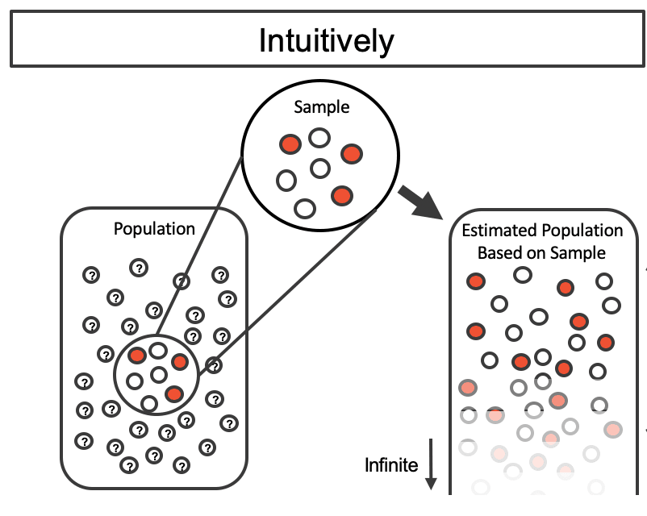
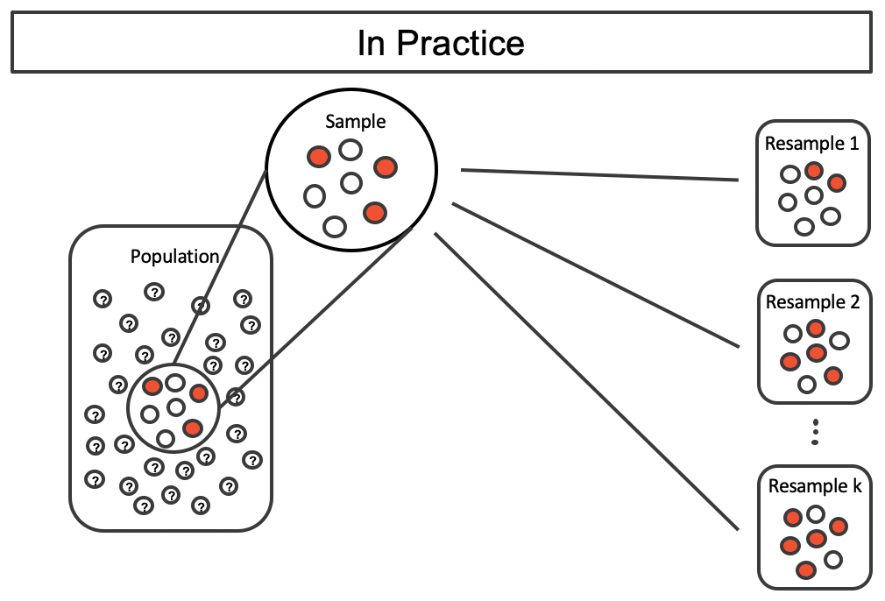
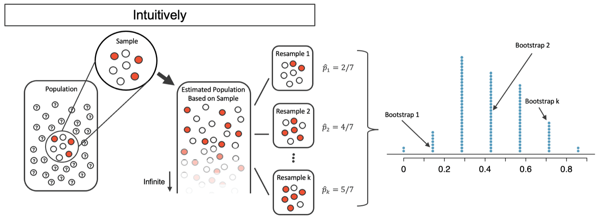
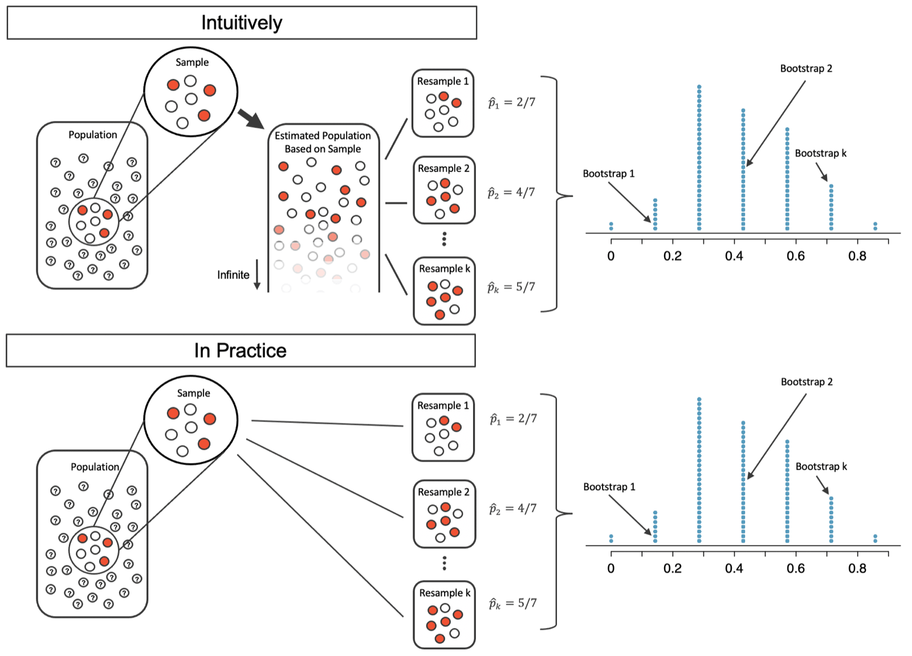



```{r}
#| label: setup
#| include: false
library(tidyverse)
library(infer)
knitr::opts_chunk$set(out.width = "90%")
```

## Student Information

```{r}
#| label: student-information-1
#| echo: false
learnr2::student_info()
```

## Introduction

This tutorial covers [Chapter 12: Confidence intervals with bootstrapping](https://openintrostat.github.io/ims/foundations-bootstrapping.html) from [*Introduction to Modern Statistics*](https://openintrostat.github.io/ims/) by Mine Çetinkaya-Rundel and Johanna Hardin. You will learn to estimate a population proportion by resampling your own data with replacement, to turn 10,000 bootstrapped proportions into a 95% bootstrap percentile confidence interval, and what the confidence level does and does not promise, using a medical consultant's record and a song-tapping experiment.

### Exercise 1

You should be doing this tutorial in a repo named `confidence-intervals-with-bootstrapping`. If you are not, create one and then connect to it.

Create a new file, `analysis.qmd`, with the title `"Confidence Intervals with Bootstrapping"` and your name as the author. In a bash Terminal, render it:

```bash
quarto render analysis.qmd
```

Open `analysis.html` with Live Server (right-click it in the Explorer → **Open with Live Server**) and keep the tab open. It refreshes on every render. Going forward, we will just tell you to "Render" when we want you to take these steps.

Create a `.gitignore` with `analysis_files` followed by a blank line. Commit and push. Use AI however you like.

If `show_file()` fails, it is probably because you have not yet loaded `library(learnr2)` in the R Terminal.

```{r}
#| label: introduction-1
#| echo: false
learnr2::question('In the R Terminal, run show_file(".gitignore"). CP/CR.', type = "reflection")
```

###

```{.output}
analysis_files
```

###

The ideal world where sampling data is free or extremely cheap is almost never the case, and taking repeated samples from a population is usually impossible. So, instead of using a "resample from the population" approach, bootstrapping uses a "resample from the sample" approach.

### Exercise 2

Add a chunk to `analysis.qmd` that loads the **[tidyverse](https://www.tidyverse.org/)**, with `#| message: false` so the startup messages stay out of the rendered page. Add `execute: echo: false` to the YAML header. Render.

```{r}
#| label: introduction-2
#| echo: false
learnr2::question('In the R Terminal, run show_file("analysis.qmd"). CP/CR.', type = "reflection")
```

###

````{verbatim}
#| message: false
library(tidyverse)
````

###

Our goal with bootstrapping will be to produce an *interval estimate* (a range of plausible values) for the population parameter. The **tidyverse** reads the data, counts it, and draws the histograms.

### Exercise 3

Add **[infer](https://infer.tidymodels.org/)** to that chunk. Render.

```{r}
#| label: introduction-3
#| echo: false
learnr2::question('In the R Terminal, run show_file("analysis.qmd"). CP/CR.', type = "reflection")
```

###

````{verbatim}
#| message: false
library(tidyverse)
library(infer)
````

###

**infer** writes a simulation as a pipeline of steps: name the variable, generate resamples, and calculate a statistic for each one. Bootstrapping provides a computational approach for providing interval estimates for almost any population parameter.

### Exercise 4

The chapter's two case studies come as counts, not as datasets in an R package, so you will download them. Create a `data` directory at the top level of the `confidence-intervals-with-bootstrapping` repo.

```{r}
#| label: introduction-4
#| echo: false
learnr2::question("In the bash Terminal, run ls. CP/CR.", type = "reflection")
```

###

```{.output}
analysis.html  analysis.qmd  analysis_files  data
```

###

We turned each case study's counts into a CSV file with one row per person, the shape the bootstrap needs, since it resamples people.

### Exercise 5

Download the file at

```default
https://raw.githubusercontent.com/PPBDS/ims.tutorials/main/inst/extdata/medical_consultant.csv
```

into your `data` directory, keeping the name `medical_consultant.csv`.

```{r}
#| label: introduction-5
#| echo: false
learnr2::question("In the bash Terminal, run ls data. CP/CR.", type = "reflection")
```

###

```{.output}
medical_consultant.csv
```

###

People providing an organ for donation sometimes seek the help of a special medical consultant. This file holds the record of one such consultant: every liver donor surgery she has facilitated.

### Exercise 6

Download the file at

```default
https://raw.githubusercontent.com/PPBDS/ims.tutorials/main/inst/extdata/tappers.csv
```

into your `data` directory, keeping the name `tappers.csv`.

```{r}
#| label: introduction-6
#| echo: false
learnr2::question("In the bash Terminal, run ls data. CP/CR.", type = "reflection")
```

###

```{.output}
medical_consultant.csv  tappers.csv
```

###

This file holds the listeners from an experiment in which one person taps out a song and another tries to name it. Bootstrapping is best suited for modeling studies where the data have been generated through random sampling from a population.

## Medical consultant case study

Patients might choose a consultant based in part on the historical complication rate of the consultant's clients. This section bootstraps one consultant's record to find a range of plausible values for her true complication rate.

### Exercise 1

```{r}
#| label: medical-consultant-case-study-1
#| echo: false
learnr2::question("In the bash Terminal, run head data/medical_consultant.csv. CP/CR.", type = "reflection")
```

###

```{.output}
client,complication
1,no
2,no
3,no
4,no
5,no
6,no
7,no
8,no
9,no
```

###

One consultant tried to attract patients by noting the average complication rate for liver donor surgeries in the US is about 10%, but her clients have had only 3 complications in the 62 liver donor surgeries she has facilitated. The book gives only those two counts, so the file has one row per client and nothing else.

### Exercise 2

Start a new chunk that reads `data/medical_consultant.csv` and prints it. Render.

```{r}
#| label: medical-consultant-case-study-2
#| echo: false
learnr2::question('In the R Terminal, run show_file("analysis.qmd"). CP/CR.', type = "reflection")
```

###

```{r}
#| label: medical-consultant-case-study-2-test
#| echo: true
read_csv("data/medical_consultant.csv", show_col_types = FALSE)
```

###

The tibble has 62 rows, one for each client. `client` is stored as a number, but it is only a label, so averaging it would mean nothing.

### Exercise 3

Replace the code in that chunk so that it counts the clients with and without a complication. Render.

```{r}
#| label: medical-consultant-case-study-3
#| echo: false
learnr2::question('In the R Terminal, run show_file("analysis.qmd"). CP/CR.', type = "reflection")
```

###

```{r}
#| label: medical-consultant-case-study-3-test
#| echo: true
read_csv("data/medical_consultant.csv", show_col_types = FALSE) |>
  count(complication)
```

###

Think of each client as a marble in a bag. There will be 59 white marbles (no complication) and 3 red marbles (complication).

### Exercise 4

Replace the code in that chunk so that it calculates the proportion of clients who had a complication. Render.

```{r}
#| label: medical-consultant-case-study-4
#| echo: false
learnr2::question('In the R Terminal, run show_file("analysis.qmd"). CP/CR.', type = "reflection")
```

###

```{r}
#| label: medical-consultant-case-study-4-test
#| echo: true
read_csv("data/medical_consultant.csv", show_col_types = FALSE) |>
  summarize(prop_complication = mean(complication == "yes"))
```

###

A *parameter* is the "true" value of interest, here the consultant's true complication rate, $p$. Our 0.048 is the point estimate, $\hat{p}$, and the point estimate is also known as the *statistic*.

### Exercise 5

Replace the code in that chunk so that it calculates the same proportion with **infer**, treating `"yes"` as a success. Render.

```{r}
#| label: medical-consultant-case-study-5
#| echo: false
learnr2::question('In the R Terminal, run show_file("analysis.qmd"). CP/CR.', type = "reflection")
```

###

```{r}
#| label: medical-consultant-case-study-5-test
#| echo: true
read_csv("data/medical_consultant.csv", show_col_types = FALSE) |>
  specify(response = complication, success = "yes") |>
  calculate(stat = "prop")
```

###

There is no reason to believe that $p$ is exactly $\hat{p} = 3/62,$ but there is also no reason to believe that $p$ is particularly far from $\hat{p} = 3/62.$ The unknown population can be estimated by using the sample to approximate the proportion of successes and failures, here complications and no complications.

{fig-alt="A small sample of 3 red marbles and 4 white marbles is taken from a large population with predominately unknown individual values. The sample is then replicated infinitely many times to create a proxy population where the values are known to be 3/7 red and 4/7 white."}

### Exercise 6

Replace the code in that chunk so that it draws one bootstrap sample: 62 clients drawn at random, with replacement, from the 62 in the data. Set a seed first, so that the sample is the same on every render. Count how many times each client appears in the sample, from most to fewest. Render.

```{r}
#| label: medical-consultant-case-study-6
#| echo: false
learnr2::question('In the R Terminal, run show_file("analysis.qmd"). CP/CR.', type = "reflection")
```

###

```{r}
#| label: medical-consultant-case-study-6-test
#| echo: true
set.seed(4)
read_csv("data/medical_consultant.csv", show_col_types = FALSE) |>
  slice_sample(n = 62, replace = TRUE) |>
  count(client, sort = TRUE)
```

###

Bootstrap sampling is often called sampling with replacement. Only 40 of the 62 clients made it into our sample, while client 48 was drawn 4 times.

{fig-alt="Shown is the unknown large population with a sample of 3 red and 4 white marbles. Without creating the infinitely large proxy population, resamples are taken from the original sample (by sampling with replacement from the sample). Three resamples of size 7 are shown: Resample 1 has 2/7 red; Resample 2 has 4/7 red; and Resample k has 5/7 red."}

### Exercise 7

Replace the count in that chunk with the proportion of clients in the bootstrap sample who had a complication. Keep the same seed. Render.

```{r}
#| label: medical-consultant-case-study-7
#| echo: false
learnr2::question('In the R Terminal, run show_file("analysis.qmd"). CP/CR.', type = "reflection")
```

###

```{r}
#| label: medical-consultant-case-study-7-test
#| echo: true
set.seed(4)
read_csv("data/medical_consultant.csv", show_col_types = FALSE) |>
  slice_sample(n = 62, replace = TRUE) |>
  summarize(prop_complication = mean(complication == "yes"))
```

###

Client 51, one of the three with a complication, was drawn three times, so our bootstrap sample has 5 complications and a proportion of 0.081, not 0.048. This "bootstrap" proportion represents a single simulated proportion from the "resample from the sample" approach.

### Exercise 8

Start a new chunk that uses **infer** to draw 10,000 bootstrap samples from `data/medical_consultant.csv`, calculates the proportion of complications in each, and stores the result as `boot_med`. Set a seed first. Print `boot_med`. Render.

```{r}
#| label: medical-consultant-case-study-8
#| echo: false
learnr2::question('In the R Terminal, run show_file("analysis.qmd"). CP/CR.', type = "reflection")
```

###

```{r}
#| label: medical-consultant-case-study-8-test
#| echo: true
set.seed(10)
boot_med <- read_csv("data/medical_consultant.csv", show_col_types = FALSE) |>
  specify(response = complication, success = "yes") |>
  generate(reps = 10000, type = "bootstrap") |>
  calculate(stat = "prop")

boot_med
```

###

One simulation isn't enough to get a sense of the variability from one bootstrap proportion to another bootstrap proportion, so we repeat the simulation 10,000 times using a computer. Each row of `boot_med` is one resample, and together the 10,000 `stat` values form a bootstrap distribution, as for the 7 marbles below.

{fig-alt="The same unknown large population with a sample of 3 red and 4 white marbles; the proxy population which is infinite with 3/7 red marbles; and the k Resamples of size 7 are shown. From each of the resamples the bootstrapped proportion of red is calculated (shown as 2/7, 4/7, and 5/7). Many many resamples are taken and summarized in a dotplot of the bootstrapped proportions. The proportions range from 0/7 to 7/7 in a bell shape with the majority of bootstrapped proportions falling between 1/7 and 6/7."}

### Exercise 9

Start a new chunk that counts how many of the 10,000 bootstrapped proportions in `boot_med` take each value. Render.

```{r}
#| label: medical-consultant-case-study-9
#| echo: false
learnr2::question('In the R Terminal, run show_file("analysis.qmd"). CP/CR.', type = "reflection")
```

###

```{r}
#| label: medical-consultant-case-study-9-test
#| echo: true
boot_med |>
  count(stat)
```

###

Only multiples of 1/62 appear, and the most common is 0.048, the original 3 of 62. 469 of our 10,000 resamples, 4.7%, had no complications at all.

### Exercise 10

Replace the code in that chunk so that it uses **infer** to calculate a 95% percentile confidence interval from `boot_med`. Render.

```{r}
#| label: medical-consultant-case-study-10
#| echo: false
learnr2::question('In the R Terminal, run show_file("analysis.qmd"). CP/CR.', type = "reflection")
```

###

```{r}
#| label: medical-consultant-case-study-10-test
#| echo: true
boot_med |>
  get_confidence_interval(level = 0.95, type = "percentile")
```

###

Our interval runs from 0 to 0.113, as in the book. This range of values for the true proportion is called a *bootstrap percentile confidence interval*.

### Exercise 11

Replace the code in that chunk so that it calculates the 2.5th and 97.5th percentiles of the bootstrapped proportions directly, without **infer**. Render.

```{r}
#| label: medical-consultant-case-study-11
#| echo: false
learnr2::question('In the R Terminal, run show_file("analysis.qmd"). CP/CR.', type = "reflection")
```

###

```{r}
#| label: medical-consultant-case-study-11-test
#| echo: true
boot_med |>
  summarize(lower = quantile(stat, 0.025),
            upper = quantile(stat, 0.975))
```

###

Call the 2.5% bootstrapped proportion value "lower", and call the 97.5% bootstrapped proportion value "upper". The lower end is 0 because more than 2.5% of resamples had no complications, even though a true rate of 0 is impossible for a consultant whose clients have had 3.

### Exercise 12

Replace the code in that chunk with a histogram of the bootstrapped proportions in `boot_med`, with one bar for each possible proportion. Render.

```{r}
#| label: medical-consultant-case-study-12
#| echo: false
learnr2::question('In the R Terminal, run show_file("analysis.qmd"). CP/CR.', type = "reflection")
```

###

```{r}
#| label: medical-consultant-case-study-12-test
#| echo: true
boot_med |>
  ggplot(aes(x = stat)) +
  geom_histogram(binwidth = 1 / 62)
```

###

The bootstrap distribution is lopsided: it stops at 0 on the left but stretches right, as far as 0.194 in our 10,000. It shows, directly, the variability of the sample proportion, $\hat{p},$ from sample to sample.

### Exercise 13

Improve the histogram. Mark the two ends of the 95% percentile interval with dashed lines and the national complication rate of 10% with a solid line, and show the x-axis as percentages. Add a title, axis labels, a subtitle that states whether the interval includes 10%, and a caption giving the number of clients, the number of resamples, and the source. Render.

```{r}
#| label: medical-consultant-case-study-13
#| echo: false
learnr2::question('In the R Terminal, run show_file("analysis.qmd"). CP/CR.', type = "reflection")
```

###

```{r}
#| label: medical-consultant-case-study-13-test
#| echo: true
med_ci <- boot_med |>
  get_confidence_interval(level = 0.95, type = "percentile")

boot_med |>
  ggplot(aes(x = stat)) +
  geom_histogram(binwidth = 1 / 62) +
  geom_vline(xintercept = c(med_ci$lower_ci, med_ci$upper_ci),
             linetype = "dashed") +
  geom_vline(xintercept = 0.10, color = "red") +
  scale_x_continuous(labels = scales::label_percent()) +
  labs(title = "Bootstrapped Complication Rates for One Medical Consultant",
       subtitle = "The 95% interval, 0% to 11.3%, includes the national rate of 10%",
       x = "Bootstrapped Proportion of Clients with a Complication",
       y = "Number of Bootstrap Samples",
       caption = "62 clients, 10,000 bootstrap samples; Introduction to Modern Statistics, Chapter 12")
```

###

Because the interval overlaps 10%, it might be that the consultant's work is associated with a lower risk of complications, or it might be that the consultant's work is associated with a higher risk (i.e., greater than 10%) of complications. Her 3 in 62 is not strong evidence that she beats the national rate.

### Exercise 14

Commit `analysis.qmd` with the message `"Bootstrap the medical consultant"` and push.

```{r}
#| label: medical-consultant-case-study-14
#| echo: false
learnr2::question("In the bash Terminal, run git log --oneline -3. CP/CR.", type = "reflection")
```

###

```{.output}
5c81e2d (HEAD -> main, origin/main) Bootstrap the medical consultant
a07f93b Initial commit
```

###

Because this is an observational study, even if an association can be measured, there is no evidence that the consultant's work is the cause of the complication rate (being higher or lower). Maybe patients who can afford a medical consultant can afford better medical care, which can also lead to a lower complication rate.

## Tappers, listeners, and confidence intervals

Here's a game you can try with your friends or family: pick a simple, well-known song, tap that tune on your desk, and see if the other person can guess the song. This section bootstraps the results of Elizabeth Newton's experiment built on that game, then tests the bootstrap where we know the right answer.

### Exercise 1

```{r}
#| label: tappers-listeners-and-confidence-intervals-1
#| echo: false
learnr2::question("In the bash Terminal, run head data/tappers.csv. CP/CR.", type = "reflection")
```

###

```{.output}
listener,correct
1,no
2,no
3,no
4,no
5,no
6,no
7,no
8,no
9,no
```

###

About 50% of the tappers expected that the listener would be able to guess the song. Not one of the first nine listeners in the file guessed it.

### Exercise 2

Start a new chunk that reads `data/tappers.csv` and counts the listeners who did and did not guess the song. Render.

```{r}
#| label: tappers-listeners-and-confidence-intervals-2
#| echo: false
learnr2::question('In the R Terminal, run show_file("analysis.qmd"). CP/CR.', type = "reflection")
```

###

```{r}
#| label: tappers-listeners-and-confidence-intervals-2-test
#| echo: true
read_csv("data/tappers.csv", show_col_types = FALSE) |>
  count(correct)
```

###

In Newton's study, only 3 out of 120 listeners ($\hat{p} = 0.025$) were able to guess the tune. The tappers expected 50%.

### Exercise 3

Replace the code in that chunk so that it uses **infer** to calculate the proportion of listeners who guessed the song. Render.

```{r}
#| label: tappers-listeners-and-confidence-intervals-3
#| echo: false
learnr2::question('In the R Terminal, run show_file("analysis.qmd"). CP/CR.', type = "reflection")
```

###

```{r}
#| label: tappers-listeners-and-confidence-intervals-3-test
#| echo: true
read_csv("data/tappers.csv", show_col_types = FALSE) |>
  specify(response = correct, success = "yes") |>
  calculate(stat = "prop")
```

###

That seems like quite a low number which leads the researcher to ask: what is the true proportion of people who can guess the tune? This case study is described in *[Made to Stick](https://en.wikipedia.org/wiki/Made_to_Stick)* by Chip and Dan Heath, and the teaching principles behind many OpenIntro resources are based on it.

### Exercise 4

Replace the code in that chunk so that it draws 10 bootstrap samples and calculates the proportion of correct guesses in each. Set a seed first. Render.

```{r}
#| label: tappers-listeners-and-confidence-intervals-4
#| echo: false
learnr2::question('In the R Terminal, run show_file("analysis.qmd"). CP/CR.', type = "reflection")
```

###

```{r}
#| label: tappers-listeners-and-confidence-intervals-4-test
#| echo: true
set.seed(10)
read_csv("data/tappers.csv", show_col_types = FALSE) |>
  specify(response = correct, success = "yes") |>
  generate(reps = 10, type = "bootstrap") |>
  calculate(stat = "prop")
```

###

Our ten bootstrapped proportions run from 0 to 0.033, and the book's from 0 to 0.05. As we did with the randomization technique, seeing what would happen with one simulation isn't enough.

### Exercise 5

Replace the code in that chunk so that it draws 10,000 bootstrap samples, stores their proportions as `boot_tap`, and calculates a 95% percentile confidence interval from `boot_tap`. Keep the seed. Render.

```{r}
#| label: tappers-listeners-and-confidence-intervals-5
#| echo: false
learnr2::question('In the R Terminal, run show_file("analysis.qmd"). CP/CR.', type = "reflection")
```

###

```{r}
#| label: tappers-listeners-and-confidence-intervals-5-test
#| echo: true
set.seed(10)
boot_tap <- read_csv("data/tappers.csv", show_col_types = FALSE) |>
  specify(response = correct, success = "yes") |>
  generate(reps = 10000, type = "bootstrap") |>
  calculate(stat = "prop")

boot_tap |>
  get_confidence_interval(level = 0.95, type = "percentile")
```

###

Our interval, 0 to 0.0583, matches the book's: we expect that between 0% and 5.83% of people are truly able to guess the tapper's tune. The upper end, 7 of 120, means that 97.5% of our resamples had 7 or fewer correct guesses.

### Exercise 6

Replace the interval in that chunk with the largest of the 10,000 bootstrapped proportions in `boot_tap`. Render.

```{r}
#| label: tappers-listeners-and-confidence-intervals-6
#| echo: false
learnr2::question('In the R Terminal, run show_file("analysis.qmd"). CP/CR.', type = "reflection")
```

###

```{r}
#| label: tappers-listeners-and-confidence-intervals-6-test
#| echo: true
set.seed(10)
boot_tap <- read_csv("data/tappers.csv", show_col_types = FALSE) |>
  specify(response = correct, success = "yes") |>
  generate(reps = 10000, type = "bootstrap") |>
  calculate(stat = "prop")

boot_tap |>
  summarize(largest = max(stat))
```

###

Not one of our 10,000 resamples came near the tappers' 50%: the largest was 0.092, or 11 of 120. Because 50% is not in the interval estimate for the true parameter, we can say that there is convincing evidence against the hypothesis that 50% of listeners can guess the tune.

### Exercise 7

Replace the code after `boot_tap` in that chunk so that it calculates 80%, 95%, and 99% percentile confidence intervals from `boot_tap`, one row for each level. Render.

```{r}
#| label: tappers-listeners-and-confidence-intervals-7
#| echo: false
learnr2::question('In the R Terminal, run show_file("analysis.qmd"). CP/CR.', type = "reflection")
```

###

```{r}
#| label: tappers-listeners-and-confidence-intervals-7-test
#| echo: true
set.seed(10)
boot_tap <- read_csv("data/tappers.csv", show_col_types = FALSE) |>
  specify(response = correct, success = "yes") |>
  generate(reps = 10000, type = "bootstrap") |>
  calculate(stat = "prop")

tibble(level = c(0.80, 0.95, 0.99)) |>
  mutate(ci = map(level, \(l) get_confidence_interval(boot_tap, level = l,
                                                        type = "percentile"))) |>
  unnest(ci)
```

###

Using only a single point estimate is like fishing in a murky lake with a spear, and using a confidence interval is like fishing with a net. Our net widens from 0.008 to 0.042 at 80% to 0 to 0.067 at 99%, because we use a wider confidence interval if we want to be more certain that we capture the parameter.

### Exercise 8

Test the bootstrap where you know the true parameter. If we could, we would measure the variability of the statistics by repeatedly taking sample data from the population and compute the sample proportion.

###

Start a new chunk that creates a population of 10,000 clients, 1,000 of whom had a complication, so the true complication rate is exactly the national 10%. From it, draw 100 samples of 62 clients, the consultant's sample size, and calculate the proportion of complications in each. Set the seed to 10 first, as we do: with some seeds a sample has no complications at all, and the next exercise's bootstrap then fails. Render.

```{r}
#| label: tappers-listeners-and-confidence-intervals-8
#| echo: false
learnr2::question('In the R Terminal, run show_file("analysis.qmd"). CP/CR.', type = "reflection")
```

###

```{r}
#| label: tappers-listeners-and-confidence-intervals-8-test
#| echo: true
set.seed(10)
population <- tibble(complication = rep(c("yes", "no"), times = c(1000, 9000)))

population |>
  rep_slice_sample(n = 62, reps = 100) |>
  summarize(prop_complication = mean(complication == "yes"))
```

###

Our 100 sample proportions run from 0.016 to 0.194, and not one equals 0.10, because with 62 clients a proportion must be a multiple of 1/62. If we report a point estimate, we probably will not hit the exact population parameter.

### Exercise 9

Replace the proportions in that chunk. For each of the 100 samples, draw 1,000 bootstrap samples and calculate a 95% percentile confidence interval, then record whether the interval captures the true rate of 10%. Store the result as `ci_sims`, and count how many intervals did and did not capture 10%. Keep the seed. Render.

```{r}
#| label: tappers-listeners-and-confidence-intervals-9
#| echo: false
learnr2::question('In the R Terminal, run show_file("analysis.qmd"). CP/CR.', type = "reflection")
```

###

```{r}
#| label: tappers-listeners-and-confidence-intervals-9-test
#| echo: true
set.seed(10)
population <- tibble(complication = rep(c("yes", "no"), times = c(1000, 9000)))

ci_sims <- population |>
  rep_slice_sample(n = 62, reps = 100) |>
  nest() |>
  ungroup() |>
  mutate(ci = map(data, \(sample) sample |>
                    specify(response = complication, success = "yes") |>
                    generate(reps = 1000, type = "bootstrap") |>
                    calculate(stat = "prop") |>
                    get_confidence_interval(level = 0.95, type = "percentile"))) |>
  unnest(ci) |>
  mutate(captured = lower_ci <= 0.10 & upper_ci >= 0.10)

ci_sims |>
  count(captured)
```

###

93 of our 100 intervals captured the true rate, close to the 95 that a 95% confidence level leads you to expect.

### Exercise 10

Replace the count in that chunk with a plot that draws each of the 100 intervals in `ci_sims` as a horizontal line, one above the other, with a vertical line at the true rate of 10%. Render.

```{r}
#| label: tappers-listeners-and-confidence-intervals-10
#| echo: false
learnr2::question('In the R Terminal, run show_file("analysis.qmd"). CP/CR.', type = "reflection")
```

###

```{r}
#| label: tappers-listeners-and-confidence-intervals-10-test
#| echo: true
ci_sims |>
  ggplot(aes(y = replicate)) +
  geom_segment(aes(x = lower_ci, xend = upper_ci)) +
  geom_vline(xintercept = 0.10)
```

###

Each interval comes from a different sample of 62 clients, so each sits in a different place. A few stop short of the vertical line, and from its sample alone, no one could tell which.

### Exercise 11

Improve the plot. Color each interval by whether it captured the true rate, and show the x-axis as percentages. Add a title, axis labels, a subtitle that states how many intervals captured 10%, and a caption describing the samples and the source. Render.

```{r}
#| label: tappers-listeners-and-confidence-intervals-11
#| echo: false
learnr2::question('In the R Terminal, run show_file("analysis.qmd"). CP/CR.', type = "reflection")
```

###

```{r}
#| label: tappers-listeners-and-confidence-intervals-11-test
#| echo: true
ci_sims |>
  ggplot(aes(y = replicate, color = captured)) +
  geom_segment(aes(x = lower_ci, xend = upper_ci)) +
  geom_vline(xintercept = 0.10) +
  scale_x_continuous(labels = scales::label_percent()) +
  scale_color_manual(values = c(`TRUE` = "grey50", `FALSE` = "red"),
                     labels = c(`TRUE` = "Yes", `FALSE` = "No")) +
  labs(title = "100 Bootstrap Confidence Intervals for a 10% Complication Rate",
       subtitle = "93 of the 100 95% intervals captured the true rate",
       x = "95% Bootstrap Percentile Interval",
       y = "Sample",
       color = "Captured 10%?",
       caption = "100 samples of 62 clients from a population with a 10% complication rate;\n1,000 bootstrap samples each. Rate from Introduction to Modern Statistics, Chapter 12.")
```

###

Every red interval misses on the low side, in samples that drew few complications. The 95% describes the method, not any one interval, such as the consultant's 0% to 11.3%.

### Exercise 12

Commit `analysis.qmd` with the message `"Bootstrap the tappers and test the intervals"` and push.

```{r}
#| label: tappers-listeners-and-confidence-intervals-12
#| echo: false
learnr2::question("In the bash Terminal, run git log --oneline -3. CP/CR.", type = "reflection")
```

###

```{.output}
e4d17a9 (HEAD -> main, origin/main) Bootstrap the tappers and test the intervals
5c81e2d Bootstrap the medical consultant
a07f93b Initial commit
```

###

The consultant's complication rate and the share of listeners who can name a tapped song are both parameters, and the bootstrap gave each a range of plausible values.

## Summary

This tutorial covered [Chapter 12: Confidence intervals with bootstrapping](https://openintrostat.github.io/ims/foundations-bootstrapping.html) from [*Introduction to Modern Statistics*](https://openintrostat.github.io/ims/) by Mine Çetinkaya-Rundel and Johanna Hardin. You have learned to estimate a population proportion by resampling your own data with replacement, to turn 10,000 bootstrapped proportions into a 95% bootstrap percentile confidence interval, and what the confidence level does and does not promise, using a medical consultant's record and a song-tapping experiment.

We can summarize the bootstrap process as follows:

-   **Frame the research question in terms of a parameter to estimate.** Confidence Intervals are appropriate for research questions that aim to estimate a number from the population (called a parameter).
-   **Collect data with an observational study or experiment.** If a research question can be formed as a query about the parameter, we can collect data to calculate a statistic which is the best guess we have for the value of the parameter. However, we know that the statistic won't be exactly equal to the parameter due to natural variability.
-   **Model the randomness by using the data values as a proxy for the population.** In order to assess how far the statistic might be from the parameter, we take repeated resamples from the dataset to measure the variability in bootstrapped statistics. The variability of the bootstrapped statistics around the observed statistic (a quantity which can be measured through computational technique) should be approximately the same as the variability of many observed sample statistics around the parameter (a quantity which is very difficult to measure because in real life we only get exactly one sample).
-   **Create the interval.** After choosing a particular confidence level, use the variability of the bootstrapped statistics to create an interval estimate which will hope to capture the true parameter. While the interval estimate associated with the particular sample at hand may or may not capture the parameter, the researcher knows that over their lifetime, the confidence level will determine the percentage of their research confidence intervals that do capture the true parameter.
-   **Form a conclusion.** Using the confidence interval from the analysis, report on the interval estimate for the parameter of interest. Also, be sure to write the conclusion in plain language so casual readers can understand the results.

For the tappers and listeners, and for why some ideas stick while others do not, read *[Made to Stick](https://en.wikipedia.org/wiki/Made_to_Stick)* by Chip and Dan Heath. For more on bootstrapping in R, see the **infer** article "[Getting to Know infer](https://infer.tidymodels.org/articles/infer.html)."

Many sentences in this tutorial, and its figures, come from the chapter, used under the book's [CC BY-SA 3.0 license](https://creativecommons.org/licenses/by-sa/3.0/).

### Exercise 1

Render one last time.

```{r}
#| label: summary-1
#| echo: false
learnr2::question('In the R Terminal, run show_file("analysis.qmd", start = 0). CP/CR.', type = "reflection")
```

###

````{verbatim}
---
title: "Confidence Intervals with Bootstrapping"
author: "Your Name"
format: html
execute:
  echo: false
---

```{r}
#| message: false
library(tidyverse)
library(infer)
```

```{r}
set.seed(4)
read_csv("data/medical_consultant.csv", show_col_types = FALSE) |>
  slice_sample(n = 62, replace = TRUE) |>
  summarize(prop_complication = mean(complication == "yes"))
```

```{r}
set.seed(10)
boot_med <- read_csv("data/medical_consultant.csv", show_col_types = FALSE) |>
  specify(response = complication, success = "yes") |>
  generate(reps = 10000, type = "bootstrap") |>
  calculate(stat = "prop")

boot_med
```

```{r}
med_ci <- boot_med |>
  get_confidence_interval(level = 0.95, type = "percentile")

boot_med |>
  ggplot(aes(x = stat)) +
  geom_histogram(binwidth = 1 / 62) +
  geom_vline(xintercept = c(med_ci$lower_ci, med_ci$upper_ci),
             linetype = "dashed") +
  geom_vline(xintercept = 0.10, color = "red") +
  scale_x_continuous(labels = scales::label_percent()) +
  labs(title = "Bootstrapped Complication Rates for One Medical Consultant",
       subtitle = "The 95% interval, 0% to 11.3%, includes the national rate of 10%",
       x = "Bootstrapped Proportion of Clients with a Complication",
       y = "Number of Bootstrap Samples",
       caption = "62 clients, 10,000 bootstrap samples; Introduction to Modern Statistics, Chapter 12")
```

```{r}
set.seed(10)
boot_tap <- read_csv("data/tappers.csv", show_col_types = FALSE) |>
  specify(response = correct, success = "yes") |>
  generate(reps = 10000, type = "bootstrap") |>
  calculate(stat = "prop")

tibble(level = c(0.80, 0.95, 0.99)) |>
  mutate(ci = map(level, \(l) get_confidence_interval(boot_tap, level = l,
                                                        type = "percentile"))) |>
  unnest(ci)
```

```{r}
set.seed(10)
population <- tibble(complication = rep(c("yes", "no"), times = c(1000, 9000)))

ci_sims <- population |>
  rep_slice_sample(n = 62, reps = 100) |>
  nest() |>
  ungroup() |>
  mutate(ci = map(data, \(sample) sample |>
                    specify(response = complication, success = "yes") |>
                    generate(reps = 1000, type = "bootstrap") |>
                    calculate(stat = "prop") |>
                    get_confidence_interval(level = 0.95, type = "percentile"))) |>
  unnest(ci) |>
  mutate(captured = lower_ci <= 0.10 & upper_ci >= 0.10)

ci_sims |>
  ggplot(aes(y = replicate, color = captured)) +
  geom_segment(aes(x = lower_ci, xend = upper_ci)) +
  geom_vline(xintercept = 0.10) +
  scale_x_continuous(labels = scales::label_percent()) +
  scale_color_manual(values = c(`TRUE` = "grey50", `FALSE` = "red"),
                     labels = c(`TRUE` = "Yes", `FALSE` = "No")) +
  labs(title = "100 Bootstrap Confidence Intervals for a 10% Complication Rate",
       subtitle = "93 of the 100 95% intervals captured the true rate",
       x = "95% Bootstrap Percentile Interval",
       y = "Sample",
       color = "Captured 10%?",
       caption = "100 samples of 62 clients from a population with a 10% complication rate;\n1,000 bootstrap samples each. Rate from Introduction to Modern Statistics, Chapter 12.")
```
````

###

Your page has a bootstrap interval for one consultant's complication rate and 100 intervals that show how often the method captures a rate we know. The figure below provides a visual summary of creating bootstrap confidence intervals.

{fig-alt="Full depiction of the bootstrapping process. Cartoon of the population and potential bootstrap samples is shown, each with a different bootstrap proportion. A dot plot of the bootstrapped proportions shows how they are naturally variable."}

### Exercise 2

Publish your analysis to GitHub Pages. In a bash Terminal, run:

```bash
quarto publish gh-pages analysis.qmd
```

```{r}
#| label: summary-2
#| echo: false
learnr2::question("Paste the URL of your published page.", type = "reflection")
```

###

Your answer should look like `https://your-github-username.github.io/confidence-intervals-with-bootstrapping/`.

###

Bootstrapping returns in the book's chapters on a single mean, two means, and paired means.

### Exercise 3

Commit and push any remaining changes.

```{r}
#| label: summary-3
#| echo: false
learnr2::question("Paste the URL of your GitHub repo.", type = "reflection")
```

###

Your answer should look like `https://github.com/your-github-username/confidence-intervals-with-bootstrapping`.

###

A point estimate is rarely perfect: usually there is some error in the estimate. A confidence interval reports that error as a range of plausible values for the parameter.

## Your Answers

```{r}
#| label: your-answers-1
#| echo: false
learnr2::question(
  "How many minutes, approximately, did it take you to complete this
  tutorial? For example, an hour and a half would be 90 minutes.",
  type = "reflection_editable",
  validate = "integer"
)
```

```{r}
#| label: your-answers-2
#| echo: false
learnr2::download_answers_button(filename_prefix = "confidence-intervals-bootstrap")
```
