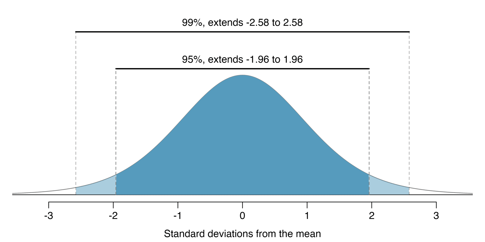
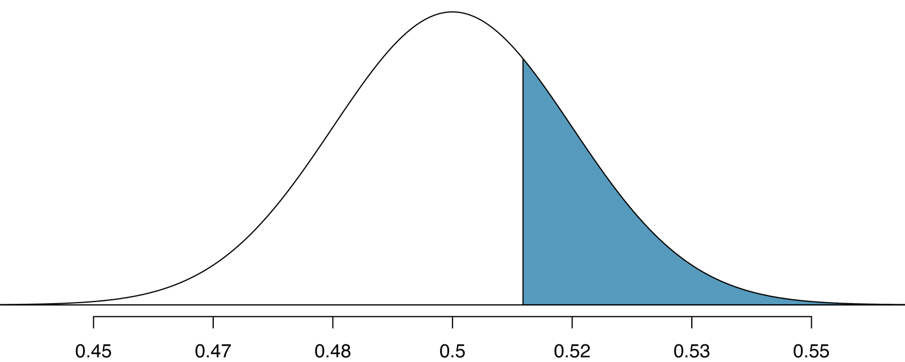



```{r}
#| label: setup
#| include: false
library(tidyverse)
library(infer)
knitr::opts_chunk$set(out.width = "90%")
```

## Student Information

```{r}
#| label: student-information-1
#| echo: false
learnr2::student_info()
```

## Introduction

This tutorial covers [Chapter 16: Inference for a single proportion](https://openintrostat.github.io/ims/inference-one-prop.html) from [*Introduction to Modern Statistics*](https://openintrostat.github.io/ims/) by Mine Çetinkaya-Rundel and Johanna Hardin. You will learn to test a claim about a single proportion by simulating under the null hypothesis, to check the success-failure condition, and to build normal-model confidence intervals and hypothesis tests that you compare against simulation, using a medical consultant's surgery record and two polls of payday loan borrowers.

### Exercise 1

You should be doing this tutorial in a repo named `inference-for-a-single-proportion`. If you are not, create one and then connect to it.

Create a new file, `analysis.qmd`, with the title `"Inference for a Single Proportion"` and your name as the author. In a bash Terminal, render it:

```bash
quarto render analysis.qmd
```

Open `analysis.html` with Live Server (right-click it in the Explorer → **Open with Live Server**) and keep the tab open. It refreshes on every render. Going forward, we will just tell you to "Render" when we want you to take these steps.

Create a `.gitignore` with `analysis_files` followed by a blank line. Commit and push. Use AI however you like.

If `show_file()` fails, it is probably because you have not yet loaded `library(learnr2)` in the R Terminal.

```{r}
#| label: introduction-1
#| echo: false
learnr2::question('In the R Terminal, run show_file(".gitignore"). CP/CR.', type = "reflection")
```

###

```{.output}
analysis_files
```

###

There is only one variable being measured in a study which focuses on one proportion. Every dataset in this tutorial has a single yes-or-no variable, with one row per person.

### Exercise 2

Add a chunk to `analysis.qmd` that loads the **[tidyverse](https://www.tidyverse.org/)**, with `#| message: false` so the startup messages stay out of the rendered page. Add `execute: echo: false` to the YAML header. Render.

```{r}
#| label: introduction-2
#| echo: false
learnr2::question('In the R Terminal, run show_file("analysis.qmd"). CP/CR.', type = "reflection")
```

###

````{verbatim}
#| message: false
library(tidyverse)
````

###

The **tidyverse** includes **[readr](https://readr.tidyverse.org/)**, which reads the CSV files you are about to download, and **[ggplot2](https://ggplot2.tidyverse.org/)**, which drew the chapter's null distribution.

### Exercise 3

Add **[infer](https://infer.tidymodels.org/)** to that chunk. Render.

```{r}
#| label: introduction-3
#| echo: false
learnr2::question('In the R Terminal, run show_file("analysis.qmd"). CP/CR.', type = "reflection")
```

###

````{verbatim}
#| message: false
library(tidyverse)
library(infer)
````

###

Simulations are typically programmed into a computer, which is much more efficient than simulating by hand. **infer** is the package OpenIntro's labs use for them, with the same four steps for every test: specify the variable, state the null hypothesis, generate simulated data, and calculate a statistic.

### Exercise 4

The chapter gives its data only as counts, so you will download files we built from those counts. Create a `data` directory at the top level of the `inference-for-a-single-proportion` repo.

```{r}
#| label: introduction-4
#| echo: false
learnr2::question("In the bash Terminal, run ls. CP/CR.", type = "reflection")
```

###

```{.output}
analysis.html  analysis.qmd  analysis_files  data
```

###

The book reports each of the chapter's studies only as a count, such as 3 complications in 62 surgeries. A count is enough for a single proportion, but most data arrives as one row per case.

### Exercise 5

Download the file at

```default
https://raw.githubusercontent.com/PPBDS/ims.tutorials/main/inst/extdata/medical_consultant.csv
```

into your `data` directory, keeping the name `medical_consultant.csv`.

```{r}
#| label: introduction-5
#| echo: false
learnr2::question("In the bash Terminal, run ls data. CP/CR.", type = "reflection")
```

###

```{.output}
medical_consultant.csv
```

###

One consultant tried to attract patients by noting the average complication rate for liver donor surgeries in the US is about 10%, but her clients have only had 3 complications in the 62 liver donor surgeries she has facilitated. The file rebuilds those counts as 62 rows, one for each surgery.

### Exercise 6

Download the two files at

```default
https://raw.githubusercontent.com/PPBDS/ims.tutorials/main/inst/extdata/payday_regulation.csv
https://raw.githubusercontent.com/PPBDS/ims.tutorials/main/inst/extdata/payday_credit_check.csv
```

into your `data` directory, keeping their names.

```{r}
#| label: introduction-6
#| echo: false
learnr2::question("In the bash Terminal, run ls data. CP/CR.", type = "reflection")
```

###

```{.output}
medical_consultant.csv  payday_credit_check.csv  payday_regulation.csv
```

###

A simple random sample of 826 payday loan borrowers was surveyed to better understand their interests around regulation and costs. Each payday file has one row for each of those 826 borrowers, with their answer to one question about regulation.

## Bootstrap test for a proportion

Because the nature of the research question at hand focuses on only a single variable, there is not a way to randomize the variable across a different (explanatory) variable. So this section tests the medical consultant's claim by simulating studies in a world where her complication rate is the US rate of 10%.

### Exercise 1

```{r}
#| label: bootstrap-test-for-a-proportion-1
#| echo: false
learnr2::question("In the bash Terminal, run head data/medical_consultant.csv. CP/CR.", type = "reflection")
```

###

```{.output}
client,complication
1,no
2,no
3,no
4,no
5,no
6,no
7,no
8,no
9,no
```

###

The consultant's claim is that there is a causal connection, but the data are observational. Patients who hire this medical consultant may have lower complication rates for other reasons.

### Exercise 2

Add a chunk that reads `data/medical_consultant.csv` and prints it. Render.

```{r}
#| label: bootstrap-test-for-a-proportion-2
#| echo: false
learnr2::question('In the R Terminal, run show_file("analysis.qmd"). CP/CR.', type = "reflection")
```

###

```{r}
#| label: bootstrap-test-for-a-proportion-2-test
#| echo: true
read_csv("data/medical_consultant.csv", show_col_types = FALSE)
```

###

Each of the 62 rows is one liver donor surgery the consultant facilitated. While it is not possible to assess this causal claim, it is still possible to test for an association using these data.

### Exercise 3

Replace the code in that chunk so that it counts the surgeries by `complication`. Render.

```{r}
#| label: bootstrap-test-for-a-proportion-3
#| echo: false
learnr2::question('In the R Terminal, run show_file("analysis.qmd"). CP/CR.', type = "reflection")
```

###

```{r}
#| label: bootstrap-test-for-a-proportion-3-test
#| echo: true
read_csv("data/medical_consultant.csv", show_col_types = FALSE) |>
  count(complication)
```

###

For each observational unit, the single variable is measured as either a success or failure. Here a complication counts as the success, a label for the outcome we are counting, not a good outcome.

### Exercise 4

Replace the code in that chunk so that it calculates the proportion of surgeries with a complication. Render.

```{r}
#| label: bootstrap-test-for-a-proportion-4
#| echo: false
learnr2::question('In the R Terminal, run show_file("analysis.qmd"). CP/CR.', type = "reflection")
```

###

```{r}
#| label: bootstrap-test-for-a-proportion-4-test
#| echo: true
read_csv("data/medical_consultant.csv", show_col_types = FALSE) |>
  summarize(p_hat = mean(complication == "yes"))
```

###

The sample proportion, 3/62 = 0.0484, is half the US rate. The null hypothesis is that there is no association between the consultant's contributions and the clients' complication rate.

### Exercise 5

Replace the code in that chunk so that it simulates one study under the null hypothesis: 62 clients, each with a 10% chance of a complication. Calculate the proportion of simulated clients with a complication. Set a seed first, so that every render gives the same simulation. Render.

```{r}
#| label: bootstrap-test-for-a-proportion-5
#| echo: false
learnr2::question('In the R Terminal, run show_file("analysis.qmd"). CP/CR.', type = "reflection")
```

###

```{r}
#| label: bootstrap-test-for-a-proportion-5-test
#| echo: true
set.seed(16)
read_csv("data/medical_consultant.csv", show_col_types = FALSE) |>
  specify(response = complication, success = "yes") |>
  hypothesize(null = "point", p = 0.10) |>
  generate(reps = 1, type = "draw") |>
  calculate(stat = "prop")
```

###

Sampling a marble from the bag (with 10% red marbles) is one way of simulating whether a patient has a complication *if the true complication rate is 10%*. Our simulated study had 6 complications (0.0968), and the chapter's had 5 (0.081).

### Exercise 6

Replace the code in that chunk so that it creates `null_dist`, the proportions with a complication from 10,000 simulated studies under the same null hypothesis, with a seed set first. Print `null_dist`. Render.

```{r}
#| label: bootstrap-test-for-a-proportion-6
#| echo: false
learnr2::question('In the R Terminal, run show_file("analysis.qmd"). CP/CR.', type = "reflection")
```

###

```{r}
#| label: bootstrap-test-for-a-proportion-6-test
#| echo: true
set.seed(16)
null_dist <- read_csv("data/medical_consultant.csv", show_col_types = FALSE) |>
  specify(response = complication, success = "yes") |>
  hypothesize(null = "point", p = 0.10) |>
  generate(reps = 10000, type = "draw") |>
  calculate(stat = "prop")

null_dist
```

###

Each row is one simulated study of 62 clients in a world where the true rate is 10%. Simulating observations using a hypothesized null parameter value is often called a *parametric bootstrap simulation*.

### Exercise 7

Replace the line that prints `null_dist` with a count of how many simulated studies produced each value of the proportion. Render.

```{r}
#| label: bootstrap-test-for-a-proportion-7
#| echo: false
learnr2::question('In the R Terminal, run show_file("analysis.qmd"). CP/CR.', type = "reflection")
```

###

```{r}
#| label: bootstrap-test-for-a-proportion-7-test
#| echo: true
null_dist |>
  count(stat)
```

###

The 10,000 studies produced only 18 different proportions, because a study of 62 clients can only have a whole number of complications. Together they form the null distribution, which is the distribution of the test statistic if the null hypothesis is true.

### Exercise 8

Start a new chunk that uses `null_dist` to calculate how many of the simulated proportions are at or below the observed 3/62, and what proportion of the 10,000 that is. Render.

```{r}
#| label: bootstrap-test-for-a-proportion-8
#| echo: false
learnr2::question('In the R Terminal, run show_file("analysis.qmd"). CP/CR.', type = "reflection")
```

###

```{r}
#| label: bootstrap-test-for-a-proportion-8-test
#| echo: true
null_dist |>
  summarize(at_or_below = sum(stat <= 3 / 62),
            proportion = mean(stat <= 3 / 62))
```

###

Supposing the null hypothesis is true, we can compute the p-value by identifying the probability of observing a test statistic that favors the alternative hypothesis at least as strongly as the observed test statistic. In our simulation, 1,247 of 10,000 studies had 3 or fewer complications, and in the chapter's, 1,170 did.

### Exercise 9

Replace the code in that chunk so that it calculates the same p-value with **infer**'s own tool for the job. The alternative hypothesis is that the consultant's rate is less than 10%. Render.

```{r}
#| label: bootstrap-test-for-a-proportion-9
#| echo: false
learnr2::question('In the R Terminal, run show_file("analysis.qmd"). CP/CR.', type = "reflection")
```

###

```{r}
#| label: bootstrap-test-for-a-proportion-9-test
#| echo: true
null_dist |>
  get_p_value(obs_stat = 3 / 62, direction = "less")
```

###

Our p-value is 0.125 and the chapter's is 0.117. Neither is exact because the simulated null distribution itself is only a close approximation of the sampling distribution of the sample statistic.

### Exercise 10

Replace the code in that chunk with a histogram of `null_dist`, with one bar for each possible proportion and a dashed line at the observed 3/62. Render.

```{r}
#| label: bootstrap-test-for-a-proportion-10
#| echo: false
learnr2::question('In the R Terminal, run show_file("analysis.qmd"). CP/CR.', type = "reflection")
```

###

```{r}
#| label: bootstrap-test-for-a-proportion-10-test
#| echo: true
null_dist |>
  ggplot(aes(x = stat)) +
  geom_histogram(binwidth = 1 / 62, center = 0) +
  geom_vline(xintercept = 3 / 62, linetype = "dashed")
```

###

The distribution is lopsided: it stops at zero on the left but stretches to 0.274 on the right. The observed 3/62 sits in the left shoulder, not out in the tail.

### Exercise 11

Improve the plot. Shade the bars at or below the observed proportion in a different color, show the x-axis as percentages, and add a title, axis labels, a subtitle that states the main finding, and a caption giving the number of surgeries, the number of simulations, and the source. Render.

```{r}
#| label: bootstrap-test-for-a-proportion-11
#| echo: false
learnr2::question('In the R Terminal, run show_file("analysis.qmd"). CP/CR.', type = "reflection")
```

###

```{r}
#| label: bootstrap-test-for-a-proportion-11-test
#| echo: true
null_dist |>
  ggplot(aes(x = stat, fill = stat <= 3 / 62)) +
  geom_histogram(binwidth = 1 / 62, center = 0) +
  geom_vline(xintercept = 3 / 62, linetype = "dashed") +
  scale_fill_manual(values = c("gray70", "steelblue"), guide = "none") +
  scale_x_continuous(labels = scales::label_percent()) +
  labs(title = "Complication Rates If the Consultant Matched the US Rate of 10%",
       subtitle = "12.5% of simulated studies had 3 or fewer complications, so her record could easily be chance",
       x = "Simulated Complication Rate",
       y = "Number of Simulated Studies",
       caption = "62 surgeries, 3 with complications; 10,000 simulated studies\nIntroduction to Modern Statistics, Chapter 16")
```

###

There is not enough evidence to reject the null hypothesis in favor of the alternative hypothesis. There is no evidence to make a claim in either direction, so we cannot make any claims about whether the consultant is good at their job.

### Exercise 12

Commit `analysis.qmd` and the `data` directory with the message `"Simulate the consultant's null distribution"` and push.

```{r}
#| label: bootstrap-test-for-a-proportion-12
#| echo: false
learnr2::question("In the bash Terminal, run git log --oneline -3. CP/CR.", type = "reflection")
```

###

```{.output}
4d81a7e (HEAD -> main, origin/main) Simulate the consultant's null distribution
9be04d2 Initial commit
```

###

The bootstrap simulation for hypothesis testing has a fantastic advantage that it can be used for any sample size (a huge benefit for small samples, a nice alternative for large samples). Sixty-two surgeries with only a handful of complications is the small-sample case.

## Mathematical model for a proportion

When the observations are independent and the sample size is sufficiently large, the normal model will describe the sampling distribution of the sample proportion quite well, and when the observations violate the conditions, the normal model can be inaccurate. This section checks those conditions, then builds a confidence interval and a hypothesis test from the normal model, each checked against a simulation.

### Exercise 1

Start a new chunk that reads `data/medical_consultant.csv` and calculates the number of surgeries, along with the number of complications and of surgeries without one that we would expect if the null rate of 10% were true. Render.

```{r}
#| label: mathematical-model-for-a-proportion-1
#| echo: false
learnr2::question('In the R Terminal, run show_file("analysis.qmd"). CP/CR.', type = "reflection")
```

###

```{r}
#| label: mathematical-model-for-a-proportion-1-test
#| echo: true
read_csv("data/medical_consultant.csv", show_col_types = FALSE) |>
  summarize(n = n()) |>
  mutate(expected_yes = n * 0.10,
         expected_no = n * (1 - 0.10))
```

###

The *success-failure condition* says we should expect to see at least 10 successes and 10 failures in the sample. With only 6.2 expected complications, the consultant's data fail it, so the normal model should not be used for them.

### Exercise 2

Add the p-value the normal model would give anyway: the standard error of the proportion using the null value of 10%, the Z score of the observed proportion, and the area of the standard normal curve below that Z score. Render.

```{r}
#| label: mathematical-model-for-a-proportion-2
#| echo: false
learnr2::question('In the R Terminal, run show_file("analysis.qmd"). CP/CR.', type = "reflection")
```

###

```{r}
#| label: mathematical-model-for-a-proportion-2-test
#| echo: true
read_csv("data/medical_consultant.csv", show_col_types = FALSE) |>
  summarize(n = n(),
            p_hat = mean(complication == "yes")) |>
  mutate(se = sqrt(0.10 * (1 - 0.10) / n),
         z = (p_hat - 0.10) / se,
         p_value = pnorm(z))
```

###

The normal model's p-value, 0.088, is well below the 0.125 from simulation, making the consultant's record look more unusual than it is. When the conditions fail, the normal model can underestimate the variability of the sample proportion.

### Exercise 3

```{r}
#| label: mathematical-model-for-a-proportion-3
#| echo: false
learnr2::question("In the bash Terminal, run head data/payday_regulation.csv. CP/CR.", type = "reflection")
```

###

```{.output}
borrower,support
1,yes
2,yes
3,yes
4,yes
5,yes
6,yes
7,yes
8,yes
9,yes
```

###

The chapter says only that 70% of the 826 responses supported new regulations on payday lenders. The data are a random sample, so it is reasonable to assume that the observations are independent and representative of the population of interest.

### Exercise 4

Replace the code in that chunk so that it reads `data/payday_regulation.csv` and counts the borrowers by `support`. Render.

```{r}
#| label: mathematical-model-for-a-proportion-4
#| echo: false
learnr2::question('In the R Terminal, run show_file("analysis.qmd"). CP/CR.', type = "reflection")
```

###

```{r}
#| label: mathematical-model-for-a-proportion-4-test
#| echo: true
read_csv("data/payday_regulation.csv", show_col_types = FALSE) |>
  count(support)
```

###

The independence condition is a more nuanced requirement. For example, there exist no statistical methods available to truly correct the inherent biases of data from a convenience sample.

### Exercise 5

The chapter reports that 70% of the borrowers supported regulation. Replace the code in that chunk so that it calculates the number of borrowers, the number who support regulation, and 70% of the number of borrowers. Render.

```{r}
#| label: mathematical-model-for-a-proportion-5
#| echo: false
learnr2::question('In the R Terminal, run show_file("analysis.qmd"). CP/CR.', type = "reflection")
```

###

```{r}
#| label: mathematical-model-for-a-proportion-5-test
#| echo: true
read_csv("data/payday_regulation.csv", show_col_types = FALSE) |>
  summarize(n = n(),
            supporters = sum(support == "yes")) |>
  mutate(seventy_percent = 0.70 * n)
```

###

Seventy percent of 826 is 578.2, so the published 70% was rounded from 578 supporters, a proportion of 0.6998. The chapter also uses 578 to check its conditions.

### Exercise 6

Replace the code in that chunk so that it calculates the number of borrowers, the proportion who support regulation, and the number of supporters and of non-supporters we would expect if the true proportion were the sample proportion. Render.

```{r}
#| label: mathematical-model-for-a-proportion-6
#| echo: false
learnr2::question('In the R Terminal, run show_file("analysis.qmd"). CP/CR.', type = "reflection")
```

###

```{r}
#| label: mathematical-model-for-a-proportion-6-test
#| echo: true
read_csv("data/payday_regulation.csv", show_col_types = FALSE) |>
  summarize(n = n(),
            p_hat = mean(support == "yes")) |>
  mutate(expected_yes = n * p_hat,
         expected_no = n * (1 - p_hat))
```

###

For confidence intervals, the sample proportion is used to check the success-failure condition, giving 578 and 248. Since both values are at least 10, we can use the normal distribution to model the sample proportion.

### Exercise 7

Before using the formula, simulate. Replace the code in that chunk with a 95% bootstrap percentile confidence interval for the proportion of borrowers who support regulation, from 10,000 bootstrap samples, with a seed set first. Render.

```{r}
#| label: mathematical-model-for-a-proportion-7
#| echo: false
learnr2::question('In the R Terminal, run show_file("analysis.qmd"). CP/CR.', type = "reflection")
```

###

```{r}
#| label: mathematical-model-for-a-proportion-7-test
#| echo: true
set.seed(16)
read_csv("data/payday_regulation.csv", show_col_types = FALSE) |>
  specify(response = support, success = "yes") |>
  generate(reps = 10000, type = "bootstrap") |>
  calculate(stat = "prop") |>
  get_confidence_interval(level = 0.95, type = "percentile")
```

###

Our bootstrap interval runs from 0.667 to 0.731. A confidence interval provides a range of plausible values for the parameter, here the proportion of all payday borrowers who support regulation.

### Exercise 8

Replace the code in that chunk so that it calculates the number of borrowers, the proportion who support regulation, and the standard error of that proportion from the formula, using the sample proportion. Render.

```{r}
#| label: mathematical-model-for-a-proportion-8
#| echo: false
learnr2::question('In the R Terminal, run show_file("analysis.qmd"). CP/CR.', type = "reflection")
```

###

```{r}
#| label: mathematical-model-for-a-proportion-8-test
#| echo: true
read_csv("data/payday_regulation.csv", show_col_types = FALSE) |>
  summarize(n = n(),
            p_hat = mean(support == "yes")) |>
  mutate(se = sqrt(p_hat * (1 - p_hat) / n))
```

###

The formula gives 0.0159, the chapter's 0.016, and the standard deviation of our 10,000 bootstrap proportions was 0.0161. The value of the standard error depends heavily on the sample size.

### Exercise 9

Add the lower and upper ends of a 95% confidence interval: the sample proportion plus and minus 1.96 standard errors. Render.

```{r}
#| label: mathematical-model-for-a-proportion-9
#| echo: false
learnr2::question('In the R Terminal, run show_file("analysis.qmd"). CP/CR.', type = "reflection")
```

###

```{r}
#| label: mathematical-model-for-a-proportion-9-test
#| echo: true
read_csv("data/payday_regulation.csv", show_col_types = FALSE) |>
  summarize(n = n(),
            p_hat = mean(support == "yes")) |>
  mutate(se = sqrt(p_hat * (1 - p_hat) / n),
         lower = p_hat - 1.96 * se,
         upper = p_hat + 1.96 * se)
```

###

The formula's interval, 0.668 to 0.731, matches the bootstrap's 0.667 to 0.731. We are 95% confident that the true proportion of payday borrowers who supported regulation at the time of the poll was between 0.668 and 0.731.

### Exercise 10

Replace the code in that chunk with a table of three confidence intervals, at the 90%, 95%, and 99% levels. For each level, show the z-star value from the normal distribution, the margin of error, and the lower and upper ends. Render.

```{r}
#| label: mathematical-model-for-a-proportion-10
#| echo: false
learnr2::question('In the R Terminal, run show_file("analysis.qmd"). CP/CR.', type = "reflection")
```

###

```{r}
#| label: mathematical-model-for-a-proportion-10-test
#| echo: true
read_csv("data/payday_regulation.csv", show_col_types = FALSE) |>
  summarize(n = n(),
            p_hat = mean(support == "yes")) |>
  mutate(se = sqrt(p_hat * (1 - p_hat) / n)) |>
  cross_join(tibble(level = c(0.90, 0.95, 0.99))) |>
  mutate(z_star = qnorm(1 - (1 - level) / 2),
         margin = z_star * se,
         lower = p_hat - margin,
         upper = p_hat + margin) |>
  select(level, z_star, margin, lower, upper)
```

###

The margin of error grows from 0.026 at 90% to 0.041 at 99%, as z-star grows from 1.64 to 2.58. We select z-star so that the area between -z-star and z-star in the normal model corresponds to the confidence level.

{fig-alt="A normal curve with 99% of the area between negative z star and positive z star. The area between negative z star and positive z star increases as z star becomes larger. If the confidence level is 99 percent, we choose z star such that 99 percent of the normal curve is between negative z star and positive z star, which corresponds to 0.5 percent in the lower tail and 0.5 percent in the upper tail. The z star value is 2.58."}

### Exercise 11

```{r}
#| label: mathematical-model-for-a-proportion-11
#| echo: false
learnr2::question("In the bash Terminal, run head data/payday_credit_check.csv. CP/CR.", type = "reflection")
```

###

```{.output}
borrower,support
1,yes
2,yes
3,yes
4,yes
5,yes
6,yes
7,yes
8,yes
9,yes
```

###

One possible regulation for payday lenders is that they would be required to do a credit check and evaluate debt payments against the borrower's finances. The chapter reports that 51% of 826 borrowers supported it, and 51% of 826 is 421.26, so the file has 421 supporters.

### Exercise 12

Replace the code in that chunk so that it reads `data/payday_credit_check.csv` and calculates the number of borrowers, the proportion who support the credit-check regulation, and the number of supporters and of non-supporters we would expect if the null value of 50% were true. Render.

```{r}
#| label: mathematical-model-for-a-proportion-12
#| echo: false
learnr2::question('In the R Terminal, run show_file("analysis.qmd"). CP/CR.', type = "reflection")
```

###

```{r}
#| label: mathematical-model-for-a-proportion-12-test
#| echo: true
read_csv("data/payday_credit_check.csv", show_col_types = FALSE) |>
  summarize(n = n(),
            p_hat = mean(support == "yes")) |>
  mutate(expected_yes = n * 0.5,
         expected_no = n * (1 - 0.5))
```

###

The question is whether a majority supports the regulation, so the null value is 50%, and the alternative is that more than 50% do. In a hypothesis test, the success-failure condition is checked using the null proportion, and 413 expected supporters and 413 expected non-supporters pass easily.

### Exercise 13

Simulate first. Replace the code in that chunk with the p-value from 10,000 studies simulated under the null hypothesis that 50% of borrowers support the regulation, with a seed set first. The alternative is that more than 50% do. Render.

```{r}
#| label: mathematical-model-for-a-proportion-13
#| echo: false
learnr2::question('In the R Terminal, run show_file("analysis.qmd"). CP/CR.', type = "reflection")
```

###

```{r}
#| label: mathematical-model-for-a-proportion-13-test
#| echo: true
set.seed(16)
read_csv("data/payday_credit_check.csv", show_col_types = FALSE) |>
  specify(response = support, success = "yes") |>
  hypothesize(null = "point", p = 0.5) |>
  generate(reps = 10000, type = "draw") |>
  calculate(stat = "prop") |>
  get_p_value(obs_stat = 421 / 826, direction = "greater")
```

###

In our simulation, 29.8% of polls from an evenly split population showed at least 421 supporters out of 826. The general ideas of confidence intervals and hypothesis tests remain the same, but the strategy or technique used to generate the interval or p-value change.

### Exercise 14

Now the formula. Replace the code in that chunk so that it calculates the number of borrowers, the sample proportion, the standard error using the null value of 50%, the Z score of the sample proportion, and the area of the standard normal curve above that Z score. Render.

```{r}
#| label: mathematical-model-for-a-proportion-14
#| echo: false
learnr2::question('In the R Terminal, run show_file("analysis.qmd"). CP/CR.', type = "reflection")
```

###

```{r}
#| label: mathematical-model-for-a-proportion-14-test
#| echo: true
read_csv("data/payday_credit_check.csv", show_col_types = FALSE) |>
  summarize(n = n(),
            p_hat = mean(support == "yes")) |>
  mutate(se = sqrt(0.5 * (1 - 0.5) / n),
         z = (p_hat - 0.5) / se,
         p_value = pnorm(z, lower.tail = FALSE))
```

###

When the null hypothesis is true and the conditions are met, Z has a standard normal distribution. Our Z of 0.557 gives a p-value of 0.289, the shaded tail below, close to the simulation's 0.298 and the chapter's 0.2776.

{fig-alt="A normal curve centered at 0.5 with a standard deviation of 0.017. The area to the right of 0.51 is shaded."}

### Exercise 15

Replace the code in that chunk with a histogram of the 10,000 simulated proportions from Exercise 13, on a density scale, with the normal curve that the null hypothesis implies drawn over it and a dashed line at the observed proportion. Render.

```{r}
#| label: mathematical-model-for-a-proportion-15
#| echo: false
learnr2::question('In the R Terminal, run show_file("analysis.qmd"). CP/CR.', type = "reflection")
```

###

```{r}
#| label: mathematical-model-for-a-proportion-15-test
#| echo: true
set.seed(16)
read_csv("data/payday_credit_check.csv", show_col_types = FALSE) |>
  specify(response = support, success = "yes") |>
  hypothesize(null = "point", p = 0.5) |>
  generate(reps = 10000, type = "draw") |>
  calculate(stat = "prop") |>
  ggplot(aes(x = stat)) +
  geom_histogram(aes(y = after_stat(density)), binwidth = 5 / 826, center = 0.5) +
  geom_function(fun = dnorm, args = list(mean = 0.5, sd = sqrt(0.5 * 0.5 / 826))) +
  geom_vline(xintercept = 421 / 826, linetype = "dashed")
```

###

The normal curve traces the simulated histogram almost exactly, unlike the consultant's lopsided null distribution. The success-failure condition separates the two cases: 413 expected successes and failures here, against 6.2 expected complications for the consultant.

### Exercise 16

Improve the plot. Shade the bars at or above the observed proportion in a different color, show the x-axis as percentages, and add a title, axis labels, a subtitle that states the main finding, and a caption giving the number of borrowers, the number of simulations, and the source. Render.

```{r}
#| label: mathematical-model-for-a-proportion-16
#| echo: false
learnr2::question('In the R Terminal, run show_file("analysis.qmd"). CP/CR.', type = "reflection")
```

###

```{r}
#| label: mathematical-model-for-a-proportion-16-test
#| echo: true
set.seed(16)
read_csv("data/payday_credit_check.csv", show_col_types = FALSE) |>
  specify(response = support, success = "yes") |>
  hypothesize(null = "point", p = 0.5) |>
  generate(reps = 10000, type = "draw") |>
  calculate(stat = "prop") |>
  ggplot(aes(x = stat)) +
  geom_histogram(aes(y = after_stat(count / sum(count) / width),
                     fill = stat >= 421 / 826),
                 binwidth = 5 / 826, center = 0.5) +
  geom_function(fun = dnorm, args = list(mean = 0.5, sd = sqrt(0.5 * 0.5 / 826)),
                linewidth = 1) +
  geom_vline(xintercept = 421 / 826, linetype = "dashed") +
  scale_fill_manual(values = c("gray70", "steelblue"), guide = "none") +
  scale_x_continuous(labels = scales::label_percent()) +
  labs(title = "Support for a Credit-Check Rule If Borrowers Were Evenly Split",
       subtitle = "Simulation and normal model agree on a p-value near 0.3: no clear majority support",
       x = "Simulated Proportion Supporting the Regulation",
       y = "Density",
       caption = "826 borrowers, 421 in support; 10,000 simulated polls\nIntroduction to Modern Statistics, Chapter 16")
```

###

The poll does not provide convincing evidence that a majority of payday loan borrowers support regulations around credit checks and evaluation of debt payments. We cannot claim that exactly 50% of people support the regulation, but we cannot claim a majority in either direction.

### Exercise 17

Commit `analysis.qmd` with the message `"Test payday loan support with the normal model"` and push.

```{r}
#| label: mathematical-model-for-a-proportion-17
#| echo: false
learnr2::question("In the bash Terminal, run git log --oneline -3. CP/CR.", type = "reflection")
```

###

```{.output}
b6f30c2 (HEAD -> main, origin/main) Test payday loan support with the normal model
4d81a7e Simulate the consultant's null distribution
9be04d2 Initial commit
```

###

The consultant's 62 surgeries failed the success-failure condition and the normal model understated her p-value, while the polls of 826 borrowers passed and the formula matched the simulation.

## Summary

This tutorial covered [Chapter 16: Inference for a single proportion](https://openintrostat.github.io/ims/inference-one-prop.html) from [*Introduction to Modern Statistics*](https://openintrostat.github.io/ims/) by Mine Çetinkaya-Rundel and Johanna Hardin. You have learned to test a claim about a single proportion by simulating under the null hypothesis, to check the success-failure condition, and to build normal-model confidence intervals and hypothesis tests that you compared against simulation, using a medical consultant's surgery record and two polls of payday loan borrowers.

Building on the foundational ideas from the previous few tutorials, this tutorial focused exclusively on the single population proportion as the parameter of interest. Note that it is not possible to do a randomization test with only one variable, so to do computational hypothesis testing, we applied a bootstrapping framework. The bootstrap confidence interval and the mathematical framework for both hypothesis testing and confidence intervals are similar to those applied to other data structures and parameters. When using the mathematical model, keep in mind the success-failure conditions. Additionally, know that bootstrapping is always more accurate with larger samples.

For more on simulation-based inference in R, read **infer**'s "[Full infer Pipeline Examples](https://infer.tidymodels.org/articles/observed_stat_examples.html)," which runs the same specify, hypothesize, generate, and calculate steps for every test in the book. For the consultant's bootstrap confidence interval, which this chapter builds on, read the [medical consultant case study](https://openintrostat.github.io/ims/foundations-bootstrapping.html) in Chapter 12.

Many sentences in this tutorial, and its figures, come from the chapter, used under the book's [CC BY-SA 3.0 license](https://creativecommons.org/licenses/by-sa/3.0/).

### Exercise 1

Render one last time.

```{r}
#| label: summary-1
#| echo: false
learnr2::question('In the R Terminal, run show_file("analysis.qmd", start = 0). CP/CR.', type = "reflection")
```

###

````{verbatim}
---
title: "Inference for a Single Proportion"
author: "Your Name"
format: html
execute:
  echo: false
---

```{r}
#| message: false
library(tidyverse)
library(infer)
```

```{r}
set.seed(16)
null_dist <- read_csv("data/medical_consultant.csv", show_col_types = FALSE) |>
  specify(response = complication, success = "yes") |>
  hypothesize(null = "point", p = 0.10) |>
  generate(reps = 10000, type = "draw") |>
  calculate(stat = "prop")

null_dist |>
  count(stat)
```

```{r}
null_dist |>
  ggplot(aes(x = stat, fill = stat <= 3 / 62)) +
  geom_histogram(binwidth = 1 / 62, center = 0) +
  geom_vline(xintercept = 3 / 62, linetype = "dashed") +
  scale_fill_manual(values = c("gray70", "steelblue"), guide = "none") +
  scale_x_continuous(labels = scales::label_percent()) +
  labs(title = "Complication Rates If the Consultant Matched the US Rate of 10%",
       subtitle = "12.5% of simulated studies had 3 or fewer complications, so her record could easily be chance",
       x = "Simulated Complication Rate",
       y = "Number of Simulated Studies",
       caption = "62 surgeries, 3 with complications; 10,000 simulated studies\nIntroduction to Modern Statistics, Chapter 16")
```

```{r}
set.seed(16)
read_csv("data/payday_credit_check.csv", show_col_types = FALSE) |>
  specify(response = support, success = "yes") |>
  hypothesize(null = "point", p = 0.5) |>
  generate(reps = 10000, type = "draw") |>
  calculate(stat = "prop") |>
  ggplot(aes(x = stat)) +
  geom_histogram(aes(y = after_stat(count / sum(count) / width),
                     fill = stat >= 421 / 826),
                 binwidth = 5 / 826, center = 0.5) +
  geom_function(fun = dnorm, args = list(mean = 0.5, sd = sqrt(0.5 * 0.5 / 826)),
                linewidth = 1) +
  geom_vline(xintercept = 421 / 826, linetype = "dashed") +
  scale_fill_manual(values = c("gray70", "steelblue"), guide = "none") +
  scale_x_continuous(labels = scales::label_percent()) +
  labs(title = "Support for a Credit-Check Rule If Borrowers Were Evenly Split",
       subtitle = "Simulation and normal model agree on a p-value near 0.3: no clear majority support",
       x = "Simulated Proportion Supporting the Regulation",
       y = "Density",
       caption = "826 borrowers, 421 in support; 10,000 simulated polls\nIntroduction to Modern Statistics, Chapter 16")
```
````

###

Your first plot shows a lopsided null distribution for 62 surgeries, and your second shows the normal curve matching one for 826 borrowers.

### Exercise 2

Publish your analysis to GitHub Pages. In a bash Terminal, run:

```bash
quarto publish gh-pages analysis.qmd
```

```{r}
#| label: summary-2
#| echo: false
learnr2::question("Paste the URL of your published page.", type = "reflection")
```

###

Your answer should look like `https://your-github-username.github.io/inference-for-a-single-proportion/`.

###

An exact p-value can be generated using the binomial distribution, but that method will not be covered in this text. Simulation gets close to that exact answer.

### Exercise 3

Commit and push any remaining changes.

```{r}
#| label: summary-3
#| echo: false
learnr2::question("Paste the URL of your GitHub repo.", type = "reflection")
```

###

Your answer should look like `https://github.com/your-github-username/inference-for-a-single-proportion`.

###

While this book is scoped to well-constrained statistical problems, do remember that this is just the first book in what is a large library of statistical methods that are suitable for a very wide range of data and contexts.

## Your Answers

```{r}
#| label: your-answers-1
#| echo: false
learnr2::question(
  "How many minutes, approximately, did it take you to complete this
  tutorial? For example, an hour and a half would be 90 minutes.",
  type = "reflection_editable",
  validate = "integer"
)
```

```{r}
#| label: your-answers-2
#| echo: false
learnr2::download_answers_button(filename_prefix = "inference-for-a-single-proportion")
```
