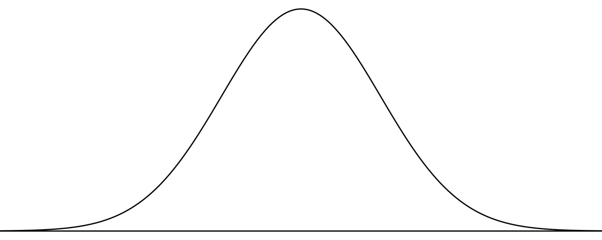
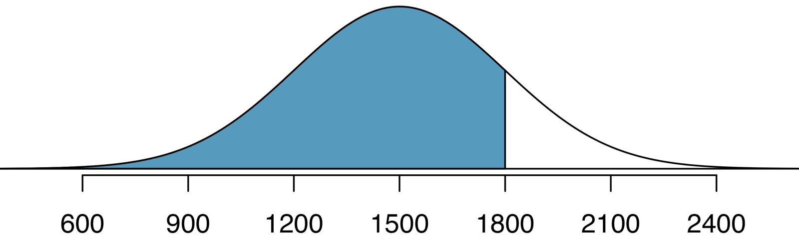
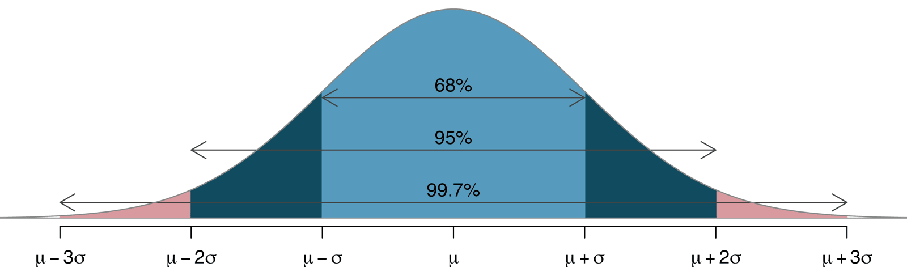
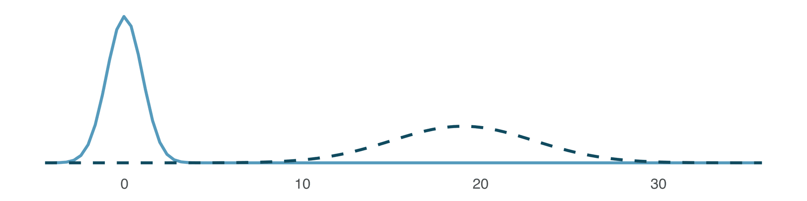
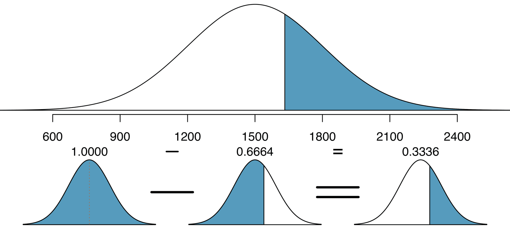
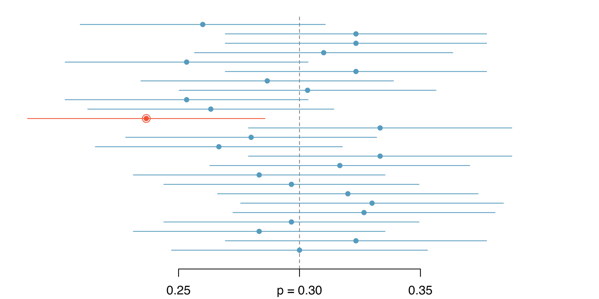



```{r}
#| label: setup
#| include: false
library(tidyverse)
library(openintro)
library(infer)
knitr::opts_chunk$set(out.width = "90%")
```

## Student Information

```{r}
#| label: student-information-1
#| echo: false
learnr2::student_info()
```

## Introduction

This tutorial covers [Chapter 13: Inference with mathematical models](https://openintrostat.github.io/ims/foundations-mathematical.html) from [*Introduction to Modern Statistics*](https://openintrostat.github.io/ims/) by Mine Çetinkaya-Rundel and Johanna Hardin. You will learn how the Central Limit Theorem lets a normal model stand in for a simulated distribution, how to measure a statistic's variability with its standard error, and how to use the normal model for hypothesis tests and confidence intervals, using an experiment on opportunity cost and a clinical trial of brain stents.

### Exercise 1

You should be doing this tutorial in a repo named `inference-with-mathematical-models`. If you are not, create one and then connect to it.

Create a new file, `analysis.qmd`, with the title `"Inference with Mathematical Models"` and your name as the author. In a bash Terminal, render it:

```bash
quarto render analysis.qmd
```

Open `analysis.html` with Live Server (right-click it in the Explorer → **Open with Live Server**) and keep the tab open. It refreshes on every render. Going forward, we will just tell you to "Render" when we want you to take these steps.

Create a `.gitignore` with `analysis_files` followed by a blank line. Commit and push. Use AI however you like.

If `show_file()` fails, it is probably because you have not yet loaded `library(learnr2)` in the R Terminal.

```{r}
#| label: introduction-1
#| echo: false
learnr2::question('In the R Terminal, run show_file(".gitignore"). CP/CR.', type = "reflection")
```

###

```{.output}
analysis_files
```

###

In many cases (indeed, with sample proportions), the variability of the statistic can be described by the computational method (as in previous chapters) or by a mathematical formula (as in this chapter). This tutorial does both: simulate first, then check against the formula.

### Exercise 2

Add a chunk to `analysis.qmd` that loads the **[tidyverse](https://www.tidyverse.org/)**, with `#| message: false` so the startup messages stay out of the rendered page. Add `execute: echo: false` to the YAML header. Render.

```{r}
#| label: introduction-2
#| echo: false
learnr2::question('In the R Terminal, run show_file("analysis.qmd"). CP/CR.', type = "reflection")
```

###

````{verbatim}
#| message: false
library(tidyverse)
````

###

The **tidyverse** draws every plot in this tutorial, and the normal probabilities come from base R. The `pnorm()` function is available in default R and will provide the percentile associated with any cutoff on a normal curve.

### Exercise 3

Add **[openintro](https://openintrostat.github.io/openintro/)** to that chunk. Render.

```{r}
#| label: introduction-3
#| echo: false
learnr2::question('In the R Terminal, run show_file("analysis.qmd"). CP/CR.', type = "reflection")
```

###

````{verbatim}
#| message: false
library(tidyverse)
library(openintro)
````

###

**openintro** holds both of the chapter's datasets, `opportunity_cost` and `stent30`. The `normTail()` function is available in the [**openintro**](http://openintrostat.github.io/openintro/) R package and will draw the associated normal distribution curve.

### Exercise 4

Add **[infer](https://infer.tidymodels.org/)** to that chunk. Render.

```{r}
#| label: introduction-4
#| echo: false
learnr2::question('In the R Terminal, run show_file("analysis.qmd"). CP/CR.', type = "reflection")
```

###

````{verbatim}
#| message: false
library(tidyverse)
library(openintro)
library(infer)
````

###

**infer** runs the simulations. With randomization tests, the data were permuted assuming the null hypothesis, and with bootstrapping, the data were resampled in order to measure the variability.

## Central Limit Theorem and the normal distribution

The bell-shaped curve similarity is not a coincidence, but rather, is guaranteed by mathematical theory. This section builds a null distribution by permutation, as in the Hypothesis Testing with Randomization tutorial, and checks its shape and spread against the normal model.

### Exercise 1

Add a chunk that prints `opportunity_cost`. Render.

```{r}
#| label: central-limit-theorem-and-the-normal-distribution-1
#| echo: false
learnr2::question('In the R Terminal, run show_file("analysis.qmd"). CP/CR.', type = "reflection")
```

###

```{r}
#| label: central-limit-theorem-and-the-normal-distribution-1-test
#| echo: true
opportunity_cost
```

###

Each of the 150 rows is one student, with the `group` the student was randomly assigned to and the `decision` the student made. The study found that students became thriftier when they were reminded that not spending money now means the money can be spent on other things in the future.

### Exercise 2

Replace the code in that chunk so that it counts the students by `group` and `decision`. Render.

```{r}
#| label: central-limit-theorem-and-the-normal-distribution-2
#| echo: false
learnr2::question('In the R Terminal, run show_file("analysis.qmd"). CP/CR.', type = "reflection")
```

###

```{r}
#| label: central-limit-theorem-and-the-normal-distribution-2-test
#| echo: true
opportunity_cost |>
  count(group, decision)
```

###

Each group has 75 students, and all four counts, from 19 to 56, are well above 10. The normal model needs, for proportions, at least 10 expected successes and 10 expected failures in the sample.

### Exercise 3

Replace the code in that chunk so that it calculates, for each `group`, the proportion of students who did not buy the video. Render.

```{r}
#| label: central-limit-theorem-and-the-normal-distribution-3
#| echo: false
learnr2::question('In the R Terminal, run show_file("analysis.qmd"). CP/CR.', type = "reflection")
```

###

```{r}
#| label: central-limit-theorem-and-the-normal-distribution-3-test
#| echo: true
opportunity_cost |>
  summarize(prop_not_buy = mean(decision == "not buy video"), .by = group)
```

###

25.3% of the control group and 45.3% of the treatment group did not buy the video, a difference of 0.20.

### Exercise 4

Replace the code in that chunk so that it calculates a single number: the proportion of the treatment group who *bought* the video minus the proportion of the control group who bought it. Render.

```{r}
#| label: central-limit-theorem-and-the-normal-distribution-4
#| echo: false
learnr2::question('In the R Terminal, run show_file("analysis.qmd"). CP/CR.', type = "reflection")
```

###

```{r}
#| label: central-limit-theorem-and-the-normal-distribution-4-test
#| echo: true
opportunity_cost |>
  specify(decision ~ group, success = "buy video") |>
  calculate(stat = "diff in props", order = c("treatment", "control"))
```

###

Counting buyers instead of non-buyers flips the sign, from 0.20 to -0.20. The chapter's differences are in the proportions of students who do not buy the video, so from here on, not buying counts as a success.

### Exercise 5

Replace the code in that chunk so that it sets a random seed, then creates `null_dist`: 10,000 differences in the proportion who did not buy the video, treatment minus control, each from a random permutation of the `group` labels under the null hypothesis that the reminder made no difference. Print `null_dist`. Render.

```{r}
#| label: central-limit-theorem-and-the-normal-distribution-5
#| echo: false
learnr2::question('In the R Terminal, run show_file("analysis.qmd"). CP/CR.', type = "reflection")
```

###

```{r}
#| label: central-limit-theorem-and-the-normal-distribution-5-test
#| echo: true
set.seed(13)
null_dist <- opportunity_cost |>
  specify(decision ~ group, success = "not buy video") |>
  hypothesize(null = "independence") |>
  generate(reps = 10000, type = "permute") |>
  calculate(stat = "diff in props", order = c("treatment", "control"))

null_dist
```

###

A *sampling distribution* is the distribution of all possible values of a *sample statistic* from samples of a given sample size from a given population. The *null distribution* is the sampling distribution of the statistic created under the setting where the null hypothesis is true.

### Exercise 6

Start a new chunk with a histogram of the simulated differences in `null_dist`. Make each bar 2/75 wide. Render.

```{r}
#| label: central-limit-theorem-and-the-normal-distribution-6
#| echo: false
learnr2::question('In the R Terminal, run show_file("analysis.qmd"). CP/CR.', type = "reflection")
```

###

```{r}
#| label: central-limit-theorem-and-the-normal-distribution-6-test
#| echo: true
null_dist |>
  ggplot(aes(x = stat)) +
  geom_histogram(binwidth = 2 / 75, boundary = 0)
```

###

The histogram is symmetric, bell-shaped, and centered at zero. If we look at a proportion (or difference in proportions) and the scenario satisfies certain conditions, then the sample proportion (or difference in proportions) will appear to follow a bell-shaped curve called the *normal distribution*.

{fig-alt="A normal curve centered at 0 with a standard deviation of one."}

### Exercise 7

Replace the code in that chunk so that it calculates the mean and the standard deviation of the simulated differences. Render.

```{r}
#| label: central-limit-theorem-and-the-normal-distribution-7
#| echo: false
learnr2::question('In the R Terminal, run show_file("analysis.qmd"). CP/CR.', type = "reflection")
```

###

```{r}
#| label: central-limit-theorem-and-the-normal-distribution-7-test
#| echo: true
null_dist |>
  summarize(mean = mean(stat), sd = sd(stat))
```

###

Point estimates vary from sample to sample, and we quantify this variability with what is called the *standard error (SE)*. The standard error is equal to the standard deviation associated with the statistic, here 0.078.

### Exercise 8

Now check the simulation against a formula. Replace the code in that chunk so that it calculates `p`, the proportion of all 150 students who did not buy the video, and then the standard error: the square root of p(1 − p)(1/75 + 1/75). Render.

```{r}
#| label: central-limit-theorem-and-the-normal-distribution-8
#| echo: false
learnr2::question('In the R Terminal, run show_file("analysis.qmd"). CP/CR.', type = "reflection")
```

###

```{r}
#| label: central-limit-theorem-and-the-normal-distribution-8-test
#| echo: true
opportunity_cost |>
  summarize(p = mean(decision == "not buy video")) |>
  mutate(se = sqrt(p * (1 - p) * (1 / 75 + 1 / 75)))
```

###

The formula gives 0.0781, matching the simulation's 0.0780. The chapter takes $SE = 0.078$ as a given, and typically it is determined using a formula based on the Central Limit Theorem.

### Exercise 9

The chapter practices normal probabilities on SAT scores, which follow a normal model with mean 1500 and standard deviation 300. Replace the code in that chunk with a small table of two SAT scores, Nel's 1800 and Edward's 1400, that calculates each score's Z score and its percentile under that normal model. Render.

```{r}
#| label: central-limit-theorem-and-the-normal-distribution-9
#| echo: false
learnr2::question('In the R Terminal, run show_file("analysis.qmd"). CP/CR.', type = "reflection")
```

###

```{r}
#| label: central-limit-theorem-and-the-normal-distribution-9-test
#| echo: true
tibble(score = c(1800, 1400)) |>
  mutate(z = (score - 1500) / 300,
         percentile = pnorm(z))
```

###

The *Z score* of an observation is defined as the number of standard deviations it falls above or below the mean. Nel's percentile, 0.841, is the shaded area below, and Edward's is 0.369, not the chapter's 0.3707, because the chapter rounds his Z score to -0.33.

{fig-alt="Nel's SAT score of 1800 is plotted on a normal curve with mean of 1500 and standard deviation of 300. The scores lower than Nel's are shaded in blue and represent roughly 84% of the distribution."}

### Exercise 10

Back to `null_dist`. Replace the code in that chunk so that it calculates the proportion of the simulated differences that fall within 1, 2, and 3 standard errors of zero, using the chapter's SE of 0.078. Render.

```{r}
#| label: central-limit-theorem-and-the-normal-distribution-10
#| echo: false
learnr2::question('In the R Terminal, run show_file("analysis.qmd"). CP/CR.', type = "reflection")
```

###

```{r}
#| label: central-limit-theorem-and-the-normal-distribution-10-test
#| echo: true
null_dist |>
  summarize(within_1 = mean(abs(stat) <= 0.078),
            within_2 = mean(abs(stat) <= 2 * 0.078),
            within_3 = mean(abs(stat) <= 3 * 0.078))
```

###

70.1% of the simulated differences fall within one SE of zero, 96.0% within two, and 99.8% within three. The simulation can only produce differences that are odd multiples of 1/75, so the first number differs from what a smooth curve gives.

### Exercise 11

Replace the code in that chunk so that it calculates the same three proportions from the normal model instead: the area under a standard normal curve between -1 and 1, between -2 and 2, and between -3 and 3. Render.

```{r}
#| label: central-limit-theorem-and-the-normal-distribution-11
#| echo: false
learnr2::question('In the R Terminal, run show_file("analysis.qmd"). CP/CR.', type = "reflection")
```

###

```{r}
#| label: central-limit-theorem-and-the-normal-distribution-11-test
#| echo: true
tibble(sds = 1:3) |>
  mutate(area = pnorm(sds) - pnorm(-sds))
```

###

The normal model gives 68.3%, 95.4%, and 99.7%, close to the simulation's 70.1%, 96.0%, and 99.8%. The *68-95-99.7 rule* is a useful general rule for the probability of falling within 1, 2, and 3 standard deviations of the mean in the normal distribution.

{fig-alt="A normal curve showing the area within one standard deviation of the mean (which is 0.68), the area within two standard deviations of the mean (which is 0.95), and the are within three standard deviations of the mean (which is 0.997)."}

### Exercise 12

Replace the code in that chunk with the histogram of `null_dist` from before, with bars 2/75 wide, but with density instead of counts on the y-axis. Lay over it a normal curve with mean 0 and standard deviation 0.078. Render.

```{r}
#| label: central-limit-theorem-and-the-normal-distribution-12
#| echo: false
learnr2::question('In the R Terminal, run show_file("analysis.qmd"). CP/CR.', type = "reflection")
```

###

```{r}
#| label: central-limit-theorem-and-the-normal-distribution-12-test
#| echo: true
null_dist |>
  ggplot(aes(x = stat)) +
  geom_histogram(aes(y = after_stat(density)), binwidth = 2 / 75, boundary = 0) +
  geom_function(fun = dnorm, args = list(mean = 0, sd = 0.078))
```

###

The curve and the bars agree almost everywhere. While the mean (center) and standard deviation (width or spread) may change for each plot, the general shape remains roughly intact.

{fig-alt="Two normal curves plotted on the same axis. One is a standard normal curve with a mean at zero and a standard deviation of one. The other has a mean of 19 with a standard deviation of four."}

### Exercise 13

Improve the plot. Give the bars a light fill with white outlines, make the curve thicker and colored, and add a title, axis labels, a subtitle that states the main finding, and a caption giving the number of simulations and students and the source. Render.

```{r}
#| label: central-limit-theorem-and-the-normal-distribution-13
#| echo: false
learnr2::question('In the R Terminal, run show_file("analysis.qmd"). CP/CR.', type = "reflection")
```

###

```{r}
#| label: central-limit-theorem-and-the-normal-distribution-13-test
#| echo: true
null_dist |>
  ggplot(aes(x = stat)) +
  geom_histogram(aes(y = after_stat(density)), binwidth = 2 / 75, boundary = 0,
                 fill = "gray75", color = "white") +
  geom_function(fun = dnorm, args = list(mean = 0, sd = 0.078),
                color = "steelblue", linewidth = 1.2) +
  labs(title = "Permuted Differences and the Normal Model",
       subtitle = "A normal curve with mean 0 and SE 0.078 matches the simulated null distribution",
       x = "Difference in Proportion Not Buying the Video (Treatment - Control)",
       y = "Density",
       caption = "10,000 permutations of 150 students; Frederick et al. (2009)")
```

###

Distributions of many variables are nearly normal, but none are exactly normal. Thus, the normal distribution, while not perfect for any single problem, is very useful for a variety of problems.

### Exercise 14

Commit `analysis.qmd` with the message `"Compare a null distribution to the normal model"` and push.

```{r}
#| label: central-limit-theorem-and-the-normal-distribution-14
#| echo: false
learnr2::question("In the bash Terminal, run git log --oneline -3. CP/CR.", type = "reflection")
```

###

```{.output}
8d41f2a (HEAD -> main, origin/main) Compare a null distribution to the normal model
3c07b9e Initial commit
```

###

Because the mean and standard deviation describe a normal distribution exactly, they are called the distribution's *parameters*. For a null distribution, the mean is the null value and the standard deviation is the standard error.

## The normal model for tests and intervals

The approach for using the normal model in the context of inference is very similar to the practice of applying the model to individual observations that are nearly normal. This section uses the normal model for a hypothesis test with the opportunity cost data and a confidence interval with the stent data, checking each against simulation.

### Exercise 1

Start a new chunk that calculates the observed difference in the proportion who did not buy the video, treatment minus control, and its Z score: the difference minus the null value of 0, divided by the SE of 0.078. Render.

```{r}
#| label: the-normal-model-for-tests-and-intervals-1
#| echo: false
learnr2::question('In the R Terminal, run show_file("analysis.qmd"). CP/CR.', type = "reflection")
```

###

```{r}
#| label: the-normal-model-for-tests-and-intervals-1-test
#| echo: true
opportunity_cost |>
  specify(decision ~ group, success = "not buy video") |>
  calculate(stat = "diff in props", order = c("treatment", "control")) |>
  mutate(z = (stat - 0) / 0.078)
```

###

The observed difference sits 2.56 standard errors above the null value, the chapter's Z score. In the context of a hypothesis test, the Z score for a point estimate is the point estimate minus the null value, divided by the SE.

### Exercise 2

Add a column with the p-value from the normal model: the area under a standard normal curve to the right of that Z score. Render.

```{r}
#| label: the-normal-model-for-tests-and-intervals-2
#| echo: false
learnr2::question('In the R Terminal, run show_file("analysis.qmd"). CP/CR.', type = "reflection")
```

###

```{r}
#| label: the-normal-model-for-tests-and-intervals-2-test
#| echo: true
opportunity_cost |>
  specify(decision ~ group, success = "not buy video") |>
  calculate(stat = "diff in props", order = c("treatment", "control")) |>
  mutate(z = (stat - 0) / 0.078,
         p_value = 1 - pnorm(z))
```

###

Most statistical software, as well as normal probability tables in most books, give the area to the left. If you would like the area to the right, first find the area to the left and then subtract the amount from one, as for an SAT score of 1630 below.

{fig-alt="Three normal curves visualizing that probabilities can be calculated using arithmetic on areas. The area above 1630 can be calculated by taking the total area of one and subtracting the area below 1630 (which is 0.6664). The resulting value is 0.3336."}

### Exercise 3

Replace the code in that chunk so that it calculates the simulation's p-value instead: the proportion of the differences in `null_dist` that are at least as large as the observed 0.20. Render.

```{r}
#| label: the-normal-model-for-tests-and-intervals-3
#| echo: false
learnr2::question('In the R Terminal, run show_file("analysis.qmd"). CP/CR.', type = "reflection")
```

###

```{r}
#| label: the-normal-model-for-tests-and-intervals-3-test
#| echo: true
null_dist |>
  get_p_value(obs_stat = 0.2, direction = "right")
```

###

Our simulation gives 0.007 and the chapter's gave 0.006, both close to the normal model's 0.0052. The randomization approach and the normal distribution approach provide almost identical p-values and conclusions in the opportunity cost case study.

### Exercise 4

Replace the code in that chunk so that it finds the two Z values that cut off the middle 95% of a standard normal curve: the 2.5th and the 97.5th percentiles. Render.

```{r}
#| label: the-normal-model-for-tests-and-intervals-4
#| echo: false
learnr2::question('In the R Terminal, run show_file("analysis.qmd"). CP/CR.', type = "reflection")
```

###

```{r}
#| label: the-normal-model-for-tests-and-intervals-4-test
#| echo: true
tibble(percentile = c(0.025, 0.975)) |>
  mutate(z = qnorm(percentile))
```

###

The cutoffs are -1.96 and 1.96, and the area between these two Z scores is $0.9750 - 0.0250 = 0.9500.$ This is where "1.96" comes from in the 95% confidence interval formula.

### Exercise 5

Replace the code in that chunk so that it calculates a 95% confidence interval for the opportunity cost difference: the point estimate, 0.20, plus and minus 1.96 times the SE, 0.078. Render.

```{r}
#| label: the-normal-model-for-tests-and-intervals-5
#| echo: false
learnr2::question('In the R Terminal, run show_file("analysis.qmd"). CP/CR.', type = "reflection")
```

###

```{r}
#| label: the-normal-model-for-tests-and-intervals-5-test
#| echo: true
tibble(point_estimate = 0.20, se = 0.078) |>
  mutate(lower = point_estimate - 1.96 * se,
         upper = point_estimate + 1.96 * se)
```

###

We are 95% confident that the video purchase rate resulting from the treatment is between 4.7% and 35.3% lower than in the control group. Since this confidence interval does not contain 0, it is consistent with our earlier hypothesis test where we rejected the notion of "no difference".

### Exercise 6

Replace the code in that chunk so that it prints `stent30`. Render.

```{r}
#| label: the-normal-model-for-tests-and-intervals-6
#| echo: false
learnr2::question('In the R Terminal, run show_file("analysis.qmd"). CP/CR.', type = "reflection")
```

###

```{r}
#| label: the-normal-model-for-tests-and-intervals-6-test
#| echo: true
stent30
```

###

Each of the 451 rows is one patient, with the `group` the patient was assigned to and the `outcome` in the first 30 days of the study. The study examined whether implanting a stent in the brain of a patient at risk for a stroke helps reduce the risk of a stroke.

### Exercise 7

Replace the code in that chunk so that it calculates, for each `group`, the number of patients, the number who had a stroke, the number who did not, and the proportion who had a stroke. Render.

```{r}
#| label: the-normal-model-for-tests-and-intervals-7
#| echo: false
learnr2::question('In the R Terminal, run show_file("analysis.qmd"). CP/CR.', type = "reflection")
```

###

```{r}
#| label: the-normal-model-for-tests-and-intervals-7-test
#| echo: true
stent30 |>
  summarize(n = n(),
            strokes = sum(outcome == "stroke"),
            no_event = sum(outcome == "no event"),
            stroke_rate = mean(outcome == "stroke"),
            .by = group)
```

###

14.7% of the 224 treatment patients had a stroke, against 5.7% of the 227 control patients. The control group's 13 strokes clear the bar of at least 10 expected successes and 10 expected failures by only three.

### Exercise 8

Replace the code in that chunk so that it calculates the difference in the proportion who had a stroke, treatment minus control. Render.

```{r}
#| label: the-normal-model-for-tests-and-intervals-8
#| echo: false
learnr2::question('In the R Terminal, run show_file("analysis.qmd"). CP/CR.', type = "reflection")
```

###

```{r}
#| label: the-normal-model-for-tests-and-intervals-8-test
#| echo: true
stent30 |>
  specify(outcome ~ group, success = "stroke") |>
  calculate(stat = "diff in props", order = c("treatment", "control"))
```

###

These results are surprising. The point estimate suggests that patients who received stents may have a *higher* risk of stroke: $p_{trmt} - p_{ctrl} = 0.090.$

### Exercise 9

Replace the code in that chunk so that it sets a random seed, then creates `boot_dist`: 10,000 bootstrap differences in the proportion who had a stroke, treatment minus control. Show the standard deviation of those differences. Render.

```{r}
#| label: the-normal-model-for-tests-and-intervals-9
#| echo: false
learnr2::question('In the R Terminal, run show_file("analysis.qmd"). CP/CR.', type = "reflection")
```

###

```{r}
#| label: the-normal-model-for-tests-and-intervals-9-test
#| echo: true
set.seed(13)
boot_dist <- stent30 |>
  specify(outcome ~ group, success = "stroke") |>
  generate(reps = 10000, type = "bootstrap") |>
  calculate(stat = "diff in props", order = c("treatment", "control"))

boot_dist |>
  summarize(se = sd(stat))
```

###

The bootstrap SE is 0.0284, close to the chapter's $SE = 0.028$.

### Exercise 10

Delete the lines that show the standard deviation, so that the chunk only sets the seed and creates `boot_dist`. Render.

```{r}
#| label: the-normal-model-for-tests-and-intervals-10
#| echo: false
learnr2::question('In the R Terminal, run show_file("analysis.qmd"). CP/CR.', type = "reflection")
```

###

````{verbatim}
set.seed(13)
boot_dist <- stent30 |>
  specify(outcome ~ group, success = "stroke") |>
  generate(reps = 10000, type = "bootstrap") |>
  calculate(stat = "diff in props", order = c("treatment", "control"))
````

###

A point estimate is our best guess for the value of the parameter, so it makes sense to build the confidence interval around that value. The standard error, which is a measure of the uncertainty associated with the point estimate, provides a guide for how large we should make the confidence interval.

### Exercise 11

Start a new chunk that calculates a 95% confidence interval from the normal model: the point estimate, 33/224 − 13/227, plus and minus 1.96 times the standard deviation of `boot_dist`. Render.

```{r}
#| label: the-normal-model-for-tests-and-intervals-11
#| echo: false
learnr2::question('In the R Terminal, run show_file("analysis.qmd"). CP/CR.', type = "reflection")
```

###

```{r}
#| label: the-normal-model-for-tests-and-intervals-11-test
#| echo: true
boot_dist |>
  summarize(se = sd(stat)) |>
  mutate(point_estimate = 33 / 224 - 13 / 227,
         lower = point_estimate - 1.96 * se,
         upper = point_estimate + 1.96 * se)
```

###

Our interval runs from 0.034 to 0.146, and the chapter's, with SE = 0.028, from 0.035 to 0.145. When the sampling distribution of a point estimate can reasonably be modeled as normal, the point estimate we observe will be within 1.96 standard errors of the true value of interest about 95% of the time.

### Exercise 12

Replace the code in that chunk so that it calculates a 95% confidence interval without the normal model: the middle 95% of the differences in `boot_dist`. Render.

```{r}
#| label: the-normal-model-for-tests-and-intervals-12
#| echo: false
learnr2::question('In the R Terminal, run show_file("analysis.qmd"). CP/CR.', type = "reflection")
```

###

```{r}
#| label: the-normal-model-for-tests-and-intervals-12-test
#| echo: true
boot_dist |>
  get_confidence_interval(level = 0.95, type = "percentile")
```

###

The percentile interval, 0.034 to 0.147, nearly matches the normal one, because the bootstrap distribution is nearly normal. We are 95% confident that implanting a stent in a stroke patient's brain increased the risk of stroke within 30 days by a rate of 0.035 to 0.145.

### Exercise 13

Replace the code in that chunk with a histogram of `boot_dist`, with bars 0.01 wide and density on the y-axis. Lay over it a normal curve with the chapter's point estimate, 0.090, as its mean and the chapter's SE, 0.028, as its standard deviation, and add dashed vertical lines at the chapter's interval, 0.035 and 0.145. Render.

```{r}
#| label: the-normal-model-for-tests-and-intervals-13
#| echo: false
learnr2::question('In the R Terminal, run show_file("analysis.qmd"). CP/CR.', type = "reflection")
```

###

```{r}
#| label: the-normal-model-for-tests-and-intervals-13-test
#| echo: true
boot_dist |>
  ggplot(aes(x = stat)) +
  geom_histogram(aes(y = after_stat(density)), binwidth = 0.01) +
  geom_function(fun = dnorm, args = list(mean = 0.090, sd = 0.028)) +
  geom_vline(xintercept = c(0.035, 0.145), linetype = "dashed")
```

###

Zero lies well to the left of the dashed lines. Since the interval does not contain 0 (is completely above 0), the data provide convincing evidence that the stent used in the study changed the risk of stroke within 30 days.

### Exercise 14

Improve the plot. Give the bars a light fill with white outlines, make the curve thicker and colored, add a solid vertical line at zero, show the x-axis as percentage points, and add a title, axis labels, a subtitle that states the main finding, and a caption giving the number of resamples and patients and the source. Render.

```{r}
#| label: the-normal-model-for-tests-and-intervals-14
#| echo: false
learnr2::question('In the R Terminal, run show_file("analysis.qmd"). CP/CR.', type = "reflection")
```

###

```{r}
#| label: the-normal-model-for-tests-and-intervals-14-test
#| echo: true
boot_dist |>
  ggplot(aes(x = stat)) +
  geom_histogram(aes(y = after_stat(density)), binwidth = 0.01,
                 fill = "gray75", color = "white") +
  geom_function(fun = dnorm, args = list(mean = 0.090, sd = 0.028),
                color = "steelblue", linewidth = 1.2) +
  geom_vline(xintercept = c(0.035, 0.145), linetype = "dashed") +
  geom_vline(xintercept = 0) +
  scale_x_continuous(labels = scales::label_percent()) +
  labs(title = "Stents and 30-Day Stroke Risk",
       subtitle = "Bootstrap and normal model agree: stents raised stroke risk 3.5 to 14.5 points",
       x = "Difference in Stroke Rate (Treatment - Control)",
       y = "Density",
       caption = "10,000 bootstrap resamples of 451 patients; Chimowitz et al. (2011)")
```

###

About 1-in-20 properly constructed 95% confidence intervals will fail to capture the parameter of interest, simply due to natural variability in the observed data. Below, 1 of 25 intervals for a true proportion of 0.30 misses it.

{fig-alt="A series of 25 horizontal lines are drawn, representing each of 25 different samples. Each vertical line starts at the value of the lower bound of the confidence interval and ends at the value of the upper bound of the confidence interval which was created from that particular sample. In the center of the line is a solid dot at the observed proportion of successes for that particular sample. A dashed vertical line runs through the horizontal lines at p = 0.3 (which is the true value of the population proportion). 24 of the 25 horizontal lines cross the vertical line at 0.3, but one of the horizontal lines is completely lower than 0.3. The line that does not cross 0.3 is colored red because the confidence interval from that particular sample would not have captured the true population proportion."}

### Exercise 15

Commit `analysis.qmd` with the message `"Use the normal model for a test and an interval"` and push.

```{r}
#| label: the-normal-model-for-tests-and-intervals-15
#| echo: false
learnr2::question("In the bash Terminal, run git log --oneline -3. CP/CR.", type = "reflection")
```

###

```{.output}
5f62b1c (HEAD -> main, origin/main) Use the normal model for a test and an interval
8d41f2a Compare a null distribution to the normal model
3c07b9e Initial commit
```

###

Statistical techniques are like a carpenter's tools. When used responsibly, they can produce amazing and precise results.

## Summary

This tutorial covered [Chapter 13: Inference with mathematical models](https://openintrostat.github.io/ims/foundations-mathematical.html) from [*Introduction to Modern Statistics*](https://openintrostat.github.io/ims/) by Mine Çetinkaya-Rundel and Johanna Hardin. You have learned how the Central Limit Theorem lets a normal model stand in for a simulated distribution, how to measure a statistic's variability with its standard error, and how to use the normal model for hypothesis tests and confidence intervals, using an experiment on opportunity cost and a clinical trial of brain stents.

We can summarise the process of using the normal model as follows:

-   **Frame the research question.** The mathematical model can be applied to both the hypothesis testing and the confidence interval framework. Make sure that your research question is being addressed by the most appropriate inference procedure.
-   **Collect data with an observational study or experiment.** To address the research question, collect data on the variables of interest. Note that your data may be a random sample from a population or may be part of a randomized experiment.
-   **Model the randomness of the statistic.** In many cases, the normal distribution will be an excellent model for the randomness associated with the statistic of interest. The Central Limit Theorem tells us that if the sample size is large enough, sample averages (which can be calculated as either a proportion or a sample mean) will be approximately normally distributed when describing how the statistics change from sample to sample.
-   **Calculate the variability of the statistic.** Using formulas, come up with the standard deviation (or more typically, an estimate of the standard deviation called the standard error) of the statistic. The SE of the statistic will give information on how far the observed statistic is from the null hypothesized value (if performing a hypothesis test) or from the unknown population parameter (if creating a confidence interval).
-   **Use the normal distribution to quantify the variability.** The normal distribution will provide a probability which measures how likely it is for your observed and hypothesized (or observed and unknown) parameter to differ by the amount measured. The unusualness (or not) of the discrepancy will form the conclusion to the research question.
-   **Form a conclusion.** Using the p-value or the confidence interval from the analysis, report on the research question of interest. Also, be sure to write the conclusion in plain language so casual readers can understand the results.

For the stent trial itself, read "[Stenting versus Aggressive Medical Therapy for Intracranial Arterial Stenosis](https://doi.org/10.1056/NEJMoa1105335)" by Marc Chimowitz and colleagues. It reports why the trial was stopped early.

Many sentences in this tutorial, and its figures, come from the chapter, used under the book's [CC BY-SA 3.0 license](https://creativecommons.org/licenses/by-sa/3.0/).

### Exercise 1

Render one last time.

```{r}
#| label: summary-1
#| echo: false
learnr2::question('In the R Terminal, run show_file("analysis.qmd", start = 0). CP/CR.', type = "reflection")
```

###

````{verbatim}
---
title: "Inference with Mathematical Models"
author: "Your Name"
format: html
execute:
  echo: false
---

```{r}
#| message: false
library(tidyverse)
library(openintro)
library(infer)
```

```{r}
set.seed(13)
null_dist <- opportunity_cost |>
  specify(decision ~ group, success = "not buy video") |>
  hypothesize(null = "independence") |>
  generate(reps = 10000, type = "permute") |>
  calculate(stat = "diff in props", order = c("treatment", "control"))

null_dist
```

```{r}
null_dist |>
  ggplot(aes(x = stat)) +
  geom_histogram(aes(y = after_stat(density)), binwidth = 2 / 75, boundary = 0,
                 fill = "gray75", color = "white") +
  geom_function(fun = dnorm, args = list(mean = 0, sd = 0.078),
                color = "steelblue", linewidth = 1.2) +
  labs(title = "Permuted Differences and the Normal Model",
       subtitle = "A normal curve with mean 0 and SE 0.078 matches the simulated null distribution",
       x = "Difference in Proportion Not Buying the Video (Treatment - Control)",
       y = "Density",
       caption = "10,000 permutations of 150 students; Frederick et al. (2009)")
```

```{r}
set.seed(13)
boot_dist <- stent30 |>
  specify(outcome ~ group, success = "stroke") |>
  generate(reps = 10000, type = "bootstrap") |>
  calculate(stat = "diff in props", order = c("treatment", "control"))
```

```{r}
boot_dist |>
  ggplot(aes(x = stat)) +
  geom_histogram(aes(y = after_stat(density)), binwidth = 0.01,
                 fill = "gray75", color = "white") +
  geom_function(fun = dnorm, args = list(mean = 0.090, sd = 0.028),
                color = "steelblue", linewidth = 1.2) +
  geom_vline(xintercept = c(0.035, 0.145), linetype = "dashed") +
  geom_vline(xintercept = 0) +
  scale_x_continuous(labels = scales::label_percent()) +
  labs(title = "Stents and 30-Day Stroke Risk",
       subtitle = "Bootstrap and normal model agree: stents raised stroke risk 3.5 to 14.5 points",
       x = "Difference in Stroke Rate (Treatment - Control)",
       y = "Density",
       caption = "10,000 bootstrap resamples of 451 patients; Chimowitz et al. (2011)")
```
````

###

Normality can often lead to excellent approximations of the data using straightforward modeling techniques. In both of your plots, a normal curve set by a mean and a standard error traces 10,000 simulated statistics.

### Exercise 2

Publish your analysis to GitHub Pages. In a bash Terminal, run:

```bash
quarto publish gh-pages analysis.qmd
```

```{r}
#| label: summary-2
#| echo: false
learnr2::question("Paste the URL of your published page.", type = "reflection")
```

###

Your answer should look like `https://your-github-username.github.io/inference-with-mathematical-models/`.

###

Confidence intervals provide an interval estimate for and attempt to capture *population parameters*. Your page's second plot shows one such interval, not a range for individual patients.

### Exercise 3

Commit and push any remaining changes.

```{r}
#| label: summary-3
#| echo: false
learnr2::question("Paste the URL of your GitHub repo.", type = "reflection")
```

###

Your answer should look like `https://github.com/your-github-username/inference-with-mathematical-models`.

###

The normal distribution is quite powerful in that it describes the variability of many different statistics, and we will encounter the normal distribution throughout the remainder of the book.

## Your Answers

```{r}
#| label: your-answers-1
#| echo: false
learnr2::question(
  "How many minutes, approximately, did it take you to complete this
  tutorial? For example, an hour and a half would be 90 minutes.",
  type = "reflection_editable",
  validate = "integer"
)
```

```{r}
#| label: your-answers-2
#| echo: false
learnr2::download_answers_button(filename_prefix = "inference-mathematical-models")
```
