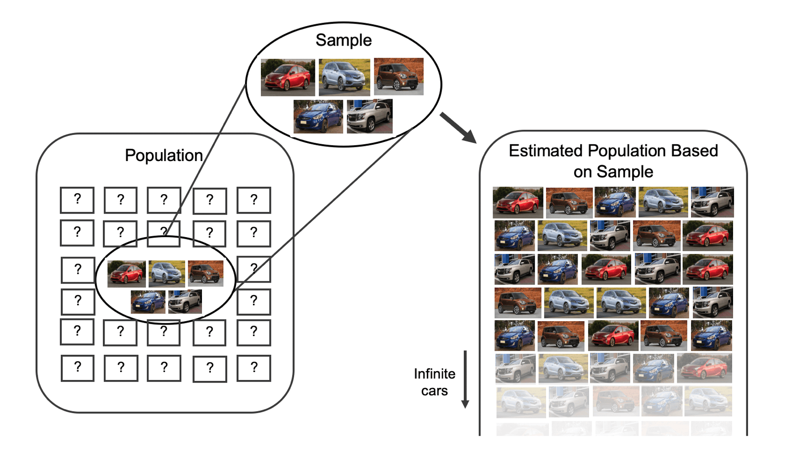
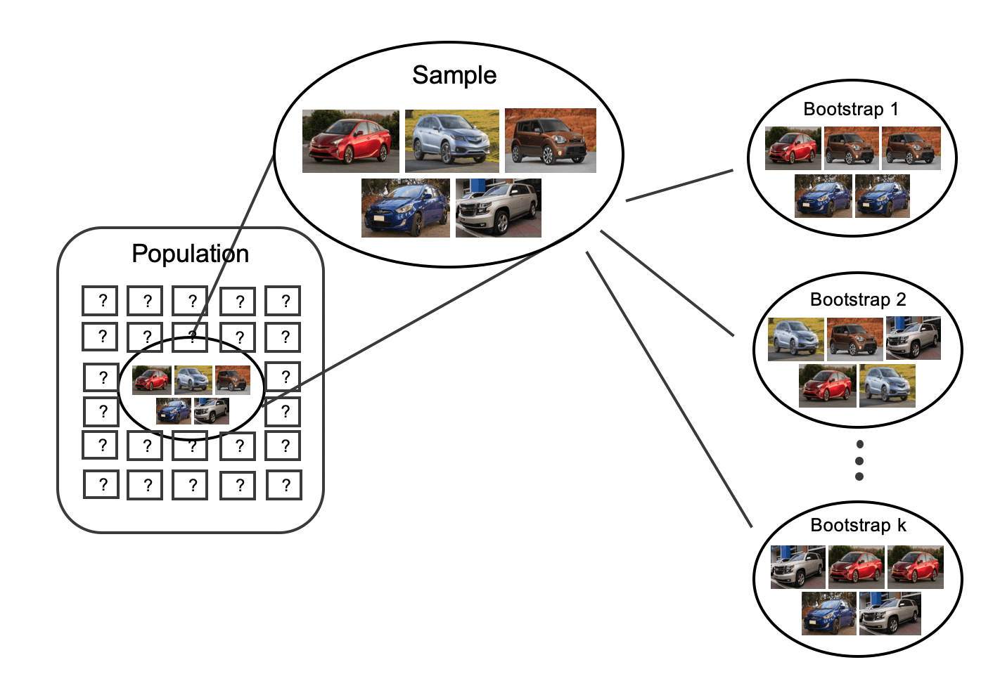
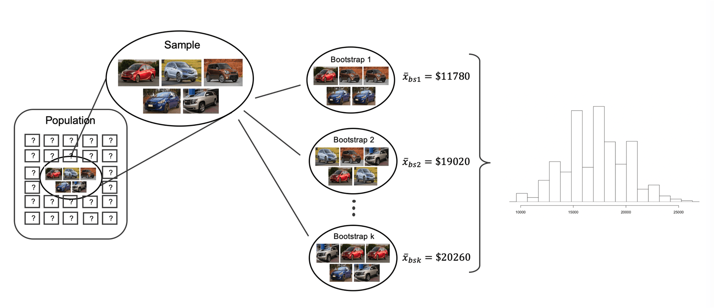
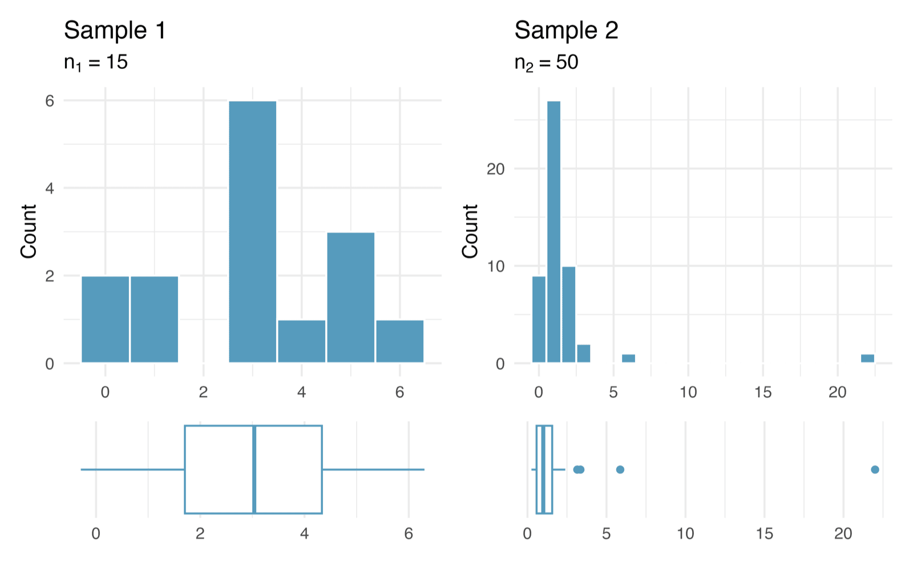
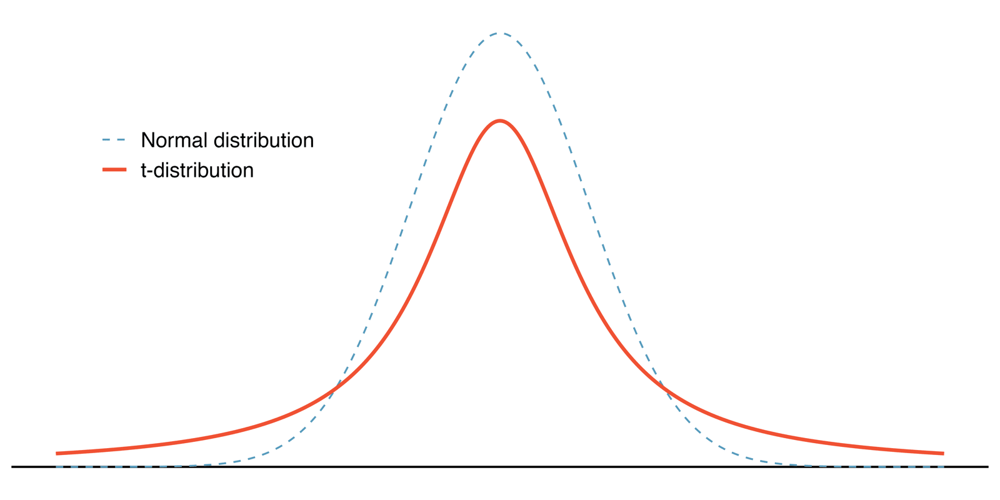
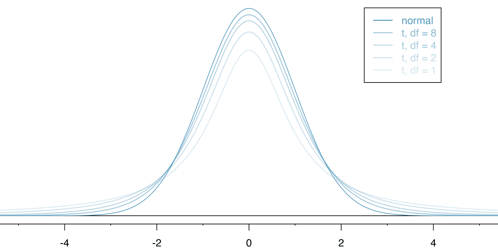



```{r}
#| label: setup
#| include: false
library(tidyverse)
library(cherryblossom)
library(infer)
knitr::opts_chunk$set(out.width = "90%")
```

## Student Information

```{r}
#| label: student-information-1
#| echo: false
learnr2::student_info()
```

## Introduction

This tutorial covers [Chapter 19: Inference for a single mean](https://openintrostat.github.io/ims/inference-one-mean.html) from [*Introduction to Modern Statistics*](https://openintrostat.github.io/ims/) by Mine Çetinkaya-Rundel and Johanna Hardin. You will learn to bootstrap a confidence interval for a population mean, and then to use the $t$-distribution, its degrees of freedom, and its conditions to build a $t$-interval and a $t$-test that you check against the bootstrap, using a random sample of runners from the 2017 Cherry Blossom Run.

### Exercise 1

You should be doing this tutorial in a repo named `inference-for-a-single-mean`. If you are not, create one and then connect to it.

Create a new file, `analysis.qmd`, with the title `"Inference for a Single Mean"` and your name as the author. In a bash Terminal, render it:

```bash
quarto render analysis.qmd
```

Open `analysis.html` with Live Server (right-click it in the Explorer → **Open with Live Server**) and keep the tab open. It refreshes on every render. Going forward, we will just tell you to "Render" when we want you to take these steps.

Create a `.gitignore` with `analysis_files` followed by a blank line. Commit and push. Use AI however you like.

If `show_file()` fails, it is probably because you have not yet loaded `library(learnr2)` in the R Terminal.

```{r}
#| label: introduction-1
#| echo: false
learnr2::question('In the R Terminal, run show_file(".gitignore"). CP/CR.', type = "reflection")
```

###

```{.output}
analysis_files
```

###

In this tutorial, we focus on the sample mean (instead of, for example, the sample median or the range of the observations) because of the well-studied mathematical model which describes the behavior of the sample mean. The proportions of the last three tutorials came from yes-or-no variables, but a mean needs a numerical one.

### Exercise 2

Add a chunk to `analysis.qmd` that loads the **[tidyverse](https://www.tidyverse.org/)**, with `#| message: false` so the startup messages stay out of the rendered page. Add `execute: echo: false` to the YAML header. Render.

```{r}
#| label: introduction-2
#| echo: false
learnr2::question('In the R Terminal, run show_file("analysis.qmd"). CP/CR.', type = "reflection")
```

###

````{verbatim}
#| message: false
library(tidyverse)
````

###

The important data structure for this tutorial is a numeric response variable (that is, the outcome is quantitative). The **tidyverse** filters the runners, converts their times to minutes, and draws the histograms.

### Exercise 3

Add **[cherryblossom](https://openintrostat.github.io/cherryblossom/)** to that chunk. Render.

```{r}
#| label: introduction-3
#| echo: false
learnr2::question('In the R Terminal, run show_file("analysis.qmd"). CP/CR.', type = "reflection")
```

###

````{verbatim}
#| message: false
library(tidyverse)
library(cherryblossom)
````

###

**cherryblossom** is a small OpenIntro package with results from three years of one race: `run09`, `run12`, and `run17`. The Cherry Blossom Race is a 10-mile race in Washington, DC each spring.

### Exercise 4

Add **[infer](https://infer.tidymodels.org/)** to that chunk. Render.

```{r}
#| label: introduction-4
#| echo: false
learnr2::question('In the R Terminal, run show_file("analysis.qmd"). CP/CR.', type = "reflection")
```

###

````{verbatim}
#| message: false
library(tidyverse)
library(cherryblossom)
library(infer)
````

###

We will not cover mathematical models which describe other statistics, but the bootstrap and randomization techniques described below are immediately extendable to any function of the observed data. **infer** bootstraps a mean, a median, or a standard deviation with the same pipeline, changing only the name of the statistic.

## Bootstrap confidence interval for a mean

Fortunately, as it did in previous chapters for the sample proportion, bootstrapping will approximate the variability of the sample mean from sample to sample. The chapter shows the idea with a sample of five cars, and this section applies it to a sample of 100 runners.

{fig-alt="The sample of 5 cars is drawn from a large population with other values (i.e., other car prices) unknown. The sample of five cars is replicated infinitely many times to create a proxy population where the car prices are given by the original dataset in the same relative distribution as measured in the sample."}

### Exercise 1

Add a chunk that prints `run17`. Render.

```{r}
#| label: bootstrap-confidence-interval-for-a-mean-1
#| echo: false
learnr2::question('In the R Terminal, run show_file("analysis.qmd"). CP/CR.', type = "reflection")
```

###

```{r}
#| label: bootstrap-confidence-interval-for-a-mean-1-test
#| echo: true
run17
```

###

Each of the 19,961 rows is one runner, and `net_sec` is that runner's finishing time in seconds. The data start with the fastest women, and the first finished in 3,217 seconds, under 54 minutes.

### Exercise 2

Replace the code in that chunk so that it counts the runners in each `event`. Render.

```{r}
#| label: bootstrap-confidence-interval-for-a-mean-2
#| echo: false
learnr2::question('In the R Terminal, run show_file("analysis.qmd"). CP/CR.', type = "reflection")
```

###

```{r}
#| label: bootstrap-confidence-interval-for-a-mean-2-test
#| echo: true
run17 |>
  count(event)
```

###

17,442 runners ran the 10 miles and 2,519 the 5K. The average time for all runners who finished the 10-mile Cherry Blossom Race in 2006 was 93.29 minutes (93 minutes and about 17 seconds).

### Exercise 3

Replace the code in that chunk so that it calculates, for each event, the number of runners, the number with a missing finishing time, and the average finishing time in minutes. Render.

```{r}
#| label: bootstrap-confidence-interval-for-a-mean-3
#| echo: false
learnr2::question('In the R Terminal, run show_file("analysis.qmd"). CP/CR.', type = "reflection")
```

###

```{r}
#| label: bootstrap-confidence-interval-for-a-mean-3-test
#| echo: true
run17 |>
  summarize(runners = n(),
            missing = sum(is.na(net_sec)),
            mean_minutes = mean(net_sec / 60, na.rm = TRUE),
            .by = event)
```

###

Three 5K runners have no time at all, while every 10-mile runner has one. The 5K average of 39.6 minutes would drag down any average that forgot to keep only the 10-mile race.

### Exercise 4

Replace the code in that chunk with a histogram of the finishing times, in minutes, of the 10 Mile runners only, with bars 5 minutes wide. Render.

```{r}
#| label: bootstrap-confidence-interval-for-a-mean-4
#| echo: false
learnr2::question('In the R Terminal, run show_file("analysis.qmd"). CP/CR.', type = "reflection")
```

###

```{r}
#| label: bootstrap-confidence-interval-for-a-mean-4-test
#| echo: true
run17 |>
  filter(event == "10 Mile") |>
  ggplot(aes(x = net_sec / 60)) +
  geom_histogram(binwidth = 5, boundary = 0)
```

###

The right tail stops at 140 minutes, with 242 runners in the last bar and none beyond it. The help page says all 10 Mile racers had to finish by a time limit, and the slowest time, 139.97 minutes, suggests it was 2 hours and 20 minutes.

### Exercise 5

Replace the code in that chunk so that it calculates the number of 10 Mile runners and the mean and standard deviation of their finishing times in minutes. Render.

```{r}
#| label: bootstrap-confidence-interval-for-a-mean-5
#| echo: false
learnr2::question('In the R Terminal, run show_file("analysis.qmd"). CP/CR.', type = "reflection")
```

###

```{r}
#| label: bootstrap-confidence-interval-for-a-mean-5-test
#| echo: true
run17 |>
  filter(event == "10 Mile") |>
  summarize(runners = n(),
            mean_time = mean(net_sec / 60),
            sd_time = sd(net_sec / 60))
```

###

Because `run17` holds every 10-mile finisher, 97.8 minutes is the population mean, $\mu$, a number researchers almost never get to see. The chapter instead uses data from 100 participants in the 2017 Cherry Blossom Race.

### Exercise 6

Start a new chunk that keeps only the 10 Mile runners, sets the seed to 1, draws a random sample of 100 of them, and adds a column `time` with each finishing time in minutes. Store the result as `run17_sample`, and print it. These are the chapter's own steps, so you should get the chapter's 100 runners. Render.

```{r}
#| label: bootstrap-confidence-interval-for-a-mean-6
#| echo: false
learnr2::question('In the R Terminal, run show_file("analysis.qmd"). CP/CR.', type = "reflection")
```

###

```{r}
#| label: bootstrap-confidence-interval-for-a-mean-6-test
#| echo: true
set.seed(1)
run17_sample <- run17 |>
  filter(event == "10 Mile") |>
  slice_sample(n = 100) |>
  mutate(time = net_sec / 60)

run17_sample
```

###

The data come from a simple random sample of all participants, so the observations are independent. If your first runner is not Deepak S., check that the seed is set right before the sampling.

### Exercise 7

Replace the line that prints `run17_sample` with the number of runners, the mean, the standard deviation, the minimum, and the maximum of `time`. Render.

```{r}
#| label: bootstrap-confidence-interval-for-a-mean-7
#| echo: false
learnr2::question('In the R Terminal, run show_file("analysis.qmd"). CP/CR.', type = "reflection")
```

###

```{r}
#| label: bootstrap-confidence-interval-for-a-mean-7-test
#| echo: true
set.seed(1)
run17_sample <- run17 |>
  filter(event == "10 Mile") |>
  slice_sample(n = 100) |>
  mutate(time = net_sec / 60)

run17_sample |>
  summarize(n = n(),
            mean_time = mean(time),
            sd_time = sd(time),
            min_time = min(time),
            max_time = max(time))
```

###

Our mean of 98.8 and standard deviation of 16.6 minutes are the chapter's numbers, and we will consider the sample average to be the best guess point estimate for $\mu.$ It is one minute above the population mean of 97.8, an error no researcher with only the sample could measure.

### Exercise 8

Start a new chunk that draws one bootstrap sample: 100 runners drawn at random, with replacement, from `run17_sample`. Set a seed first. Calculate the sample's mean time and how many different runners it contains. Render.

```{r}
#| label: bootstrap-confidence-interval-for-a-mean-8
#| echo: false
learnr2::question('In the R Terminal, run show_file("analysis.qmd"). CP/CR.', type = "reflection")
```

###

```{r}
#| label: bootstrap-confidence-interval-for-a-mean-8-test
#| echo: true
set.seed(19)
run17_sample |>
  slice_sample(n = 100, replace = TRUE) |>
  summarize(mean_time = mean(time),
            runners = n_distinct(bib))
```

###

Only 64 of the 100 runners made it into our bootstrap sample, some of them more than once, and its mean is 100.0 minutes, not 98.8. The bootstrap samples were taken from the same (estimated) population, and so the differences in bootstrap samples are due entirely to natural variability in the sampling procedure.

{fig-alt="The sample is shown being taken from the large unknown population. The bootstrap resamples, however, are taken directly from the original sample (sampling with replacement) as if the resamples had been taken from an infinitely large proxy population. Three bootstrap resamples of 5 cars each are shown, each resample is slightly different due to the process of resampling with replacement."}

### Exercise 9

Replace the code in that chunk so that it uses **infer** to draw 10,000 bootstrap samples from `run17_sample`, calculates the mean `time` of each, and stores the result as `boot_means`. Keep the seed. Print `boot_means`. Render.

```{r}
#| label: bootstrap-confidence-interval-for-a-mean-9
#| echo: false
learnr2::question('In the R Terminal, run show_file("analysis.qmd"). CP/CR.', type = "reflection")
```

###

```{r}
#| label: bootstrap-confidence-interval-for-a-mean-9-test
#| echo: true
set.seed(19)
boot_means <- run17_sample |>
  specify(response = time) |>
  generate(reps = 10000, type = "bootstrap") |>
  calculate(stat = "mean")

boot_means
```

###

By summarizing each of the bootstrap samples (here, using the sample mean), we see, directly, the variability of the sample mean, $\bar{x},$ from sample to sample. Each row of `boot_means` is one such summary, like the $\bar{x}_{bs}$ values in the figure.

{fig-alt="The sample is shown being taken from the large unknown population. Three bootstrap resamples of 5 cars each are shown; the three resamples have an average car price of 11780 dollars, 19020 dollars, and 20260 dollars, respectively. A histogram representing many bootstrap resamples indicates that the bootstrap averages vary from roughly 10000 dollars to 25000 dollars."}

### Exercise 10

Start a new chunk that calculates the standard deviation of the 10,000 bootstrapped means in `boot_means`. Render.

```{r}
#| label: bootstrap-confidence-interval-for-a-mean-10
#| echo: false
learnr2::question('In the R Terminal, run show_file("analysis.qmd"). CP/CR.', type = "reflection")
```

###

```{r}
#| label: bootstrap-confidence-interval-for-a-mean-10-test
#| echo: true
boot_means |>
  summarize(se = sd(stat))
```

###

The standard deviation calculated on the bootstrapped means is referred to as the bootstrap standard error of the mean. Our 1.64 minutes measures how much the mean of 100 runners varies from sample to sample, while the 16.6 minutes from Exercise 7 measures how much the runners vary from each other.

### Exercise 11

Replace the code in that chunk so that it uses **infer** to calculate a 95% percentile confidence interval from `boot_means`. Render.

```{r}
#| label: bootstrap-confidence-interval-for-a-mean-11
#| echo: false
learnr2::question('In the R Terminal, run show_file("analysis.qmd"). CP/CR.', type = "reflection")
```

###

```{r}
#| label: bootstrap-confidence-interval-for-a-mean-11-test
#| echo: true
boot_means |>
  get_confidence_interval(level = 0.95, type = "percentile")
```

###

The bootstrap percentile confidence interval is found by locating the middle 90% (for a 90% confidence interval) or a 95% (for a 95% confidence interval) of the bootstrapped statistics. Ours runs from 95.5 to 101.9 minutes.

### Exercise 12

The chapter also builds a bootstrap SE interval: the point estimate plus and minus 2 bootstrap standard errors. Replace the code in that chunk so that it calculates the mean of `time` in `run17_sample`, the standard deviation of the means in `boot_means`, and the lower and upper ends of that interval. Render.

```{r}
#| label: bootstrap-confidence-interval-for-a-mean-12
#| echo: false
learnr2::question('In the R Terminal, run show_file("analysis.qmd"). CP/CR.', type = "reflection")
```

###

```{r}
#| label: bootstrap-confidence-interval-for-a-mean-12-test
#| echo: true
run17_sample |>
  summarize(mean_time = mean(time)) |>
  mutate(se = sd(boot_means$stat),
         lower = mean_time - 2 * se,
         upper = mean_time + 2 * se)
```

###

The SE interval, 95.5 to 102.1, is close to the percentile interval, 95.5 to 101.9, so the two methods provide very similar interval approximations. For when each kind of interval works best, the chapter points to Tim Hesterberg's "[What Teachers Should Know About the Bootstrap](https://www.tandfonline.com/doi/full/10.1080/00031305.2015.1089789)."

### Exercise 13

The chapter bootstraps other statistics, too. Replace the code in that chunk so that it uses **infer** to draw 10,000 bootstrap samples from `run17_sample`, calculates the standard deviation of `time` in each, and returns a 90% percentile confidence interval. Set a seed first. Render.

```{r}
#| label: bootstrap-confidence-interval-for-a-mean-13
#| echo: false
learnr2::question('In the R Terminal, run show_file("analysis.qmd"). CP/CR.', type = "reflection")
```

###

```{r}
#| label: bootstrap-confidence-interval-for-a-mean-13-test
#| echo: true
set.seed(19)
run17_sample |>
  specify(response = time) |>
  generate(reps = 10000, type = "bootstrap") |>
  calculate(stat = "sd") |>
  get_confidence_interval(level = 0.90, type = "percentile")
```

###

Although there is a mathematical model which describes how $s$ varies from sample to sample, the mathematical model will not be presented in the book. The bootstrap needs no such model: we are 90% confident that the standard deviation of all 10-mile times is between 14.8 and 18.2 minutes, and the true 16.9 is inside.

### Exercise 14

Replace the code in that chunk with a histogram of the bootstrapped means in `boot_means`, with bars half a minute wide. Render.

```{r}
#| label: bootstrap-confidence-interval-for-a-mean-14
#| echo: false
learnr2::question('In the R Terminal, run show_file("analysis.qmd"). CP/CR.', type = "reflection")
```

###

```{r}
#| label: bootstrap-confidence-interval-for-a-mean-14-test
#| echo: true
boot_means |>
  ggplot(aes(x = stat)) +
  geom_histogram(binwidth = 0.5)
```

###

The bootstrapped means pile up around 98.8 in a symmetric bell, from 91.7 to 105.0 minutes. If the bootstrap distribution is relatively symmetric and bell-shaped, then the 95% bootstrap SE confidence interval can be constructed with the formula familiar from the mathematical models in previous chapters.

### Exercise 15

Improve the histogram. Mark the two ends of the 95% percentile interval with dashed lines, and the mean finishing time of all 10 Mile runners in `run17` with a solid red line. Add a title, axis labels, a subtitle that states whether the interval captures the true mean, and a caption giving the sample size, the number of bootstrap samples, and the source. Render.

```{r}
#| label: bootstrap-confidence-interval-for-a-mean-15
#| echo: false
learnr2::question('In the R Terminal, run show_file("analysis.qmd"). CP/CR.', type = "reflection")
```

###

```{r}
#| label: bootstrap-confidence-interval-for-a-mean-15-test
#| echo: true
boot_ci <- boot_means |>
  get_confidence_interval(level = 0.95, type = "percentile")

true_mean <- run17 |>
  filter(event == "10 Mile") |>
  summarize(mean_time = mean(net_sec / 60)) |>
  pull(mean_time)

boot_means |>
  ggplot(aes(x = stat)) +
  geom_histogram(binwidth = 0.5) +
  geom_vline(xintercept = c(boot_ci$lower_ci, boot_ci$upper_ci),
             linetype = "dashed") +
  geom_vline(xintercept = true_mean, color = "red") +
  labs(title = "Bootstrapped Mean Finishing Times, 2017 Cherry Blossom 10 Mile",
       subtitle = "The 95% interval, 95.5 to 101.9 minutes, captures the true mean of all runners, 97.8",
       x = "Bootstrapped Mean Finishing Time (minutes)",
       y = "Number of Bootstrap Samples",
       caption = "100 runners sampled from 17,442; 10,000 bootstrap samples\nSource: run17, cherryblossom package; Introduction to Modern Statistics, Chapter 19")
```

###

As you might guess, the larger the random sample, the more accurately that sample will represent the population of interest. Our interval caught the true mean of 97.8, but a researcher holding only the sample could never have checked.

### Exercise 16

Commit `analysis.qmd` with the message `"Bootstrap the Cherry Blossom sample"` and push.

```{r}
#| label: bootstrap-confidence-interval-for-a-mean-16
#| echo: false
learnr2::question("In the bash Terminal, run git log --oneline -3. CP/CR.", type = "reflection")
```

###

```{.output}
3f8a2c1 (HEAD -> main, origin/main) Bootstrap the Cherry Blossom sample
a07f93b Initial commit
```

###

Bootstrapping is a method for capturing the variability of a statistic when the mathematical model is unknown (it is not a method for navigating small samples). As with analysis techniques that build on mathematical models, bootstrapping works best when a large random sample has been taken from the population.

## Mathematical model for a mean

As with the sample proportion, the variability of the sample mean is well described by the mathematical theory given by the Central Limit Theorem. However, because of missing information about the inherent variability in the population ($\sigma$), a $t$-distribution is used in place of the standard normal when performing hypothesis test or confidence interval analyses.

### Exercise 1

Start a new chunk that calculates, from `run17_sample`, the number of runners, the mean and standard deviation of `time`, and the standard error of the mean from the formula: the standard deviation divided by the square root of the number of runners. Render.

```{r}
#| label: mathematical-model-for-a-mean-1
#| echo: false
learnr2::question('In the R Terminal, run show_file("analysis.qmd"). CP/CR.', type = "reflection")
```

###

```{r}
#| label: mathematical-model-for-a-mean-1-test
#| echo: true
run17_sample |>
  summarize(n = n(),
            mean_time = mean(time),
            sd_time = sd(time)) |>
  mutate(se = sd_time / sqrt(n))
```

###

The formula's 1.66 minutes, the chapter's number, is close to the 1.64 from the bootstrap. The formula uses the sample's $s$ in place of the unknown $\sigma$, and this strategy tends to work well when we have a lot of data and can estimate $\sigma$ using $s$ accurately.

### Exercise 2

The model has two conditions, independence and normality, and a random sample satisfies the first. To check the second, replace the code in that chunk with a histogram of `time` in `run17_sample`, with bars 5 minutes wide, as in the chapter. Render.

```{r}
#| label: mathematical-model-for-a-mean-2
#| echo: false
learnr2::question('In the R Terminal, run show_file("analysis.qmd"). CP/CR.', type = "reflection")
```

###

```{r}
#| label: mathematical-model-for-a-mean-2-test
#| echo: true
run17_sample |>
  ggplot(aes(x = time)) +
  geom_histogram(binwidth = 5)
```

###

If the sample size $n$ is large and there are no **particularly extreme** outliers, then we typically assume the sampling distribution of $\bar{x}$ is nearly normal, even if the underlying distribution of individual observations is not. With a sample of 100, we should only be concerned if there are particularly extreme outliers.

### Exercise 3

Replace the histogram with a box plot of `time` in `run17_sample`. Render.

```{r}
#| label: mathematical-model-for-a-mean-3
#| echo: false
learnr2::question('In the R Terminal, run show_file("analysis.qmd"). CP/CR.', type = "reflection")
```

###

```{r}
#| label: mathematical-model-for-a-mean-3-test
#| echo: true
run17_sample |>
  ggplot(aes(x = time)) +
  geom_boxplot()
```

###

It's often helpful to also visualize the data using a box plot to assess skewness and existence of outliers. No runner in your box plot falls beyond the whiskers, unlike the extreme outlier in the second sample below.

{fig-alt="Two histogram and box plot pairs. The first pair of plots describes a sample size of 15 and the points are distributed between zero and six with no outliers. The second pair of plots describes a sample of size 50 and the points are distributed between zero and six with one additional outlying point above 20."}

### Exercise 4

Replace the code in that chunk with a plot of four curves from −5 to 5, in different colors: the standard normal distribution and the $t$-distributions with 2, 8, and 99 degrees of freedom. Render.

```{r}
#| label: mathematical-model-for-a-mean-4
#| echo: false
learnr2::question('In the R Terminal, run show_file("analysis.qmd"). CP/CR.', type = "reflection")
```

###

```{r}
#| label: mathematical-model-for-a-mean-4-test
#| echo: true
ggplot() +
  xlim(-5, 5) +
  geom_function(aes(color = "normal"), fun = dnorm) +
  geom_function(aes(color = "t, df = 2"), fun = dt, args = list(df = 2)) +
  geom_function(aes(color = "t, df = 8"), fun = dt, args = list(df = 8)) +
  geom_function(aes(color = "t, df = 99"), fun = dt, args = list(df = 99))
```

###

Your $t$-distribution with 2 degrees of freedom, like the book's below, has tails thicker than the normal distribution's, meaning observations are more likely to fall beyond two standard deviations from the mean than under the normal distribution. With 99 degrees of freedom, the curve hides under the normal one.

{fig-alt="Two symmetric bell-shaped curves on top of one another. One is a normal curve with smaller tails and a higher peak in the middle. The other is a t-distribution with longer tails, meaning that there are more observations far from the center of a t-distribution than of a normal distribution."}

### Exercise 5

Replace the plot with a table with one row for each of 2, 8, 18, 99, and infinite degrees of freedom. For each, show the $t$ cutoff that leaves 2.5% in the upper tail, and the proportion of the $t$-distribution more than 3 units from 0. Render.

```{r}
#| label: mathematical-model-for-a-mean-5
#| echo: false
learnr2::question('In the R Terminal, run show_file("analysis.qmd"). CP/CR.', type = "reflection")
```

###

```{r}
#| label: mathematical-model-for-a-mean-5-test
#| echo: true
tibble(df = c(2, 8, 18, 99, Inf)) |>
  mutate(t_star = qt(0.975, df = df),
         beyond_3 = 2 * pt(-3, df = df))
```

###

In general, we'll use a $t$-distribution with $df = n - 1$ to model the sample mean when the sample size is $n.$ The larger the degrees of freedom, the more closely the $t$-distribution resembles the standard normal distribution, and infinite degrees of freedom gives the normal's 1.96.

{fig-alt="A normal distribution and four t distributions, all super imposed on top of one another. The smaller the degrees of freedom, the wider the tails in the t distribution."}

### Exercise 6

Before using the formula, recall the bootstrap's 95% interval, 95.5 to 101.9 minutes. Replace the code in that chunk so that it calculates, from `run17_sample`, the number of runners, the mean of `time`, the standard error, $t^{\star}$ for a 95% interval with $n - 1$ degrees of freedom, the margin of error, and the lower and upper ends of the 95% $t$-interval. Render.

```{r}
#| label: mathematical-model-for-a-mean-6
#| echo: false
learnr2::question('In the R Terminal, run show_file("analysis.qmd"). CP/CR.', type = "reflection")
```

###

```{r}
#| label: mathematical-model-for-a-mean-6-test
#| echo: true
run17_sample |>
  summarize(n = n(),
            mean_time = mean(time),
            se = sd(time) / sqrt(n)) |>
  mutate(t_star = qt(0.975, df = n - 1),
         margin = t_star * se,
         lower = mean_time - margin,
         upper = mean_time + margin)
```

###

The $t$-interval, 95.5 to 102.1 minutes, nearly matches the bootstrap's 95.5 to 101.9. The margin of error is $t^\star_{df} \times s/\sqrt{n}$ where $t^\star_{df}$ is calculated from a specified percentile on the t-distribution with *df* degrees of freedom.

### Exercise 7

Replace the code in that chunk so that it counts how many of the 100 runners in `run17_sample` have a `time` inside that 95% $t$-interval. Render.

```{r}
#| label: mathematical-model-for-a-mean-7
#| echo: false
learnr2::question('In the R Terminal, run show_file("analysis.qmd"). CP/CR.', type = "reflection")
```

###

```{r}
#| label: mathematical-model-for-a-mean-7-test
#| echo: true
run17_sample |>
  mutate(margin = qt(0.975, df = n() - 1) * sd(time) / sqrt(n()),
         lower = mean(time) - margin,
         upper = mean(time) + margin) |>
  summarize(inside = sum(time >= lower & time <= upper))
```

###

Only 15 of the 100 runners finished inside the 95% interval, because a confidence interval only provides a range of plausible values for a population parameter, in this case the population mean. It does not describe what we might observe for individual observations.

### Exercise 8

Now the test. The null hypothesis is that the 2017 mean equals 2006's 93.29 minutes, and the alternative is that it is different. Start a new chunk that uses **infer** to create `null_means`: the means of 10,000 bootstrap samples from `run17_sample`, generated as if the null hypothesis were true. Set a seed first. Print `null_means`. Render.

```{r}
#| label: mathematical-model-for-a-mean-8
#| echo: false
learnr2::question('In the R Terminal, run show_file("analysis.qmd"). CP/CR.', type = "reflection")
```

###

```{r}
#| label: mathematical-model-for-a-mean-8-test
#| echo: true
set.seed(19)
null_means <- run17_sample |>
  specify(response = time) |>
  hypothesize(null = "point", mu = 93.29) |>
  generate(reps = 10000, type = "bootstrap") |>
  calculate(stat = "mean")

null_means
```

###

To make the null true, **infer** subtracts 5.49 minutes from every runner's time, so that the sample mean is exactly 93.29, and then bootstraps. Each row is the mean of 100 runners in a world where the average 10-mile run time was the same for 2006 and 2017.

### Exercise 9

Replace the line that prints `null_means` with the two-sided p-value for the observed mean of `time` in `run17_sample`. Render.

```{r}
#| label: mathematical-model-for-a-mean-9
#| echo: false
learnr2::question('In the R Terminal, run show_file("analysis.qmd"). CP/CR.', type = "reflection")
```

###

```{r}
#| label: mathematical-model-for-a-mean-9-test
#| echo: true
set.seed(19)
null_means <- run17_sample |>
  specify(response = time) |>
  hypothesize(null = "point", mu = 93.29) |>
  generate(reps = 10000, type = "bootstrap") |>
  calculate(stat = "mean")

null_means |>
  get_p_value(obs_stat = mean(run17_sample$time), direction = "two-sided")
```

###

Only 3 of our 10,000 null means reached 98.8, and **infer** doubles that tail to a p-value of 0.0006. The chapter does the same with the formula: find the one-tail area under the sampling distribution, and double it.

### Exercise 10

Now the formula. Start a new chunk that calculates, from `run17_sample`, the number of runners, the mean of `time`, the standard error, the T score of the mean against the null value of 93.29, and the two-sided p-value from the $t$-distribution with $n - 1$ degrees of freedom. Render.

```{r}
#| label: mathematical-model-for-a-mean-10
#| echo: false
learnr2::question('In the R Terminal, run show_file("analysis.qmd"). CP/CR.', type = "reflection")
```

###

```{r}
#| label: mathematical-model-for-a-mean-10-test
#| echo: true
run17_sample |>
  summarize(n = n(),
            mean_time = mean(time),
            se = sd(time) / sqrt(n)) |>
  mutate(t = (mean_time - 93.29) / se,
         p_value = 2 * pt(t, df = n - 1, lower.tail = FALSE))
```

###

The Z score and T score are computed in the exact same way and are conceptually identical: each represents how many standard errors the observed value is from the null value. Our T of 3.31 and p-value of 0.0013 differ slightly from the chapter's 3.32 and 0.00126, which round the mean to 98.8 and the standard error to 1.66.

### Exercise 11

Replace the code in that chunk so that it runs the same two-sided $t$-test with **infer**'s own tool for it. Render.

```{r}
#| label: mathematical-model-for-a-mean-11
#| echo: false
learnr2::question('In the R Terminal, run show_file("analysis.qmd"). CP/CR.', type = "reflection")
```

###

```{r}
#| label: mathematical-model-for-a-mean-11-test
#| echo: true
run17_sample |>
  t_test(response = time, mu = 93.29)
```

###

One line returns the T score, the 99 degrees of freedom, the p-value, and the 95% $t$-interval, all matching your formulas. In practice, it's common to use statistical software, such as R, Python, or SAS for these analyses.

### Exercise 12

Replace the code in that chunk with a histogram of `null_means`, on a density scale, with bars half a minute wide. Draw over it the curve the mathematical model implies for the sample mean under the null: a $t$-distribution with 99 degrees of freedom, centered at 93.29 and scaled by the standard error. Add a dashed line at the observed mean. Render.

```{r}
#| label: mathematical-model-for-a-mean-12
#| echo: false
learnr2::question('In the R Terminal, run show_file("analysis.qmd"). CP/CR.', type = "reflection")
```

###

```{r}
#| label: mathematical-model-for-a-mean-12-test
#| echo: true
se <- sd(run17_sample$time) / sqrt(nrow(run17_sample))

null_means |>
  ggplot(aes(x = stat)) +
  geom_histogram(aes(y = after_stat(density)), binwidth = 0.5) +
  geom_function(fun = \(x) dt((x - 93.29) / se, df = 99) / se) +
  geom_vline(xintercept = mean(run17_sample$time), linetype = "dashed")
```

###

The $t$ curve's slightly thicker tails are why its p-value, 0.0013, is larger than the simulation's 0.0006. The extra thick tails of the $t$-distribution are exactly the correction needed to resolve the problem (due to extra variability of the T score) of using $s$ in place of $\sigma$ in the $SE$ calculation.

### Exercise 13

Improve the plot. Add a second dashed line as far below 93.29 as the observed mean is above it, since the test is two-sided, and make the curve thicker. Add a title, axis labels, a subtitle that states the main finding, and a caption giving the sample size, the number of simulations, and the source. Render.

```{r}
#| label: mathematical-model-for-a-mean-13
#| echo: false
learnr2::question('In the R Terminal, run show_file("analysis.qmd"). CP/CR.', type = "reflection")
```

###

```{r}
#| label: mathematical-model-for-a-mean-13-test
#| echo: true
se <- sd(run17_sample$time) / sqrt(nrow(run17_sample))
gap <- mean(run17_sample$time) - 93.29

null_means |>
  ggplot(aes(x = stat)) +
  geom_histogram(aes(y = after_stat(density)), binwidth = 0.5, fill = "gray70") +
  geom_function(fun = \(x) dt((x - 93.29) / se, df = 99) / se, linewidth = 1) +
  geom_vline(xintercept = 93.29 + c(-gap, gap), linetype = "dashed") +
  labs(title = "Mean 10 Mile Times If 2017 Runners Matched 2006's 93.29 Minutes",
       subtitle = "The 2017 mean of 98.8 is far in the tail: p = 0.0006 by simulation, 0.0013 by the t-test",
       x = "Mean Finishing Time of 100 Runners (minutes)",
       y = "Density",
       caption = "100 runners sampled from 17,442; 10,000 bootstrap samples under the null; curve: t, df = 99\nSource: run17, cherryblossom package; Introduction to Modern Statistics, Chapter 19")
```

###

Because the p-value is smaller than 0.05, we reject the null hypothesis. That is, the data provide convincing evidence that the average run time for the Cherry Blossom Run in 2017 is different than the 2006 average.

### Exercise 14

Commit `analysis.qmd` with the message `"Test the 2017 runners with the t-distribution"` and push.

```{r}
#| label: mathematical-model-for-a-mean-14
#| echo: false
learnr2::question("In the bash Terminal, run git log --oneline -3. CP/CR.", type = "reflection")
```

###

```{.output}
8d4e6b0 (HEAD -> main, origin/main) Test the 2017 runners with the t-distribution
3f8a2c1 Bootstrap the Cherry Blossom sample
a07f93b Initial commit
```

###

The $t$-distribution allows us greater flexibility than the normal distribution when analyzing numerical data. With its conditions met, the $t$-distribution gave nearly the same interval and the same conclusion as the bootstrap, which needed no formula at all.

## Summary

This tutorial covered [Chapter 19: Inference for a single mean](https://openintrostat.github.io/ims/inference-one-mean.html) from [*Introduction to Modern Statistics*](https://openintrostat.github.io/ims/) by Mine Çetinkaya-Rundel and Johanna Hardin. You have learned to bootstrap a confidence interval for a population mean, and then to use the $t$-distribution, its degrees of freedom, and its conditions to build a $t$-interval and a $t$-test that you checked against the bootstrap, using a random sample of runners from the 2017 Cherry Blossom Run.

In this tutorial we extended the randomization / bootstrap / mathematical model paradigm to questions involving quantitative variables of interest. When there is only one variable of interest, we are often hypothesizing or finding confidence intervals about the population mean. Note, however, the bootstrap method can be used for other statistics like the population median or the population IQR. Questions about a single mean are addressed using the t-distribution, with *t-tests* and *t-intervals*. Again, almost all the research questions can be approached using computational methods (e.g., randomization tests or bootstrapping) or using mathematical models. We continue to emphasize the importance of experimental design in making conclusions about research claims. In particular, recall that variability can come from different sources (e.g., random sampling vs. random allocation).

For when a bootstrap interval can be trusted, read Tim Hesterberg's "[What Teachers Should Know About the Bootstrap](https://www.tandfonline.com/doi/full/10.1080/00031305.2015.1089789)," which the chapter cites. For the race data, including the 2009 and 2012 runs, see the **cherryblossom** [reference pages](https://openintrostat.github.io/cherryblossom/reference/index.html).

Many sentences in this tutorial, and its figures, come from the chapter, used under the book's [CC BY-SA 3.0 license](https://creativecommons.org/licenses/by-sa/3.0/).

### Exercise 1

Render one last time.

```{r}
#| label: summary-1
#| echo: false
learnr2::question('In the R Terminal, run show_file("analysis.qmd", start = 0). CP/CR.', type = "reflection")
```

###

````{verbatim}
---
title: "Inference for a Single Mean"
author: "Your Name"
format: html
execute:
  echo: false
---

```{r}
#| message: false
library(tidyverse)
library(cherryblossom)
library(infer)
```

```{r}
run17 |>
  filter(event == "10 Mile") |>
  summarize(runners = n(),
            mean_time = mean(net_sec / 60),
            sd_time = sd(net_sec / 60))
```

```{r}
set.seed(1)
run17_sample <- run17 |>
  filter(event == "10 Mile") |>
  slice_sample(n = 100) |>
  mutate(time = net_sec / 60)

run17_sample |>
  summarize(n = n(),
            mean_time = mean(time),
            sd_time = sd(time),
            min_time = min(time),
            max_time = max(time))
```

```{r}
set.seed(19)
boot_means <- run17_sample |>
  specify(response = time) |>
  generate(reps = 10000, type = "bootstrap") |>
  calculate(stat = "mean")

boot_means
```

```{r}
boot_ci <- boot_means |>
  get_confidence_interval(level = 0.95, type = "percentile")

true_mean <- run17 |>
  filter(event == "10 Mile") |>
  summarize(mean_time = mean(net_sec / 60)) |>
  pull(mean_time)

boot_means |>
  ggplot(aes(x = stat)) +
  geom_histogram(binwidth = 0.5) +
  geom_vline(xintercept = c(boot_ci$lower_ci, boot_ci$upper_ci),
             linetype = "dashed") +
  geom_vline(xintercept = true_mean, color = "red") +
  labs(title = "Bootstrapped Mean Finishing Times, 2017 Cherry Blossom 10 Mile",
       subtitle = "The 95% interval, 95.5 to 101.9 minutes, captures the true mean of all runners, 97.8",
       x = "Bootstrapped Mean Finishing Time (minutes)",
       y = "Number of Bootstrap Samples",
       caption = "100 runners sampled from 17,442; 10,000 bootstrap samples\nSource: run17, cherryblossom package; Introduction to Modern Statistics, Chapter 19")
```

```{r}
run17_sample |>
  mutate(margin = qt(0.975, df = n() - 1) * sd(time) / sqrt(n()),
         lower = mean(time) - margin,
         upper = mean(time) + margin) |>
  summarize(inside = sum(time >= lower & time <= upper))
```

```{r}
set.seed(19)
null_means <- run17_sample |>
  specify(response = time) |>
  hypothesize(null = "point", mu = 93.29) |>
  generate(reps = 10000, type = "bootstrap") |>
  calculate(stat = "mean")

null_means |>
  get_p_value(obs_stat = mean(run17_sample$time), direction = "two-sided")
```

```{r}
se <- sd(run17_sample$time) / sqrt(nrow(run17_sample))
gap <- mean(run17_sample$time) - 93.29

null_means |>
  ggplot(aes(x = stat)) +
  geom_histogram(aes(y = after_stat(density)), binwidth = 0.5, fill = "gray70") +
  geom_function(fun = \(x) dt((x - 93.29) / se, df = 99) / se, linewidth = 1) +
  geom_vline(xintercept = 93.29 + c(-gap, gap), linetype = "dashed") +
  labs(title = "Mean 10 Mile Times If 2017 Runners Matched 2006's 93.29 Minutes",
       subtitle = "The 2017 mean of 98.8 is far in the tail: p = 0.0006 by simulation, 0.0013 by the t-test",
       x = "Mean Finishing Time of 100 Runners (minutes)",
       y = "Density",
       caption = "100 runners sampled from 17,442; 10,000 bootstrap samples under the null; curve: t, df = 99\nSource: run17, cherryblossom package; Introduction to Modern Statistics, Chapter 19")
```
````

###

Your page answers both questions about one variable, finishing time: a range of plausible values for the 2017 mean, and a test of whether it changed since 2006.

### Exercise 2

Publish your analysis to GitHub Pages. In a bash Terminal, run:

```bash
quarto publish gh-pages analysis.qmd
```

```{r}
#| label: summary-2
#| echo: false
learnr2::question("Paste the URL of your published page.", type = "reflection")
```

###

Your answer should look like `https://your-github-username.github.io/inference-for-a-single-mean/`.

###

The published page carries an interval of about 95.5 to 102 minutes, on which the bootstrap and the $t$-distribution agree. The same two approaches return in the tutorials on two independent means and paired means.

### Exercise 3

Commit and push any remaining changes.

```{r}
#| label: summary-3
#| echo: false
learnr2::question("Paste the URL of your GitHub repo.", type = "reflection")
```

###

Your answer should look like `https://github.com/your-github-username/inference-for-a-single-mean`.

###

The test shows that 2017 runners were slower than 2006's, not why: the sample cannot say whether the runners changed or the field of entrants did.

## Your Answers

```{r}
#| label: your-answers-1
#| echo: false
learnr2::question(
  "How many minutes, approximately, did it take you to complete this
  tutorial? For example, an hour and a half would be 90 minutes.",
  type = "reflection_editable",
  validate = "integer"
)
```

```{r}
#| label: your-answers-2
#| echo: false
learnr2::download_answers_button(filename_prefix = "inference-single-mean")
```
