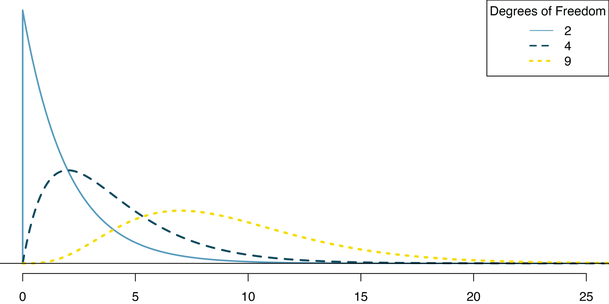
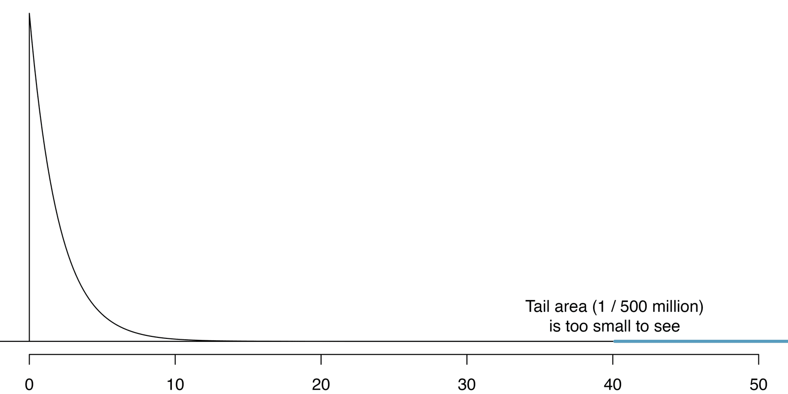



```{r}
#| label: setup
#| include: false
library(tidyverse)
library(openintro)
library(infer)
knitr::opts_chunk$set(out.width = "90%")
```

## Student Information

```{r}
#| label: student-information-1
#| echo: false
learnr2::student_info()
```

## Introduction

This tutorial covers [Chapter 18: Inference for two-way tables](https://openintrostat.github.io/ims/inference-tables.html) from [*Introduction to Modern Statistics*](https://openintrostat.github.io/ims/) by Mine Çetinkaya-Rundel and Johanna Hardin. You will learn to compute expected counts and the chi-squared statistic for a two-way table, to test independence by shuffling the data, and to check that test against the chi-squared distribution, using an experiment on the questions that get sellers to disclose a problem and a clinical trial of three diabetes treatments.

### Exercise 1

You should be doing this tutorial in a repo named `inference-for-two-way-tables`. If you are not, create one and then connect to it.

Create a new file, `analysis.qmd`, with the title `"Inference for Two-Way Tables"` and your name as the author. In a bash Terminal, render it:

```bash
quarto render analysis.qmd
```

Open `analysis.html` with Live Server (right-click it in the Explorer → **Open with Live Server**) and keep the tab open. It refreshes on every render. Going forward, we will just tell you to "Render" when we want you to take these steps.

Create a `.gitignore` with `analysis_files` followed by a blank line. Commit and push. Use AI however you like.

If `show_file()` fails, it is probably because you have not yet loaded `library(learnr2)` in the R Terminal.

```{r}
#| label: introduction-1
#| echo: false
learnr2::question('In the R Terminal, run show_file(".gitignore"). CP/CR.', type = "reflection")
```

###

```{.output}
analysis_files
```

###

With two-way tables, there is not an obvious single parameter of interest. Instead, research questions usually focus on how the proportions of the response variable changes (or not) across the different levels of the explanatory variable.

### Exercise 2

Add a chunk to `analysis.qmd` that loads the **[tidyverse](https://www.tidyverse.org/)**, with `#| message: false` so the startup messages stay out of the rendered page. Add `execute: echo: false` to the YAML header. Render.

```{r}
#| label: introduction-2
#| echo: false
learnr2::question('In the R Terminal, run show_file("analysis.qmd"). CP/CR.', type = "reflection")
```

###

````{verbatim}
#| message: false
library(tidyverse)
````

###

The **tidyverse** counts, reshapes, and plots everything in this tutorial. The chapter adds the row and column totals to its tables with **[janitor](https://sfirke.github.io/janitor/)**, a small package for cleaning and tabulating data.

### Exercise 3

Add **[openintro](https://openintrostat.github.io/openintro/)** to that chunk. Render.

```{r}
#| label: introduction-3
#| echo: false
learnr2::question('In the R Terminal, run show_file("analysis.qmd"). CP/CR.', type = "reflection")
```

###

````{verbatim}
#| message: false
library(tidyverse)
library(openintro)
````

###

**openintro** holds both of the chapter's datasets, `ask` and `diabetes2`, and both come from experiments. For `ask`, researchers recruited 219 participants in a study where they would sell a used iPod that was known to have frozen twice in the past.

### Exercise 4

Add **[infer](https://infer.tidymodels.org/)** to that chunk. Render.

```{r}
#| label: introduction-4
#| echo: false
learnr2::question('In the R Terminal, run show_file("analysis.qmd"). CP/CR.', type = "reflection")
```

###

````{verbatim}
#| message: false
library(tidyverse)
library(openintro)
library(infer)
````

###

Because there is not a population parameter to estimate, bootstrapping to find the standard error of the estimate is not meaningful. So **infer** only shuffles the data under the null hypothesis here, and its article "[Tidy Chi-Squared Tests with infer](https://infer.tidymodels.org/articles/chi_squared.html)" works through the same steps.

## Randomization test of independence

The hypothesis test for the iPod experiment is really about assessing whether there is convincing evidence that there was a difference in the success rates that each question had on getting the participant to disclose the problem with the iPod. In other words, the goal is to check whether the buyer's question was independent of whether the seller disclosed a problem.

### Exercise 1

Add a chunk that prints `ask`. Render.

```{r}
#| label: randomization-test-of-independence-1
#| echo: false
learnr2::question('In the R Terminal, run show_file("analysis.qmd"). CP/CR.', type = "reflection")
```

###

```{r}
#| label: randomization-test-of-independence-1-test
#| echo: true
ask
```

###

Each of the 219 rows is one seller. The question is the treatment given to the sellers, and the response is whether the question prompted them to disclose the freezing issue with the iPod.

### Exercise 2

Replace the code in that chunk so that it counts the sellers by `question_class` and `question`. Render.

```{r}
#| label: randomization-test-of-independence-2
#| echo: false
learnr2::question('In the R Terminal, run show_file("analysis.qmd"). CP/CR.', type = "reflection")
```

###

```{r}
#| label: randomization-test-of-independence-2-test
#| echo: true
ask |>
  count(question_class, question)
```

###

Each `question_class` goes with exactly one question, and each question went to exactly 73 sellers. The data's "It doesn't have any problems, does it?" is the chapter's "It does not have any problems, does it?"

### Exercise 3

Replace the code in that chunk so that it counts the sellers by `question_class` and `response`. Render.

```{r}
#| label: randomization-test-of-independence-3
#| echo: false
learnr2::question('In the R Terminal, run show_file("analysis.qmd"). CP/CR.', type = "reflection")
```

###

```{r}
#| label: randomization-test-of-independence-3-test
#| echo: true
ask |>
  count(question_class, response)
```

###

Only 2 of the 73 sellers asked the general question disclosed the freezing problem, against 36 of the 73 asked "What problems does it have?" We sometimes assume the sellers of used products will be forthright about any underlying problems with what they're selling, but this is not something we should take for granted.

### Exercise 4

Reshape those counts into a two-way table, with one row for each `question_class`, one column for each `response`, and a column for the row total. Render.

```{r}
#| label: randomization-test-of-independence-4
#| echo: false
learnr2::question('In the R Terminal, run show_file("analysis.qmd"). CP/CR.', type = "reflection")
```

###

```{r}
#| label: randomization-test-of-independence-4-test
#| echo: true
ask |>
  count(question_class, response) |>
  pivot_wider(names_from = response, values_from = n) |>
  mutate(total = disclose + hide)
```

###

The primary way to summarize categorical data where the explanatory and response variables both have 2 or more levels is through a two-way table. Moving the levels of `response` into columns turns six rows of counts into the chapter's three-by-two table.

### Exercise 5

Add a column with the proportion of sellers in each row who disclosed the problem. Render.

```{r}
#| label: randomization-test-of-independence-5
#| echo: false
learnr2::question('In the R Terminal, run show_file("analysis.qmd"). CP/CR.', type = "reflection")
```

###

```{r}
#| label: randomization-test-of-independence-5-test
#| echo: true
ask |>
  count(question_class, response) |>
  pivot_wider(names_from = response, values_from = n) |>
  mutate(total = disclose + hide,
         prop_disclose = disclose / total)
```

###

The disclosure rate climbs from 2.7% for the general question to 31.5% for the positive assumption and 49.3% for the negative one. While we would not expect the number of disclosures to be exactly the same across the three question classes, the rate of disclosure seems substantially different across the three groups.

### Exercise 6

Replace the code in that chunk so that it calculates, for all 219 sellers together, the number of sellers, the number who disclosed, the proportion who disclosed, and how many of a group of 73 sellers we would expect to disclose at that proportion. Render.

```{r}
#| label: randomization-test-of-independence-6
#| echo: false
learnr2::question('In the R Terminal, run show_file("analysis.qmd"). CP/CR.', type = "reflection")
```

###

```{r}
#| label: randomization-test-of-independence-6-test
#| echo: true
ask |>
  summarize(n = n(),
            disclosed = sum(response == "disclose"),
            prop_disclose = mean(response == "disclose")) |>
  mutate(expected_of_73 = prop_disclose * 73)
```

###

If there really is no difference among the questions and 27.85% of sellers were going to disclose the freezing problem no matter the question they were asked, we would expect about 20.33 of each group of 73 to disclose it. The general-question group had 2, though it is not yet clear if that is due to chance variation or whether that is because the questions vary in how effective they are at getting to the truth.

### Exercise 7

Replace the code in that chunk so that it counts the sellers by `question_class` and `response`, then adds each cell's row total, its column total, and its expected count: the row total times the column total, divided by the table total. Round the expected count to two decimal places. Render.

```{r}
#| label: randomization-test-of-independence-7
#| echo: false
learnr2::question('In the R Terminal, run show_file("analysis.qmd"). CP/CR.', type = "reflection")
```

###

```{r}
#| label: randomization-test-of-independence-7-test
#| echo: true
ask |>
  count(question_class, response) |>
  mutate(row_total = sum(n), .by = question_class) |>
  mutate(col_total = sum(n), .by = response) |>
  mutate(expected = round(row_total * col_total / sum(n), 2))
```

###

In general, expected counts for a two-way table may be computed using the row totals, column totals, and the table total. Every question has the same expected counts, 20.33 disclosures and 52.67 hidden problems, because every question went to 73 sellers.

### Exercise 8

Add a column with each cell's contribution to the chi-squared statistic: the squared difference between the observed and expected counts, divided by the expected count. Render.

```{r}
#| label: randomization-test-of-independence-8
#| echo: false
learnr2::question('In the R Terminal, run show_file("analysis.qmd"). CP/CR.', type = "reflection")
```

###

```{r}
#| label: randomization-test-of-independence-8-test
#| echo: true
ask |>
  count(question_class, response) |>
  mutate(row_total = sum(n), .by = question_class) |>
  mutate(col_total = sum(n), .by = response) |>
  mutate(expected = round(row_total * col_total / sum(n), 2),
         contribution = (n - expected)^2 / expected)
```

###

The chi-squared test statistic for a two-way table is found by finding the ratio of how far the observed counts are from the expected counts, as compared to the expected counts, for every cell in the table. The general question's 2 disclosures, against 20.33 expected, contribute 16.53, the largest piece.

### Exercise 9

Add up the six contributions to get the chi-squared statistic. Render.

```{r}
#| label: randomization-test-of-independence-9
#| echo: false
learnr2::question('In the R Terminal, run show_file("analysis.qmd"). CP/CR.', type = "reflection")
```

###

```{r}
#| label: randomization-test-of-independence-9-test
#| echo: true
ask |>
  count(question_class, response) |>
  mutate(row_total = sum(n), .by = question_class) |>
  mutate(col_total = sum(n), .by = response) |>
  mutate(expected = row_total * col_total / sum(n),
         contribution = (n - expected)^2 / expected) |>
  summarize(chi_squared = sum(contribution))
```

###

The chi-squared statistic is 40.13, the chapter's value. To investigate whether 40.13 is large enough to indicate the observed and expected counts are substantially different, we need to understand the variability in the values of the chi-squared statistic we would expect to see if the null hypothesis was true.

### Exercise 10

Replace the code in that chunk so that it calculates the same chi-squared statistic with **infer**, with `response` as the response variable and `question_class` as the explanatory variable. Render.

```{r}
#| label: randomization-test-of-independence-10
#| echo: false
learnr2::question('In the R Terminal, run show_file("analysis.qmd"). CP/CR.', type = "reflection")
```

###

```{r}
#| label: randomization-test-of-independence-10-test
#| echo: true
ask |>
  specify(response ~ question_class) |>
  calculate(stat = "Chisq")
```

###

**infer** gets the same 40.1. From here on, it computes the statistic for each of thousands of shuffles.

### Exercise 11

If the question made no difference, the 61 disclosures could have landed in any of the three groups. Replace the code in that chunk so that it shuffles the responses across the 219 sellers once, as if the question and the response were independent, and counts the shuffled sellers by `question_class` and `response`. Set a seed of 4747 first, the seed the chapter used. Render.

```{r}
#| label: randomization-test-of-independence-11
#| echo: false
learnr2::question('In the R Terminal, run show_file("analysis.qmd"). CP/CR.', type = "reflection")
```

###

```{r}
#| label: randomization-test-of-independence-11-test
#| echo: true
set.seed(4747)
ask |>
  specify(response ~ question_class) |>
  hypothesize(null = "independence") |>
  generate(reps = 1, type = "permute") |>
  count(question_class, response)
```

###

Assuming that the individuals would disclose or hide the problems **regardless** of the question they are given (i.e., that the null hypothesis is true), we can randomize the data by reassigning the 61 disclosed problems and 158 hidden problems to the three groups at random. Our shuffle gave 25, 17, and 19 disclosures, still 61 in all, with 73 sellers per question.

### Exercise 12

Replace the code in that chunk so that it sets the same seed, then creates `null_dist`: the chi-squared statistics from 1,000 shuffles of the responses. Print `null_dist`. Render.

```{r}
#| label: randomization-test-of-independence-12
#| echo: false
learnr2::question('In the R Terminal, run show_file("analysis.qmd"). CP/CR.', type = "reflection")
```

###

```{r}
#| label: randomization-test-of-independence-12-test
#| echo: true
set.seed(4747)
null_dist <- ask |>
  specify(response ~ question_class) |>
  hypothesize(null = "independence") |>
  generate(reps = 1000, type = "permute") |>
  calculate(stat = "Chisq")

null_dist
```

###

The first statistic, 2.36, comes from the shuffle you just counted. One randomization will not be sufficient for understanding if the observed data are particularly different from the expected chi-squared statistics when the null hypothesis is true.

### Exercise 13

Start a new chunk that uses `null_dist` to calculate the largest simulated chi-squared statistic, how many of the 1,000 are at least the observed 40.13, and what proportion that is. Render.

```{r}
#| label: randomization-test-of-independence-13
#| echo: false
learnr2::question('In the R Terminal, run show_file("analysis.qmd"). CP/CR.', type = "reflection")
```

###

```{r}
#| label: randomization-test-of-independence-13-test
#| echo: true
null_dist |>
  summarize(largest = max(stat),
            at_least_observed = sum(stat >= 40.13),
            p_value = mean(stat >= 40.13))
```

###

The largest of our 1,000 shuffles reached only 12.6. The observed value is so far from the null statistics that the simulated p-value is zero.

### Exercise 14

Replace the code in that chunk with a histogram of `null_dist`, with bars one unit wide and a vertical line at the observed 40.13. Render.

```{r}
#| label: randomization-test-of-independence-14
#| echo: false
learnr2::question('In the R Terminal, run show_file("analysis.qmd"). CP/CR.', type = "reflection")
```

###

```{r}
#| label: randomization-test-of-independence-14-test
#| echo: true
null_dist |>
  ggplot(aes(x = stat)) +
  geom_histogram(binwidth = 1) +
  geom_vline(xintercept = 40.13, color = "red")
```

###

A chi-squared statistic adds up squares, so it can never be negative, and the shuffles pile up between 0 and 5 with a long right tail. The observed 40.13 sits far beyond all of them.

### Exercise 15

Improve the plot. Make the observed line thicker and dashed, label it with its value, and add a title, axis labels, a subtitle that states the main finding, and a caption giving the number of sellers, the number of shuffles, and the source. Render.

```{r}
#| label: randomization-test-of-independence-15
#| echo: false
learnr2::question('In the R Terminal, run show_file("analysis.qmd"). CP/CR.', type = "reflection")
```

###

```{r}
#| label: randomization-test-of-independence-15-test
#| echo: true
null_dist |>
  ggplot(aes(x = stat)) +
  geom_histogram(binwidth = 1, fill = "gray60", color = "white") +
  geom_vline(xintercept = 40.13, color = "red", linetype = "dashed", linewidth = 1) +
  annotate("text", x = 40.13, y = 150, label = "Observed: 40.13",
           hjust = 1.1, color = "red") +
  labs(title = "Chi-Squared Statistics If the Question Made No Difference",
       subtitle = "No shuffle came near the observed 40.13: the question changed what sellers disclosed",
       x = "Chi-Squared Statistic from a Shuffle of the Responses",
       y = "Number of Shuffles",
       caption = "219 sellers, 73 per question; 1,000 shuffles\nIntroduction to Modern Statistics, Chapter 18")
```

###

We use the causal language of "changed" because the study was an experiment. We are not able to claim which type of question causes which type of response.

### Exercise 16

Commit `analysis.qmd` with the message `"Shuffle the iPod responses"` and push.

```{r}
#| label: randomization-test-of-independence-16
#| echo: false
learnr2::question("In the bash Terminal, run git log --oneline -3. CP/CR.", type = "reflection")
```

###

```{.output}
3e8a1f4 (HEAD -> main, origin/main) Shuffle the iPod responses
9be04d2 Initial commit
```

###

The same idea of shuffling the data under the null hypothesis can be used in the setting of the two-way table. Only the statistic changed: the chi-squared statistic summarizes a table of any size in one number.

## Mathematical model for test of independence

The chi-squared test statistic has a different mathematical distribution called the chi-squared distribution. The important specification to make in describing the chi-squared distribution is something called *degrees of freedom*.

### Exercise 1

Start a new chunk with a plot of three chi-squared distributions, with 2, 4, and 9 degrees of freedom, for values from 0 to 25, one curve for each. Render.

```{r}
#| label: mathematical-model-for-test-of-independence-1
#| echo: false
learnr2::question('In the R Terminal, run show_file("analysis.qmd"). CP/CR.', type = "reflection")
```

###

```{r}
#| label: mathematical-model-for-test-of-independence-1-test
#| echo: true
expand_grid(df = c(2, 4, 9), x = seq(0, 25, by = 0.1)) |>
  mutate(density = dchisq(x, df = df)) |>
  ggplot(aes(x = x, y = density, color = factor(df))) +
  geom_line()
```

###

The degrees of freedom change the shape of the chi-squared distribution to fit the problem at hand. Your curves match the book's: the larger the degrees of freedom, the longer the right tail extends.

{fig-alt="The chi-squared distribution for differing degrees of freedom. The larger the degrees of freedom, the longer the right tail extends. The smaller the degrees of freedom, the more peaked the mode on the left becomes."}

### Exercise 2

Replace the code in that chunk so that it calculates, from `ask`, the number of rows in its two-way table (the levels of `question_class`), the number of columns (the levels of `response`), and the degrees of freedom: the number of rows minus 1, times the number of columns minus 1. Render.

```{r}
#| label: mathematical-model-for-test-of-independence-2
#| echo: false
learnr2::question('In the R Terminal, run show_file("analysis.qmd"). CP/CR.', type = "reflection")
```

###

```{r}
#| label: mathematical-model-for-test-of-independence-2-test
#| echo: true
ask |>
  summarize(rows = n_distinct(question_class),
            columns = n_distinct(response)) |>
  mutate(df = (rows - 1) * (columns - 1))
```

###

The iPod table has 3 rows and 2 columns, so 2 degrees of freedom: once the row and column totals are fixed, only two of the six counts are free to vary. As it turns out, the chi-squared test statistic follows a *chi-squared distribution* when the null hypothesis is true.

### Exercise 3

Replace the code in that chunk so that it calculates the expected count for each cell of the iPod table, then shows only the number of cells and the smallest expected count. Render.

```{r}
#| label: mathematical-model-for-test-of-independence-3
#| echo: false
learnr2::question('In the R Terminal, run show_file("analysis.qmd"). CP/CR.', type = "reflection")
```

###

```{r}
#| label: mathematical-model-for-test-of-independence-3-test
#| echo: true
ask |>
  count(question_class, response) |>
  mutate(row_total = sum(n), .by = question_class) |>
  mutate(col_total = sum(n), .by = response) |>
  mutate(expected = row_total * col_total / sum(n)) |>
  summarize(cells = n(),
            smallest_expected = min(expected))
```

###

The conditions are independent observations and at least 5 expected counts in each cell. We can safely assume that the observations are independent, as the question groups were randomly assigned, and the smallest expected count, 20.33, is well over 5.

### Exercise 4

Replace the code in that chunk so that it calculates the p-value from the chi-squared distribution with 2 degrees of freedom: the area to the right of the observed 40.13. Render.

```{r}
#| label: mathematical-model-for-test-of-independence-4
#| echo: false
learnr2::question('In the R Terminal, run show_file("analysis.qmd"). CP/CR.', type = "reflection")
```

###

```{r}
#| label: mathematical-model-for-test-of-independence-4-test
#| echo: true
tibble(chi_squared = 40.13, df = 2) |>
  mutate(p_value = pchisq(chi_squared, df = df, lower.tail = FALSE))
```

###

The p-value is 0.0000000019, about 1 in 500 million, so small that it is not visible on the plot. The data provide convincing evidence that the question asked did affect a seller's likelihood to tell the truth about problems with the iPod.

{fig-alt="Chi-square distribution (with df = 2) curve, shaded for p-value for X2 = 40.13. The p-value is so small that it is not visible on the plot."}

### Exercise 5

Replace the code in that chunk with **infer**'s one-step chi-squared test of independence for `response` and `question_class`, which reports the statistic, the degrees of freedom, and the p-value. Render.

```{r}
#| label: mathematical-model-for-test-of-independence-5
#| echo: false
learnr2::question('In the R Terminal, run show_file("analysis.qmd"). CP/CR.', type = "reflection")
```

###

```{r}
#| label: mathematical-model-for-test-of-independence-5-test
#| echo: true
ask |>
  chisq_test(response ~ question_class)
```

###

The test reports the same numbers: 40.1, 2 degrees of freedom, and a p-value of 0.0000000019. The 1,000 shuffles could only say that the p-value was below about 1 in 1,000, and the chi-squared distribution says how far below.

### Exercise 6

Replace the code in that chunk so that it prints `diabetes2`. Render.

```{r}
#| label: mathematical-model-for-test-of-independence-6
#| echo: false
learnr2::question('In the R Terminal, run show_file("analysis.qmd"). CP/CR.', type = "reflection")
```

###

```{r}
#| label: mathematical-model-for-test-of-independence-6-test
#| echo: true
diabetes2
```

###

The three treatments considered were continued treatment with metformin (`met`), treatment with metformin combined with rosiglitazone (`rosi`), or a `lifestyle` intervention program. Each patient had a primary outcome, which was either lacked glycemic control (failure) or did not lack that control (success).

### Exercise 7

Replace the code in that chunk with a two-way table of `diabetes2`: one row for each `treatment`, one column for each `outcome`, a column for the row total, and a column for the proportion of successes. Render.

```{r}
#| label: mathematical-model-for-test-of-independence-7
#| echo: false
learnr2::question('In the R Terminal, run show_file("analysis.qmd"). CP/CR.', type = "reflection")
```

###

```{r}
#| label: mathematical-model-for-test-of-independence-7-test
#| echo: true
diabetes2 |>
  count(treatment, outcome) |>
  pivot_wider(names_from = outcome, values_from = n) |>
  mutate(total = failure + success,
         prop_success = success / total)
```

###

Success ranged from 48.3% for `met` to 53.4% for `lifestyle` and 61.4% for `rosi`, a much smaller spread than the iPod questions showed. The null hypothesis is that there is no difference in the effectiveness of the three treatments.

### Exercise 8

Replace the code in that chunk so that it counts the patients by `treatment` and `outcome`, then adds each cell's row total, column total, and expected count, rounded to one decimal place. Render.

```{r}
#| label: mathematical-model-for-test-of-independence-8
#| echo: false
learnr2::question('In the R Terminal, run show_file("analysis.qmd"). CP/CR.', type = "reflection")
```

###

```{r}
#| label: mathematical-model-for-test-of-independence-8-test
#| echo: true
diabetes2 |>
  count(treatment, outcome) |>
  mutate(row_total = sum(n), .by = treatment) |>
  mutate(col_total = sum(n), .by = outcome) |>
  mutate(expected = round(row_total * col_total / sum(n), 1))
```

###

These are the chapter's expected counts, all far above 5, with `lifestyle` first because R sorts the treatments alphabetically. Comparing the expected and observed values by eye often gives the researcher some insight into why or why not the null hypothesis for a given test is rejected or not.

### Exercise 9

Simulate first. The observed chi-squared statistic for `diabetes2` is 8.16. Replace the code in that chunk with the p-value from 1,000 shuffles of `outcome` across the patients, under the null hypothesis that treatment and outcome are independent. Set a seed of 4747 first. Render.

```{r}
#| label: mathematical-model-for-test-of-independence-9
#| echo: false
learnr2::question('In the R Terminal, run show_file("analysis.qmd"). CP/CR.', type = "reflection")
```

###

```{r}
#| label: mathematical-model-for-test-of-independence-9-test
#| echo: true
set.seed(4747)
diabetes2 |>
  specify(outcome ~ treatment) |>
  hypothesize(null = "independence") |>
  generate(reps = 1000, type = "permute") |>
  calculate(stat = "Chisq") |>
  get_p_value(obs_stat = 8.16, direction = "greater")
```

###

In our simulation, 15 of 1,000 shuffles reached 8.16, a p-value of 0.015. The chapter stops at the expected counts, so this test and the next are ours.

### Exercise 10

Now the formula. Replace the code in that chunk with **infer**'s one-step chi-squared test of independence for `outcome` and `treatment`. Render.

```{r}
#| label: mathematical-model-for-test-of-independence-10
#| echo: false
learnr2::question('In the R Terminal, run show_file("analysis.qmd"). CP/CR.', type = "reflection")
```

###

```{r}
#| label: mathematical-model-for-test-of-independence-10-test
#| echo: true
diabetes2 |>
  chisq_test(outcome ~ treatment)
```

###

The chi-squared distribution with 2 degrees of freedom gives a p-value of 0.0169, close to the simulation's 0.015 and below 0.05, so the data favor the alternative: there is some difference in effectiveness between the three treatments. The test does not say which treatment differs, only that they are not all the same.

### Exercise 11

Replace the code in that chunk with a histogram of the 1,000 chi-squared statistics from the `diabetes2` shuffles, on a density scale, with the chi-squared distribution with 2 degrees of freedom drawn over it and a vertical line at the observed 8.16. Keep the seed. Render.

```{r}
#| label: mathematical-model-for-test-of-independence-11
#| echo: false
learnr2::question('In the R Terminal, run show_file("analysis.qmd"). CP/CR.', type = "reflection")
```

###

```{r}
#| label: mathematical-model-for-test-of-independence-11-test
#| echo: true
set.seed(4747)
diabetes2 |>
  specify(outcome ~ treatment) |>
  hypothesize(null = "independence") |>
  generate(reps = 1000, type = "permute") |>
  calculate(stat = "Chisq") |>
  ggplot(aes(x = stat)) +
  geom_histogram(aes(y = after_stat(density)), binwidth = 0.5, boundary = 0) +
  geom_function(fun = dchisq, args = list(df = 2)) +
  geom_vline(xintercept = 8.16, color = "red")
```

###

The curve follows the histogram closely: tallest at zero, then a long tail to the right. When the conditions are met, the formula can stand in for the simulation.

### Exercise 12

Improve the plot. Shade the bars at or above the observed statistic in a different color, make the curve thicker, make the observed line dashed, and add a title, axis labels, a subtitle that states the main finding, and a caption giving the number of patients, the number of shuffles, and the source. Render.

```{r}
#| label: mathematical-model-for-test-of-independence-12
#| echo: false
learnr2::question('In the R Terminal, run show_file("analysis.qmd"). CP/CR.', type = "reflection")
```

###

```{r}
#| label: mathematical-model-for-test-of-independence-12-test
#| echo: true
set.seed(4747)
diabetes2 |>
  specify(outcome ~ treatment) |>
  hypothesize(null = "independence") |>
  generate(reps = 1000, type = "permute") |>
  calculate(stat = "Chisq") |>
  ggplot(aes(x = stat)) +
  geom_histogram(aes(y = after_stat(count / sum(count) / width),
                     fill = stat >= 8.16),
                 binwidth = 0.51, boundary = 0) +
  geom_function(fun = dchisq, args = list(df = 2), linewidth = 1) +
  geom_vline(xintercept = 8.16, color = "red", linetype = "dashed") +
  scale_fill_manual(values = c("gray70", "steelblue"), guide = "none") +
  labs(title = "Chi-Squared Statistics If the Diabetes Treatments Were Equally Effective",
       subtitle = "Simulation (p = 0.015) and the chi-squared curve (p = 0.017) agree: the treatments differ",
       x = "Chi-Squared Statistic from a Shuffle of the Outcomes",
       y = "Density",
       caption = "699 patients, three treatments; 1,000 shuffles; curve has 2 degrees of freedom\nIntroduction to Modern Statistics, Chapter 18")
```

###

Typically we will use a computer to do the computational work of finding the chi-squared statistic. However, it is always good to have a sense for what the computer is doing, and in particular, calculating the values which would be expected if the null hypothesis is true can help to understand the null hypothesis claim.

### Exercise 13

Commit `analysis.qmd` with the message `"Test the diabetes treatments with the chi-squared distribution"` and push.

```{r}
#| label: mathematical-model-for-test-of-independence-13
#| echo: false
learnr2::question("In the bash Terminal, run git log --oneline -3. CP/CR.", type = "reflection")
```

###

```{.output}
a71c0d2 (HEAD -> main, origin/main) Test the diabetes treatments with the chi-squared distribution
3e8a1f4 Shuffle the iPod responses
9be04d2 Initial commit
```

###

When analyzing 2-by-2 contingency tables (that is, when both variables only have two possible options), one guideline is to use the two-proportion methods introduced in the Inference for Comparing Two Proportions tutorial. A difference in proportions says which group did better, while a chi-squared statistic only says that the groups differ.

## Summary

This tutorial covered [Chapter 18: Inference for two-way tables](https://openintrostat.github.io/ims/inference-tables.html) from [*Introduction to Modern Statistics*](https://openintrostat.github.io/ims/) by Mine Çetinkaya-Rundel and Johanna Hardin. You have learned to compute expected counts and the chi-squared statistic for a two-way table, to test independence by shuffling the data, and to check that test against the chi-squared distribution, using an experiment on the questions that get sellers to disclose a problem and a clinical trial of three diabetes treatments.

In this tutorial we extended the randomization / bootstrap / mathematical model paradigm to research questions involving categorical variables. The test of independence allowed for hypothesis testing on categorical variables with more than two levels. We note that the normal model was an excellent mathematical approximation to the sampling distribution of sample proportions (or differences in sample proportions), but that the questions with categorical variables with more than 2 levels required a new mathematical model, the chi-squared distribution. As seen in earlier tutorials, almost all the research questions can be approached using computational methods (e.g., randomization tests or bootstrapping) or using mathematical models. We continue to emphasize the importance of experimental design in making conclusions about research claims. In particular, recall that variability can come from different sources (e.g., random sampling vs. random allocation).

For the same test in **infer**, read "[Tidy Chi-Squared Tests with infer](https://infer.tidymodels.org/articles/chi_squared.html)," which runs both the shuffled and the theoretical versions. For the diabetes trial itself, read "[A Clinical Trial to Maintain Glycemic Control in Youth with Type 2 Diabetes](https://doi.org/10.1056/NEJMoa1109333)" by Zeitler and colleagues, the source the `diabetes2` help page cites.

Many sentences in this tutorial, and its figures, come from the chapter, used under the book's [CC BY-SA 3.0 license](https://creativecommons.org/licenses/by-sa/3.0/).

### Exercise 1

Render one last time.

```{r}
#| label: summary-1
#| echo: false
learnr2::question('In the R Terminal, run show_file("analysis.qmd", start = 0). CP/CR.', type = "reflection")
```

###

````{verbatim}
---
title: "Inference for Two-Way Tables"
author: "Your Name"
format: html
execute:
  echo: false
---

```{r}
#| message: false
library(tidyverse)
library(openintro)
library(infer)
```

```{r}
set.seed(4747)
null_dist <- ask |>
  specify(response ~ question_class) |>
  hypothesize(null = "independence") |>
  generate(reps = 1000, type = "permute") |>
  calculate(stat = "Chisq")

null_dist
```

```{r}
null_dist |>
  ggplot(aes(x = stat)) +
  geom_histogram(binwidth = 1, fill = "gray60", color = "white") +
  geom_vline(xintercept = 40.13, color = "red", linetype = "dashed", linewidth = 1) +
  annotate("text", x = 40.13, y = 150, label = "Observed: 40.13",
           hjust = 1.1, color = "red") +
  labs(title = "Chi-Squared Statistics If the Question Made No Difference",
       subtitle = "No shuffle came near the observed 40.13: the question changed what sellers disclosed",
       x = "Chi-Squared Statistic from a Shuffle of the Responses",
       y = "Number of Shuffles",
       caption = "219 sellers, 73 per question; 1,000 shuffles\nIntroduction to Modern Statistics, Chapter 18")
```

```{r}
set.seed(4747)
diabetes2 |>
  specify(outcome ~ treatment) |>
  hypothesize(null = "independence") |>
  generate(reps = 1000, type = "permute") |>
  calculate(stat = "Chisq") |>
  ggplot(aes(x = stat)) +
  geom_histogram(aes(y = after_stat(count / sum(count) / width),
                     fill = stat >= 8.16),
                 binwidth = 0.51, boundary = 0) +
  geom_function(fun = dchisq, args = list(df = 2), linewidth = 1) +
  geom_vline(xintercept = 8.16, color = "red", linetype = "dashed") +
  scale_fill_manual(values = c("gray70", "steelblue"), guide = "none") +
  labs(title = "Chi-Squared Statistics If the Diabetes Treatments Were Equally Effective",
       subtitle = "Simulation (p = 0.015) and the chi-squared curve (p = 0.017) agree: the treatments differ",
       x = "Chi-Squared Statistic from a Shuffle of the Outcomes",
       y = "Density",
       caption = "699 patients, three treatments; 1,000 shuffles; curve has 2 degrees of freedom\nIntroduction to Modern Statistics, Chapter 18")
```
````

###

Your second plot shows the chi-squared distribution laid over the shuffles it approximates.

### Exercise 2

Publish your analysis to GitHub Pages. In a bash Terminal, run:

```bash
quarto publish gh-pages analysis.qmd
```

```{r}
#| label: summary-2
#| echo: false
learnr2::question("Paste the URL of your published page.", type = "reflection")
```

###

Your answer should look like `https://your-github-username.github.io/inference-for-two-way-tables/`.

###

Both studies randomly assigned their treatments, which is what lets a small p-value support a causal claim.

### Exercise 3

Commit and push any remaining changes.

```{r}
#| label: summary-3
#| echo: false
learnr2::question("Paste the URL of your GitHub repo.", type = "reflection")
```

###

Your answer should look like `https://github.com/your-github-username/inference-for-two-way-tables`.

###

For both two-way tables, you ran a randomization test and a chi-squared test, and they agreed.

## Your Answers

```{r}
#| label: your-answers-1
#| echo: false
learnr2::question(
  "How many minutes, approximately, did it take you to complete this
  tutorial? For example, an hour and a half would be 90 minutes.",
  type = "reflection_editable",
  validate = "integer"
)
```

```{r}
#| label: your-answers-2
#| echo: false
learnr2::download_answers_button(filename_prefix = "inference-two-way-tables")
```
