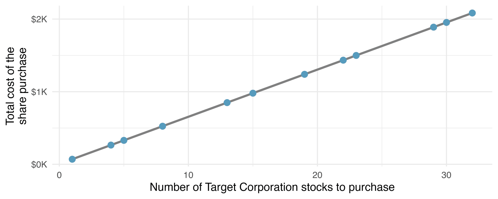
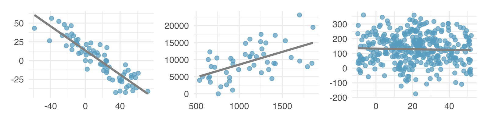
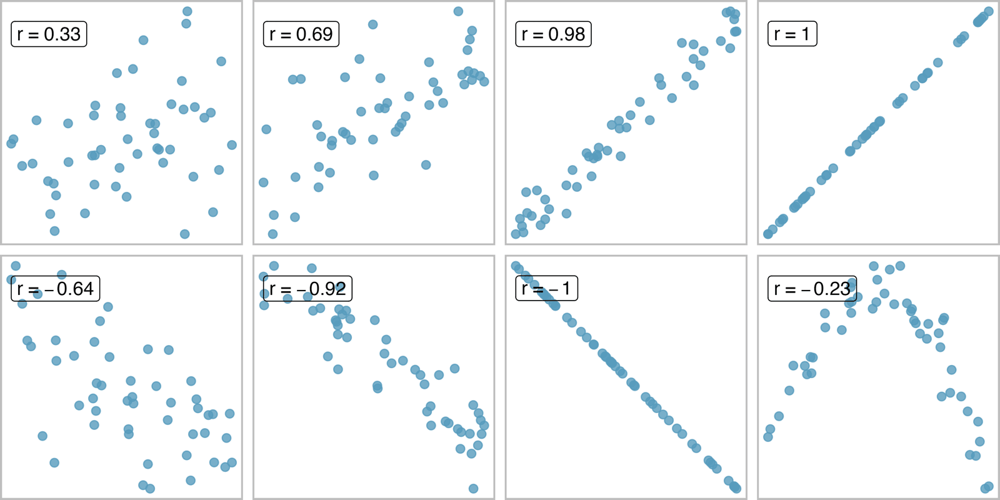
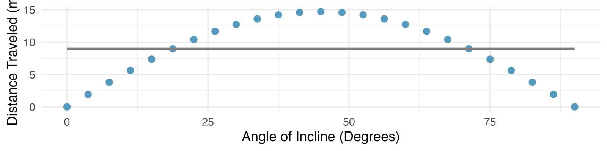
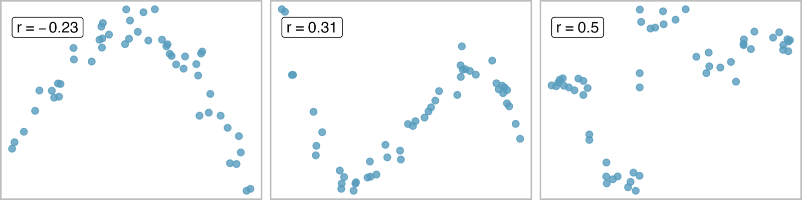
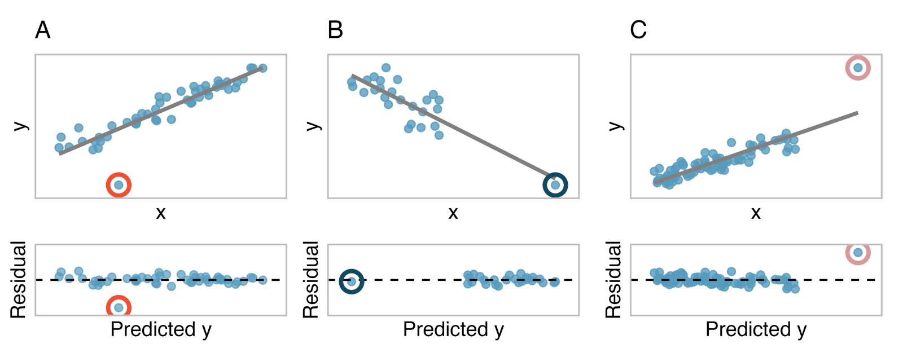
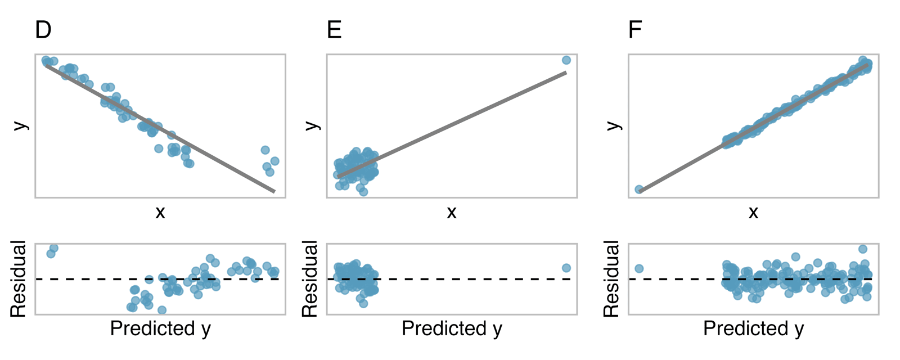



```{r}
#| label: setup
#| include: false
library(tidyverse)
library(openintro)
library(broom)
knitr::opts_chunk$set(out.width = "90%")
```

## Student Information

```{r}
#| label: student-information-1
#| echo: false
learnr2::student_info()
```

## Introduction

This tutorial covers [Chapter 7: Linear regression with a single predictor](https://openintrostat.github.io/ims/model-slr.html) from [*Introduction to Modern Statistics*](https://openintrostat.github.io/ims/) by Mine Çetinkaya-Rundel and Johanna Hardin. You will learn to fit a least squares line, to read its slope, intercept, fitted values, and residuals, to measure a linear relationship with the correlation and $R^2$, to use a categorical predictor with two levels, and to judge how much outliers move the line.

### Exercise 1

You should be doing this tutorial in a repo named `linear-regression-with-a-single-predictor`. If you are not, create one and then connect to it.

Create a new file, `analysis.qmd`, with the title `"Linear Regression with a Single Predictor"` and your name as the author. In a bash Terminal, render it:

```bash
quarto render analysis.qmd
```

Open `analysis.html` with Live Server (right-click it in the Explorer → **Open with Live Server**) and keep the tab open. It refreshes on every render. Going forward, we will just tell you to "Render" when we want you to take these steps.

Create a `.gitignore` with `analysis_files` followed by a blank line. Commit and push. Use AI however you like.

If `show_file()` fails, it is probably because you have not yet loaded `library(learnr2)` in the R Terminal.

```{r}
#| label: introduction-1
#| echo: false
learnr2::question('In the R Terminal, run show_file(".gitignore"). CP/CR.', type = "reflection")
```

###

```{.output}
analysis_files
```

###

Linear regression is a very powerful statistical technique. Linear models can be used for prediction or to describe the relationship between two numerical variables, assuming there is a linear relationship between them.

### Exercise 2

Add a chunk to `analysis.qmd` that loads the **[tidyverse](https://www.tidyverse.org/)**, with `#| message: false` so the startup messages stay out of the rendered page. Add `execute: echo: false` to the YAML header. Render.

```{r}
#| label: introduction-2
#| echo: false
learnr2::question('In the R Terminal, run show_file("analysis.qmd"). CP/CR.', type = "reflection")
```

###

````{verbatim}
#| message: false
library(tidyverse)
````

###

**ggplot2**, part of the **tidyverse**, can draw a least squares line on a scatterplot in one layer. Every straight line in this chapter's figures was drawn that way.

### Exercise 3

Add **[openintro](https://openintrostat.github.io/openintro/)** to that chunk. Render.

```{r}
#| label: introduction-3
#| echo: false
learnr2::question('In the R Terminal, run show_file("analysis.qmd"). CP/CR.', type = "reflection")
```

###

````{verbatim}
#| message: false
library(tidyverse)
library(openintro)
````

###

**openintro** holds the chapter's three datasets. `possum` has body measurements of Australian possums, `elmhurst` has family income and gift aid for 50 college students, and `mariokart` has eBay auctions of a video game.

### Exercise 4

Add **[broom](https://broom.tidymodels.org/)** to that chunk. Render.

```{r}
#| label: introduction-4
#| echo: false
learnr2::question('In the R Terminal, run show_file("analysis.qmd"). CP/CR.', type = "reflection")
```

###

````{verbatim}
#| message: false
library(tidyverse)
library(openintro)
library(broom)
````

###

**broom** turns a fitted model into tibbles: one row per coefficient, one row per observation with its fitted value and residual, or one row of fit statistics like $R^2$. Base R's model summary prints the same numbers as text, and **parameters** and **modelsummary** are popular alternatives.

## Fitting a line, residuals, and correlation

When considering linear regression, it's helpful to think deeply about the line fitting process. This section fits a line to brushtail possums: researchers captured 104 of these animals and took body measurements before releasing the animals back into the wild.

### Exercise 1

Add a chunk that prints `possum`. Render.

```{r}
#| label: fitting-a-line-residuals-and-correlation-1
#| echo: false
learnr2::question('In the R Terminal, run show_file("analysis.qmd"). CP/CR.', type = "reflection")
```

###

```{r}
#| label: fitting-a-line-residuals-and-correlation-1-test
#| echo: true
possum
```

###

Each of the 104 rows is one possum, with eight measurements. This section models just two of them: `head_l`, the length of the head in millimeters, and `total_l`, the length of the whole animal in centimeters.

### Exercise 2

Replace the code in that chunk with a scatterplot of `head_l` against `total_l`. Render.

```{r}
#| label: fitting-a-line-residuals-and-correlation-2
#| echo: false
learnr2::question('In the R Terminal, run show_file("analysis.qmd"). CP/CR.', type = "reflection")
```

###

```{r}
#| label: fitting-a-line-residuals-and-correlation-2-test
#| echo: true
possum |>
  ggplot(aes(x = total_l, y = head_l)) +
  geom_point()
```

###

The head and total length variables are associated: possums with an above average total length also tend to have above average head lengths. A perfect linear relationship, like the total cost of buying shares of one stock, is unrealistic in almost any natural process.

{fig-alt="A scatterplot showing a perfect linear relationship between number of stocks to purchase on the x-axis and total cost of the share purchase on the y-axis."}

### Exercise 3

Add the least squares line to the scatterplot, without a shaded band around it. Render.

```{r}
#| label: fitting-a-line-residuals-and-correlation-3
#| echo: false
learnr2::question('In the R Terminal, run show_file("analysis.qmd"). CP/CR.', type = "reflection")
```

###

```{r}
#| label: fitting-a-line-residuals-and-correlation-3-test
#| echo: true
possum |>
  ggplot(aes(x = total_l, y = head_l)) +
  geom_point() +
  geom_smooth(method = "lm", formula = y ~ x, se = FALSE)
```

###

*Linear regression* is the statistical method for fitting a line to data where the relationship between two variables, *x* and *y*, can be modeled by a straight line with some error. It is rare for all of the data to fall perfectly on a straight line, as with the possums and these three datasets.

{fig-alt="Three scatterplots with fabricated data. The first panel shows a strong negative linear relationship. The second panel shows a moderate positive linear relationship. The last panel shows no relationship between the x and y variables."}

### Exercise 4

Color the points by `sex`. Render.

```{r}
#| label: fitting-a-line-residuals-and-correlation-4
#| echo: false
learnr2::question('In the R Terminal, run show_file("analysis.qmd"). CP/CR.', type = "reflection")
```

###

```{r}
#| label: fitting-a-line-residuals-and-correlation-4-test
#| echo: true
possum |>
  ggplot(aes(x = total_l, y = head_l)) +
  geom_point(aes(color = sex)) +
  geom_smooth(method = "lm", formula = y ~ x, se = FALSE)
```

###

The chapter says male possums seem to be larger in terms of total length and head length than female possums. The two colors overlap too much to tell by eye.

### Exercise 5

Replace the code in that chunk so that it calculates the mean `head_l` and the mean `total_l` for each `sex`. Render.

```{r}
#| label: fitting-a-line-residuals-and-correlation-5
#| echo: false
learnr2::question('In the R Terminal, run show_file("analysis.qmd"). CP/CR.', type = "reflection")
```

###

```{r}
#| label: fitting-a-line-residuals-and-correlation-5-test
#| echo: true
possum |>
  summarize(head_l = mean(head_l),
            total_l = mean(total_l),
            .by = sex)
```

###

Males do have longer heads, 92.9 mm against 92.1 mm, but females are longer overall, 87.9 cm against 86.5 cm. The book's claim holds for heads but not for bodies.

### Exercise 6

Replace the code in that chunk so that it calculates the correlation between `total_l` and `head_l`. Render.

```{r}
#| label: fitting-a-line-residuals-and-correlation-6
#| echo: false
learnr2::question('In the R Terminal, run show_file("analysis.qmd"). CP/CR.', type = "reflection")
```

###

```{r}
#| label: fitting-a-line-residuals-and-correlation-6-test
#| echo: true
possum |>
  summarize(r = cor(total_l, head_l))
```

###

*Correlation*, which always takes values between -1 and 1, describes the strength and direction of the linear relationship between two variables. At 0.691, the possum relationship is positive and moderately strong, like the r = 0.69 plot below.

{fig-alt="Eight scatterplots on fabricated data. The first seven plots show linear trends with correlations ranging from -1 to +1. The eighth plot shows a quadratic relationship which produces a correlation of -0.23."}

### Exercise 7

Change the calculation so that it uses total length in inches, not centimeters. There are 2.54 centimeters in an inch. Render.

```{r}
#| label: fitting-a-line-residuals-and-correlation-7
#| echo: false
learnr2::question('In the R Terminal, run show_file("analysis.qmd"). CP/CR.', type = "reflection")
```

###

```{r}
#| label: fitting-a-line-residuals-and-correlation-7-test
#| echo: true
possum |>
  mutate(total_in = total_l / 2.54) |>
  summarize(r = cor(total_in, head_l))
```

###

Still 0.691. The correlation value has no units and will not be affected by a linear change in the units (e.g., going from inches to centimeters).

### Exercise 8

Start a new chunk that fits a linear model predicting `head_l` from `total_l`, stores it as `possum_fit`, and shows only the term names and the estimates of its coefficients. Render.

```{r}
#| label: fitting-a-line-residuals-and-correlation-8
#| echo: false
learnr2::question('In the R Terminal, run show_file("analysis.qmd"). CP/CR.', type = "reflection")
```

###

```{r}
#| label: fitting-a-line-residuals-and-correlation-8-test
#| echo: true
possum_fit <- lm(head_l ~ total_l, data = possum)

possum_fit |>
  tidy() |>
  select(term, estimate)
```

###

The least squares line is $\hat{y} = 42.7 + 0.573x$, with `total_l` as the *predictor* and `head_l` as the *outcome*. The book's line, fit by eye, is $\hat{y} = 41 + 0.59x$.

### Exercise 9

Replace the coefficient table with the predicted head length of a possum whose total length is 80 cm. Render.

```{r}
#| label: fitting-a-line-residuals-and-correlation-9
#| echo: false
learnr2::question('In the R Terminal, run show_file("analysis.qmd"). CP/CR.', type = "reflection")
```

###

```{r}
#| label: fitting-a-line-residuals-and-correlation-9-test
#| echo: true
possum_fit <- lm(head_l ~ total_l, data = possum)

possum_fit |>
  augment(newdata = tibble(total_l = 80))
```

###

Our line predicts 88.5 mm, and the book's line by eye gives 88.2 mm. The estimate may be viewed as an average: the equation predicts that possums with a total length of 80 cm will have an average head length of 88.5 mm.

### Exercise 10

Replace the prediction with a table showing, for every possum, its `head_l`, its `total_l`, its fitted value, and its residual. Render.

```{r}
#| label: fitting-a-line-residuals-and-correlation-10
#| echo: false
learnr2::question('In the R Terminal, run show_file("analysis.qmd"). CP/CR.', type = "reflection")
```

###

```{r}
#| label: fitting-a-line-residuals-and-correlation-10-test
#| echo: true
possum_fit <- lm(head_l ~ total_l, data = possum)

possum_fit |>
  augment() |>
  select(head_l, total_l, .fitted, .resid)
```

###

*Residuals* are the leftover variation in the data after accounting for the model fit. The first possum's head, 94.1 mm, is above its fitted value of 93.7 mm, so its residual is positive, 0.402, while the second possum's head is below the line, so its residual, -2.63, is negative.

### Exercise 11

Start a new chunk with a residual plot for `possum_fit`: each possum's residual against its fitted value, with a dashed horizontal line at zero. Render.

```{r}
#| label: fitting-a-line-residuals-and-correlation-11
#| echo: false
learnr2::question('In the R Terminal, run show_file("analysis.qmd"). CP/CR.', type = "reflection")
```

###

```{r}
#| label: fitting-a-line-residuals-and-correlation-11-test
#| echo: true
possum_fit |>
  augment() |>
  ggplot(aes(x = .fitted, y = .resid)) +
  geom_point() +
  geom_hline(yintercept = 0, linetype = "dashed")
```

###

Creating a residual plot is sort of like tipping the scatterplot over so the regression line is horizontal. The possum residuals show no curve, but sometimes fitting a straight line to the data, even if there is a clear relationship between the variables, is not helpful.

{fig-alt="A scatterplot showing a perfect quadratic relationship between angle of incline on the x-axis and distance traveled on the y-axis. The line of best fit is superimposed as a perfectly horizontal line. That is to say, the variables are clearly related, but they do not have a linear relationship."}

### Exercise 12

Replace the residual plot with a scatterplot of `head_l` against `total_l`, with the fitted values from `possum_fit` drawn as a line. Render.

```{r}
#| label: fitting-a-line-residuals-and-correlation-12
#| echo: false
learnr2::question('In the R Terminal, run show_file("analysis.qmd"). CP/CR.', type = "reflection")
```

###

```{r}
#| label: fitting-a-line-residuals-and-correlation-12-test
#| echo: true
possum_fit |>
  augment(data = possum) |>
  ggplot(aes(x = total_l, y = head_l)) +
  geom_point() +
  geom_line(aes(y = .fitted))
```

###

Every fitted value lies on one straight line, and each point's vertical distance from it is that possum's residual. Each head length is its fitted value plus its residual.

### Exercise 13

Improve the scatterplot. Color the points by sex, and add a title, axis labels, a legend title, a subtitle that states the main finding, and a caption giving the number of possums and the source. Render.

```{r}
#| label: fitting-a-line-residuals-and-correlation-13
#| echo: false
learnr2::question('In the R Terminal, run show_file("analysis.qmd"). CP/CR.', type = "reflection")
```

###

```{r}
#| label: fitting-a-line-residuals-and-correlation-13-test
#| echo: true
possum_fit |>
  augment(data = possum) |>
  ggplot(aes(x = total_l, y = head_l)) +
  geom_point(aes(color = sex)) +
  geom_line(aes(y = .fitted)) +
  scale_color_discrete(labels = c("Female", "Male")) +
  labs(title = "Head Length and Total Length of Brushtail Possums",
       subtitle = "Each extra 10 cm of body goes with about 5.7 mm more head, on average",
       x = "Total Length (cm)",
       y = "Head Length (mm)",
       color = "Sex",
       caption = "104 possums; Lindenmayer et al. (1995)")
```

###

The slope of 0.573 mm per cm becomes 5.7 mm per 10 cm, a unit a reader can picture.

### Exercise 14

Commit `analysis.qmd` with the message `"Fit a line to possum lengths"` and push.

```{r}
#| label: fitting-a-line-residuals-and-correlation-14
#| echo: false
learnr2::question("In the bash Terminal, run git log --oneline -3. CP/CR.", type = "reflection")
```

###

```{.output}
3f8a1c2 (HEAD -> main, origin/main) Fit a line to possum lengths
9be04d2 Initial commit
```

###

The correlation is intended to quantify the strength of a linear trend. Nonlinear trends, even when strong, sometimes produce correlations that do not reflect the strength of the relationship, as in these three examples.

{fig-alt="Three scatterplots on fabricated data which demonstrate strong patterns between the x and y variables. The first plot shows a quadratic trend with a correlation of -0.23. The second plot shows a cyclic trend (like a sin wave) with a correlation of 0.31. The third plot shows a distinct relationship that is not obviously functional and has a correlation of 0.5."}

## Least squares regression and outliers

Fitting linear models by eye is open to criticism since it is based on an individual's preference. This section fits the least squares line to the gift aid of 50 Elmhurst College students in `elmhurst`, measures how well it fits, and then turns to eBay auctions of Mario Kart. Gift aid is financial aid that does not need to be paid back, as opposed to a loan, and all monetary amounts are given in \$1,000s.

### Exercise 1

Start a new chunk with a scatterplot of `gift_aid` against `family_income`, using `elmhurst`, with the least squares line and no shaded band. Render.

```{r}
#| label: least-squares-regression-and-outliers-1
#| echo: false
learnr2::question('In the R Terminal, run show_file("analysis.qmd"). CP/CR.', type = "reflection")
```

###

```{r}
#| label: least-squares-regression-and-outliers-1-test
#| echo: true
elmhurst |>
  ggplot(aes(x = family_income, y = gift_aid)) +
  geom_point() +
  geom_smooth(method = "lm", formula = y ~ x, se = FALSE)
```

###

The line follows a negative trend in the data: students who have higher family incomes tended to have lower gift aid from the university. This line is the *least squares line*, the one that minimizes the sum of the squared residuals.

### Exercise 2

Replace the code in that chunk so that it calculates the mean and standard deviation of both `family_income` and `gift_aid`, and the correlation between them. Render.

```{r}
#| label: least-squares-regression-and-outliers-2
#| echo: false
learnr2::question('In the R Terminal, run show_file("analysis.qmd"). CP/CR.', type = "reflection")
```

###

```{r}
#| label: least-squares-regression-and-outliers-2-test
#| echo: true
elmhurst |>
  summarize(mean_income = mean(family_income),
            sd_income = sd(family_income),
            mean_aid = mean(gift_aid),
            sd_aid = sd(gift_aid),
            r = cor(family_income, gift_aid))
```

###

These five numbers are enough to find the line. The slope is $b_1 = (s_y / s_x) r = (5.46 / 63.2)(-0.499) = -0.0431$, and the line passes through the point of means, (102, 19.9).

### Exercise 3

Replace the code in that chunk so that it fits a linear model predicting `gift_aid` from `family_income` and shows only the term names and the estimates of its coefficients. Render.

```{r}
#| label: least-squares-regression-and-outliers-3
#| echo: false
learnr2::question('In the R Terminal, run show_file("analysis.qmd"). CP/CR.', type = "reflection")
```

###

```{r}
#| label: least-squares-regression-and-outliers-3-test
#| echo: true
lm(gift_aid ~ family_income, data = elmhurst) |>
  tidy() |>
  select(term, estimate)
```

###

The slope describes the estimated difference in the predicted average outcome of *y* if the predictor variable *x* happened to be one unit larger. Both variables are in thousands of dollars, so each extra \$1,000 of family income goes with \$43.10 less aid, on average, though we cannot interpret a causal connection between the variables because these data are observational.

### Exercise 4

Replace the coefficient table with the model's predicted gift aid for a family income of \$0 and for a family income of \$1 million. Render.

```{r}
#| label: least-squares-regression-and-outliers-4
#| echo: false
learnr2::question('In the R Terminal, run show_file("analysis.qmd"). CP/CR.', type = "reflection")
```

###

```{r}
#| label: least-squares-regression-and-outliers-4-test
#| echo: true
lm(gift_aid ~ family_income, data = elmhurst) |>
  augment(newdata = tibble(family_income = c(0, 1000)))
```

###

The intercept, \$24,300 for a family with no income, makes sense because one student's family reported \$0. The \$1 million family gets -\$18,800, and applying a model estimate to values outside of the realm of the original data is called *extrapolation*.

### Exercise 5

Replace the predictions with the variance of `gift_aid` and the variance of the model's residuals. Render.

```{r}
#| label: least-squares-regression-and-outliers-5
#| echo: false
learnr2::question('In the R Terminal, run show_file("analysis.qmd"). CP/CR.', type = "reflection")
```

###

```{r}
#| label: least-squares-regression-and-outliers-5-test
#| echo: true
lm(gift_aid ~ family_income, data = elmhurst) |>
  augment() |>
  summarize(var_aid = var(gift_aid),
            var_resid = var(.resid))
```

###

Knowing family income shrinks the variance from 29.8 to 22.4, a reduction of (29.8 - 22.4) / 29.8, about 25%. The $R^2$ of a linear model describes the amount of variation in the outcome variable that is explained by the least squares line.

### Exercise 6

Replace the variances with the model's $R^2$. Render.

```{r}
#| label: least-squares-regression-and-outliers-6
#| echo: false
learnr2::question('In the R Terminal, run show_file("analysis.qmd"). CP/CR.', type = "reflection")
```

###

```{r}
#| label: least-squares-regression-and-outliers-6-test
#| echo: true
lm(gift_aid ~ family_income, data = elmhurst) |>
  glance() |>
  select(r.squared)
```

###

$R^2$ corresponds exactly to the squared value of the correlation: $(-0.499)^2 = 0.249$. $R^2$ is also called the *coefficient of determination*.

### Exercise 7

Replace the code in that chunk with a histogram of `total_pr` from `mariokart`. Render.

```{r}
#| label: least-squares-regression-and-outliers-7
#| echo: false
learnr2::question('In the R Terminal, run show_file("analysis.qmd"). CP/CR.', type = "reflection")
```

###

```{r}
#| label: least-squares-regression-and-outliers-7-test
#| echo: true
mariokart |>
  ggplot(aes(x = total_pr)) +
  geom_histogram(binwidth = 5)
```

###

Nearly every auction sold for under \$80, but two sit far off to the right, stretching the axis past \$300. In a regression, *outliers* are observations that fall far from the cloud of points.

### Exercise 8

Replace the histogram with the auctions whose `total_pr` is above \$100, showing their `cond`, `total_pr`, and `title`. Render.

```{r}
#| label: least-squares-regression-and-outliers-8
#| echo: false
learnr2::question('In the R Terminal, run show_file("analysis.qmd"). CP/CR.', type = "reflection")
```

###

```{r}
#| label: least-squares-regression-and-outliers-8-test
#| echo: true
mariokart |>
  filter(total_pr > 100) |>
  select(cond, total_pr, title)
```

###

The \$327 auction was a whole Wii console bundled with Guitar Hero 5, and the \$118 one was ten Wii games. The help page says auctions were kept only if "there were no other items included in the auction with the exception of racing wheels," yet these two bundles made it in.

### Exercise 9

Replace the code in that chunk so that it fits a linear model predicting `total_pr` from `cond`, using only the auctions under \$100, and shows only the term names and the estimates. Render.

```{r}
#| label: least-squares-regression-and-outliers-9
#| echo: false
learnr2::question('In the R Terminal, run show_file("analysis.qmd"). CP/CR.', type = "reflection")
```

###

```{r}
#| label: least-squares-regression-and-outliers-9-test
#| echo: true
mariokart |>
  filter(total_pr < 100) |>
  lm(total_pr ~ cond, data = _) |>
  tidy() |>
  select(term, estimate)
```

###

The estimated intercept is the value of the outcome variable for the first category (i.e., the category corresponding to an indicator value of 0). R puts the levels in alphabetical order, so `new` came first: new games averaged \$53.80, and used ones \$10.90 less.

### Exercise 10

Change the model so that `used` is the first category of `cond`, as in the book. Render.

```{r}
#| label: least-squares-regression-and-outliers-10
#| echo: false
learnr2::question('In the R Terminal, run show_file("analysis.qmd"). CP/CR.', type = "reflection")
```

###

```{r}
#| label: least-squares-regression-and-outliers-10-test
#| echo: true
mariokart |>
  filter(total_pr < 100) |>
  mutate(cond = fct_relevel(cond, "used")) |>
  lm(total_pr ~ cond, data = _) |>
  tidy() |>
  select(term, estimate)
```

###

Now `condnew` is an *indicator variable*, which takes value 1 when the game is new and 0 when the game is used. Used games averaged \$42.90, and the estimated slope is the average change in the outcome variable between the two categories, \$10.90.

### Exercise 11

Fit the same model to all 143 auctions, including the two bundles. Render.

```{r}
#| label: least-squares-regression-and-outliers-11
#| echo: false
learnr2::question('In the R Terminal, run show_file("analysis.qmd"). CP/CR.', type = "reflection")
```

###

```{r}
#| label: least-squares-regression-and-outliers-11-test
#| echo: true
mariokart |>
  mutate(cond = fct_relevel(cond, "used")) |>
  lm(total_pr ~ cond, data = _) |>
  tidy() |>
  select(term, estimate)
```

###

Two auctions out of 143 cut the gap between new and used from \$10.90 to \$6.62. Like the circled point in plot C, an outlier far from the cloud can pull the least squares line toward it.

{fig-alt="A grid of 2 by 3 scatterplots with fabricated data, all of which contain at least one outlying observation. The top row of plots contains original x-y data plots with a least squares regression line. The bottom row of plots is a series of residual plot with predicted value on the x-axis and residual on the y-axis. The first column of plots gives an example of an outlier in the bivariate model which does not impact the least squares regression line. The second column gives an example of a point which is outlying in both the x and y directions but it is not a model outlier. The third column gives an example of a point that pulls the regression line toward it, impacting the least squares line."}

### Exercise 12

Replace the coefficient table with a table showing the $R^2$ of both models: one fit to all auctions and one fit to the auctions under \$100. Render.

```{r}
#| label: least-squares-regression-and-outliers-12
#| echo: false
learnr2::question('In the R Terminal, run show_file("analysis.qmd"). CP/CR.', type = "reflection")
```

###

```{r}
#| label: least-squares-regression-and-outliers-12-test
#| echo: true
bind_rows(
  all = lm(total_pr ~ cond, data = mariokart) |>
    glance(),
  under_100 = lm(total_pr ~ cond, data = filter(mariokart, total_pr < 100)) |>
    glance(),
  .id = "auctions"
) |>
  select(auctions, r.squared)
```

###

With the two bundles, condition explains 1.6% of the variation in price, and without them, 35.1%. A good practice for dealing with outlying observations is to produce two analyses: one with and one without the outlying observations.

### Exercise 13

Replace the table with a scatterplot of `total_pr` against an indicator equal to 1 for new games and 0 for used ones, for the auctions under \$100. Jitter the points a little horizontally, and add the least squares line. Render.

```{r}
#| label: least-squares-regression-and-outliers-13
#| echo: false
learnr2::question('In the R Terminal, run show_file("analysis.qmd"). CP/CR.', type = "reflection")
```

###

```{r}
#| label: least-squares-regression-and-outliers-13-test
#| echo: true
mariokart |>
  filter(total_pr < 100) |>
  mutate(new = if_else(cond == "new", 1, 0)) |>
  ggplot(aes(x = new, y = total_pr)) +
  geom_jitter(width = 0.05, height = 0) +
  geom_smooth(method = "lm", formula = y ~ x, se = FALSE)
```

###

To incorporate the game condition variable into a regression equation, we must convert the categories into a numerical form. Once condition is 0 or 1, the least squares line runs from the used mean at 0 to the new mean at 1.

### Exercise 14

Improve the scatterplot. Label the x-axis ticks with the condition names, show prices in dollars, and add a title, axis labels, a subtitle that states the main finding, and a caption giving the number of auctions and the source. Render.

```{r}
#| label: least-squares-regression-and-outliers-14
#| echo: false
learnr2::question('In the R Terminal, run show_file("analysis.qmd"). CP/CR.', type = "reflection")
```

###

```{r}
#| label: least-squares-regression-and-outliers-14-test
#| echo: true
mariokart |>
  filter(total_pr < 100) |>
  mutate(new = if_else(cond == "new", 1, 0)) |>
  ggplot(aes(x = new, y = total_pr)) +
  geom_jitter(width = 0.05, height = 0, alpha = 0.6) +
  geom_smooth(method = "lm", formula = y ~ x, se = FALSE) +
  scale_x_continuous(breaks = c(0, 1),
                     labels = c("Used (0)", "New (1)")) +
  scale_y_continuous(labels = scales::label_dollar()) +
  labs(title = "Mario Kart Wii Prices on eBay by Condition",
       subtitle = "New copies sold for about $10.90 more than used ones",
       x = "Condition",
       y = "Total Price (Auction plus Shipping)",
       caption = "141 eBay auctions under $100, October 2009; two bundles removed")
```

###

The slope of this line is the \$10.90 difference between conditions, and its intercept is the used average. The intercept and slope interpretations do not change when modeling categorical variables with two levels.

### Exercise 15

Commit `analysis.qmd` with the message `"Fit least squares lines and check outliers"` and push.

```{r}
#| label: least-squares-regression-and-outliers-15
#| echo: false
learnr2::question("In the bash Terminal, run git log --oneline -3. CP/CR.", type = "reflection")
```

###

```{.output}
7c41e9d (HEAD -> main, origin/main) Fit least squares lines and check outliers
3f8a1c2 Fit a line to possum lengths
9be04d2 Initial commit
```

###

Points that fall horizontally away from the center of the cloud tend to pull harder on the line, so we call them points with *high leverage* or *leverage points*, like the point on the right of plot E. The two bundles sit at 0 or 1 like every other auction, so they are not leverage points, but they still moved the line.

{fig-alt="A grid of 2 by 3 scatterplots with fabricated data, all of which contain at least one outlying observation. The top row of plots contains original x-y data plots with a least squares regression line. The bottom row of plots is a series of residual plot with predicted value on the x-axis and residual on the y-axis. The first column of plots gives an example of a small cloud of points that drags the regression line toward it. The second column gives an example of a point which is outlying enough in both the x and y direction that it changes a model which has no linearity into what seems like a strong positive relationship. The third column gives an example of a point that is far in both the x and y directions but is in-line with the regression model and has very little impact on the least squares regression line."}

## Summary

This tutorial covered [Chapter 7: Linear regression with a single predictor](https://openintrostat.github.io/ims/model-slr.html) from [*Introduction to Modern Statistics*](https://openintrostat.github.io/ims/) by Mine Çetinkaya-Rundel and Johanna Hardin. You have learned to fit a least squares line, to read its slope, intercept, fitted values, and residuals, to measure a linear relationship with the correlation and $R^2$, to use a categorical predictor with two levels, and to judge how much outliers move the line.

Throughout this tutorial, the nuances of the linear model have been described. You have learned how to create a linear model with explanatory variables that are numerical (e.g., total possum length) and those that are categorical (e.g., whether a video game was new). The residuals in a linear model are an important metric used to understand how well a model fits; high leverage points and other types of outliers can impact the fit of a model. Correlation is a measure of the strength and direction of the linear relationship of two variables, without specifying which variable is the explanatory and which is the outcome. Future tutorials will focus on generalizing the linear model from the sample of data to claims about the population of interest.

For the possums themselves, read the original [article](https://doi.org/10.1071/ZO9950449) by Lindenmayer and colleagues in the *Australian Journal of Zoology*. For the college aid data, read "[What Students Really Pay to Go to College](https://www.chronicle.com/article/what-students-really-pay-to-go-to-college/?sra=true)" in *The Chronicle of Higher Education*.

Many sentences in this tutorial, and its figures, come from the chapter, used under the book's [CC BY-SA 3.0 license](https://creativecommons.org/licenses/by-sa/3.0/).

### Exercise 1

Render one last time.

```{r}
#| label: summary-1
#| echo: false
learnr2::question('In the R Terminal, run show_file("analysis.qmd", start = 0). CP/CR.', type = "reflection")
```

###

````{verbatim}
---
title: "Linear Regression with a Single Predictor"
author: "Your Name"
format: html
execute:
  echo: false
---

```{r}
#| message: false
library(tidyverse)
library(openintro)
library(broom)
```

```{r}
possum |>
  mutate(total_in = total_l / 2.54) |>
  summarize(r = cor(total_in, head_l))
```

```{r}
possum_fit <- lm(head_l ~ total_l, data = possum)

possum_fit |>
  augment() |>
  select(head_l, total_l, .fitted, .resid)
```

```{r}
possum_fit |>
  augment(data = possum) |>
  ggplot(aes(x = total_l, y = head_l)) +
  geom_point(aes(color = sex)) +
  geom_line(aes(y = .fitted)) +
  scale_color_discrete(labels = c("Female", "Male")) +
  labs(title = "Head Length and Total Length of Brushtail Possums",
       subtitle = "Each extra 10 cm of body goes with about 5.7 mm more head, on average",
       x = "Total Length (cm)",
       y = "Head Length (mm)",
       color = "Sex",
       caption = "104 possums; Lindenmayer et al. (1995)")
```

```{r}
mariokart |>
  filter(total_pr < 100) |>
  mutate(new = if_else(cond == "new", 1, 0)) |>
  ggplot(aes(x = new, y = total_pr)) +
  geom_jitter(width = 0.05, height = 0, alpha = 0.6) +
  geom_smooth(method = "lm", formula = y ~ x, se = FALSE) +
  scale_x_continuous(breaks = c(0, 1),
                     labels = c("Used (0)", "New (1)")) +
  scale_y_continuous(labels = scales::label_dollar()) +
  labs(title = "Mario Kart Wii Prices on eBay by Condition",
       subtitle = "New copies sold for about $10.90 more than used ones",
       x = "Condition",
       y = "Total Price (Auction plus Shipping)",
       caption = "141 eBay auctions under $100, October 2009; two bundles removed")
```
````

###

Your page has one numerical predictor and one categorical predictor, each with its least squares line.

### Exercise 2

Publish your analysis to GitHub Pages. In a bash Terminal, run:

```bash
quarto publish gh-pages analysis.qmd
```

```{r}
#| label: summary-2
#| echo: false
learnr2::question("Paste the URL of your published page.", type = "reflection")
```

###

Your answer should look like `https://your-github-username.github.io/linear-regression-with-a-single-predictor/`.

###

A regression line, unlike a correlation, depends on which variable predicts which.

### Exercise 3

Commit and push any remaining changes.

```{r}
#| label: summary-3
#| echo: false
learnr2::question("Paste the URL of your GitHub repo.", type = "reflection")
```

###

Your answer should look like `https://github.com/your-github-username/linear-regression-with-a-single-predictor`.

###

Linear regression is simply a modeling framework. The truth is almost always much more complex than a simple line.


## Your Answers

```{r}
#| label: your-answers-1
#| echo: false
learnr2::question(
  "How many minutes, approximately, did it take you to complete this
  tutorial? For example, an hour and a half would be 90 minutes.",
  type = "reflection_editable",
  validate = "integer"
)
```

```{r}
#| label: your-answers-2
#| echo: false
learnr2::download_answers_button(filename_prefix = "linear-regression-single")
```
