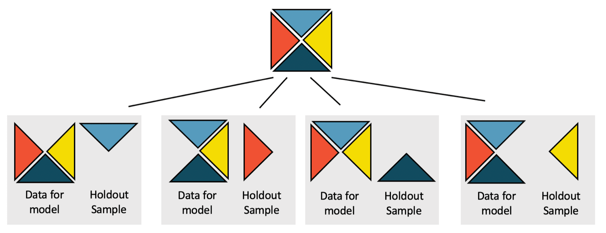
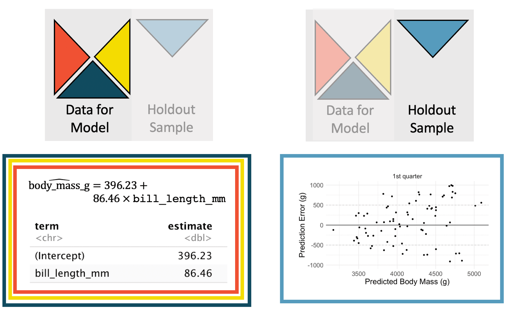
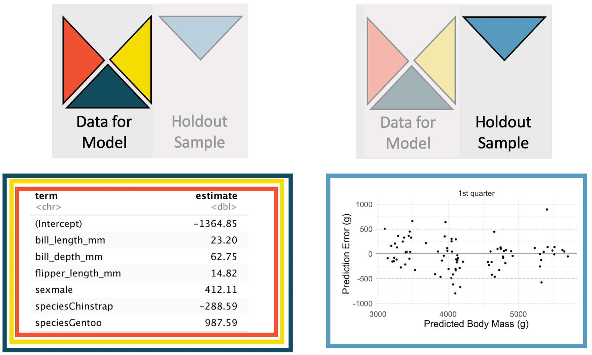



```{r}
#| label: setup
#| include: false
library(tidyverse)
library(openintro)
library(broom)
library(palmerpenguins)
knitr::opts_chunk$set(out.width = "90%")

loans <- loans_full_schema |>
  mutate(credit_util = total_credit_utilized / total_credit_limit,
         bankruptcy = as.factor(if_else(public_record_bankrupt == 0, 0, 1)),
         verified_income = droplevels(verified_income)) |>
  rename(credit_checks = inquiries_last_12m) |>
  select(interest_rate, verified_income, debt_to_income, credit_util,
         bankruptcy, term, credit_checks, issue_month)

set.seed(47)
penguins_cv <- penguins |>
  drop_na() |>
  mutate(fold = sample(rep(1:4, length.out = n())))
```

## Student Information

```{r}
#| label: student-information-1
#| echo: false
learnr2::student_info()
```

## Introduction

This tutorial covers [Chapter 25: Inference for linear regression with multiple predictors](https://openintrostat.github.io/ims/inf-model-mlr.html) from [*Introduction to Modern Statistics*](https://openintrostat.github.io/ims/) by Mine Çetinkaya-Rundel and Johanna Hardin. You will learn to read the standard errors, T scores, and p-values of a model with several predictors, to see how correlated predictors change a model's coefficients, and to compare two models by their cross-validated prediction errors, using Lending Club loans and Palmer penguins.

### Exercise 1

You should be doing this tutorial in a repo named `inference-for-linear-regression-with-multiple-predictors`. If you are not, create one and then connect to it.

Create a new file, `analysis.qmd`, with the title `"Inference for Linear Regression with Multiple Predictors"` and your name as the author. In a bash Terminal, render it:

```bash
quarto render analysis.qmd
```

Open `analysis.html` with Live Server (right-click it in the Explorer → **Open with Live Server**) and keep the tab open. It refreshes on every render. Going forward, we will just tell you to "Render" when we want you to take these steps.

Create a `.gitignore` with `analysis_files` followed by a blank line. Commit and push. Use AI however you like.

If `show_file()` fails, it is probably because you have not yet loaded `library(learnr2)` in the R Terminal.

```{r}
#| label: introduction-1
#| echo: false
learnr2::question('In the R Terminal, run show_file(".gitignore"). CP/CR.', type = "reflection")
```

###

```{.output}
analysis_files
```

###

Here, we discuss whether each of the variables individually is a statistically discernible predictor of the outcome or whether the model might be just as strong without that variable. Our first outcome is the interest rate on a loan, and our second is the body mass of a penguin.

### Exercise 2

Add a chunk to `analysis.qmd` that loads the **[tidyverse](https://www.tidyverse.org/)**, with `#| message: false` so the startup messages stay out of the rendered page. Add `execute: echo: false` to the YAML header. Render.

```{r}
#| label: introduction-2
#| echo: false
learnr2::question('In the R Terminal, run show_file("analysis.qmd"). CP/CR.', type = "reflection")
```

###

````{verbatim}
#| message: false
library(tidyverse)
````

###

Both the derivations from the mathematical model and the randomization model are beyond the scope of this book, but we are able to calculate p-values using statistical software. Base R fits the models and computes those p-values, and the **tidyverse** prepares the data, splits it for cross-validation, and draws the plots.

### Exercise 3

Add **[openintro](https://openintrostat.github.io/openintro/)** to that chunk. Render.

```{r}
#| label: introduction-3
#| echo: false
learnr2::question('In the R Terminal, run show_file("analysis.qmd"). CP/CR.', type = "reflection")
```

###

````{verbatim}
#| message: false
library(tidyverse)
library(openintro)
````

###

The `loans_full_schema` data can be found in the **openintro** R package. You fit models to it in the Linear Regression with Multiple Predictors tutorial, and this time we ask what those models say beyond these 10,000 loans.

### Exercise 4

Add **[broom](https://broom.tidymodels.org/)** to that chunk. Render.

```{r}
#| label: introduction-4
#| echo: false
learnr2::question('In the R Terminal, run show_file("analysis.qmd"). CP/CR.', type = "reflection")
```

###

````{verbatim}
#| message: false
library(tidyverse)
library(openintro)
library(broom)
````

###

**broom** turns a fitted model into a tibble with one row per coefficient: its estimate, standard error, T score, p-value, and, on request, a confidence interval. The chapter does its cross-validation with **[tidymodels](https://www.tidymodels.org/)**, but four folds are easy to do by hand.

### Exercise 5

Add **[palmerpenguins](https://allisonhorst.github.io/palmerpenguins/)** to that chunk. Render.

```{r}
#| label: introduction-5
#| echo: false
learnr2::question('In the R Terminal, run show_file("analysis.qmd"). CP/CR.', type = "reflection")
```

###

````{verbatim}
#| message: false
library(tidyverse)
library(openintro)
library(broom)
library(palmerpenguins)
````

###

The `penguins` data can be found in the **palmerpenguins** R package. R 4.5 and later also ship a `penguins` dataset with shorter column names, like `bill_len`, and loading **palmerpenguins** masks it.

## Regression output and multicollinearity

Now, our goal is to create a model where `interest_rate` can be predicted using the variables `debt_to_income`, `term`, and `credit_checks`. We rebuild the chapter's `loans` data, read the full output of that model, and check whether its three predictors are correlated.

### Exercise 1

Add a chunk that prints `loans_full_schema`. Render.

```{r}
#| label: regression-output-and-multicollinearity-1
#| echo: false
learnr2::question('In the R Terminal, run show_file("analysis.qmd"). CP/CR.', type = "reflection")
```

###

```{r}
#| label: regression-output-and-multicollinearity-1-test
#| echo: true
loans_full_schema
```

###

10,000 loans and 55 variables, made through Lending Club in early 2018. The help page warns that "this dataset only represents loans actually made, i.e. do not mistake this data for loan applications!"

### Exercise 2

Replace the code in that chunk so that it shows the six loans with the highest `debt_to_income`, keeping only `debt_to_income`, `annual_income`, `application_type`, `annual_income_joint`, and `debt_to_income_joint`. Render.

```{r}
#| label: regression-output-and-multicollinearity-2
#| echo: false
learnr2::question('In the R Terminal, run show_file("analysis.qmd"). CP/CR.', type = "reflection")
```

###

```{r}
#| label: regression-output-and-multicollinearity-2-test
#| echo: true
loans_full_schema |>
  arrange(desc(debt_to_income)) |>
  select(debt_to_income, annual_income, application_type,
         annual_income_joint, debt_to_income_joint) |>
  head(6)
```

###

The top borrower's debt is 469% of an annual income of $3,300, but the couple's joint income is $283,300. All six are joint applications, where `debt_to_income` divides the pair's debt by one person's income.

### Exercise 3

Replace the code in that chunk so that, for each `application_type`, it shows the number of loans, the number missing `debt_to_income`, and the number with `debt_to_income` above 100. Render.

```{r}
#| label: regression-output-and-multicollinearity-3
#| echo: false
learnr2::question('In the R Terminal, run show_file("analysis.qmd"). CP/CR.', type = "reflection")
```

###

```{r}
#| label: regression-output-and-multicollinearity-3-test
#| echo: true
loans_full_schema |>
  summarize(n = n(),
            missing = sum(is.na(debt_to_income)),
            over_100 = sum(debt_to_income > 100, na.rm = TRUE),
            .by = application_type)
```

###

All 24 missing values and all 33 ratios above 100 belong to the 1,495 joint applications. The chapter models `debt_to_income` as it stands, so a few joint borrowers sit far out on that predictor's scale.

### Exercise 4

Start a new chunk that creates the chapter's `loans` from `loans_full_schema`, as you did in the Linear Regression with Multiple Predictors tutorial. Add `credit_util`, the total credit utilized divided by the total credit limit, and `bankruptcy`, a factor that is 1 if `public_record_bankrupt` is at least 1 and 0 otherwise. Drop the unused level of `verified_income`, and rename `inquiries_last_12m` to `credit_checks`. Keep `interest_rate`, `verified_income`, `debt_to_income`, `credit_util`, `bankruptcy`, `term`, `credit_checks`, and `issue_month`, in that order. Print `loans`. Render.

```{r}
#| label: regression-output-and-multicollinearity-4
#| echo: false
learnr2::question('In the R Terminal, run show_file("analysis.qmd"). CP/CR.', type = "reflection")
```

###

```{r}
#| label: regression-output-and-multicollinearity-4-test
#| echo: true
loans <- loans_full_schema |>
  mutate(credit_util = total_credit_utilized / total_credit_limit,
         bankruptcy = as.factor(if_else(public_record_bankrupt == 0, 0, 1)),
         verified_income = droplevels(verified_income)) |>
  rename(credit_checks = inquiries_last_12m) |>
  select(interest_rate, verified_income, debt_to_income, credit_util,
         bankruptcy, term, credit_checks, issue_month)

loans
```

###

We will refer to this modified dataset as `loans`. If your columns or their types differ from ours, replace your code with ours, because every loan model below is built from it.

### Exercise 5

Start a new chunk that fits a linear model of `interest_rate` on `debt_to_income`, `term`, and `credit_checks`, using `loans`, and shows the full table of coefficients: estimate, standard error, test statistic, and p-value. Render.

```{r}
#| label: regression-output-and-multicollinearity-5
#| echo: false
learnr2::question('In the R Terminal, run show_file("analysis.qmd"). CP/CR.', type = "reflection")
```

###

```{r}
#| label: regression-output-and-multicollinearity-5-test
#| echo: true
lm(interest_rate ~ debt_to_income + term + credit_checks, data = loans) |>
  tidy()
```

###

These are the chapter's estimates: 4.31 + 0.041 × `debt_to_income` + 0.16 × `term` + 0.25 × `credit_checks`. The very low p-values from the software output tell us that each of the variables acts as an important predictor in the model, despite the inclusion of the other two.

### Exercise 6

Add a column to that table that divides each estimate by its standard error. Render.

```{r}
#| label: regression-output-and-multicollinearity-6
#| echo: false
learnr2::question('In the R Terminal, run show_file("analysis.qmd"). CP/CR.', type = "reflection")
```

###

```{r}
#| label: regression-output-and-multicollinearity-6-test
#| echo: true
lm(interest_rate ~ debt_to_income + term + credit_checks, data = loans) |>
  tidy() |>
  mutate(t_by_hand = estimate / std.error)
```

###

The new column matches `statistic`: it is the T score, the estimate's distance from zero measured in standard errors. The `debt_to_income` slope, 0.0408, sits 13.3 standard errors above zero, which is why its p-value is so small.

### Exercise 7

Replace the code in that chunk so that, for the same model, it shows only the number of observations and the residual degrees of freedom. Render.

```{r}
#| label: regression-output-and-multicollinearity-7
#| echo: false
learnr2::question('In the R Terminal, run show_file("analysis.qmd"). CP/CR.', type = "reflection")
```

###

```{r}
#| label: regression-output-and-multicollinearity-7-test
#| echo: true
lm(interest_rate ~ debt_to_income + term + credit_checks, data = loans) |>
  glance() |>
  select(nobs, df.residual)
```

###

The model used 9,976 loans, not 10,000: the 24 joint applications missing `debt_to_income` were dropped silently. The degrees of freedom, 9,972, are those 9,976 loans minus the four coefficients the model estimates.

### Exercise 8

Replace the code in that chunk so that it shows the full table of coefficients again, now with a 95% confidence interval for each. Render.

```{r}
#| label: regression-output-and-multicollinearity-8
#| echo: false
learnr2::question('In the R Terminal, run show_file("analysis.qmd"). CP/CR.', type = "reflection")
```

###

```{r}
#| label: regression-output-and-multicollinearity-8-test
#| echo: true
lm(interest_rate ~ debt_to_income + term + credit_checks, data = loans) |>
  tidy(conf.int = TRUE)
```

###

The interval for `debt_to_income`, 0.0348 to 0.0468, is narrow and far from zero. You might have thought that the value 0.041 is a small number (i.e., close to zero), but in the units of the problem, 0.041 turns out to be far away from zero, it's all about context.

### Exercise 9

Replace the model in that chunk with one that has `debt_to_income` as its only predictor. Render.

```{r}
#| label: regression-output-and-multicollinearity-9
#| echo: false
learnr2::question('In the R Terminal, run show_file("analysis.qmd"). CP/CR.', type = "reflection")
```

###

```{r}
#| label: regression-output-and-multicollinearity-9-test
#| echo: true
lm(interest_rate ~ debt_to_income, data = loans) |>
  tidy(conf.int = TRUE)
```

###

Alone, the slope is 0.0472, and next to `term` and `credit_checks`, it was 0.0408. With multiple predictors, the hypothesis is similar, however, it is now conditioned on each of the other variables remaining in the model.

### Exercise 10

Replace the code in that chunk with the correlations among `debt_to_income`, `term`, and `credit_checks`, using only the loans with no missing values. Render.

```{r}
#| label: regression-output-and-multicollinearity-10
#| echo: false
learnr2::question('In the R Terminal, run show_file("analysis.qmd"). CP/CR.', type = "reflection")
```

###

```{r}
#| label: regression-output-and-multicollinearity-10-test
#| echo: true
loans |>
  select(debt_to_income, term, credit_checks) |>
  cor(use = "complete.obs")
```

###

In practice, there will almost always be some degree of correlation between the explanatory variables in a multiple regression model. Here there is very little: the largest correlation, between `debt_to_income` and `term`, is 0.046.

### Exercise 11

Replace the code in that chunk with one table that compares each predictor's slope in two kinds of model: alone, as the only predictor of `interest_rate`, and together, in the model with all three. Show the model, the term, the estimate, the 95% confidence interval, and the p-value, without the intercepts. Render.

```{r}
#| label: regression-output-and-multicollinearity-11
#| echo: false
learnr2::question('In the R Terminal, run show_file("analysis.qmd"). CP/CR.', type = "reflection")
```

###

```{r}
#| label: regression-output-and-multicollinearity-11-test
#| echo: true
bind_rows(
  alone = map(c("debt_to_income", "term", "credit_checks"),
              \(x) tidy(lm(reformulate(x, "interest_rate"), data = loans),
                        conf.int = TRUE)) |>
    list_rbind(),
  together = tidy(lm(interest_rate ~ debt_to_income + term + credit_checks,
                     data = loans),
                  conf.int = TRUE),
  .id = "model"
) |>
  filter(term != "(Intercept)") |>
  select(model, term, estimate, conf.low, conf.high, p.value)
```

###

*Multicollinearity* happens when the predictor variables are correlated within themselves. These three predictors barely are, so each slope moves only a little, and stays positive, when the other two join the model.

### Exercise 12

Replace the table with a plot of the same results: for each predictor, its estimate as a point and its confidence interval as a line, with one row for the alone model and one for the together model. Give each predictor its own panel with its own x-axis. Render.

```{r}
#| label: regression-output-and-multicollinearity-12
#| echo: false
learnr2::question('In the R Terminal, run show_file("analysis.qmd"). CP/CR.', type = "reflection")
```

###

```{r}
#| label: regression-output-and-multicollinearity-12-test
#| echo: true
bind_rows(
  alone = map(c("debt_to_income", "term", "credit_checks"),
              \(x) tidy(lm(reformulate(x, "interest_rate"), data = loans),
                        conf.int = TRUE)) |>
    list_rbind(),
  together = tidy(lm(interest_rate ~ debt_to_income + term + credit_checks,
                     data = loans),
                  conf.int = TRUE),
  .id = "model"
) |>
  filter(term != "(Intercept)") |>
  ggplot(aes(x = estimate, y = model)) +
  geom_pointrange(aes(xmin = conf.low, xmax = conf.high)) +
  facet_wrap(~ term, scales = "free_x")
```

###

In each panel the two intervals overlap, and the together estimate sits a little left of the alone one. The predictors share a small part of what each explains about interest rates, and the together model splits it between them.

### Exercise 13

Improve the plot. Stack the three panels in one column, label each predictor with a readable name, and add a title, axis labels, a subtitle that states the main finding, and a caption giving the number of loans and the source. Render.

```{r}
#| label: regression-output-and-multicollinearity-13
#| echo: false
learnr2::question('In the R Terminal, run show_file("analysis.qmd"). CP/CR.', type = "reflection")
```

###

```{r}
#| label: regression-output-and-multicollinearity-13-test
#| echo: true
bind_rows(
  alone = map(c("debt_to_income", "term", "credit_checks"),
              \(x) tidy(lm(reformulate(x, "interest_rate"), data = loans),
                        conf.int = TRUE)) |>
    list_rbind(),
  together = tidy(lm(interest_rate ~ debt_to_income + term + credit_checks,
                     data = loans),
                  conf.int = TRUE),
  .id = "model"
) |>
  filter(term != "(Intercept)") |>
  mutate(term = case_when(term == "debt_to_income" ~ "Debt-to-income ratio (per point)",
                          term == "term" ~ "Loan term (per month)",
                          term == "credit_checks" ~ "Credit checks (per inquiry)"),
         model = if_else(model == "alone", "Only predictor", "With the other two")) |>
  ggplot(aes(x = estimate, y = model)) +
  geom_pointrange(aes(xmin = conf.low, xmax = conf.high)) +
  facet_wrap(~ term, scales = "free_x", ncol = 1) +
  labs(title = "Interest Rate Slopes, Alone and Together",
       subtitle = "Nearly uncorrelated predictors, so each slope barely moves when the others join",
       x = "Change in Interest Rate (percentage points), with 95% Confidence Interval",
       y = NULL,
       caption = "9,976 to 10,000 Lending Club loans, January to March 2018; openintro package")
```

###

If the predictor variables have some degree of correlation, it can be quite difficult to interpret the value of the coefficient or evaluate whether the variable is a statistically discernible predictor of the outcome. With predictors this close to uncorrelated, each slope can be read almost as if it stood alone.

### Exercise 14

Commit `analysis.qmd` with the message `"Read regression output for loans"` and push.

```{r}
#| label: regression-output-and-multicollinearity-14
#| echo: false
learnr2::question("In the bash Terminal, run git log --oneline -3. CP/CR.", type = "reflection")
```

###

```{.output}
4c1e8a7 (HEAD -> main, origin/main) Read regression output for loans
9be04d2 Initial commit
```

###

Even a model that suffers from high multicollinearity will likely lead to unbiased predictions of the response variable. So if the task at hand is only to do prediction (and not to interpret coefficients), multicollinearity is likely to not cause you substantial problems.

## Cross-validation for prediction error

Cross-validation is a computational technique which removes some observations before a model is run, then assesses the model accuracy on the held-out sample. Our goal in this section is to compare two different regression models which both seek to predict the mass of an individual penguin in grams.

### Exercise 1

Start a new chunk that prints `penguins`. Render.

```{r}
#| label: cross-validation-for-prediction-error-1
#| echo: false
learnr2::question('In the R Terminal, run show_file("analysis.qmd"). CP/CR.', type = "reflection")
```

###

```{r}
#| label: cross-validation-for-prediction-error-1-test
#| echo: true
penguins
```

###

The observations of three different penguin species include measurements on body size and sex. The data were collected by Dr. Kristen Gorman and the Palmer Station, Antarctica LTER, and published in [Gorman, Williams, and Fraser (2014)](https://doi.org/10.1371/journal.pone.0090081).

### Exercise 2

Replace the code in that chunk so that it shows every penguin with at least one missing value. Render.

```{r}
#| label: cross-validation-for-prediction-error-2
#| echo: false
learnr2::question('In the R Terminal, run show_file("analysis.qmd"). CP/CR.', type = "reflection")
```

###

```{r}
#| label: cross-validation-for-prediction-error-2-test
#| echo: true
penguins |>
  filter(if_any(everything(), is.na))
```

###

Eleven penguins have a missing value: two have no measurements at all, and nine more lack only `sex`. A model with `sex` as a predictor drops all eleven, while a model with only `bill_length_mm` drops just two.

### Exercise 3

Replace the code in that chunk with a linear model of `body_mass_g` with `bill_length_mm` as its only predictor, using `penguins`, and show the full table of coefficients. Render.

```{r}
#| label: cross-validation-for-prediction-error-3
#| echo: false
learnr2::question('In the R Terminal, run show_file("analysis.qmd"). CP/CR.', type = "reflection")
```

###

```{r}
#| label: cross-validation-for-prediction-error-3-test
#| echo: true
lm(body_mass_g ~ bill_length_mm, data = penguins) |>
  tidy()
```

###

We refer to the model given with only `bill_length_mm` as the *smaller* model. Fit to the 342 penguins with measurements, it matches the chapter: 362.31 + 87.42 × `bill_length_mm`.

### Exercise 4

Replace the model in that chunk with one that predicts `body_mass_g` from `bill_length_mm`, `bill_depth_mm`, `flipper_length_mm`, `sex`, and `species`. Render.

```{r}
#| label: cross-validation-for-prediction-error-4
#| echo: false
learnr2::question('In the R Terminal, run show_file("analysis.qmd"). CP/CR.', type = "reflection")
```

###

```{r}
#| label: cross-validation-for-prediction-error-4-test
#| echo: true
lm(body_mass_g ~ bill_length_mm + bill_depth_mm + flipper_length_mm + sex + species,
   data = penguins) |>
  tidy()
```

###

This is the chapter's *larger* model, and every p-value is below 0.02. The `bill_length_mm` slope fell from 87.42 grams per millimeter to 18.20, because the other measurements now carry much of what bill length said about mass.

### Exercise 5

Replace the code in that chunk with the correlations among `bill_length_mm`, `bill_depth_mm`, `flipper_length_mm`, and `body_mass_g`, using only penguins with no missing values. Render.

```{r}
#| label: cross-validation-for-prediction-error-5
#| echo: false
learnr2::question('In the R Terminal, run show_file("analysis.qmd"). CP/CR.', type = "reflection")
```

###

```{r}
#| label: cross-validation-for-prediction-error-5-test
#| echo: true
penguins |>
  drop_na() |>
  select(bill_length_mm, bill_depth_mm, flipper_length_mm, body_mass_g) |>
  cor()
```

###

Two of the predictors, bill length and flipper length, have a correlation of 0.65, far more than any pair of loan predictors. Given what we know about high correlations between body measurements, it is somewhat unsurprising that all of the variables have low p-values, suggesting that each variable is a statistically discernible predictor of `body_mass_g`, given all other variables in the model.

### Exercise 6

Start a new chunk that creates `penguins_cv`: `penguins` without any rows that have missing values, plus a column `fold` that randomly assigns each penguin to one of four groups of nearly equal size. Set the random seed to 47 first. Then count the penguins in each fold. Render.

```{r}
#| label: cross-validation-for-prediction-error-6
#| echo: false
learnr2::question('In the R Terminal, run show_file("analysis.qmd"). CP/CR.', type = "reflection")
```

###

```{r}
#| label: cross-validation-for-prediction-error-6-test
#| echo: true
set.seed(47)
penguins_cv <- penguins |>
  drop_na() |>
  mutate(fold = sample(rep(1:4, length.out = n())))

penguins_cv |>
  count(fold)
```

###

The 333 penguins split 84, 83, 83, 83. We use a 4-fold cross-validation (meaning that one quarter of the data is removed each time) to produce four different versions of each model.

{fig-alt="A square represents the original observed data which has been partitioned into four triangular segments. From the original partition, four different settings are considered. The first setting is such that the red, green, and yellow triangular representations of the data are used to build the model; the blue triangular representation of the data is heldout and used for independent model prediction. The second setting is such that the blue, green, and yellow triangular representations of the data are used to build the model; the red triangular representation of the data is heldout and used for independent model prediction. The third setting is such that the red, blue, and yellow triangular representations of the data are used to build the model; the green triangular representation of the data is heldout and used for independent model prediction. The fourth setting is such that the red, green, and blue triangular representations of the data are used to build the model; the yellow triangular representation of the data is held out and used for independent model prediction."}

### Exercise 7

Delete the count, so that the chunk only creates `penguins_cv`. Render.

```{r}
#| label: cross-validation-for-prediction-error-7
#| echo: false
learnr2::question('In the R Terminal, run show_file("analysis.qmd"). CP/CR.', type = "reflection")
```

###

````{verbatim}
set.seed(47)
penguins_cv <- penguins |>
  drop_na() |>
  mutate(fold = sample(rep(1:4, length.out = n())))
````

###

By removing some observations, we provide ourselves with an independent evaluation of the model (that is, the removed observations do not contribute to finding the parameters which minimize the least squares equation). Each fold takes one turn as the held-out sample.

### Exercise 8

Start a new chunk that fits the smaller model, `body_mass_g` on `bill_length_mm`, to the penguins in folds 2, 3, and 4 of `penguins_cv`, and shows the full table of coefficients. Render.

```{r}
#| label: cross-validation-for-prediction-error-8
#| echo: false
learnr2::question('In the R Terminal, run show_file("analysis.qmd"). CP/CR.', type = "reflection")
```

###

```{r}
#| label: cross-validation-for-prediction-error-8-test
#| echo: true
lm(body_mass_g ~ bill_length_mm, data = filter(penguins_cv, fold != 1)) |>
  tidy()
```

###

Fit to three quarters of the penguins, the model is 699.36 + 79.88 × `bill_length_mm`, slightly different from the 362.31 + 87.42 × `bill_length_mm` fit to all of them.

### Exercise 9

Replace the code in that chunk so that it uses that model to predict the body mass of the penguins in fold 1, which the model never saw. Show `fold`, `bill_length_mm`, `body_mass_g`, the prediction, and the prediction error, the observed mass minus the predicted mass. Render.

```{r}
#| label: cross-validation-for-prediction-error-9
#| echo: false
learnr2::question('In the R Terminal, run show_file("analysis.qmd"). CP/CR.', type = "reflection")
```

###

```{r}
#| label: cross-validation-for-prediction-error-9-test
#| echo: true
lm(body_mass_g ~ bill_length_mm, data = filter(penguins_cv, fold != 1)) |>
  augment(newdata = filter(penguins_cv, fold == 1)) |>
  select(fold, bill_length_mm, body_mass_g, .fitted, .resid)
```

###

The predicted error (also previously called the *residual*) is the difference between the observed value and the predicted value (from the regression model). For the 84 penguins in fold 1, the errors run from -1,746 to 1,640 grams, and the book's figure shows the same two steps for its own first fold.

{fig-alt="The left panel shows the linear model predicting body mass in grams using bill length in mm; the model was built using the red, green, and yellow triangular sections of the observed data. The right panel shows a scatterplot of the prediction error versus the fitted values for the set of observations in the blue triangular section of the observed data. The prediction errors range from roughly -1,000 grams to +1,000 grams."}

### Exercise 10

Replace the code in that chunk so that it repeats the process for every fold: for each of the four folds, fit the smaller model to the other three and predict the penguins in the held-out fold. Combine the four sets of predictions into one table, with the same columns. Render.

```{r}
#| label: cross-validation-for-prediction-error-10
#| echo: false
learnr2::question('In the R Terminal, run show_file("analysis.qmd"). CP/CR.', type = "reflection")
```

###

```{r}
#| label: cross-validation-for-prediction-error-10-test
#| echo: true
map(1:4, \(k) {
  lm(body_mass_g ~ bill_length_mm, data = filter(penguins_cv, fold != k)) |>
    augment(newdata = filter(penguins_cv, fold == k))
}) |>
  list_rbind() |>
  select(fold, bill_length_mm, body_mass_g, .fitted, .resid)
```

###

All 333 penguins now have exactly one prediction, made by a model that never saw them. Each of the predictions that (when combined together) will allow us to distinguish between the smaller and larger models is independent of the data which were used to build the model.

### Exercise 11

Replace the code in that chunk so that it calculates the **cross-validation SSE**, the sum of the squared prediction errors, for the smaller model. Render.

```{r}
#| label: cross-validation-for-prediction-error-11
#| echo: false
learnr2::question('In the R Terminal, run show_file("analysis.qmd"). CP/CR.', type = "reflection")
```

###

```{r}
#| label: cross-validation-for-prediction-error-11-test
#| echo: true
map(1:4, \(k) {
  lm(body_mass_g ~ bill_length_mm, data = filter(penguins_cv, fold != k)) |>
    augment(newdata = filter(penguins_cv, fold == k))
}) |>
  list_rbind() |>
  summarize(cv_sse = sum(.resid^2))
```

###

The cross-validation SSE is the sum of squared cross-validation prediction errors. Ours is 142,245,149, and the chapter's, from different folds, is 141,552,822.

### Exercise 12

Replace the code in that chunk so that it calculates the cross-validation SSE for both models, the smaller one and the larger one with `bill_length_mm`, `bill_depth_mm`, `flipper_length_mm`, `sex`, and `species`, with one row for each model. Render.

```{r}
#| label: cross-validation-for-prediction-error-12
#| echo: false
learnr2::question('In the R Terminal, run show_file("analysis.qmd"). CP/CR.', type = "reflection")
```

###

```{r}
#| label: cross-validation-for-prediction-error-12-test
#| echo: true
cv_predictions <- function(formula) {
  map(1:4, \(k) {
    lm(formula, data = filter(penguins_cv, fold != k)) |>
      augment(newdata = filter(penguins_cv, fold == k))
  }) |>
    list_rbind()
}

bind_rows(
  smaller = cv_predictions(body_mass_g ~ bill_length_mm),
  larger = cv_predictions(body_mass_g ~ bill_length_mm + bill_depth_mm +
                            flipper_length_mm + sex + species),
  .id = "model"
) |>
  summarize(cv_sse = sum(.resid^2), .by = model)
```

###

The larger model's CV SSE, 28,112,842, is about a fifth of the smaller model's, and in the book's first fold for the larger model the errors stay mostly within ±500 grams. The model with more predictor variables seems like the better model (according to the cross-validated prediction errors criteria).

{fig-alt="The left panel shows the linear model predicting body mass in grams using bill length, bill depth, flipper length, sex, and species; the model was built using the red, green, and yellow triangular sections of the observed data. The right panel shows a scatterplot of the prediction error versus the fitted values for the set of observations in the blue triangular section of the observed data. The prediction errors range from roughly -500 grams to +500 grams."}

### Exercise 13

Replace the code in that chunk with a scatterplot of the prediction errors against the predicted body mass, with one panel for each model and a horizontal line at zero. Render.

```{r}
#| label: cross-validation-for-prediction-error-13
#| echo: false
learnr2::question('In the R Terminal, run show_file("analysis.qmd"). CP/CR.', type = "reflection")
```

###

```{r}
#| label: cross-validation-for-prediction-error-13-test
#| echo: true
cv_predictions <- function(formula) {
  map(1:4, \(k) {
    lm(formula, data = filter(penguins_cv, fold != k)) |>
      augment(newdata = filter(penguins_cv, fold == k))
  }) |>
    list_rbind()
}

bind_rows(
  smaller = cv_predictions(body_mass_g ~ bill_length_mm),
  larger = cv_predictions(body_mass_g ~ bill_length_mm + bill_depth_mm +
                            flipper_length_mm + sex + species),
  .id = "model"
) |>
  ggplot(aes(x = .fitted, y = .resid)) +
  geom_point() +
  geom_hline(yintercept = 0) +
  facet_wrap(~ model)
```

###

38 of the smaller model's 333 errors fall beyond 1,000 grams either way: heavy Gentoo males it predicts too light, and Chinstraps it predicts too heavy. The chapter's figures cut the y-axis off at ±1,000 grams, hiding these penguins, while the larger model, which knows `species` and `sex`, has none.

### Exercise 14

Improve the plot. Order the panels with the smaller model first and give them readable names, add dashed lines at ±500 grams, color the points by `species`, put commas in the x-axis labels, and add a title, axis labels, a legend title, a subtitle that states the main finding, and a caption giving the number of penguins and the source. Render.

```{r}
#| label: cross-validation-for-prediction-error-14
#| echo: false
learnr2::question('In the R Terminal, run show_file("analysis.qmd"). CP/CR.', type = "reflection")
```

###

```{r}
#| label: cross-validation-for-prediction-error-14-test
#| echo: true
cv_predictions <- function(formula) {
  map(1:4, \(k) {
    lm(formula, data = filter(penguins_cv, fold != k)) |>
      augment(newdata = filter(penguins_cv, fold == k))
  }) |>
    list_rbind()
}

bind_rows(
  `Smaller: bill length only` = cv_predictions(body_mass_g ~ bill_length_mm),
  `Larger: bills, flippers, sex, species` =
    cv_predictions(body_mass_g ~ bill_length_mm + bill_depth_mm +
                     flipper_length_mm + sex + species),
  .id = "model"
) |>
  mutate(model = fct_inorder(model)) |>
  ggplot(aes(x = .fitted, y = .resid, color = species)) +
  geom_hline(yintercept = 0) +
  geom_hline(yintercept = c(-500, 500), linetype = "dashed", color = "grey50") +
  geom_point(alpha = 0.7) +
  facet_wrap(~ model) +
  scale_x_continuous(breaks = c(3500, 4500, 5500), labels = scales::label_comma()) +
  labs(title = "Cross-Validated Prediction Errors for Penguin Body Mass",
       subtitle = "More predictors cut the CV SSE from 142 to 28 million; most errors stay within 500 g",
       x = "Predicted Body Mass (g)",
       y = "Prediction Error (g)",
       color = "Species",
       caption = "333 penguins with complete data, 4-fold cross-validation\nGorman, Williams, and Fraser (2014); palmerpenguins package") +
  theme(legend.position = "bottom")
```

###

Cross-validation is a computational approach to model building and model validation as an alternative to reliance on p-values. The p-values said each predictor in the larger model was discernible, and cross-validation shows how much better that model predicts penguins it never saw.

### Exercise 15

Commit `analysis.qmd` with the message `"Compare penguin models with cross-validation"` and push.

```{r}
#| label: cross-validation-for-prediction-error-15
#| echo: false
learnr2::question("In the bash Terminal, run git log --oneline -3. CP/CR.", type = "reflection")
```

###

```{.output}
b83f2d5 (HEAD -> main, origin/main) Compare penguin models with cross-validation
4c1e8a7 Read regression output for loans
9be04d2 Initial commit
```

###

We encourage you to consider both standard inferential methods (such as p-values) and computational approaches (such as cross-validation) as you build and use multivariable models of all varieties.

## Summary

This tutorial covered [Chapter 25: Inference for linear regression with multiple predictors](https://openintrostat.github.io/ims/inf-model-mlr.html) from [*Introduction to Modern Statistics*](https://openintrostat.github.io/ims/) by Mine Çetinkaya-Rundel and Johanna Hardin. You have learned to read the standard errors, T scores, and p-values of a model with several predictors, to see how correlated predictors change a model's coefficients, and to compare two models by their cross-validated prediction errors, using Lending Club loans and Palmer penguins.

Building on the modeling ideas from the Linear Regression with Multiple Predictors tutorial, we have now introduced methods for evaluating coefficients (based on p-values) and evaluating models (cross-validation). There are many important aspects to consider when working with multiple variables in a single model, and we have only glanced at a few topics. Remember, multicollinearity can make coefficient interpretation difficult. A topic not covered in this text but important for multiple regression models is interaction, and we hope that you learn more about how variables work together as you continue to build up your modeling skills.

For the penguins themselves, read "[Ecological Sexual Dimorphism and Environmental Variability within a Community of Antarctic Penguins](https://doi.org/10.1371/journal.pone.0090081)" by Kristen Gorman, Tony Williams, and William Fraser, the study the chapter cites, and the **palmerpenguins** [introduction](https://allisonhorst.github.io/palmerpenguins/articles/intro.html), which the chapter links.

Many sentences in this tutorial, and its figures, come from the chapter, used under the book's [CC BY-SA 3.0 license](https://creativecommons.org/licenses/by-sa/3.0/).

### Exercise 1

Render one last time.

```{r}
#| label: summary-1
#| echo: false
learnr2::question('In the R Terminal, run show_file("analysis.qmd", start = 0). CP/CR.', type = "reflection")
```

###

````{verbatim}
---
title: "Inference for Linear Regression with Multiple Predictors"
author: "Your Name"
format: html
execute:
  echo: false
---

```{r}
#| message: false
library(tidyverse)
library(openintro)
library(broom)
library(palmerpenguins)
```

```{r}
loans <- loans_full_schema |>
  mutate(credit_util = total_credit_utilized / total_credit_limit,
         bankruptcy = as.factor(if_else(public_record_bankrupt == 0, 0, 1)),
         verified_income = droplevels(verified_income)) |>
  rename(credit_checks = inquiries_last_12m) |>
  select(interest_rate, verified_income, debt_to_income, credit_util,
         bankruptcy, term, credit_checks, issue_month)

loans
```

```{r}
bind_rows(
  alone = map(c("debt_to_income", "term", "credit_checks"),
              \(x) tidy(lm(reformulate(x, "interest_rate"), data = loans),
                        conf.int = TRUE)) |>
    list_rbind(),
  together = tidy(lm(interest_rate ~ debt_to_income + term + credit_checks,
                     data = loans),
                  conf.int = TRUE),
  .id = "model"
) |>
  filter(term != "(Intercept)") |>
  mutate(term = case_when(term == "debt_to_income" ~ "Debt-to-income ratio (per point)",
                          term == "term" ~ "Loan term (per month)",
                          term == "credit_checks" ~ "Credit checks (per inquiry)"),
         model = if_else(model == "alone", "Only predictor", "With the other two")) |>
  ggplot(aes(x = estimate, y = model)) +
  geom_pointrange(aes(xmin = conf.low, xmax = conf.high)) +
  facet_wrap(~ term, scales = "free_x", ncol = 1) +
  labs(title = "Interest Rate Slopes, Alone and Together",
       subtitle = "Nearly uncorrelated predictors, so each slope barely moves when the others join",
       x = "Change in Interest Rate (percentage points), with 95% Confidence Interval",
       y = NULL,
       caption = "9,976 to 10,000 Lending Club loans, January to March 2018; openintro package")
```

```{r}
set.seed(47)
penguins_cv <- penguins |>
  drop_na() |>
  mutate(fold = sample(rep(1:4, length.out = n())))
```

```{r}
cv_predictions <- function(formula) {
  map(1:4, \(k) {
    lm(formula, data = filter(penguins_cv, fold != k)) |>
      augment(newdata = filter(penguins_cv, fold == k))
  }) |>
    list_rbind()
}

bind_rows(
  `Smaller: bill length only` = cv_predictions(body_mass_g ~ bill_length_mm),
  `Larger: bills, flippers, sex, species` =
    cv_predictions(body_mass_g ~ bill_length_mm + bill_depth_mm +
                     flipper_length_mm + sex + species),
  .id = "model"
) |>
  mutate(model = fct_inorder(model)) |>
  ggplot(aes(x = .fitted, y = .resid, color = species)) +
  geom_hline(yintercept = 0) +
  geom_hline(yintercept = c(-500, 500), linetype = "dashed", color = "grey50") +
  geom_point(alpha = 0.7) +
  facet_wrap(~ model) +
  scale_x_continuous(breaks = c(3500, 4500, 5500), labels = scales::label_comma()) +
  labs(title = "Cross-Validated Prediction Errors for Penguin Body Mass",
       subtitle = "More predictors cut the CV SSE from 142 to 28 million; most errors stay within 500 g",
       x = "Predicted Body Mass (g)",
       y = "Prediction Error (g)",
       color = "Species",
       caption = "333 penguins with complete data, 4-fold cross-validation\nGorman, Williams, and Fraser (2014); palmerpenguins package") +
  theme(legend.position = "bottom")
```
````

###

Your page shows what correlated predictors do to coefficients and how cross-validation judges a model by its predictions.

### Exercise 2

Publish your analysis to GitHub Pages. In a bash Terminal, run:

```bash
quarto publish gh-pages analysis.qmd
```

```{r}
#| label: summary-2
#| echo: false
learnr2::question("Paste the URL of your published page.", type = "reflection")
```

###

Your answer should look like `https://your-github-username.github.io/inference-for-linear-regression-with-multiple-predictors/`.

###

We continue to encourage you to take up further study on the topic of cross-validation, as it is among the most important ideas in modern data analysis, and we are only able to scratch the surface here. The **tidymodels** family has a whole package, **rsample**, for making folds and other resamples.

### Exercise 3

Commit and push any remaining changes.

```{r}
#| label: summary-3
#| echo: false
learnr2::question("Paste the URL of your GitHub repo.", type = "reflection")
```

###

Your answer should look like `https://github.com/your-github-username/inference-for-linear-regression-with-multiple-predictors`.

###

In the larger penguin model, every species shares one slope for flipper length, and an *interaction* would let each species have its own.

## Your Answers

```{r}
#| label: your-answers-1
#| echo: false
learnr2::question(
  "How many minutes, approximately, did it take you to complete this
  tutorial? For example, an hour and a half would be 90 minutes.",
  type = "reflection_editable",
  validate = "integer"
)
```

```{r}
#| label: your-answers-2
#| echo: false
learnr2::download_answers_button(filename_prefix = "regression-multiple-inference")
```
