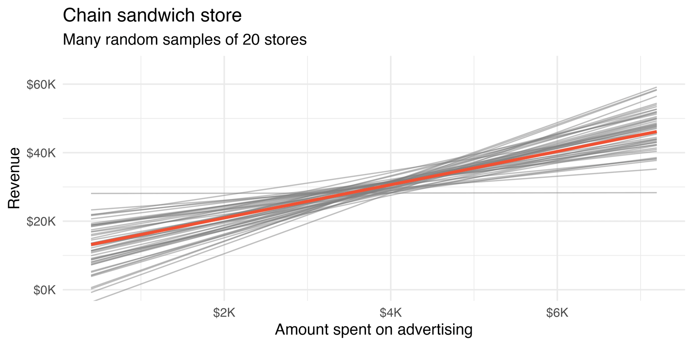
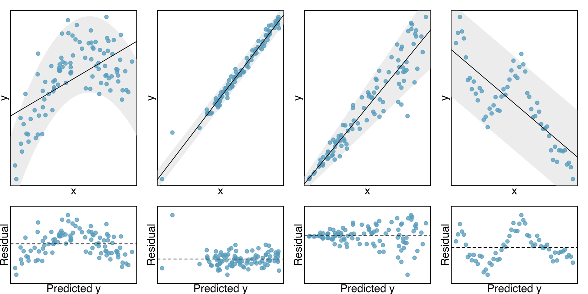



```{r}
#| label: setup
#| include: false
library(tidyverse)
library(openintro)
library(infer)
library(broom)
knitr::opts_chunk$set(out.width = "90%")

set.seed(47)
births14_100 <- births14 |>
  drop_na() |>
  slice_sample(n = 100)
```

## Student Information

```{r}
#| label: student-information-1
#| echo: false
learnr2::student_info()
```

## Introduction

This tutorial covers [Chapter 24: Inference for linear regression with a single predictor](https://openintrostat.github.io/ims/inf-model-slr.html) from [*Introduction to Modern Statistics*](https://openintrostat.github.io/ims/) by Mine Çetinkaya-Rundel and Johanna Hardin. You will learn to test whether a slope differs from zero by shuffling, to estimate a slope with a bootstrap interval, to read the same test and interval from regression output with the t-distribution, and to check the conditions that output depends on, using data on births, midterm elections, and college financial aid.

### Exercise 1

You should be doing this tutorial in a repo named `inference-for-linear-regression-with-a-single-predictor`. If you are not, create one and then connect to it.

Create a new file, `analysis.qmd`, with the title `"Inference for Linear Regression with a Single Predictor"` and your name as the author. In a bash Terminal, render it:

```bash
quarto render analysis.qmd
```

Open `analysis.html` with Live Server (right-click it in the Explorer → **Open with Live Server**) and keep the tab open. It refreshes on every render. Going forward, we will just tell you to "Render" when we want you to take these steps.

Create a `.gitignore` with `analysis_files` followed by a blank line. Commit and push. Use AI however you like.

If `show_file()` fails, it is probably because you have not yet loaded `library(learnr2)` in the R Terminal.

```{r}
#| label: introduction-1
#| echo: false
learnr2::question('In the R Terminal, run show_file(".gitignore"). CP/CR.', type = "reflection")
```

###

```{.output}
analysis_files
```

###

In particular, we will use the least squares regression line to test whether there is a relationship between two continuous variables. Additionally, we will build confidence intervals which quantify the slope of the linear regression line.

### Exercise 2

Add a chunk to `analysis.qmd` that loads the **[tidyverse](https://www.tidyverse.org/)**, with `#| message: false` so the startup messages stay out of the rendered page. Add `execute: echo: false` to the YAML header. Render.

```{r}
#| label: introduction-2
#| echo: false
learnr2::question('In the R Terminal, run show_file("analysis.qmd"). CP/CR.', type = "reflection")
```

###

````{verbatim}
#| message: false
library(tidyverse)
````

###

Many of the inferential ideas are remarkably similar to those covered in previous chapters. The **tidyverse** fits and draws the least squares lines here as it did in the Linear Regression with a Single Predictor tutorial.

### Exercise 3

Add **[openintro](https://openintrostat.github.io/openintro/)** to that chunk. Render.

```{r}
#| label: introduction-3
#| echo: false
learnr2::question('In the R Terminal, run show_file("analysis.qmd"). CP/CR.', type = "reflection")
```

###

````{verbatim}
#| message: false
library(tidyverse)
library(openintro)
````

###

**openintro** holds the chapter's three real datasets: `births14`, `midterms_house`, and `elmhurst`. The chapter also opens with a sandwich-store example, for which the authors made up the data (and the entire population).

### Exercise 4

Add **[infer](https://infer.tidymodels.org/)** to that chunk. Render.

```{r}
#| label: introduction-4
#| echo: false
learnr2::question('In the R Terminal, run show_file("analysis.qmd"). CP/CR.', type = "reflection")
```

###

````{verbatim}
#| message: false
library(tidyverse)
library(openintro)
library(infer)
````

###

**infer** simulates the datasets we did not collect by shuffling or resampling the one we did, and fits a least squares line to each. In real life, we always have exactly one sample (that is, one dataset), and through the inference process, we imagine what might have happened had we taken a different sample.

### Exercise 5

Add **[broom](https://broom.tidymodels.org/)** to that chunk. Render.

```{r}
#| label: introduction-5
#| echo: false
learnr2::question('In the R Terminal, run show_file("analysis.qmd"). CP/CR.', type = "reflection")
```

###

````{verbatim}
#| message: false
library(tidyverse)
library(openintro)
library(infer)
library(broom)
````

###

**broom** turns a fitted model into a tibble with one row per coefficient, holding its estimate, standard error, T score, and p-value. We will rely on statistical software to compute the standard error and leave the explanation of how this standard error is determined to a second or third statistics course.

## Randomization and bootstrapping for the slope

As with any numerical characteristic which describes a subset of the population, the estimated slope of a sample will vary from sample to sample. In the chapter's made-up population of sandwich stores, each random sample of 20 stores gives a different line, scattered around the population line in red.

{fig-alt="An x-y coordinate system with least squares regression lines from many random samples of size 20 (no points are plotted). The lines vary around the true population line. On the x-axis is advertising amount; on the y-axis is revenue."}

This section measures that variation in 100 births in two ways: by shuffling, to test whether there is any relationship, and by resampling, to estimate how large it is.

### Exercise 1

Start a new chunk that prints `births14`. Render.

```{r}
#| label: randomization-and-bootstrapping-for-the-slope-1
#| echo: false
learnr2::question('In the R Terminal, run show_file("analysis.qmd"). CP/CR.', type = "reflection")
```

###

```{r}
#| label: randomization-and-bootstrapping-for-the-slope-1-test
#| echo: true
births14
```

###

Each of the 1,000 rows is one birth, from a random sample of the births recorded in the US in 2014. We will work with a random sample of 100 observations from these data.

### Exercise 2

Replace the code in that chunk so that it counts the missing values in each column of `births14`. Render.

```{r}
#| label: randomization-and-bootstrapping-for-the-slope-2
#| echo: false
learnr2::question('In the R Terminal, run show_file("analysis.qmd"). CP/CR.', type = "reflection")
```

###

```{r}
#| label: randomization-and-bootstrapping-for-the-slope-2-test
#| echo: true
births14 |>
  summarize(across(everything(), \(x) sum(is.na(x))))
```

###

Father's age, `fage`, is missing for 114 births, `visits` for 56, `gained` for 42, and `habit` for 19. The three variables this chapter uses, `weight`, `weeks`, and `mage`, have no missing values.

### Exercise 3

Replace the code in that chunk so that it drops every row of `births14` with a missing value in any column and counts the rows that remain. Render.

```{r}
#| label: randomization-and-bootstrapping-for-the-slope-3
#| echo: false
learnr2::question('In the R Terminal, run show_file("analysis.qmd"). CP/CR.', type = "reflection")
```

###

```{r}
#| label: randomization-and-bootstrapping-for-the-slope-3-test
#| echo: true
births14 |>
  drop_na() |>
  nrow()
```

###

Dropping incomplete rows leaves 794 births and throws away 206, mostly for a missing father's age, which the chapter never uses. The chapter drops them anyway before it samples.

### Exercise 4

Replace the code in that chunk so that it creates `births14_100` as the chapter does: drop the rows with any missing value, then take a random sample of 100 of the births that remain. Set a seed of 47 first, the one the chapter used. Print `births14_100`. Render.

```{r}
#| label: randomization-and-bootstrapping-for-the-slope-4
#| echo: false
learnr2::question('In the R Terminal, run show_file("analysis.qmd"). CP/CR.', type = "reflection")
```

###

```{r}
#| label: randomization-and-bootstrapping-for-the-slope-4-test
#| echo: true
set.seed(47)
births14_100 <- births14 |>
  drop_na() |>
  slice_sample(n = 100)

births14_100
```

If your first rows differ from ours, replace your code with ours, since the rest of this section depends on these 100 births.

###

With a seed of 47, these are the chapter's own 100 births. The scientific research interest at hand will be in determining the linear relationship between weight of baby at birth (in lbs) and number of weeks of gestation.

### Exercise 5

Start a new chunk with a scatterplot of `weight` against `weeks` from `births14_100`, with the least squares line and no shaded band. Render.

```{r}
#| label: randomization-and-bootstrapping-for-the-slope-5
#| echo: false
learnr2::question('In the R Terminal, run show_file("analysis.qmd"). CP/CR.', type = "reflection")
```

###

```{r}
#| label: randomization-and-bootstrapping-for-the-slope-5-test
#| echo: true
births14_100 |>
  ggplot(aes(x = weeks, y = weight)) +
  geom_point() +
  geom_smooth(method = "lm", formula = y ~ x, se = FALSE)
```

###

Most births fall between 36 and 42 weeks, while a few very early ones, like a 2-pound baby born at 25 weeks, sit alone at the lower left. In the linear model setting, we might hope to have a linear relationship between `weeks` and `weight` in settings where `weeks` gestation is known and `weight` of baby needs to be predicted.

### Exercise 6

Replace the code in that chunk with a linear model predicting `weight` from `weeks`, using `births14_100`. Show only the term and the estimate for each coefficient. Render.

```{r}
#| label: randomization-and-bootstrapping-for-the-slope-6
#| echo: false
learnr2::question('In the R Terminal, run show_file("analysis.qmd"). CP/CR.', type = "reflection")
```

###

```{r}
#| label: randomization-and-bootstrapping-for-the-slope-6-test
#| echo: true
lm(weight ~ weeks, data = births14_100) |>
  tidy() |>
  select(term, estimate)
```

###

Each extra week of gestation goes with 0.335 more pounds of baby, on average. The null hypothesis is $H_0: \beta_1 = 0$, there is no linear relationship between `weight` and `weeks`, and the alternative is $H_A: \beta_1 \ne 0$, there is some linear relationship between `weight` and `weeks`.

### Exercise 7

Replace the code in that chunk so that it shuffles `weight` across the 100 births once, as if weight and weeks were unrelated, and calculates the slope of the least squares line for the shuffled data. Set a seed of 24 first. Render.

```{r}
#| label: randomization-and-bootstrapping-for-the-slope-7
#| echo: false
learnr2::question('In the R Terminal, run show_file("analysis.qmd"). CP/CR.', type = "reflection")
```

###

```{r}
#| label: randomization-and-bootstrapping-for-the-slope-7-test
#| echo: true
set.seed(24)
births14_100 |>
  specify(weight ~ weeks) |>
  hypothesize(null = "independence") |>
  generate(reps = 1, type = "permute") |>
  calculate(stat = "slope")
```

###

Our shuffled slope is -0.027, nowhere near 0.335. Each `weight` value is randomly assigned to a new `weeks` gestation.

### Exercise 8

Change the code so that it shuffles `weight` 1,000 times, calculating the slope for each shuffle, and stores the 1,000 slopes as `weeks_null`. Keep the seed of 24. Below that, show the smallest and the largest of the 1,000 slopes. Render.

```{r}
#| label: randomization-and-bootstrapping-for-the-slope-8
#| echo: false
learnr2::question('In the R Terminal, run show_file("analysis.qmd"). CP/CR.', type = "reflection")
```

###

```{r}
#| label: randomization-and-bootstrapping-for-the-slope-8-test
#| echo: true
set.seed(24)
weeks_null <- births14_100 |>
  specify(weight ~ weeks) |>
  hypothesize(null = "independence") |>
  generate(reps = 1000, type = "permute") |>
  calculate(stat = "slope")

weeks_null |>
  summarize(smallest = min(stat), largest = max(stat))
```

###

Our 1,000 shuffled slopes run from -0.178 to 0.200. If indeed there were no linear relationship between `weight` and `weeks`, the natural variability of the slopes would produce estimates between approximately -0.15 and +0.15.

### Exercise 9

Replace the smallest and largest slopes with the number of shuffled slopes at least as far from zero as the observed slope, 0.335, and the proportion of the 1,000 that number is. Render.

```{r}
#| label: randomization-and-bootstrapping-for-the-slope-9
#| echo: false
learnr2::question('In the R Terminal, run show_file("analysis.qmd"). CP/CR.', type = "reflection")
```

###

```{r}
#| label: randomization-and-bootstrapping-for-the-slope-9-test
#| echo: true
set.seed(24)
weeks_null <- births14_100 |>
  specify(weight ~ weeks) |>
  hypothesize(null = "independence") |>
  generate(reps = 1000, type = "permute") |>
  calculate(stat = "slope")

weeks_null |>
  summarize(as_extreme = sum(abs(stat) >= 0.335),
            p_value = mean(abs(stat) >= 0.335))
```

###

None of the 1,000 shuffles came near 0.335, so the p-value is below 1 in 1,000 and we reject the null hypothesis. Therefore, we believe that the slope observed on the original data is not just due to natural variability and indeed, there is a linear relationship between `weight` of baby and `weeks` gestation for births in the US.

### Exercise 10

Replace the code in that chunk with a linear model predicting `weight` from `mage`, the mother's age, using `births14_100`. Show only the term and the estimate for each coefficient. Render.

```{r}
#| label: randomization-and-bootstrapping-for-the-slope-10
#| echo: false
learnr2::question('In the R Terminal, run show_file("analysis.qmd"). CP/CR.', type = "reflection")
```

###

```{r}
#| label: randomization-and-bootstrapping-for-the-slope-10-test
#| echo: true
lm(weight ~ mage, data = births14_100) |>
  tidy() |>
  select(term, estimate)
```

###

The observed slope is 0.036 pounds of baby per year of the mother's age. The relationship between mother's age and weight of baby is not as strong as the relationship we saw previously between weeks gestation and weight of baby.

### Exercise 11

Replace the code in that chunk so that it resamples the 100 births with replacement 1,000 times, calculates the slope of `weight` on `mage` for each resample, and stores the 1,000 slopes as `mage_boot`. Set a seed of 24 first. Print `mage_boot`. Render.

```{r}
#| label: randomization-and-bootstrapping-for-the-slope-11
#| echo: false
learnr2::question('In the R Terminal, run show_file("analysis.qmd"). CP/CR.', type = "reflection")
```

###

```{r}
#| label: randomization-and-bootstrapping-for-the-slope-11-test
#| echo: true
set.seed(24)
mage_boot <- births14_100 |>
  specify(weight ~ mage) |>
  generate(reps = 1000, type = "bootstrap") |>
  calculate(stat = "slope")

mage_boot
```

###

When sampling in the linear model case, consider each observation to be a single dot. If the dot is resampled, both the `weight` and the `mage` measurement are observed.

### Exercise 12

Replace the line that prints `mage_boot` with the 95% bootstrap percentile confidence interval for the slope. Render.

```{r}
#| label: randomization-and-bootstrapping-for-the-slope-12
#| echo: false
learnr2::question('In the R Terminal, run show_file("analysis.qmd"). CP/CR.', type = "reflection")
```

###

```{r}
#| label: randomization-and-bootstrapping-for-the-slope-12-test
#| echo: true
set.seed(24)
mage_boot <- births14_100 |>
  specify(weight ~ mage) |>
  generate(reps = 1000, type = "bootstrap") |>
  calculate(stat = "slope")

mage_boot |>
  get_confidence_interval(level = 0.95, type = "percentile")
```

###

Our interval, (-0.004, 0.073), is close to the chapter's (-0.01, 0.081). The CI contains zero, so the true relationship *might* be null.

### Exercise 13

Replace the confidence interval with a histogram of the 1,000 slopes in `mage_boot`, with dashed vertical lines at the two ends of the 95% percentile interval. Render.

```{r}
#| label: randomization-and-bootstrapping-for-the-slope-13
#| echo: false
learnr2::question('In the R Terminal, run show_file("analysis.qmd"). CP/CR.', type = "reflection")
```

###

```{r}
#| label: randomization-and-bootstrapping-for-the-slope-13-test
#| echo: true
set.seed(24)
mage_boot <- births14_100 |>
  specify(weight ~ mage) |>
  generate(reps = 1000, type = "bootstrap") |>
  calculate(stat = "slope")

mage_ci <- mage_boot |>
  get_confidence_interval(level = 0.95, type = "percentile")

mage_boot |>
  ggplot(aes(x = stat)) +
  geom_histogram(bins = 30) +
  geom_vline(xintercept = c(mage_ci$lower_ci, mage_ci$upper_ci),
             linetype = "dashed")
```

###

The bootstrapped slopes form a hill centered near the observed 0.036, and the left dashed line sits just below zero. The histogram provides a sense for the variability of the slope of the linear model from sample to sample.

### Exercise 14

Improve the plot. Add a solid red vertical line at zero, and add a title, axis labels, a subtitle that states the main finding, and a caption giving the number of births, the number of resamples, and the source. Render.

```{r}
#| label: randomization-and-bootstrapping-for-the-slope-14
#| echo: false
learnr2::question('In the R Terminal, run show_file("analysis.qmd"). CP/CR.', type = "reflection")
```

###

```{r}
#| label: randomization-and-bootstrapping-for-the-slope-14-test
#| echo: true
set.seed(24)
mage_boot <- births14_100 |>
  specify(weight ~ mage) |>
  generate(reps = 1000, type = "bootstrap") |>
  calculate(stat = "slope")

mage_ci <- mage_boot |>
  get_confidence_interval(level = 0.95, type = "percentile")

mage_boot |>
  ggplot(aes(x = stat)) +
  geom_histogram(bins = 30) +
  geom_vline(xintercept = c(mage_ci$lower_ci, mage_ci$upper_ci),
             linetype = "dashed") +
  geom_vline(xintercept = 0, color = "red") +
  labs(title = "Bootstrapped Slopes for Baby's Weight on Mother's Age",
       subtitle = "The 95% interval, -0.004 to 0.073 pounds per year, includes zero: the slope might be null",
       x = "Bootstrapped Slope (pounds of birth weight per year of mother's age)",
       y = "Count",
       caption = "100 births from births14; 1,000 bootstrap resamples\nSource: CDC National Center for Health Statistics, 2014")
```

###

We are 95% confident that for the model describing the population of births, predicting weight of baby from mother's age, a one unit increase in `mage` (in years) is associated with an increase in predicted average baby `weight` of between -0.01 and 0.081 pounds. Our interval, -0.004 to 0.073, tells the same story.

### Exercise 15

Commit `analysis.qmd` with the message `"Simulate slopes for births"` and push.

```{r}
#| label: randomization-and-bootstrapping-for-the-slope-15
#| echo: false
learnr2::question("In the bash Terminal, run git log --oneline -3. CP/CR.", type = "reflection")
```

###

```{.output}
3f8a1c2 (HEAD -> main, origin/main) Simulate slopes for births
9be04d2 Initial commit
```

###

The randomization test asks whether the slope could be zero, and the bootstrap asks what values it could plausibly take. We can use bootstrapping to estimate the sampling distribution of the statistic of interest (here, the slope) without the null assumption of no relationship (which was the condition in the randomization test).

## The mathematical model and its conditions

When certain technical conditions apply, it is convenient to use mathematical approximations to test and estimate the slope parameter. This section reads the test and the interval for a slope from regression output, checks each against a simulation, and then checks the conditions.

### Exercise 1

Start a new chunk that prints `midterms_house`. Render.

```{r}
#| label: the-mathematical-model-and-its-conditions-1
#| echo: false
learnr2::question('In the R Terminal, run show_file("analysis.qmd"). CP/CR.', type = "reflection")
```

###

```{r}
#| label: the-mathematical-model-and-its-conditions-1-test
#| echo: true
midterms_house
```

###

The set of House elections occurring during the middle of a Presidential term are called midterm elections. One political theory suggests the higher the unemployment rate, the worse the President's party will do in the midterm elections.

### Exercise 2

Replace the code in that chunk so that it shows the elections with an unemployment rate above 15%. Render.

```{r}
#| label: the-mathematical-model-and-its-conditions-2
#| echo: false
learnr2::question('In the R Terminal, run show_file("analysis.qmd"). CP/CR.', type = "reflection")
```

###

```{r}
#| label: the-mathematical-model-and-its-conditions-2-test
#| echo: true
midterms_house |>
  filter(unemp > 15)
```

###

The data for the Great Depression (1934 and 1938) were removed because the unemployment rate was 21% and 18%, respectively. The data label those elections 1935 and 1939, because every `year` is one more than the year of the election.

### Exercise 3

Replace the code in that chunk with a linear model predicting `house_change`, the percent change in the number of seats of the President's party, from `unemp`, leaving out the 1935 and 1939 rows. Show the whole coefficient table. Render.

```{r}
#| label: the-mathematical-model-and-its-conditions-3
#| echo: false
learnr2::question('In the R Terminal, run show_file("analysis.qmd"). CP/CR.', type = "reflection")
```

###

```{r}
#| label: the-mathematical-model-and-its-conditions-3-test
#| echo: true
lm(house_change ~ unemp,
   data = filter(midterms_house, !year %in% c(1935, 1939))) |>
  tidy()
```

###

The line is -7.36 - 0.890 × `unemp`, the chapter's own. The row labeled `unemp` includes all relevant information about the slope estimate (i.e., the coefficient of the unemployment variable, the related SE, the T statistic, and the corresponding p-value).

### Exercise 4

Keep only the `unemp` row, and add a column that divides the estimate by its standard error. Render.

```{r}
#| label: the-mathematical-model-and-its-conditions-4
#| echo: false
learnr2::question('In the R Terminal, run show_file("analysis.qmd"). CP/CR.', type = "reflection")
```

###

```{r}
#| label: the-mathematical-model-and-its-conditions-4-test
#| echo: true
lm(house_change ~ unemp,
   data = filter(midterms_house, !year %in% c(1935, 1939))) |>
  tidy() |>
  filter(term == "unemp") |>
  mutate(t_score = estimate / std.error)
```

###

The null value is 0, so the T score is (-0.890 - 0) / 0.835 = -1.07, the `statistic` column. We will generally label the test statistic using a $T$, since it follows the $t$-distribution.

### Exercise 5

Add a column with the two-sided p-value for that T score from a t-distribution with 27 degrees of freedom, which is the 29 elections minus 2. Render.

```{r}
#| label: the-mathematical-model-and-its-conditions-5
#| echo: false
learnr2::question('In the R Terminal, run show_file("analysis.qmd"). CP/CR.', type = "reflection")
```

###

```{r}
#| label: the-mathematical-model-and-its-conditions-5-test
#| echo: true
lm(house_change ~ unemp,
   data = filter(midterms_house, !year %in% c(1935, 1939))) |>
  tidy() |>
  filter(term == "unemp") |>
  mutate(t_score = estimate / std.error,
         p_by_hand = 2 * pt(-abs(t_score), df = 27))
```

###

The p-value by hand, 0.296, matches the software's. The data do not provide convincing evidence that a higher unemployment rate has any correspondence with smaller or larger losses for the President's party in the House of Representatives in midterm elections.

### Exercise 6

Check the mathematical model against a simulation. Replace the code in that chunk with a randomization test of the same slope: shuffle `house_change` 1,000 times across the 29 elections, calculate the slope for each shuffle, and find the two-sided p-value for the observed slope of -0.890. Set a seed of 24 first. Render.

```{r}
#| label: the-mathematical-model-and-its-conditions-6
#| echo: false
learnr2::question('In the R Terminal, run show_file("analysis.qmd"). CP/CR.', type = "reflection")
```

###

```{r}
#| label: the-mathematical-model-and-its-conditions-6-test
#| echo: true
set.seed(24)
midterms_house |>
  filter(!year %in% c(1935, 1939)) |>
  specify(house_change ~ unemp) |>
  hypothesize(null = "independence") |>
  generate(reps = 1000, type = "permute") |>
  calculate(stat = "slope") |>
  get_p_value(obs_stat = -0.890, direction = "two-sided")
```

###

Our randomization p-value is 0.322, close to the t-distribution's 0.296. If there was no linear relationship between the two variables (i.e., if $\beta_1 = 0$), then we would expect to see linear models as or more extreme than the observed model roughly 30% of the time.

### Exercise 7

Replace the code in that chunk with a plot of the residuals from the model in Exercise 3 against `year`, with a dashed horizontal line at zero. Render.

```{r}
#| label: the-mathematical-model-and-its-conditions-7
#| echo: false
learnr2::question('In the R Terminal, run show_file("analysis.qmd"). CP/CR.', type = "reflection")
```

###

```{r}
#| label: the-mathematical-model-and-its-conditions-7-test
#| echo: true
midterms_house |>
  filter(!year %in% c(1935, 1939)) |>
  mutate(residual = residuals(lm(house_change ~ unemp))) |>
  ggplot(aes(x = year, y = residual)) +
  geom_point() +
  geom_line() +
  geom_hline(yintercept = 0, linetype = "dashed")
```

###

The residuals swing above and below zero every election or few, with no steady drift across 120 years. While the data are collected sequentially, a separate analysis was used to check for any apparent correlation between successive observations, and no such correlation was found.

### Exercise 8

`elmhurst` is a random sample of 50 Elmhurst College students, with `family_income` and `gift_aid` both in thousands of dollars. Replace the code in that chunk with a linear model predicting `gift_aid` from `family_income`, using `elmhurst`. Show the whole coefficient table. Render.

```{r}
#| label: the-mathematical-model-and-its-conditions-8
#| echo: false
learnr2::question('In the R Terminal, run show_file("analysis.qmd"). CP/CR.', type = "reflection")
```

###

```{r}
#| label: the-mathematical-model-and-its-conditions-8-test
#| echo: true
lm(gift_aid ~ family_income, data = elmhurst) |>
  tidy()
```

###

The point estimate of the slope of the line is -0.0431, the standard error of this estimate is 0.0108, and the $t$-test statistic is $T = -3.98$. The p-value corresponds exactly to the two-sided test we are interested in: 0.0002.

### Exercise 9

Keep only the `family_income` row, and add three columns: the t cutoff for a 95% confidence interval with 48 degrees of freedom, which is the 50 students minus 2, and the lower and upper ends of the interval, the estimate plus or minus that cutoff times the standard error. Render.

```{r}
#| label: the-mathematical-model-and-its-conditions-9
#| echo: false
learnr2::question('In the R Terminal, run show_file("analysis.qmd"). CP/CR.', type = "reflection")
```

###

```{r}
#| label: the-mathematical-model-and-its-conditions-9-test
#| echo: true
lm(gift_aid ~ family_income, data = elmhurst) |>
  tidy() |>
  filter(term == "family_income") |>
  mutate(t_star = qt(0.975, df = 48),
         lower = estimate - t_star * std.error,
         upper = estimate + t_star * std.error)
```

###

Our interval, (-0.0648, -0.0213), matches the chapter's (-0.0648, -0.0214) except for rounding. We are 95% confident that for an additional one unit (i.e., \$1000 increase) in family income, the university's gift aid is predicted to decrease on average by \$21.40 to \$64.80.

### Exercise 10

Check the interval against a simulation. Replace the code in that chunk so that it resamples the 50 students with replacement 1,000 times, calculates the slope of `gift_aid` on `family_income` for each resample, and finds the 95% bootstrap percentile interval. Set a seed of 24 first. Render.

```{r}
#| label: the-mathematical-model-and-its-conditions-10
#| echo: false
learnr2::question('In the R Terminal, run show_file("analysis.qmd"). CP/CR.', type = "reflection")
```

###

```{r}
#| label: the-mathematical-model-and-its-conditions-10-test
#| echo: true
set.seed(24)
elmhurst |>
  specify(gift_aid ~ family_income) |>
  generate(reps = 1000, type = "bootstrap") |>
  calculate(stat = "slope") |>
  get_confidence_interval(level = 0.95, type = "percentile")
```

###

Our bootstrap interval, (-0.0692, -0.0210), nearly matches the t interval, and both exclude zero. One additional reason to worry slightly less about normality is that neither the randomization test nor the bootstrapping procedures require the data to be normal around the line.

### Exercise 11

Replace the code in that chunk with a histogram of the residuals from the model predicting `gift_aid` from `family_income`. Render.

```{r}
#| label: the-mathematical-model-and-its-conditions-11
#| echo: false
learnr2::question('In the R Terminal, run show_file("analysis.qmd"). CP/CR.', type = "reflection")
```

###

```{r}
#| label: the-mathematical-model-and-its-conditions-11-test
#| echo: true
lm(gift_aid ~ family_income, data = elmhurst) |>
  augment() |>
  ggplot(aes(x = .resid)) +
  geom_histogram(bins = 15)
```

###

The residuals run from about -10 to 12 thousand dollars, centered on zero and roughly symmetric, though lumpy. The normality condition requires that points vary symmetrically around the line, spreading out in a bell-shaped fashion.

### Exercise 12

Replace the histogram with a residual plot: the residuals against `family_income`, with a dashed horizontal line at zero. Render.

```{r}
#| label: the-mathematical-model-and-its-conditions-12
#| echo: false
learnr2::question('In the R Terminal, run show_file("analysis.qmd"). CP/CR.', type = "reflection")
```

###

```{r}
#| label: the-mathematical-model-and-its-conditions-12-test
#| echo: true
lm(gift_aid ~ family_income, data = elmhurst) |>
  augment() |>
  ggplot(aes(x = family_income, y = .resid)) +
  geom_point() +
  geom_hline(yintercept = 0, linetype = "dashed")
```

###

The technical conditions are often remembered using the **LINE** mnemonic: **linear** model, **independent** observations, points **normally** distributed around the line, and **equal** variability around it. The linearity, normality, and equality of variance conditions usually can be assessed through residual plots like yours, and the book's four examples below each break one condition.

{fig-alt="A grid of 2 by 4 scatterplots with fabricated data. The top row of plots contains original x-y data plots with a least squares regression line. The bottom row of plots is a series of residual plot with predicted value on the x-axis and residual on the y-axis. The first column of plots gives an example of points that have a quadratic relationship instead of a linear relationship. The second column of plots gives an example where a single outlying point does not fit the linear model. The third column of points gives an example where the points have increasing variability as the value of x increases. The last column of points gives an example where the points are correlated with one another, possibly as part of a time series."}

### Exercise 13

Improve the plot. Add a title, axis labels in thousands of dollars, a subtitle that states what the plot says about the conditions, and a caption giving the number of students and the source. Render.

```{r}
#| label: the-mathematical-model-and-its-conditions-13
#| echo: false
learnr2::question('In the R Terminal, run show_file("analysis.qmd"). CP/CR.', type = "reflection")
```

###

```{r}
#| label: the-mathematical-model-and-its-conditions-13-test
#| echo: true
lm(gift_aid ~ family_income, data = elmhurst) |>
  augment() |>
  ggplot(aes(x = family_income, y = .resid)) +
  geom_point() +
  geom_hline(yintercept = 0, linetype = "dashed") +
  labs(title = "Residuals from Predicting Gift Aid by Family Income",
       subtitle = "No curve, no outliers, and an even spread: the conditions for the t-test look reasonable",
       x = "Family Income ($1,000s)",
       y = "Residual Gift Aid ($1,000s)",
       caption = "50 students, Elmhurst College class of 2011\nSource: The Chronicle of Higher Education")
```

###

The trend appears to be linear, the data fall around the line with no obvious outliers, and the variance is roughly constant. Least squares regression can be applied to these data.

### Exercise 14

Commit `analysis.qmd` with the message `"Test and estimate slopes with the t-distribution"` and push.

```{r}
#| label: the-mathematical-model-and-its-conditions-14
#| echo: false
learnr2::question("In the bash Terminal, run git log --oneline -3. CP/CR.", type = "reflection")
```

###

```{.output}
a71d0e5 (HEAD -> main, origin/main) Test and estimate slopes with the t-distribution
3f8a1c2 Simulate slopes for births
9be04d2 Initial commit
```

###

We usually rely on statistical software to identify point estimates, standard errors, test statistics, and p-values in practice. However, be aware that software will not generally check whether the method is appropriate, meaning we must still verify conditions are met.

## Summary

This tutorial covered [Chapter 24: Inference for linear regression with a single predictor](https://openintrostat.github.io/ims/inf-model-slr.html) from [*Introduction to Modern Statistics*](https://openintrostat.github.io/ims/) by Mine Çetinkaya-Rundel and Johanna Hardin. You have learned to test whether a slope differs from zero by shuffling, to estimate a slope with a bootstrap interval, to read the same test and interval from regression output with the t-distribution, and to check the conditions that output depends on, using data on births, midterm elections, and college financial aid.

Recall that early in the text we presented graphical techniques which communicated relationships across multiple variables. We also used modeling to formalize the relationships. Many tutorials were dedicated to inferential methods which allowed claims about the population to be made based on samples of data. Not only did we present the mathematical model for each of the inferential techniques, but when appropriate, we also presented bootstrapping and permutation methods.

In this tutorial we brought all of those ideas together by considering inferential claims on linear models through randomization tests, bootstrapping, and mathematical modeling. We continue to emphasize the importance of experimental design in making conclusions about research claims. In particular, recall that variability can come from different sources (e.g., random sampling vs. random allocation).

For the same tests and intervals in R, see the **infer** article "[Full infer Pipeline Examples](https://infer.tidymodels.org/articles/observed_stat_examples.html)," which includes randomization tests and bootstrap intervals for a slope. For the births themselves, the `births14` help page cites the CDC's [Natality Detail File, 2014](https://doi.org/10.3886/ICPSR36461.v1).

Many sentences in this tutorial, and its figures, come from the chapter, used under the book's [CC BY-SA 3.0 license](https://creativecommons.org/licenses/by-sa/3.0/).

### Exercise 1

Render one last time.

```{r}
#| label: summary-1
#| echo: false
learnr2::question('In the R Terminal, run show_file("analysis.qmd", start = 0). CP/CR.', type = "reflection")
```

###

````{verbatim}
---
title: "Inference for Linear Regression with a Single Predictor"
author: "Your Name"
format: html
execute:
  echo: false
---

```{r}
#| message: false
library(tidyverse)
library(openintro)
library(infer)
library(broom)
```

```{r}
set.seed(47)
births14_100 <- births14 |>
  drop_na() |>
  slice_sample(n = 100)

births14_100
```

```{r}
set.seed(24)
mage_boot <- births14_100 |>
  specify(weight ~ mage) |>
  generate(reps = 1000, type = "bootstrap") |>
  calculate(stat = "slope")

mage_ci <- mage_boot |>
  get_confidence_interval(level = 0.95, type = "percentile")

mage_boot |>
  ggplot(aes(x = stat)) +
  geom_histogram(bins = 30) +
  geom_vline(xintercept = c(mage_ci$lower_ci, mage_ci$upper_ci),
             linetype = "dashed") +
  geom_vline(xintercept = 0, color = "red") +
  labs(title = "Bootstrapped Slopes for Baby's Weight on Mother's Age",
       subtitle = "The 95% interval, -0.004 to 0.073 pounds per year, includes zero: the slope might be null",
       x = "Bootstrapped Slope (pounds of birth weight per year of mother's age)",
       y = "Count",
       caption = "100 births from births14; 1,000 bootstrap resamples\nSource: CDC National Center for Health Statistics, 2014")
```

```{r}
lm(gift_aid ~ family_income, data = elmhurst) |>
  augment() |>
  ggplot(aes(x = family_income, y = .resid)) +
  geom_point() +
  geom_hline(yintercept = 0, linetype = "dashed") +
  labs(title = "Residuals from Predicting Gift Aid by Family Income",
       subtitle = "No curve, no outliers, and an even spread: the conditions for the t-test look reasonable",
       x = "Family Income ($1,000s)",
       y = "Residual Gift Aid ($1,000s)",
       caption = "50 students, Elmhurst College class of 2011\nSource: The Chronicle of Higher Education")
```
````

###

Your page shows a bootstrap distribution of slopes and a check of the mathematical model's conditions. We encourage the reader to think broadly about the models at hand without putting too much dependence on the exact p-values that are reported from the statistical software.

### Exercise 2

Publish your analysis to GitHub Pages. In a bash Terminal, run:

```bash
quarto publish gh-pages analysis.qmd
```

```{r}
#| label: summary-2
#| echo: false
learnr2::question("Paste the URL of your published page.", type = "reflection")
```

###

Your answer should look like `https://your-github-username.github.io/inference-for-linear-regression-with-a-single-predictor/`.

###

The technical condition describing the independence of the observations is often the most crucial but also the most difficult to diagnose. It is also extremely difficult to gather a dataset which is a true random sample from the population of interest.

### Exercise 3

Commit and push any remaining changes.

```{r}
#| label: summary-3
#| echo: false
learnr2::question("Paste the URL of your GitHub repo.", type = "reflection")
```

###

Your answer should look like `https://github.com/your-github-username/inference-for-linear-regression-with-a-single-predictor`.

###

Many of the techniques used to deal with technical condition violations are outside the scope of this text, but they are taught in universities in the very next class after this one. If you are working with linear models or are curious to learn more, we recommend that you continue learning about statistical methods applicable to a larger class of datasets.

## Your Answers

```{r}
#| label: your-answers-1
#| echo: false
learnr2::question(
  "How many minutes, approximately, did it take you to complete this
  tutorial? For example, an hour and a half would be 90 minutes.",
  type = "reflection_editable",
  validate = "integer"
)
```

```{r}
#| label: your-answers-2
#| echo: false
learnr2::download_answers_button(filename_prefix = "regression-single-inference")
```
