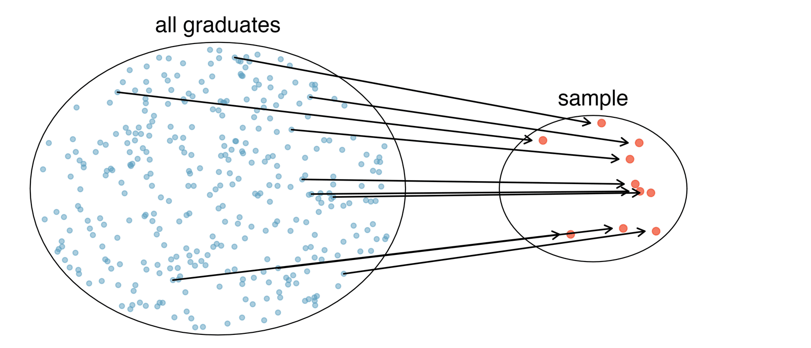
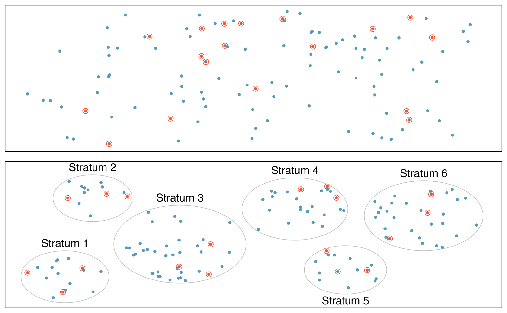
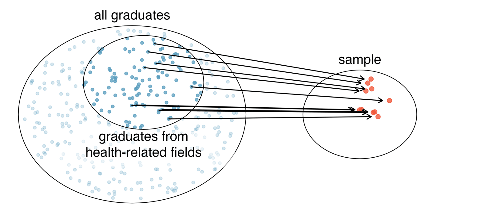
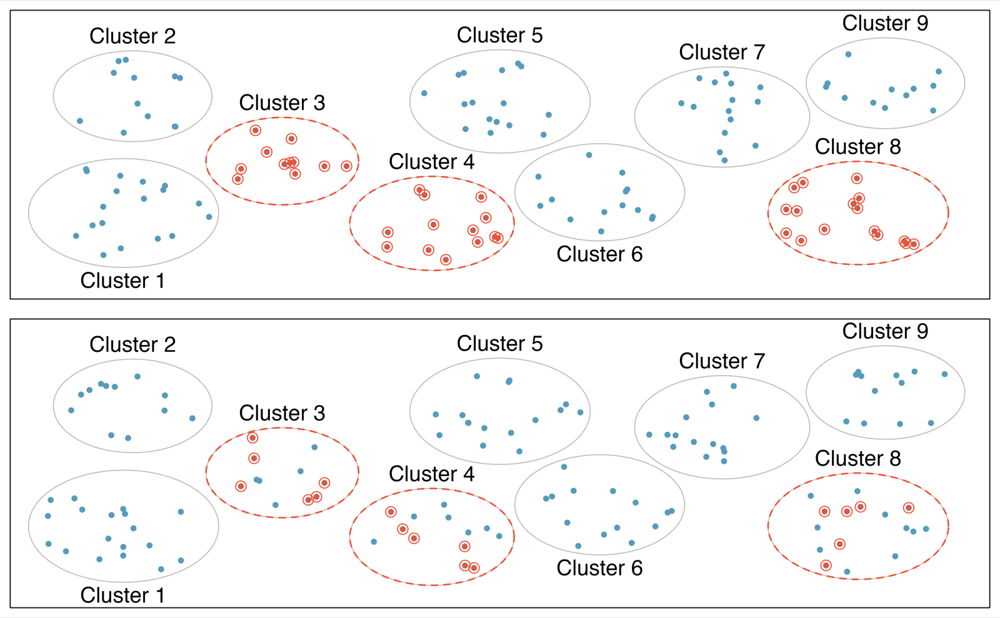
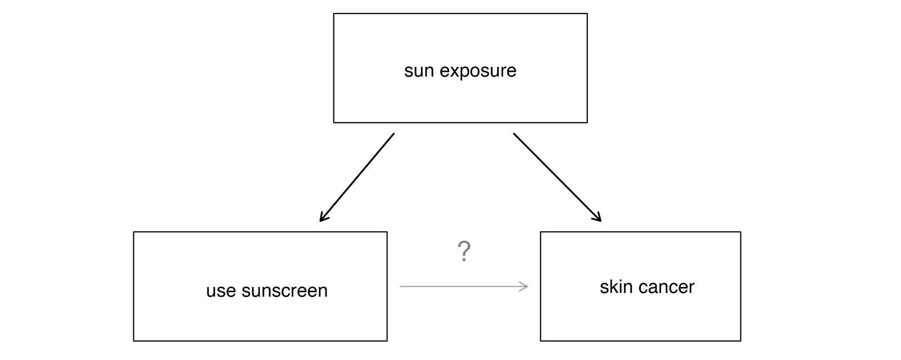
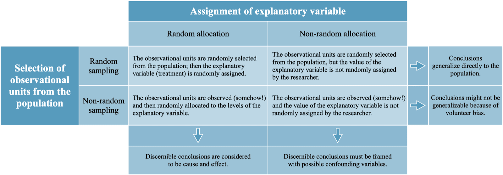



```{r}
#| label: setup
#| include: false
library(tidyverse)
library(openintro)
library(usdata)
knitr::opts_chunk$set(out.width = "90%")
```

## Student Information

```{r}
#| label: student-information-1
#| echo: false
learnr2::student_info()
```

## Introduction

This tutorial covers [Chapter 2: Study design](https://openintrostat.github.io/ims/data-design.html) from [*Introduction to Modern Statistics*](https://openintrostat.github.io/ims/) by Mine Çetinkaya-Rundel and Johanna Hardin. You will learn the difference between a population and a sample, how simple random, stratified, and convenience samples behave, and what separates a randomized experiment from an observational study.

### Exercise 1

You should be doing this tutorial in a repo named `study-design`. If you are not, create one and then connect to it.

Create a new file, `analysis.qmd`, with the title `"Study Design"` and your name as the author. In a bash Terminal, render it:

```bash
quarto render analysis.qmd
```

Open `analysis.html` with Live Server (right-click it in the Explorer → **Open with Live Server**) and keep the tab open. It refreshes on every render. Going forward, we will just tell you to "Render" when we want you to take these steps.

Create a `.gitignore` with `analysis_files` followed by a blank line. Commit and push. Use AI however you like.

If `show_file()` fails, it is probably because you have not yet loaded `library(learnr2)` in the R Terminal.

```{r}
#| label: introduction-1
#| echo: false
learnr2::question('In the R Terminal, run show_file(".gitignore"). CP/CR.', type = "reflection")
```

###

```{.output}
analysis_files
```

###

Before digging into the details of working with data, we stop to think about how data come to be. A good question to ask before working with any data is: how were these observations collected?

### Exercise 2

Add a chunk to `analysis.qmd` that loads the **[tidyverse](https://www.tidyverse.org/)**, with `#| message: false` so the startup messages stay out of the rendered page. Add `execute: echo: false` to the YAML header. Render.

```{r}
#| label: introduction-2
#| echo: false
learnr2::question('In the R Terminal, run show_file("analysis.qmd"). CP/CR.', type = "reflection")
```

###

````{verbatim}
#| message: false
library(tidyverse)
````

###

The **tidyverse** includes **dplyr**, which draws random samples from a data frame as easily as it counts or summarizes one.

### Exercise 3

Add **[openintro](https://openintrostat.github.io/openintro/)** to that chunk. Render.

```{r}
#| label: introduction-3
#| echo: false
learnr2::question('In the R Terminal, run show_file("analysis.qmd"). CP/CR.', type = "reflection")
```

###

````{verbatim}
#| message: false
library(tidyverse)
library(openintro)
````

###

**openintro** holds `mlb`, the 2010 salaries of every Major League Baseball player, which the chapter uses to explain sampling. It also holds `stent30` and `stent365`, from the stent experiment in Hello Data.

### Exercise 4

Add **[usdata](https://openintrostat.github.io/usdata/)** to that chunk. Render.

```{r}
#| label: introduction-4
#| echo: false
learnr2::question('In the R Terminal, run show_file("analysis.qmd"). CP/CR.', type = "reflection")
```

###

````{verbatim}
#| message: false
library(tidyverse)
library(openintro)
library(usdata)
````

###

**usdata** holds `county`, which the chapter uses as an example of an observational study. Making causal conclusions based on observational data can be treacherous and is not recommended.

## Sampling principles and strategies

The first step in conducting research is to identify topics or questions that are to be investigated. Ours: what was the average salary of a Major League Baseball player in 2010? We have the whole population, so we can see how samples of it behave.

### Exercise 1

Add a chunk that prints `mlb`. Render.

```{r}
#| label: sampling-principles-and-strategies-1
#| echo: false
learnr2::question('In the R Terminal, run show_file("analysis.qmd"). CP/CR.', type = "reflection")
```

###

```{r}
#| label: sampling-principles-and-strategies-1-test
#| echo: true
mlb
```

###

Each of the 828 rows is one player on a 2010 Major League roster. Collecting data for an entire population is called a *census*, and this data frame is one.

### Exercise 2

```{r}
#| label: sampling-principles-and-strategies-2
#| echo: false
learnr2::question("In the R Terminal, run ?mlb. Copy and paste the Description, the entry for salary, and the Source.", type = "reflection")
```

###

```{.output}
Description:

     Salary data for Major League Baseball players in the year 2010.

     salary Salary (in $1000s)

Source:

     <https://databases.usatoday.com/mlb-salaries/>, retrieved
     2011-02-23.
```

###

Salaries are in thousands of dollars, so a value of `8500` means $8.5 million. The data came from a *USA Today* database in February 2011, after the 2010 season ended.

### Exercise 3

Replace the code in that chunk so that it counts the players on each `team`. Render.

```{r}
#| label: sampling-principles-and-strategies-3
#| echo: false
learnr2::question('In the R Terminal, run show_file("analysis.qmd"). CP/CR.', type = "reflection")
```

###

```{r}
#| label: sampling-principles-and-strategies-3-test
#| echo: true
mlb |>
  count(team)
```

###

Each player is a member of one of the league's 30 teams, which have 25 to 31 players each.

### Exercise 4

Replace the code in that chunk so that it calculates the mean `salary` of all 828 players. Render.

```{r}
#| label: sampling-principles-and-strategies-4
#| echo: false
learnr2::question('In the R Terminal, run show_file("analysis.qmd"). CP/CR.', type = "reflection")
```

###

```{r}
#| label: sampling-principles-and-strategies-4-test
#| echo: true
mlb |>
  summarize(mean_salary = mean(salary))
```

###

The mean salary of the whole population, about $3.28 million, is a *population parameter*, a number calculated or considered for calculation on the entire population. Usually we have only a sample, so we cannot compute it.

### Exercise 5

Replace the code in that chunk so that it calculates the mean `salary` for each `team`, from highest to lowest. Render.

```{r}
#| label: sampling-principles-and-strategies-5
#| echo: false
learnr2::question('In the R Terminal, run show_file("analysis.qmd"). CP/CR.', type = "reflection")
```

###

```{r}
#| label: sampling-principles-and-strategies-5-test
#| echo: true
mlb |>
  summarize(mean_salary = mean(salary), .by = team) |>
  arrange(desc(mean_salary))
```

###

The Yankees averaged $8.25 million per player and the Pirates $1.29 million. Some teams have a lot more money: the book says up to 4 times as much, but here it is more than 6 times.

### Exercise 6

Start a new chunk that draws a simple random sample of 120 players from `mlb`, stores it as `mlb_srs`, and prints it. Set the random seed to 42 first, so that the same sample is drawn every time you render. Render.

```{r}
#| label: sampling-principles-and-strategies-6
#| echo: false
learnr2::question('In the R Terminal, run show_file("analysis.qmd"). CP/CR.', type = "reflection")
```

###

```{r}
#| label: sampling-principles-and-strategies-6-test
#| echo: true
set.seed(42)
mlb_srs <- mlb |>
  slice_sample(n = 120)

mlb_srs
```

###

The most basic random sample is called a *simple random sample* and is equivalent to drawing names out of a hat to select cases. Your 120 players may differ from ours if your code drew the sample differently, which is fine.

{fig-alt="A large circle contains many dots which indicate all the graduates. A smaller circle contains a few of the dots (i.e., graduates) which have been randomly selected from the larger circle."}

### Exercise 7

Replace the line that prints `mlb_srs` with one that calculates its mean `salary`. Render.

```{r}
#| label: sampling-principles-and-strategies-7
#| echo: false
learnr2::question('In the R Terminal, run show_file("analysis.qmd"). CP/CR.', type = "reflection")
```

###

```{r}
#| label: sampling-principles-and-strategies-7-test
#| echo: true
set.seed(42)
mlb_srs <- mlb |>
  slice_sample(n = 120)

mlb_srs |>
  summarize(mean_salary = mean(salary))
```

###

Our sample mean, about $3.29 million, is a *sample statistic*, a number calculated on a sample of data. It is close to the population parameter of $3.28 million, but a different sample would give a different number.

### Exercise 8

Replace the summary with a count of how many sampled players come from each `team`, from most to fewest. Render.

```{r}
#| label: sampling-principles-and-strategies-8
#| echo: false
learnr2::question('In the R Terminal, run show_file("analysis.qmd"). CP/CR.', type = "reflection")
```

###

```{r}
#| label: sampling-principles-and-strategies-8-test
#| echo: true
set.seed(42)
mlb_srs <- mlb |>
  slice_sample(n = 120)

mlb_srs |>
  count(team, sort = TRUE)
```

###

In our simple random sample, the Mariners contributed one player and the Nationals ten. Since teams differ so much in pay, an unlucky draw could over-represent the rich ones.

### Exercise 9

Start a new chunk that draws a stratified sample, 4 players from each `team`, stores it as `mlb_strat`, and calculates its mean `salary`. Set the random seed to 42 first. Render.

```{r}
#| label: sampling-principles-and-strategies-9
#| echo: false
learnr2::question('In the R Terminal, run show_file("analysis.qmd"). CP/CR.', type = "reflection")
```

###

```{r}
#| label: sampling-principles-and-strategies-9-test
#| echo: true
set.seed(42)
mlb_strat <- mlb |>
  slice_sample(n = 4, by = team)

mlb_strat |>
  summarize(mean_salary = mean(salary))
```

###

*Stratified sampling* is a divide-and-conquer sampling strategy. The population is divided into groups called *strata*, here the 30 teams, and a simple random sample is drawn within each one.

{fig-alt="The top box shows a population of dots (i.e., individuals) where a handful of the dots have been sampled randomly. The bottom box shows the same population of dots but grouped in such a way that there are six strata. From each stratum three dots (i.e., individuals) are randomly selected."}

### Exercise 10

Replace the code in that chunk so that it calculates the mean `salary` of the first 120 rows of `mlb`, a sample of whoever happens to be at the top of the table. Render.

```{r}
#| label: sampling-principles-and-strategies-10
#| echo: false
learnr2::question('In the R Terminal, run show_file("analysis.qmd"). CP/CR.', type = "reflection")
```

###

```{r}
#| label: sampling-principles-and-strategies-10-test
#| echo: true
mlb |>
  slice_head(n = 120) |>
  summarize(mean_salary = mean(salary))
```

###

The table is sorted by team, so the first 120 rows hold only Arizona, Atlanta, Baltimore, Boston, and a few Cubs, and their mean is $4.35 million. This is a *convenience sample*, where individuals who are easily accessible are more likely to be included in the sample.

{fig-alt="A large circle contains many dots which indicate all the graduates, but some of the dots have been greyed out where others are dark dots from which the sample is taken. A smaller circle contains a few of the dots (i.e., graduates) which have been selected from the biased group of dark dots in the large circle."}

### Exercise 11

Replace the code in that chunk with a bar chart of the mean `salary` for each `team`, with teams sorted by mean salary, and a vertical line at the mean salary of the whole population. Render.

```{r}
#| label: sampling-principles-and-strategies-11
#| echo: false
learnr2::question('In the R Terminal, run show_file("analysis.qmd"). CP/CR.', type = "reflection")
```

###

```{r}
#| label: sampling-principles-and-strategies-11-test
#| echo: true
mlb |>
  summarize(mean_salary = mean(salary), .by = team) |>
  ggplot(aes(x = mean_salary, y = fct_reorder(team, mean_salary))) +
  geom_col() +
  geom_vline(xintercept = mean(mlb$salary))
```

###

Only 13 of the 30 teams are above the population mean, because a few expensive rosters pull the average up. Stratifying by team guarantees that every roster, rich or poor, is represented.

### Exercise 12

Improve the bar chart. Show salaries in millions of dollars, and add a title, axis labels, a subtitle that states the main finding, and a caption giving the number of players and the source. Render.

```{r}
#| label: sampling-principles-and-strategies-12
#| echo: false
learnr2::question('In the R Terminal, run show_file("analysis.qmd"). CP/CR.', type = "reflection")
```

###

```{r}
#| label: sampling-principles-and-strategies-12-test
#| echo: true
mlb |>
  summarize(mean_salary = mean(salary), .by = team) |>
  ggplot(aes(x = mean_salary, y = fct_reorder(team, mean_salary))) +
  geom_col() +
  geom_vline(xintercept = mean(mlb$salary), linetype = "dashed") +
  scale_x_continuous(labels = scales::label_dollar(scale = 1 / 1000, suffix = "M")) +
  labs(title = "Mean Player Salary by Team, 2010",
       subtitle = "The Yankees paid six times what the Pirates did, so team is a natural stratum",
       x = "Mean Salary",
       y = NULL,
       caption = "828 players; USA Today salary database")
```

###

Stratified sampling is especially useful when the cases in each stratum are very similar with respect to the outcome of interest. Teammates are paid from one budget, so team is a natural stratum.

### Exercise 13

Commit `analysis.qmd` with the message `"Sample baseball salaries"` and push.

```{r}
#| label: sampling-principles-and-strategies-13
#| echo: false
learnr2::question("In the bash Terminal, run git log --oneline -3. CP/CR.", type = "reflection")
```

###

```{.output}
5b2e9c1 (HEAD -> main, origin/main) Sample baseball salaries
9be04d2 Initial commit
```

###

In a *cluster sample*, we break up the population into many groups, called *clusters*, then sample a fixed number of clusters and include all observations from each of those clusters in the sample. A *multistage sample* is like a cluster sample, but rather than keeping all observations in each cluster, we would collect a random sample within each selected cluster.

{fig-alt="In the top figure, dots are grouped into clusters, three clusters are selected, and every dot (i.e., all individuals) from each of the three clusters are sampled. In the bottom figure, dots are again grouped into clusters and three clusters are selected. However, random sampling is applied so that a random sample from each of the three selected clusters is taken."}

## Experiments and observational studies

Studies where the researchers assign treatments to cases are called *experiments*. Studies where no treatment has been explicitly applied (or explicitly withheld) are called *observational studies*. This section looks at one of each, starting with the stent study from Hello Data.

### Exercise 1

Start a new chunk that counts the patients in each `group` of `stent30`. Render.

```{r}
#| label: experiments-and-observational-studies-1
#| echo: false
learnr2::question('In the R Terminal, run show_file("analysis.qmd"). CP/CR.', type = "reflection")
```

###

```{r}
#| label: experiments-and-observational-studies-1-test
#| echo: true
stent30 |>
  count(group)
```

###

The researchers randomly assigned 224 patients to the treatment group and 227 to the control group, so this study was a *randomized experiment*. Researchers randomize patients into treatment groups to account for variables that cannot be controlled.

### Exercise 2

Replace the code in that chunk so that it calculates, for each `group`, the proportion of patients who had a stroke. Render.

```{r}
#| label: experiments-and-observational-studies-2
#| echo: false
learnr2::question('In the R Terminal, run show_file("analysis.qmd"). CP/CR.', type = "reflection")
```

###

```{r}
#| label: experiments-and-observational-studies-2-test
#| echo: true
stent30 |>
  summarize(prop_stroke = mean(outcome == "stroke"),
            .by = group)
```

###

Within 30 days, 14.7% of the treatment group had a stroke, against 5.7% of the control group, and every patient knew which group they were in. When researchers keep the patients uninformed about their treatment, the study is said to be *blind*.

### Exercise 3

The study also recorded outcomes a year after enrollment, in `stent365`. Replace the code in that chunk so that it stacks `stent30` and `stent365` into one tibble named `stent`, with a `time` column recording `"30 days"` or `"365 days"`, and then calculates the proportion who had a stroke for each combination of `time` and `group`, as you did in Hello Data. Render.

```{r}
#| label: experiments-and-observational-studies-3
#| echo: false
learnr2::question('In the R Terminal, run show_file("analysis.qmd"). CP/CR.', type = "reflection")
```

###

```{r}
#| label: experiments-and-observational-studies-3-test
#| echo: true
stent <- bind_rows(`30 days` = stent30, `365 days` = stent365, .id = "time")

stent |>
  summarize(prop_stroke = mean(outcome == "stroke"),
            .by = c(time, group))
```

###

The only way to blind this study would have been a *sham surgery*, where the patient does undergo surgery but does not receive the full treatment, though they will still get a placebo effect. A sham surgery tends to create additional risk, while withholding a treatment only maintains a person's risk.

### Exercise 4

Replace the summary in that chunk with a bar chart of the proportion of patients who had a stroke at each `time`, with the two groups' bars side by side. Render.

```{r}
#| label: experiments-and-observational-studies-4
#| echo: false
learnr2::question('In the R Terminal, run show_file("analysis.qmd"). CP/CR.', type = "reflection")
```

###

```{r}
#| label: experiments-and-observational-studies-4-test
#| echo: true
stent |>
  summarize(prop_stroke = mean(outcome == "stroke"),
            .by = c(time, group)) |>
  ggplot(aes(x = time, y = prop_stroke, fill = group)) +
  geom_col(position = "dodge")
```

###

The treatment bar is taller at both times, and more than 200 patients stand behind each bar. In a single study, we *replicate* by collecting a sufficiently large sample.

### Exercise 5

Improve the bar chart. Label each bar with its percentage, show the y-axis as percentages, and add a title, axis labels, a legend title, a subtitle that states the main finding, and a caption giving the number of patients and the source. Render.

```{r}
#| label: experiments-and-observational-studies-5
#| echo: false
learnr2::question('In the R Terminal, run show_file("analysis.qmd"). CP/CR.', type = "reflection")
```

###

```{r}
#| label: experiments-and-observational-studies-5-test
#| echo: true
stent |>
  summarize(prop_stroke = mean(outcome == "stroke"),
            .by = c(time, group)) |>
  ggplot(aes(x = time, y = prop_stroke, fill = group)) +
  geom_col(position = "dodge") +
  geom_text(aes(label = scales::label_percent(accuracy = 0.1)(prop_stroke)),
            position = position_dodge(width = 0.9), vjust = -0.5) +
  scale_y_continuous(labels = scales::label_percent(),
                     expand = expansion(mult = c(0, 0.1))) +
  labs(title = "Stroke Rates in the Stent Experiment",
       subtitle = "Random assignment made the groups alike, so the extra strokes point to the stent",
       x = "Time Since Enrollment",
       y = "Patients Who Had a Stroke",
       fill = "Group",
       caption = "451 patients randomly assigned; Chimowitz et al. (2011)")
```

###

Making causal conclusions based on experiments is often reasonable, since we can randomly assign the explanatory variable(s), i.e., the treatments. Even so, randomized experiments do not ensure an unbiased perspective into the cause-and-effect relationship in all cases, and an unblinded surgery is one such case.

### Exercise 6

Start a new chunk with a scatterplot of `homeownership` against `multi_unit`, using `county`. Render.

```{r}
#| label: experiments-and-observational-studies-6
#| echo: false
learnr2::question('In the R Terminal, run show_file("analysis.qmd"). CP/CR.', type = "reflection")
```

###

```{r}
#| label: experiments-and-observational-studies-6-test
#| echo: true
county |>
  ggplot(aes(x = multi_unit, y = homeownership)) +
  geom_point(alpha = 0.3)
```

###

Nobody assigned counties their share of apartments, so this is observational data. Observational studies are generally only sufficient to show associations or form hypotheses that can be later checked with experiments.

### Exercise 7

Replace the code in that chunk so that it counts the counties with each value of `metro`. Render.

```{r}
#| label: experiments-and-observational-studies-7
#| echo: false
learnr2::question('In the R Terminal, run show_file("analysis.qmd"). CP/CR.', type = "reflection")
```

###

```{r}
#| label: experiments-and-observational-studies-7-test
#| echo: true
county |>
  count(metro)
```

###

1,165 counties belong to a metropolitan area, 1,974 do not, and 3 are unknown. The book suggests population density might explain the negative relationship, and `metro` is the closest thing to density in this data.

### Exercise 8

Replace the code in that chunk so that it calculates the mean `homeownership` and the mean `multi_unit` for each value of `metro`, ignoring missing values. Render.

```{r}
#| label: experiments-and-observational-studies-8
#| echo: false
learnr2::question('In the R Terminal, run show_file("analysis.qmd"). CP/CR.', type = "reflection")
```

###

```{r}
#| label: experiments-and-observational-studies-8-test
#| echo: true
county |>
  drop_na(metro) |>
  summarize(homeownership = mean(homeownership, na.rm = TRUE),
            multi_unit = mean(multi_unit, na.rm = TRUE),
            .by = metro)
```

###

Metro counties have more multi-unit housing and lower homeownership, so `metro` is associated with both variables. A *confounding variable*, like sun exposure for sunscreen use and skin cancer, is one that is associated with both the explanatory and response variables.

{fig-alt="Three boxes are shown in a triangle arrangement representing: sun exposure, using sunscreen, and skin cancer. A solid arrow connects sun exposure as a causal mechanism to using sunscreen; a solid arrow also connects sun exposure as a causal mechanism to skin cancer. A questioning arrow indicates that the causal effect of using sunscreen on skin cancer is unknown."}

### Exercise 9

Replace the code in that chunk with the scatterplot of `homeownership` against `multi_unit` again, this time with points colored by `metro` and counties with unknown `metro` dropped. Render.

```{r}
#| label: experiments-and-observational-studies-9
#| echo: false
learnr2::question('In the R Terminal, run show_file("analysis.qmd"). CP/CR.', type = "reflection")
```

###

```{r}
#| label: experiments-and-observational-studies-9-test
#| echo: true
county |>
  drop_na(metro) |>
  ggplot(aes(x = multi_unit, y = homeownership, color = metro)) +
  geom_point(alpha = 0.3)
```

###

The metro counties crowd the lower right. Because a confounding variable is associated with both variables, it prevents the study from concluding that the explanatory variable caused the response variable.

### Exercise 10

Improve the scatterplot. Add a title, axis labels, a legend title, a subtitle that states the main finding, and a caption giving the number of counties. Render.

```{r}
#| label: experiments-and-observational-studies-10
#| echo: false
learnr2::question('In the R Terminal, run show_file("analysis.qmd"). CP/CR.', type = "reflection")
```

###

```{r}
#| label: experiments-and-observational-studies-10-test
#| echo: true
county |>
  drop_na(metro) |>
  ggplot(aes(x = multi_unit, y = homeownership, color = metro)) +
  geom_point(alpha = 0.3) +
  labs(title = "Homeownership and Multi-Unit Housing in US Counties",
       subtitle = "Metro counties have more apartments and less ownership, so density may explain the link",
       x = "Housing Units in Multi-Unit Structures (%)",
       y = "Homeownership Rate (%)",
       color = "Metro Area",
       caption = "3,139 US counties with known metro status")
```

###

One method to justify making causal conclusions from observational studies is to exhaust the search for confounding variables, but there is no guarantee that all confounding variables can be examined or measured. Density is one candidate, and there could be others.

### Exercise 11

Commit `analysis.qmd` with the message `"Compare an experiment with an observational study"` and push.

```{r}
#| label: experiments-and-observational-studies-11
#| echo: false
learnr2::question("In the bash Terminal, run git log --oneline -3. CP/CR.", type = "reflection")
```

###

```{.output}
c7d10e4 (HEAD -> main, origin/main) Compare an experiment with an observational study
5b2e9c1 Sample baseball salaries
9be04d2 Initial commit
```

###

A *prospective study* identifies individuals and collects information as events unfold, like the Nurses' Health Study. *Retrospective studies* collect data after events have taken place, as the county data does.

## Summary

This tutorial covered [Chapter 2: Study design](https://openintrostat.github.io/ims/data-design.html) from [*Introduction to Modern Statistics*](https://openintrostat.github.io/ims/) by Mine Çetinkaya-Rundel and Johanna Hardin. You have learned the difference between a population and a sample, how simple random, stratified, and convenience samples behave, and what separates a randomized experiment from an observational study.

A proficient analyst will have a good sense of the types of data they are working with and how to visualize the data in order to gain a complete understanding of the variables. Equally important, however, is the data source. In this tutorial, we have discussed randomized experiments and taking good, random, representative samples from a population. When we discuss inferential methods, the conclusions that can be drawn will be dependent on how the data were collected. The figure below summarizes how sampling and assignment methods relate to the scope of inference. Regularly revisiting this figure will be important when making conclusions from a given data analysis.

{fig-alt="A two by two table describing the scenarios of random sample or not and random allocation or not. Selecting randomly from a population allows for generalization back to the population. Randomly allocating in an experiment allows for establishing causation."}

For the stent study itself, read the original [article](https://doi.org/10.1056/NEJMoa1105335) by Chimowitz and colleagues in the *New England Journal of Medicine*.

Many sentences in this tutorial, and its figures, come from the chapter, used under the book's [CC BY-SA 3.0 license](https://creativecommons.org/licenses/by-sa/3.0/).

### Exercise 1

Render one last time.

```{r}
#| label: summary-1
#| echo: false
learnr2::question('In the R Terminal, run show_file("analysis.qmd", start = 0). CP/CR.', type = "reflection")
```

###

````{verbatim}
---
title: "Study Design"
author: "Your Name"
format: html
execute:
  echo: false
---

```{r}
#| message: false
library(tidyverse)
library(openintro)
library(usdata)
```

```{r}
mlb |>
  summarize(mean_salary = mean(salary), .by = team) |>
  arrange(desc(mean_salary))
```

```{r}
set.seed(42)
mlb_srs <- mlb |>
  slice_sample(n = 120)

mlb_srs |>
  count(team, sort = TRUE)
```

```{r}
mlb |>
  summarize(mean_salary = mean(salary), .by = team) |>
  ggplot(aes(x = mean_salary, y = fct_reorder(team, mean_salary))) +
  geom_col() +
  geom_vline(xintercept = mean(mlb$salary), linetype = "dashed") +
  scale_x_continuous(labels = scales::label_dollar(scale = 1 / 1000, suffix = "M")) +
  labs(title = "Mean Player Salary by Team, 2010",
       subtitle = "The Yankees paid six times what the Pirates did, so team is a natural stratum",
       x = "Mean Salary",
       y = NULL,
       caption = "828 players; USA Today salary database")
```

```{r}
stent <- bind_rows(`30 days` = stent30, `365 days` = stent365, .id = "time")

stent |>
  summarize(prop_stroke = mean(outcome == "stroke"),
            .by = c(time, group)) |>
  ggplot(aes(x = time, y = prop_stroke, fill = group)) +
  geom_col(position = "dodge") +
  geom_text(aes(label = scales::label_percent(accuracy = 0.1)(prop_stroke)),
            position = position_dodge(width = 0.9), vjust = -0.5) +
  scale_y_continuous(labels = scales::label_percent(),
                     expand = expansion(mult = c(0, 0.1))) +
  labs(title = "Stroke Rates in the Stent Experiment",
       subtitle = "Random assignment made the groups alike, so the extra strokes point to the stent",
       x = "Time Since Enrollment",
       y = "Patients Who Had a Stroke",
       fill = "Group",
       caption = "451 patients randomly assigned; Chimowitz et al. (2011)")
```

```{r}
county |>
  drop_na(metro) |>
  ggplot(aes(x = multi_unit, y = homeownership, color = metro)) +
  geom_point(alpha = 0.3) +
  labs(title = "Homeownership and Multi-Unit Housing in US Counties",
       subtitle = "Metro counties have more apartments and less ownership, so density may explain the link",
       x = "Housing Units in Multi-Unit Structures (%)",
       y = "Homeownership Rate (%)",
       color = "Metro Area",
       caption = "3,139 US counties with known metro status")
```
````

###

Your page has a population, a sample from it, an experiment, and an observational study. Both representative (ideally random) sampling and experiments (random assignment of treatments) are important for how statistical conclusions can be made on populations.

### Exercise 2

Publish your analysis to GitHub Pages. In a bash Terminal, run:

```bash
quarto publish gh-pages analysis.qmd
```

```{r}
#| label: summary-2
#| echo: false
learnr2::question("Paste the URL of your published page.", type = "reflection")
```

###

Your answer should look like `https://your-github-username.github.io/study-design/`.

###

The stent patients could distinguish what treatment they received because a stent is a surgical procedure. There is no equivalent surgical placebo, so this study was not blind.

### Exercise 3

Commit and push any remaining changes.

```{r}
#| label: summary-3
#| echo: false
learnr2::question("Paste the URL of your GitHub repo.", type = "reflection")
```

###

Your answer should look like `https://github.com/your-github-username/study-design`.

###

Almost all statistical methods are based on the notion of implied randomness. If data are not collected in a random framework from a population, these statistical methods -- the estimates and errors associated with the estimates -- are not reliable.

## Your Answers

```{r}
#| label: your-answers-1
#| echo: false
learnr2::question(
  "How many minutes, approximately, did it take you to complete this
  tutorial? For example, an hour and a half would be 90 minutes.",
  type = "reflection_editable",
  validate = "integer"
)
```

```{r}
#| label: your-answers-2
#| echo: false
learnr2::download_answers_button(filename_prefix = "study-design")
```
